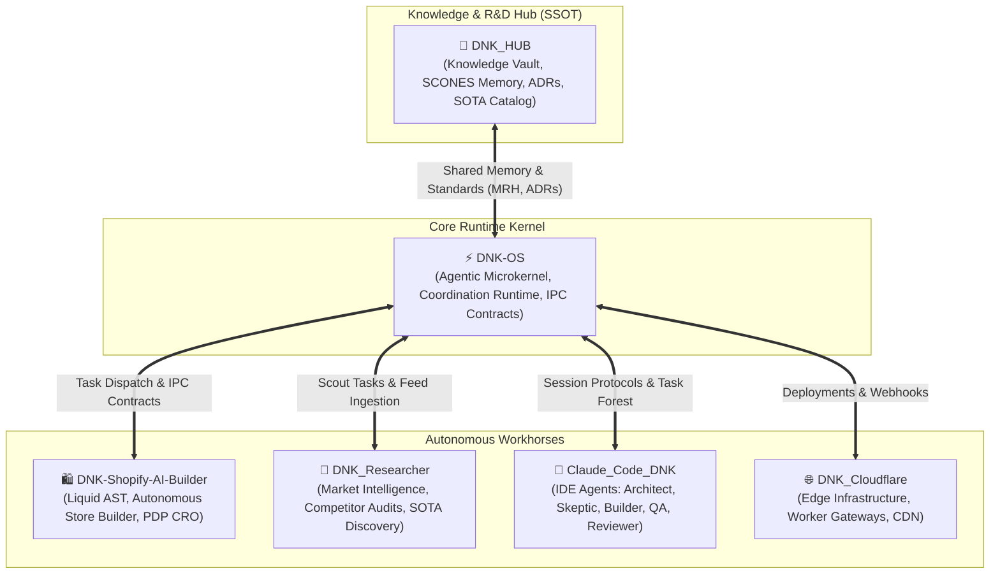

<!--
# --- DNK-MRH-HEADER ---
# mrh_id: "README.md"
# purpose: "Canonical Architecture, Mission & Ecosystem Interconnection Specification for DNK OS."
# canonical_source: true
# alters_files: []
# triggers_tasks: []
# status: "Active"
# version: "1.0.0"
# updated_at: "2026-11-06"
# author: "DNK-e.com Maksym & Antigravity"
# --- END DNK-MRH-HEADER ---
-->

# ⚡ DNK OS — Sovereign Agentic Operating System

> **DNK OS** is the autonomous, event-driven agentic operating system kernel designed for high-velocity software synthesis, e-commerce automation, and multi-agent swarm orchestration.

---

## 🗺️ 1. Ecosystem Interconnection Map

DNK OS operates within the unified **DNK Ecosystem**, acting as the autonomous execution microkernel and bridge across specialized sister repositories:



### 🔗 Repository Matrix & Interconnection Roles

| Repository | Topology Path | Primary Role | Interconnection Mechanism |
| :--- | :--- | :--- | :--- |
| **`DNK_HUB`** | `../DNK_HUB` | **Monorepo SSOT**: Knowledge vault, SCONES graph, architectural decisions (`ADR`), SOTA blueprints. | Shared file contracts (`core/contracts.py`), SCONES memories, Markdown standards. |
| **`DNK-OS`** *(This Repo)* | `../DNK-OS` | **Autonomous Agentic Microkernel**: Task distribution, agent coordination runtime, deterministic quality gates. | IPC schemas, FastMCP in-memory Code Mode, receipt validation. |
| **`DNK-Shopify-AI-Builder`** | `../DNK-Shopify-AI-Builder` | **E-Commerce Workhorse**: Liquid AST mutations, theme transpilation, Shopify Functions & Checkout UI extensions. | Dispatched jobs via `KernelTaskRequest`, headless CLI and AST artifacts. |
| **`Claude_Code_DNK`** | `../DNK_Vibe_Coding/Claude_Code_DNK` | **Agentic IDE Subagents**: Claude Code workspace, specialized subagents (`architect`, `skeptic`, `builder`, `qa`, `reviewer`). | SCONES checkpoints, Task Forest DAGs, session logs. |
| **`DNK_Researcher`** | `../DNK_Vibe_Coding/DNK_Researcher` | **Intelligence Scout**: Competitor reverse engineering, trend mining, SOTA paper/repo reconnaissance. | Autonomous research feeds, structured JSON reports into `DNK_HUB`. |
| **`DNK_Cloudflare`** | `../DNK_Vibe_Coding/DNK_Cloudflare` | **Edge & Infrastructure**: Cloudflare Workers, KV caching, edge routing, webhooks. | Automated deployment pipelines, API gateway contracts. |

---

## 🛡️ 2. Core Agent Roles & Hierarchy

1. **Antigravity (Chief Orchestrator & Mentor)**:
   - System architect, epistemic integrity supervisor, and gatekeeper.
   - Enforces ADRs, Boundary Conditions, Negative Scope, and architectural consistency.
2. **Denchik (Денчік) (Master Autonomous Builder)**:
   - Hands-on software engineering lead and chief autonomous coder.
   - Executes strictly through the 4-Phase Pipeline (In-RAM Deconstruct -> AST Overlay -> Atomic TDD -> SCONES Memory & Pre-Commit Censor).
3. **Domain Worker Swarms**:
   - `dnk_shopify`: E-commerce Liquid AST and theme engine.
   - `dnk_dev_fullstack`: High-speed generation of API routers and schemas.
   - `gerych_auditor`: Cold archival auditor and retrospective verification gates.

---

## ⚡ 3. Key Operating Invariants

- **Relative Paths ONLY**: Always construct and pass relative paths (`./`, `../`). Absolute `/Users/...` paths are strictly prohibited.
- **Strict Package Managers**:
  - Python: Strictly `uv` (`uv run pytest`, `uv pip`, `uv sync`). Bare `pip` is prohibited.
  - Node.js: Strictly `pnpm` (`pnpm install`, `pnpm test`, `pnpm run`). Bare `npm` or `yarn` are prohibited.
- **Machine-Readable Headers (MRH)**: All Python, Markdown, and YAML files must feature strict MRH frontmatter per `DNK-STD-0075`.
- **Zero-Waste High-Velocity Protocol**: Atomic task slices bound by $\le 25$ tool calls (`MASE`), context diet $\le 20\text{k}$ tokens.
- **Deterministic Proof Over Verbal Claims**: Tasks are marked `completed` only when backed by machine verification (`exit code 0`).

---

## 🚀 4. Quickstart

```bash
# Clone & enter directory
git clone https://github.com/dnk-ecom/DNK-OS.git
cd DNK-OS

# Environment setup
cp .env.example .env

# Python virtual environment via uv
uv venv
source .venv/bin/activate
uv sync

# Run test suite
uv run pytest
```

---

## 📚 5. Documentation Directory

- [`AGENTS.md`](./AGENTS.md) — Operational guidelines, banned lexicon, epistemic armor, and agent invariants.
- [`CLAUDE.md`](./CLAUDE.md) — Claude Code developer workspace & subagent orchestration rules.
- [`docs/architecture/INTERCONNECTION_ARCHITECTURE.md`](./docs/architecture/INTERCONNECTION_ARCHITECTURE.md) — Comprehensive technical specification of ecosystem IPC, topology, and data contracts.
