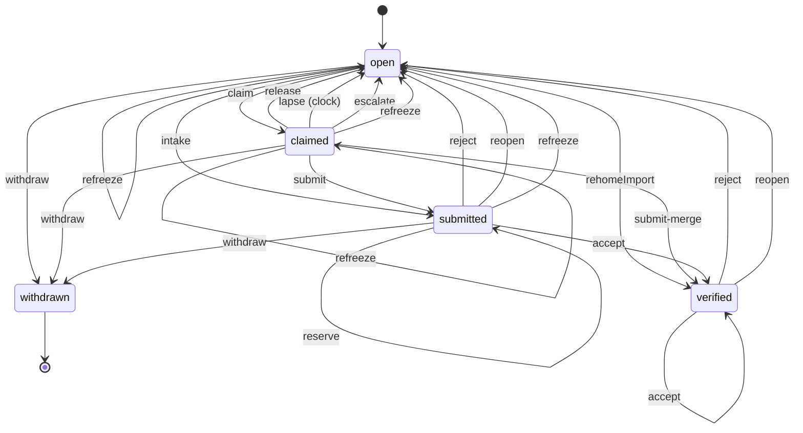

# (no title)
URL: https://raw.githubusercontent.com/pullboard-dev/pullboard/main/docs/lifecycle.md

# The item lifecycle

Generated from src/machine.js by `pullboard lifecycle`. Do not edit it by hand: change the declaration, then run `pullboard lifecycle > docs/lifecycle.md`.

An item starts open. Its final states, withdrawn, cannot be left. Every move into a guarded state passes the same transition guards, whatever command gets there. The board file itself refuses any move not declared here.

## Frozen check policy

The coordinator may set `check.install` and `check.timeout` in committed `pullboard.json`; the defaults are no install command and `5m`. Accept runs the configured install and the frozen item check in a private clone, under one timeout budget. It reuses the verifier’s npm cache when available. Install commands that need network downloads conflict with P2 (offline); configure an offline install or make its needed packages available in the cache.

Private commands drain their output through pipes, retaining a bounded 8 MiB capture of its beginning and end. Failed or unverifiable checks stream the complete log through secret scanning into an owner-readable artifact; lines over 64 KiB of UTF-8 data are replaced with a safe-scan marker. Output beyond the capture cap does not fail a successful command, and dependency files and build artifacts have no capture-size limit. A timeout kills the command's process group. An unverified check names how to restore the environment and retry; a failing check names rejection or builder rework as the next step.

## States

| State | Means | Fields it needs |
| --- | --- | --- |
| open | waiting for a builder; claimable once what it waits on is verified | none |
| claimed | an agent holds it under a lease, its criterion frozen | item_owner, item_lease_until, item_frozen_digest |
| submitted | a native build gated green, or an intaken outside commit awaiting sandbox verification, at a pinned commit | item_built_by, item_commit, item_frozen_digest |
| verified | another agent accepted it at the submitted commit, its canonically recorded trunk-only merge, or the item carries an attributed source-board acceptance | item_verified_by, item_commit |
| withdrawn (final) | nobody should build it;