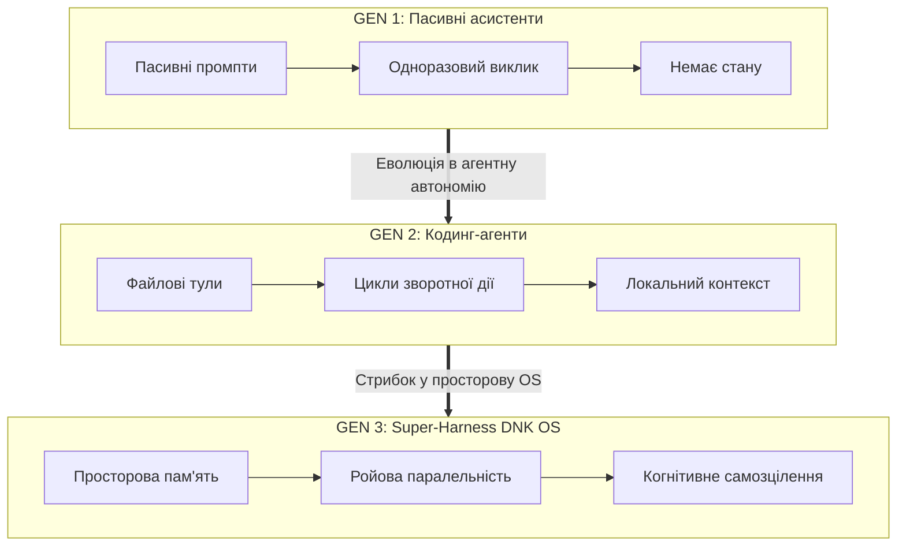

# Mermaid Responsive Layout & Interactive Zoom in Obsidian

## 1. Root Cause Analysis: Negative Scroll Clipping, Unconstrained Vertical Sprawl & Fixed-Position Collapse
When a Mermaid SVG is rendered inside Obsidian:
- **Negative Scroll Clipping**: If inside a flexbox container with `display: flex; justify-content: center;` and `overflow-x: auto;`, diagrams wider than viewport clip on the left flank because negative scroll coordinates are unaddressable.
- **Vertical Sprawl**: Deep or expansive diagrams (e.g. multi-agent state machines, class hierarchies) expand vertically to 2000px+, completely breaking the reading continuity of markdown notes.
- **Fixed-Position Disappearance Bug**: In Obsidian CodeMirror 6 reading view and live preview, `.cm-embed-block` and `.cm-content` have CSS containment (`contain: layout paint` / `isolation: isolate` and `overflow: hidden`). Per CSS containment specifications, an ancestor with `contain: paint` establishes a local containing block for `position: fixed`. When a diagram container uses `position: fixed !important; top: 0; left: 0; width: 100vw; height: 100vh;`, CodeMirror's line/embed scroller clips it, collapsing the element to 0px or pushing it off-screen so the diagram completely disappears.

## 2. Robust Solution Architecture

### A. CSS In-Flow Expansion & Height Control Engine (`full-width-view.css`)
```css
:root {
  --mermaid-max-height: 500px; /* Default window height cap (strict <= 500px on initial open) */
}

.mermaid,
.block-language-mermaid {
  width: 100% !important;
  max-width: 100% !important;
  max-height: var(--mermaid-max-height, 500px) !important;
  display: block !important;
  text-align: center !important;
  overflow: hidden !important;
  padding: 12px 0 20px 0 !important;
  margin: 16px 0 !important;
  position: relative !important;
  box-sizing: border-box !important;
  cursor: grab !important;
  resize: vertical; /* Native handle to resize viewport */
  border: 1px solid rgba(255, 255, 255, 0.08) !important;
  border-radius: 8px !important;
  transition: max-height 0.25s ease, height 0.25s ease;
}

/* Full-Window In-Flow Preview (Never use position: fixed inside CodeMirror) */
.mermaid.mermaid-window-height,
.block-language-mermaid.mermaid-window-height,
.mermaid.mermaid-fullscreen,
.block-language-mermaid.mermaid-fullscreen {
  position: relative !important;
  width: 100% !important;
  max-width: 100% !important;
  height: calc(100vh - 120px) !important;
  max-height: calc(100vh - 120px) !important;
  min-height: calc(100vh - 120px) !important;
  z-index: 100 !important;
  border-color: rgba(255, 255, 255, 0.25) !important;
  box-shadow: 0 10px 40px rgba(0, 0, 0, 0.6) !important;
  resize: none !important;
}

.mermaid svg,
.block-language-mermaid svg {
  max-width: none !important;
  width: auto !important;
  height: auto !important;
  display: inline-block !important;
  margin: 0 auto !important;
  transform-origin: 0 0;
  transition: transform 0.05s ease-out;
}
```

### B. Interactive Zoom Plugin (`.obsidian/plugins/mermaid-interactive-zoom/`)
Key capabilities and UX invariants:
1. **Ghost Mode Toolbar**:
   - Idle state: `opacity: 0.18` with `backdrop-filter: blur(8px)`. Underlying text/nodes remain 100% readable.
   - Hover on diagram: increases to `opacity: 0.60`.
   - Hover on toolbar: increases to `opacity: 1.0` (`rgba(20, 22, 28, 0.92)`).
2. **Infinite Canvas Pan & Drag ("Ладошка")**:
   - Idle cursor: `grab`.
   - Active click & drag: `grabbing` cursor, translating diagram coordinates `translate(panX, panY) scale(...)`.
   - Double-click: resets position and auto-fits diagram to container viewport (`setFit(true)`).
3. **Optimized Scaling Steps**:
   - **Toolbar Buttons**: `[+]` adds **+15%** (`zoom + 15`), `[−]` removes **−15%** (`zoom - 15`) for quick, decisive scaling.
   - **Mouse Wheel & Trackpad Pinch**: Ultra-smooth **3%** step (`deltaY < 0 ? 3 : -3`) preventing jarring jumps.
4. **Single-Action Full-Window Toggle (`⛶ На все вікно`)**:
   - Avoid dual button collisions (`↕ Вікно` vs `⤢ Екран`). Use a unified `[⛶ На все вікно]` button.
   - **Expand**: Expands container height in-flow to `calc(100vh - 120px)`, calls `container.scrollIntoView({ behavior: 'smooth', block: 'nearest' })`, and runs auto-fit after 180ms.
   - **Collapse**: Button changes to `[⛶ 500px]`. Clicking it or pressing the **Escape** key returns the container to compact `500px` height and re-fits.

5. **Initial 500px Auto-Fit Invariant**:
   - On note initial open, Mermaid diagrams MUST be capped at `max-height: 500px` and automatically fitted to the container viewport (`fitToContainer()` with `preserveAspectRatio="xMidYMid meet"`), ensuring the full diagram is immediately visible without truncation before any manual user zooming.

## 3. Directional Ergonomics: Vertical Stacking (TD) vs Horizontal Sprawl (LR)

### A. The "Horizontal Sprawl & Auto-Downscale" Failure Mode
In Obsidian Markdown notes:
- Using a root `flowchart LR` across 3+ complex phases (e.g. Generation 1 → Generation 2 → Generation 3) produces an SVG with an extreme aspect ratio (e.g. 1800px wide by 220px tall).
- Obsidian's viewport renderer is constrained by the note container width (typically 800–1200px).
- To fit the 1800px width inside a 900px container, the SVG is scaled down by 50% or more.
- **Negative Ergonomic Consequences**:
  1. **Microscopic Text**: 14px node typography scales down to 6–7px, making it unreadable without zooming.
  2. **Vast Black Letterboxing**: The diagram container allocates up to 500px height, but the downscaled SVG only occupies 110px vertically. The remaining 390px becomes empty black space, pushing note content far down.
  3. **Visual Clutter**: The user is forced to interact with zoom buttons or pan controls just to read basic node titles.

### B. Canonical Architecture: Vertical Flow (`flowchart TD`) with Horizontal Subgraphs (`direction LR`)
For multi-phase pipelines, architectures, or evolutionary milestones:
- Set the root direction to `flowchart TD` (Top-to-Bottom) so stages flow down naturally along the document scroll.
- Inside each stage's `subgraph`, set `direction LR` (Left-to-Right) containing 2–3 cards.
- Connect subgraphs vertically using thick transition arrows (`Gen1 ==> |"Еволюція"| Gen2 ==> |"Стрибок"| Gen3`).



**Benefits**:
- **100% Font Legibility**: The diagram fills note width naturally without shrinking typography.
- **Zero Wasted Vertical Space**: Each row is neatly proportioned; no giant black bars.
- **Mobile & Desktop Responsive**: Renders cleanly on any screen size.

## 4. Typography & Visual Scanning Ergonomics: Left-Alignment vs Jagged Centering

### A. The "Ragged Left" Failure Mode
By default, Mermaid centers text inside nodes. When nodes contain bullet points (`•`) or multi-line details:
- Each bullet begins at an arbitrary horizontal position depending on the line's length.
- The reader's eye is forced into continuous horizontal zigzag jumps to locate the start of each bullet point.
- Reading multi-item cards becomes exhausting and breaks rapid vertical skimmability.

### B. The Left-Alignment Pattern (`<div align='left'>`)
Wrap multi-line descriptions and bullet points in an explicit left-aligned container:
```mermaid
L1["🔍 <b>Рівень 1: Tool Schema Virtualization</b><br><div align='left'>• Dynamic Pruning & Lazy Loading схем<br>• On-demand опис інструментів (&lt;3k tax)</div>"]
```
**Rules**:
1. **Node Header**: Keep the title bold (`<b>...</b>`), centered or left-aligned.
2. **Bullets & Body**: Wrap in `<div align='left'>...</div>`.
3. **HTML Escaping**: Never use raw `<` inside HTML blocks (e.g. `<3k`); always escape as `&lt;` or write `(менше 3k)` to prevent SVG/HTML parser syntax errors.


