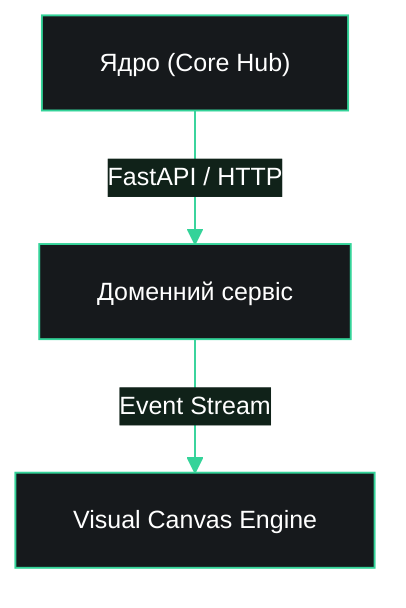

> [!metadata]- ⚙️ Системні метадані та інваріанти (MRH Header)
> ```yaml
> # --- DNK-MRH-HEADER ---
> mrh_id: "core/orchestrator/agents/gerych_prime/skills/note-taking/obsidian-vault-hygiene/templates/gold_standard_note_template.md"
> purpose: "Канонічний архітектурний опис та специфікація компонента у системі DNK OS."
> canonical_source: true
> alters_files: []
> triggers_tasks: []
> status: "Active"
> version: "2.0.0"
> updated_at: "2026-09-19"
> author: "DNK-e.com Maksym & Gerych Prime"
> # --- END DNK-MRH-HEADER ---
> ```
> > [!summary] 📋 Контекст для ШІ-агента
> > Призначення компонента, архітектурні інваріанти та шлюзи валідації.

# 🏛️ 0XX. Назва архітектурної нотатки

> [!abstract] **Призначення та архітектурний контекст**
> Короткий виклад мети нотатки (Executive Summary) на 2–4 речення. Пояснює проблему, запропоноване системне рішення та вплив на екосистему DNK OS.

---

## 🎯 1. Головне правило та формулювання проблеми

> [!question] **Ключове архітектурне питання**
> Яку саме фундаментальну проблему системи ми вирішуємо, і чому наявний підхід потребує стандартизації чи модернізації?

Тут розміщується детальний інженерний контекст, діаграми взаємодії та контракти.



---

## ⚖️ 2. Матриця рішень: Що залишаємо → Що додаємо → Що відкидаємо

> [!check] **1. Що залишаємо (Базовий перевірений фундамент)**
> - **[Компонент 1]**: Обґрунтування стабільності.

> [!tip] **2. Що додаємо (Нові архітектурні можливості)**
> - **[Інновація 1]**: Опис нового стандарту та механізму.

> [!danger] **3. Що відкидаємо (Overengineering / Антипатерни)**
> - **[Зайва складність]**: Чому цей підхід відкинуто.

---

## 🔗 3. Пов'язані нотатки та контекст
- [[000 DNK HUB Index|🗺️ Головний індекс бази знань]]
- [[001 Obsidian & DNK OS Documentation Standard|📐 Стандарт документації]]
