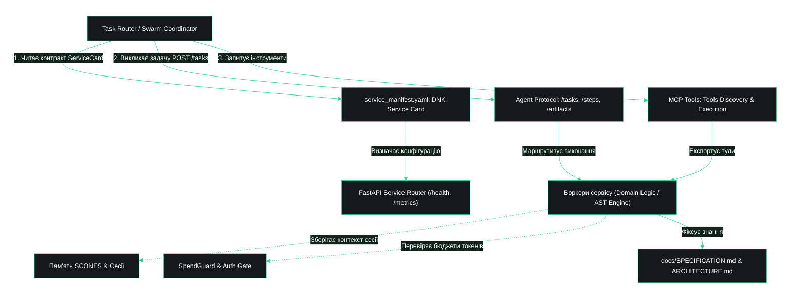
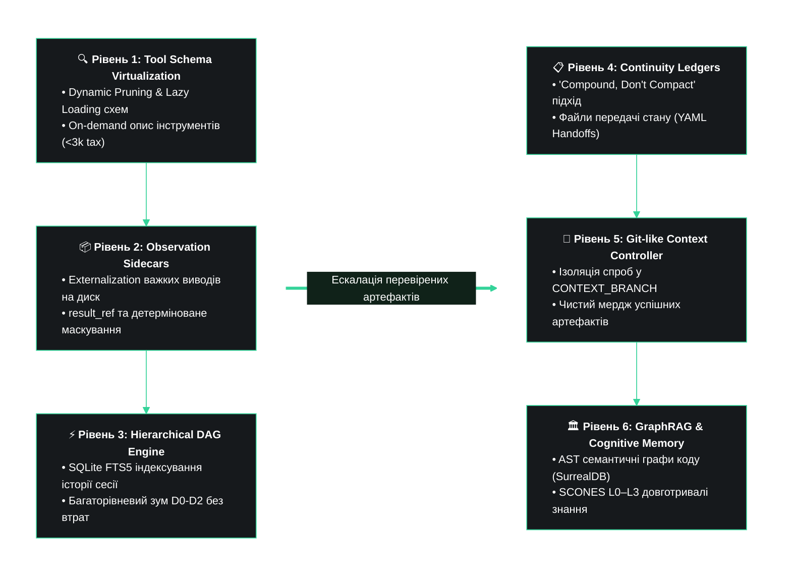

> [!metadata]- ⚙️ Системні метадані та інваріанти (MRH Header)
> ```yaml
> # --- DNK-MRH-HEADER ---
> mrh_id: "core/orchestrator/agents/gerych_prime/skills/note-taking/obsidian-vault-hygiene/templates/mermaid_diagram_template.md"
> purpose: "Document: Mermaid Diagram Template"
> canonical_source: true
> alters_files: []
> triggers_tasks: []
> status: "Draft"
> version: "1.0.0"
> updated_at: "2026-09-24"
> author: "DNK-e.com Maksym"
> # --- END DNK-MRH-HEADER ---
> ```

# --- DNK-MRH-HEADER ---
# mrh_id: "skills/note-taking/obsidian-vault-hygiene/templates/mermaid_diagram_template.md"
# purpose: "Canonical Obsidian-compatible Mermaid diagram template with mandatory label quoting and unquoted edge text."
# canonical_source: true
# alters_files: []
# triggers_tasks: []
# status: "Active"
# version: "1.1.0"
# updated_at: "2026-09-08"
# author: "Gerych Prime & DNK OS"
# --- END DNK-MRH-HEADER ---

# Canonical Mermaid Diagram Template for Obsidian

Always wrap node labels and subgraph titles in explicit double quotes `["..."]` to prevent parser collisions with parentheses `()`, colons `:`, or apostrophes `'`.

CRITICAL INVARIANT FOR EDGES & THEMING:
1. **Never use double quotes inside edge labels** (`|...|`). Edge labels between pipes MUST be plain text (`Router -->|1. Читає контракт| Card`), NEVER `Router -->|"..."| Card` which throws `Expecting 'LINK', 'UNICODE_TEXT', 'EDGE_TEXT', got 'STR'`.
2. **Never use reverse labeled arrows** (`Target <--|label| Source`). Always orient forward (`Source -->|label| Target`) or bidirectional (`Source <-->|label| Target`).
3. **Never hardcode custom HEX fills** (`style Node fill:#hex,stroke:#hex`). Omit manual `style ... fill:#...` so Obsidian's theme engine automatically adapts between Dark and Light palettes.
4. **Preserve top-down hierarchy in `flowchart TD`**. Do not create cyclic feedback loops from bottom layers to top layers (e.g. `ServiceDocs --> Router`), which causes Dagre to invert ranks and flip the diagram upside-down. Use bidirectional `<-->` or downward response edges.
5. **Multi-Column Matrix Layout for Multi-Level Architectures (4–8 levels/stages)**: Use a root `flowchart LR` pairing 2–3 vertical subgraphs (`direction TB`), connected by bold inter-tier bridges (`TierA ==>|Handoff| TierB`). This keeps diagram height compact (<500px), maintains 100% font size, and avoids the "High Tower / Endless Scroll" downscaling effect.

### Pattern A: 3-Tier Vertical Service Stack (`flowchart TD`)



### Pattern B: 2-Column Multi-Tier Architectural Matrix (`flowchart LR` + `direction TB`)

Ideal for multi-level taxonomies, SOTA audits, and dual-layer engines (e.g. Session vs Persistent memory). Prevents vertical letterboxing and fits 100% inside desktop and laptop viewports:


