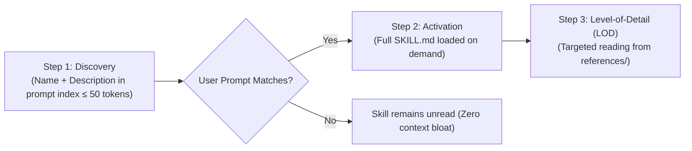

<!--
# --- DNK-MRH-HEADER ---
# mrh_id: "core/skills/antigravity_operations/references/skills_and_progressive_disclosure.md"
# purpose: "Comprehensive reference on Google Antigravity Skill architecture, progressive disclosure, and ratchet limits."
# canonical_source: true
# alters_files: []
# triggers_tasks: []
# status: "Active"
# version: "1.0.0"
# updated_at: "2026-10-23"
# author: "Antigravity & Gerych Prime"
# --- END DNK-MRH-HEADER ---
-->

# Google Antigravity Agent Skills & Progressive Disclosure Reference

Skills are modular runbooks and procedural packages that extend the agent's capabilities without bloating the baseline context window.

---

## 1. Directory Structure

A skill must be packaged as an isolated directory within a `skills/` folder:

```text
skills/<skill_name>/
├── SKILL.md          # REQUIRED: Main instruction file with YAML frontmatter
├── scripts/          # OPTIONAL: Executable helper scripts and CLI utilities
├── references/       # OPTIONAL: Level-of-Detail (LOD) docs and secondary specs
├── examples/         # OPTIONAL: Reference code patterns and golden fixtures
└── resources/        # OPTIONAL: Configuration templates and static assets
```

---

## 2. Progressive Disclosure Mechanics

To ensure high model reasoning fidelity, Antigravity uses a 3-step **Progressive Disclosure** lifecycle:



1. **Discovery (Step 0)**:
   - On conversation start, only the skill `name` and `description` are loaded into the agent's system prompt index.
   - Standing context overhead is negligible (~30-60 tokens per skill), allowing dozens of skills to coexist without context degradation.

2. **Activation**:
   - The primary agent activates a skill autonomously when the task domain matches the frontmatter `description`, or when explicitly called via `/<skill-name>`.
   - The agent reads `SKILL.md` via `view_file` or builtin skill loader.

3. **Execution & LOD (Level-of-Detail)**:
   - The agent follows instructions in `SKILL.md`.
   - If secondary details (API schemas, full prompt templates, test fixtures) are needed, the agent retrieves them from `references/<file>.md` using targeted reads.

---

## 3. Frontmatter & Ratchet Rules

### Frontmatter Schema

```yaml
---
name: my-specialized-skill
description: >-
  Third-person concise description stating WHAT the skill accomplishes
  and EXACTLY WHEN the agent should activate it.
---
```

- **`name`** (required): Lowercase alphanumeric with hyphens or underscores (`^[a-z0-9]+([-_][a-z0-9]+)*$`).
- **`description`** (required): Maximum 1,024 characters. Must include specific trigger keywords.

### Core-Size Ratchet Gate (Ceiling: 750 lines)

- `SKILL.md` body line count MUST NOT exceed **750 lines**.
- Monolithic skills degrade attention; detailed catalogs, exhaustive schemas, and extensive examples must be factored into `references/`.

---

## 4. Black-Box Script Execution Invariant

When helper scripts exist in `scripts/`:

- **Do NOT dump full script source** into conversation context.
- Run scripts with `--help` or dry-run flags first:

  ```bash
  python3 scripts/helper_tool.py --help
  ```

- Scripts should provide clean, structured stdout (`--json` or bounded summary) rather than verbose trace logs.

---

## 5. Automatic Slash Command Mapping

Creating a skill in any supported skills directory automatically maps it into the Antigravity TUI and App prompt bar as a slash command:

- Folder: `skills/optimize-images/`
- Slash Command: `/optimize-images`

---

## 6. Discovery & Scoping Matrix

| Scope | Location | Version Controlled? | Purpose |
| :--- | :--- | :--- | :--- |
| **Workspace** | `<workspace-root>/.agents/skills/<name>/` | Yes (in git) | Shared project runbooks, team conventions, service testing |
| **Global** | `~/.gemini/config/skills/<name>/` | Local workstation | Personal developer workflow skills, cross-repo utilities |
| **CLI Global** | `~/.gemini/antigravity-cli/skills/<name>/` | Local CLI | CLI-exclusive automation workflows |
| **Plugin** | `plugins/<plugin_name>/skills/<name>/` | Plugin bundle | Distributable third-party skill collections |
