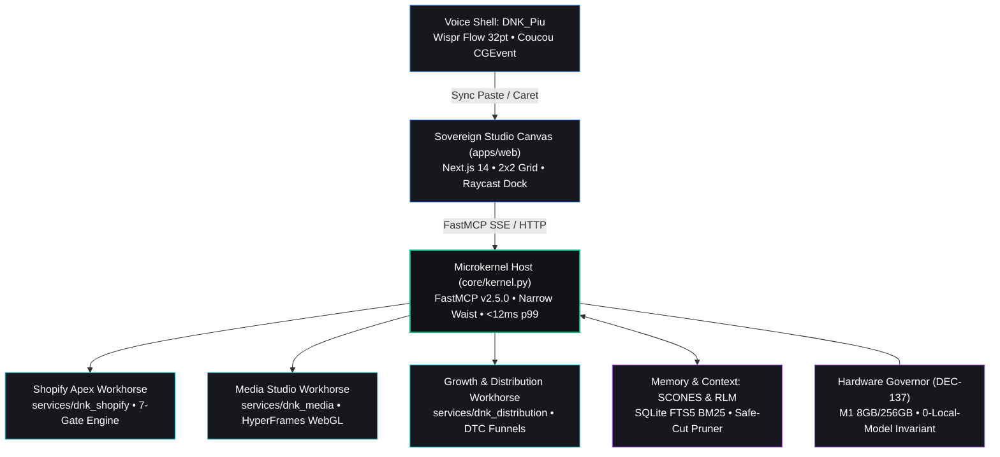

 
> [!metadata]- ⚙️ Системні метадані та інваріанти (MRH Header)
> ```yaml
> # --- DNK-MRH-HEADER ---
> mrh_id: "docs/ARCHITECTURE.md"
> purpose: "Canonical Living Architecture SSOT (Diátaxis Explanation & System Reference) for DNK OS."
> canonical_source: true
> alters_files: []
> triggers_tasks: []
> status: "Active"
> version: "2.0.0"
> updated_at: "2026-11-18"
> author: "DNK-e.com Maksym & Antigravity"
> # --- END DNK-MRH-HEADER ---
> ```

# 🛡️ DNK OS Living Architecture (November 2026 SSOT)

DNK OS is an autonomous, thin-client, agentic operating system engineered around the **Narrow Waist Microkernel** pattern. It eliminates heavyweight frameworks, multi-agent conversational thrashing, and local neural network execution, providing a deterministic bridge between human intent and production commerce assets.



---

## 🏛️ The 8 Core Subsystems (Diátaxis System Reference)

### 1. Microkernel Host (`core/kernel.py` & `core/kernel_tools.py`)
- **Role**: Narrow waist coordinator exposing FastMCP stdio/SSE server (`< 12ms p99` latency).
- **Invariants**: 384 LOC compact surface; zero framework bloat (Zero-CrewAI, Zero-LangChain in runtime); direct routing to Google Cloud Vertex AI (Gemini 3.8 Flash / 4 Argon).
- **Decisions**: `[🔒 ACTIVE CORE: DEC-012, DEC-034, DEC-117]`.

### 2. Sovereign Studio Canvas (`apps/web/`)
- **Role**: Full-bleed spatial workstation with unified 2x2 grid, Generative UI widgets, and centered Raycast command dock.
- **Components**: `ShopifyBlockPreviewWidget`, `AnalyticsMetricCardWidget`, `SocialContentCardWidget`, `ThoughtDAGCardWidget` (`apps/web/components/generative_ui/`).
- **Decisions**: `[🔒 ACTIVE CORE: DEC-135, DEC-138]`.

### 3. Shopify Apex Workhorse (`services/dnk_shopify/`)
- **Role**: Production e-commerce engine powering the flagship theme **DNK Sovereign Apex v1.0.0**.
- **Capabilities**: Shopify Theme Blocks 2.0 (Horizon/Tinker standard), Dual-Ready blocks, 7-Gate deterministic audit checkpoints (`LPIPS`, `Edge Gradient`, theme check, AST validator).
- **Decisions**: `[🔒 ACTIVE CORE: DEC-001, DEC-015, DEC-130, DEC-136]`.

### 4. Media Studio Workhorse (`services/dnk_media/`)
- **Role**: Clean-room short-form video and generative media synthesis pipeline.
- **Capabilities**: HyperFrames WebGL/Canvas 60FPS seek-safe rendering, automated SOTA Research Bridge, GCP Vertex Audio (Chirp3-HD-Achernar), and original-language audio transcription.
- **Decisions**: `[🔒 ACTIVE CORE: DEC-047, DEC-140]`.

### 5. Growth & Distribution Workhorse (`services/dnk_distribution/`)
- **Role**: Multi-platform viral syndication and CRO direct-to-consumer funnels.
- **Capabilities**: Automated video export syndication (TikTok, Reels, YouTube Shorts, X), pattern-interrupt hook compilation, and high-converting PDP bridge.
- **Decisions**: `[🔒 ACTIVE CORE: DEC-10, DEC-122]`.

### 6. Voice Shell: DNK_Piu (`apps/voice/` / `DNK_Piu`)
- **Role**: Pure Voice-to-Caret streaming audio dictation.
- **Invariants**: 32pt floating obsidian pill (`#0C0E14`), Wispr Flow / Coucou standard, synchronous `CGEvent` ⌘V injection into active caret, zero intrusive sidebar AI panels; multi-agent approvals delegated directly to Astryx Web Canvas.
- **Decisions**: `[🔒 ACTIVE CORE: DEC-141]` (supersedes `DEC-102, DEC-107, DEC-113`).

### 7. Memory & Context Engine (`core/memory/` & `core/rlm/`)
- **Role**: Durable epistemic state and dynamic context pruning.
- **Capabilities**: SCONES SQLite WAL native FTS5 BM25 search (<15ms, 0 byte cloud token cost), Prime Agent Recursive Language Model (RLM) compactor with safe-cut trajectory pruning below 40k threshold.
- **Decisions**: `[🔒 ACTIVE CORE: DEC-024, DEC-119, DEC-134]`.

### 8. Hardware Governor & Thin-Client Invariant (`DEC-137`)
- **Role**: Resource and storage watchdog for Apple Silicon M1 (8GB Unified RAM / 256GB SSD).
- **Rules**: Strict **0-Local-Model Invariant** (no Ollama, no local LLM/whisper weights eating RAM); APFS Copy-on-Write worktrees; centralized runtime `~/.dnk_runtime/` (0 duplicate node_modules).
- **Decisions**: `[🔒 ACTIVE CORE: DEC-033, DEC-137]`.

---

## 🔒 Epistemic Armor & Quality Gates

1. **Anti-Sycophancy Gate (ArXiv 2602.23971)**: Mandatory 3-flaws dissent on all architectural hypotheses before implementation.
2. **MASE Invariant**: Tasks partitioned into atomic slices bound by $\le 25$ tool calls per slice.
3. **Deterministic Verification**: `scripts/verify_all.sh` enforcing AST Syntax, Anti-Tautology Shield, and 100% test pass before release.
