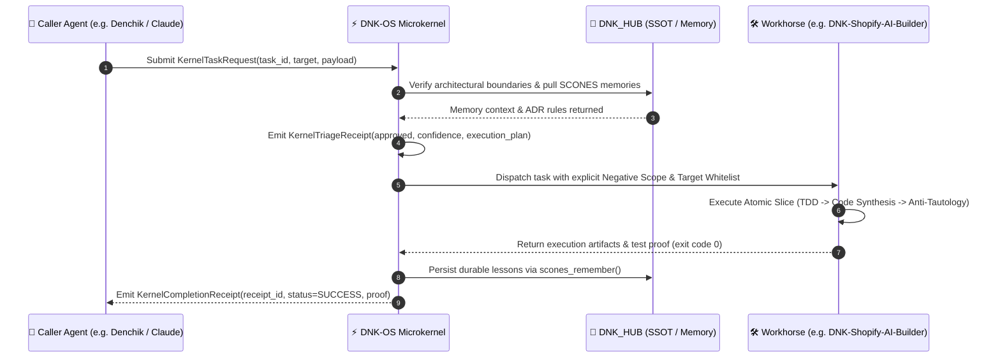

<!--
# --- DNK-MRH-HEADER ---
# mrh_id: "docs/architecture/INTERCONNECTION_ARCHITECTURE.md"
# purpose: "Comprehensive Specification of Inter-Repository Topology, Data Flows, and Inter-Agent IPC Contracts."
# canonical_source: true
# alters_files: []
# triggers_tasks: []
# status: "Active"
# version: "1.0.0"
# updated_at: "2026-11-06"
# author: "DNK-e.com Maksym & Antigravity"
# --- END DNK-MRH-HEADER ---
-->

# ⚡ DNK OS: Interconnection Architecture & Ecosystem Topology Specification

## 🗺️ 1. Ecosystem Topology

The DNK software engineering ecosystem consists of tightly integrated, sovereign repositories located under `~/Kuzmenko/MY_LIFE_WORK/`:

```
MY_LIFE_WORK/
│
├── DNK_HUB/                          # Monorepo SSOT (Knowledge Vault, R&D, SCONES, ADRs, Catalog)
│   ├── core/                         # Core orchestrator, skills curator, memory DB
│   ├── docs/                         # Canonical ADRs, SOTA documents, tech specs
│   └── tests/                        # Monorepo regression & invariant test suites
│
└── DNK_Vibe_Coding/                  # Autonomous Workhorse Repositories & Execution Hub
    ├── DNK-OS/                       # Sovereign Agentic Operating System (Microkernel & Runtime)
    │   ├── core/contracts.py         # SSOT Pydantic IPC Schemas
    │   ├── docs/architecture/        # Interconnection Specifications
    │   └── tests/                    # Microkernel contract validation
    │
    ├── DNK-Shopify-AI-Builder/       # E-Commerce Workhorse (Liquid AST, Shopify OS 2.0 Engine)
    ├── Claude_Code_DNK/              # IDE Developer Subagents & Claude Code Workspace
    ├── DNK_Researcher/               # Autonomous Competitor Intelligence & SOTA Scout
    └── DNK_Cloudflare/               # Edge Gateways, Cloudflare Workers & Deployment Hub
```

---

## 🔄 2. Data Flow & Communication Lifecycle

All cross-repository agent tasks follow a deterministic 5-stage IPC lifecycle:



---

## 📜 3. Inter-Agent Machine Contracts (IPC)

All inter-agent and cross-repo communication is strongly typed via `core/contracts.py`:

### A. `KernelTaskRequest`
Sent by an initiating agent or orchestrator:
- `task_id`: Unique deterministic UUID / task slug.
- `source_repo`: Originating repository identifier (`DNK_HUB`, `DNK-OS`, `Claude_Code_DNK`, etc.).
- `target_repo`: Target workhorse repository (`DNK-Shopify-AI-Builder`, `DNK_Researcher`, etc.).
- `action`: Targeted capability or method (e.g. `audit_theme`, `transpile_liquid`, `scout_competitor`).
- `payload`: Structured task arguments.
- `negative_scope`: Explicitly forbidden mutations or out-of-bounds files.
- `target_file_whitelist`: Specific files permitted for editing.

### B. `KernelTriageReceipt`
Emitted by the kernel prior to mutation:
- `receipt_id`: Unique receipt tracker.
- `status`: `APPROVED` | `TURN_DOWN_WORK` | `AMBIGUOUS`.
- `reasoning`: Clear architectural justification.
- `blast_radius_risk`: `LOW` | `MEDIUM` | `HIGH`.
- `execution_plan`: Ordered DAG of atomic slices.

### C. `KernelCompletionReceipt`
Machine proof emitted upon verified completion:
- `task_id`: Linked task ID.
- `status`: `SUCCESS` | `FAILURE`.
- `exit_code`: Deterministic exit code (`0` mandatory for success).
- `test_output_summary`: Machine output confirming non-tautological test pass.
- `affected_files`: List of touched relative paths.
- `scones_persisted`: Boolean indicating whether durable knowledge was stored.

---

## 🧠 4. SCONES Memory Sync Protocol

1. **Zero Knowledge Graveyard**:
   - Breakthrough discoveries, bug fixes, or performance findings discovered in `DNK-OS`, `DNK-Shopify-AI-Builder`, or `DNK_Researcher` MUST NOT remain trapped in local logs.
2. **Persistence Pipeline**:
   - Insights are distilled into structured markdown notes with MRH headers and committed to `DNK_HUB/docs/` or saved into SCONES memory via `scones_remember(topic, content)`.
3. **Pre-Task Memory Hydration**:
   - Before executing tasks requiring historical context, agents query `scones_get_memories(topic)` to retrieve established conventions and avoid redundant iterations.

---

## 🛡️ 5. Sandbox Isolation & Invariant Enforcement

1. **Working Tree Quarantine**:
   - External cloned benchmarks or third-party repositories MUST reside in `../DNK_Vibe/`, never inside `DNK-OS` or `DNK_HUB`.
2. **Zero Absolute Paths**:
   - Every file reference must be relative (`./`, `../`). Absolute `/Users/...` paths trigger an immediate gate failure.
3. **Anti-Tautology Verification Gate**:
   - Tests with fake mocks, empty assertions (`assert True`), or unexercised branches are strictly blocked.
