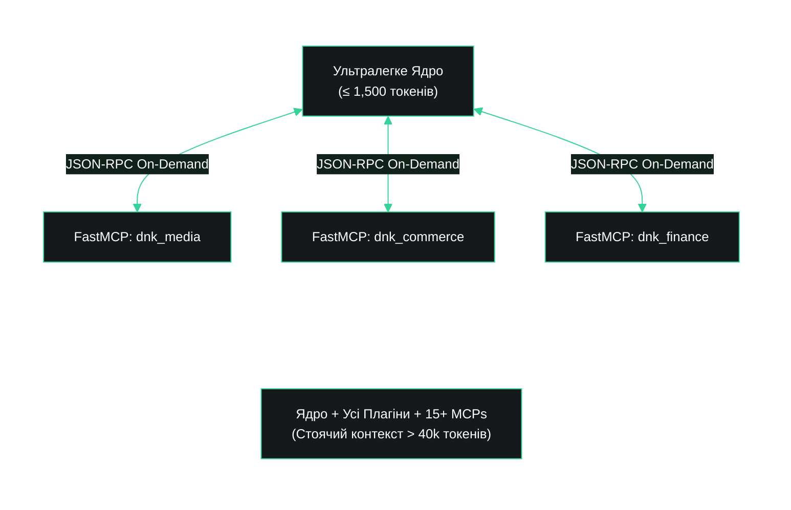

> [!metadata]- ⚙️ Системні метадані та інваріанти (MRH Header)
> ```yaml
> # --- DNK-MRH-HEADER ---
> mrh_id: "docs/architecture/adr/ADR-001-microkernel-fastmcp-architecture.md"
> purpose: "Architecture Decision Record: Adoption of Microkernel + FastMCP Plugin Architecture."
> canonical_source: true
> alters_files: []
> triggers_tasks: []
> status: "Active"
> version: "2.0.0"
> updated_at: "2026-11-18"
> author: "DNK-e.com Maksym & Antigravity"
> # --- END DNK-MRH-HEADER ---
> ```

> [!abstract] 🏛️ АРХІТЕКТУРНЕ РІШЕННЯ: FastMCP MICROKERNEL
> Прийнято рішення відмовитися від монолітного ядра на користь ультралегкого мікроядра з підключенням доменних модулів за відкритим стандартом FastMCP (JSON-RPC), що радикально зменшує оверхед стоячого контексту.

<div align="center" style="margin-bottom: 16px;">
  <span style="background-color: #1e293b; color: #38bdf8; padding: 4px 10px; border-radius: 9999px; font-size: 12px; font-weight: 600; border: 1px solid #0284c7;">Домен: Core Architecture</span>
  <span style="background-color: #1e293b; color: #34d399; padding: 4px 10px; border-radius: 9999px; font-size: 12px; font-weight: 600; border: 1px solid #059669;">Статус: Accepted</span>
  <span style="background-color: #1e293b; color: #c084fc; padding: 4px 10px; border-radius: 9999px; font-size: 12px; font-weight: 600; border: 1px solid #7c3aed;">Оптика: Dual-Lens</span>
  <span style="background-color: #1e293b; color: #f59e0b; padding: 4px 10px; border-radius: 9999px; font-size: 12px; font-weight: 600; border: 1px solid #d97706;">Ідентифікатор: ADR-001</span>
</div>

`Навігація`: [[00_MOC_DNK_OS|🗺️ Головний MOC DNK OS]] ➔ [[docs/architecture/ARCHITECTURE_MAP|Карта Архітектури]] ➔ **ADR-001: Microkernel FastMCP**

---

# ADR-001: Мікроядерна Архітектура FastMCP проти Моноліту



---

## 🎯 1. Контекст та Проблематика
Монолітні агентні платформи страждають від критичної ентропії контексту: підключення десятків інструментів одночасно роздуває системний промпт до 30,000–50,000 токенів до початку виконання задачі. Це викликає:
1. Високу вартість виконання та затримки генерації (Time-To-First-Token).
2. Забування інструкцій («Lost in the Middle»).
3. Високу зв'язність коду, де збій в одному плагіні ламає все ядро.

---

## 💡 2. Прийняте Рішення
1. Розділити систему на ультралегке **Мікроядро (Core Microkernel)** та зовнішні **Плагіни (FastMCP Plugins)**.
2. Ядро займається виключно:
   - Аутентифікацією та контролем сесій.
   - Ізоляцією проектів та Brand DNA.
   - Маршрутизацією контексту та оркестрацією графа завдань.
3. Всі прикладні доменні інструменти (Media, Shopify, Finance, Video AI) функціонують як самостійні процеси й взаємодіють з ядром виключно за стандартом **FastMCP** (JSON-RPC).

---

## ⚖️ 3. Наслідки та Трейд-офи

### Переваги (Positive)
- **Мінімальний Standing Context**: Базовий оверхед ядра знижено до ≤ 1,500 токенів.
- **Ізоляція Збоїв**: Краш плагіна не зупиняє роботу ядра та інших підсистем.
- **Модульність та Незалежність**: Кожен плагін має власний життєвий цикл розробки та версіонування.

### Недоліки та Ризики (Negative & Mitigations)
- **Накладні витрати IPC**: Необхідність маршалінгу даних між процесами через JSON-RPC.  
  *Мітигація*: Використання високошвидкісного протоколу FastMCP з локальними unix sockets або іменованими пайпами.

---

`Див. також`: [[specs/01_CORE_AND_ACTION_BUS_SPEC|Специфікація Ядра]] | [[specs/01_CORE_AND_ACTION_BUS_SPEC|Специфікація FastMCP]] | [[00_MOC_DNK_OS|Головний MOC]]
