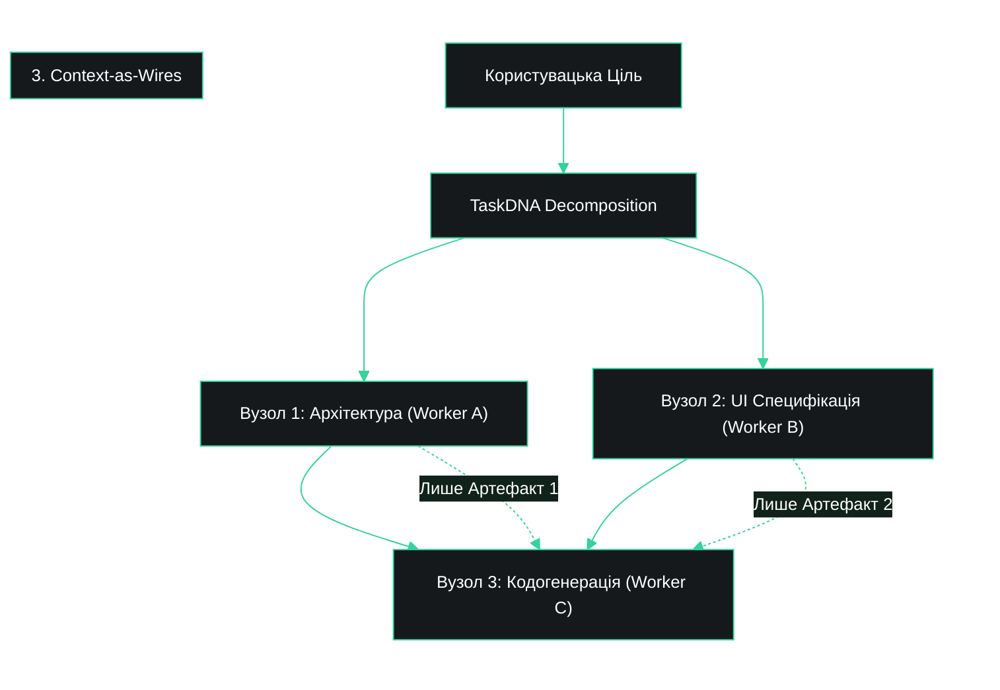

> [!metadata]- ⚙️ Системні метадані та інваріанти (MRH Header)
> ```yaml
> # --- DNK-MRH-HEADER ---
> mrh_id: "docs/architecture/adr/ADR-002-task-forest-dag-execution.md"
> purpose: "Architecture Decision Record: Task Forest DAG and Context-as-Wires Pattern."
> canonical_source: true
> alters_files: []
> triggers_tasks: []
> status: "Active"
> version: "2.0.0"
> updated_at: "2026-11-18"
> author: "DNK-e.com Maksym & Antigravity"
> # --- END DNK-MRH-HEADER ---
> ```

> [!abstract] 🏛️ АРХІТЕКТУРНЕ РІШЕННЯ: Task Forest DAG
> Перехід від довгих неструктурованих діалогових сесій до орієнтованого ациклічного графа завдань (Task Forest DAG). Застосування принципу Context-as-Wires забезпечує ізоляцію воркерів та нульову деградацію уваги.

<div align="center" style="margin-bottom: 16px;">
  <span style="background-color: #1e293b; color: #38bdf8; padding: 4px 10px; border-radius: 9999px; font-size: 12px; font-weight: 600; border: 1px solid #0284c7;">Домен: Execution Engine</span>
  <span style="background-color: #1e293b; color: #34d399; padding: 4px 10px; border-radius: 9999px; font-size: 12px; font-weight: 600; border: 1px solid #059669;">Статус: Accepted</span>
  <span style="background-color: #1e293b; color: #c084fc; padding: 4px 10px; border-radius: 9999px; font-size: 12px; font-weight: 600; border: 1px solid #7c3aed;">Оптика: Dual-Lens</span>
  <span style="background-color: #1e293b; color: #f59e0b; padding: 4px 10px; border-radius: 9999px; font-size: 12px; font-weight: 600; border: 1px solid #d97706;">Ідентифікатор: ADR-002</span>
</div>

`Навігація`: [[00_MOC_DNK_OS|🗺️ Головний MOC DNK OS]] ➔ [[specs/04_THOUGHT_TO_PLAN_PIPELINE_SPEC|Граф Задач Task Forest]] ➔ **ADR-002: Task Forest DAG**

---

# ADR-002: Task Forest DAG & Context-as-Wires



---

## 🎯 1. Контекст та Проблематика
Традиційні агентні системи використовують єдиний чат-контекст, що постійно накопичує історію. На 15–20 кроці моделі втрачають фокус, роблять галюцинації, ігнорують правила та споживають у 10 разів більше токенів на кожен наступний хід.

---

## 💡 2. Прийняте Рішення
1. Впровадити рушій **Task Forest DAG** (синтез кращих патернів `thoughtdag`, `deepagents` та `beads`).
2. Кожна комплексна задача трансформується у граф залежностей:
   - Вузли графа — це атомарні задачі з чітким очікуваним артефактом.
   - Ребра графа — це потоки даних («дроти» / Wires).
3. **Context-as-Wires**: Кожен воркер запускається в ізольованому процесі й отримує тільки дані, явно передані по вхідних ребрах (LOD ≤ 4k токенів), а не всю історію розмов.

---

## ⚖️ 3. Наслідки та Трейд-офи

### Переваги (Positive)
- **100% Фокус та Якість**: Відсутність деградації пам'яті моделі завдяки ізольованим контекстам.
- **Паралельне Виконання**: Незалежні гілки графа виконуються воркерами одночасно.
- **Відтворюваність**: Можливість перезапустити лише збійний вузол без перезапуску всього пайплайну.

### Недоліки та Ризики (Negative & Mitigations)
- Необхідність детермінованого планувальника декомпозиції перед початком роботи.  
  *Мітигація*: Використання спеціалізованого модуля TaskDNA Triage Classifier.

---

`Див. також`: [[specs/04_THOUGHT_TO_PLAN_PIPELINE_SPEC|Специфікація Task Forest]] | [[context/SYSTEM_INVARIANTS|Системні Інваріанти]] | [[00_MOC_DNK_OS|Головний MOC]]
