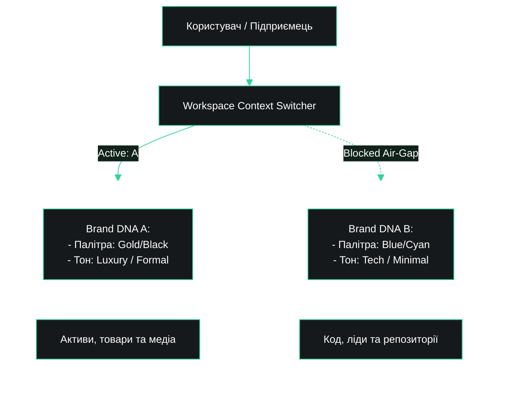

> [!metadata]- ⚙️ Системні метадані та інваріанти (MRH Header)
> ```yaml
> # --- DNK-MRH-HEADER ---
> mrh_id: "docs/architecture/adr/ADR-003-workspace-isolation-and-brand-dna.md"
> purpose: "Architecture Decision Record: Workspace Isolation and Brand DNA Engine."
> canonical_source: true
> alters_files: []
> triggers_tasks: []
> status: "Active"
> version: "2.0.0"
> updated_at: "2026-11-18"
> author: "DNK-e.com Maksym & Antigravity"
> # --- END DNK-MRH-HEADER ---
> ```

> [!abstract] 🏛️ АРХІТЕКТУРНЕ РІШЕННЯ: Workspace Isolation & Brand DNA
> Впровадження суворої багатопростірної моделі ізоляції даних (Air-Gap) для проектів користувача. Кожен бренд має власний профіль Brand DNA, базу ассетів та конфігурацію, що виключає перехресне забруднення контексту.

<div align="center" style="margin-bottom: 16px;">
  <span style="background-color: #1e293b; color: #38bdf8; padding: 4px 10px; border-radius: 9999px; font-size: 12px; font-weight: 600; border: 1px solid #0284c7;">Домен: Workspace & Security</span>
  <span style="background-color: #1e293b; color: #34d399; padding: 4px 10px; border-radius: 9999px; font-size: 12px; font-weight: 600; border: 1px solid #059669;">Статус: Accepted</span>
  <span style="background-color: #1e293b; color: #c084fc; padding: 4px 10px; border-radius: 9999px; font-size: 12px; font-weight: 600; border: 1px solid #7c3aed;">Оптика: Dual-Lens</span>
  <span style="background-color: #1e293b; color: #f59e0b; padding: 4px 10px; border-radius: 9999px; font-size: 12px; font-weight: 600; border: 1px solid #d97706;">Ідентифікатор: ADR-003</span>
</div>

`Навігація`: [[00_MOC_DNK_OS|🗺️ Головний MOC DNK OS]] ➔ [[specs/02_USER_IDENTITY_AND_SOUL_SPEC|Ідентичність та Простори]] ➔ **ADR-003: Workspace Isolation**

---

# ADR-003: Ізоляція Робочих Просторів та Brand DNA



---

## 🎯 1. Контекст та Проблематика
Підприємці та агентства часто запускають кілька незалежних продуктів одночасно. Змішування кольорових палітр, логотипів, тону спілкування (Tone of Voice) чи конфіденційних комерційних даних між проектами є критичною помилкою генеративних систем.

---

## 💡 2. Прийняте Рішення
1. Реалізувати модель суворо ізольованого робочого простору (`ProjectWorkspace`).
2. Кожен робочий простір має:
   - Власний файл маніфесту `Brand DNA` (кольори, шрифти, місія, цільова аудиторія, tone of voice).
   - Ізольовану директорію для медіа-ассетів та SQLite-базу сесій.
3. При виконанні будь-якої задачі `Context Router` інжектує Brand DNA **виключно активного простору**. Доступ до сусідніх просторів блокується на рівні ядра.

---

## ⚖️ 3. Наслідки та Трейд-офи

### Переваги (Positive)
- **100% Захист від Витоку**: Відсутність ризику генерації контенту для бренду А з атрибутами бренду Б.
- **Чистота Ассетів**: Зручне резервне копіювання, експорт або видалення цілого проекту в один клік.

### Недоліки та Ризики (Negative & Mitigations)
- Необхідність перемикання контексту в інтерфейсі перед виконанням міжпроектних операцій.  
  *Мітигація*: Використання швидкого Workspace Selector у верхній панелі або автоматична маршрутизація по ID проекту.

---

`Див. також`: [[specs/02_USER_IDENTITY_AND_SOUL_SPEC|Специфікація Просторів]] | [[context/SYSTEM_INVARIANTS|Системні Інваріанти]] | [[00_MOC_DNK_OS|Головний MOC]]
