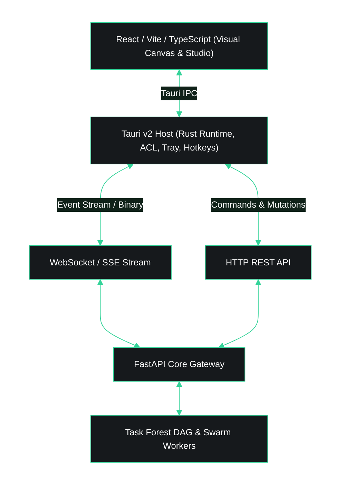

> [!metadata]- ⚙️ Системні метадані та інваріанти (MRH Header)
> ```yaml
> # --- DNK-MRH-HEADER ---
> mrh_id: "docs/architecture/adr/ADR-004-tauri-desktop-client-architecture.md"
> purpose: "Architecture Decision Record: Adoption of Tauri v2 as the Canonical Desktop Shell."
> canonical_source: true
> alters_files: []
> triggers_tasks: []
> status: "Active"
> version: "2.0.0"
> updated_at: "2026-11-18"
> author: "DNK-e.com Maksym & Antigravity"
> # --- END DNK-MRH-HEADER ---
> ```

> [!abstract] 🏛️ АРХІТЕКТУРНЕ РІШЕННЯ: TAURI v2 ДЛЯ DESKTOP SHELL
> Прийнято рішення використовувати фреймворк **Tauri v2** (Rust + нативний системний Webview) як канонічний десктопний клієнт (Visual Shell) для платформи **DNK OS Standalone Application**, відхиливши Electron через надмірне споживання ресурсів. Ядро виконання агентів залишається суворо ізольованим у Python/FastAPI мікроядрі.

<div align="center" style="margin-bottom: 16px;">
  <span style="background-color: #1e293b; color: #38bdf8; padding: 4px 10px; border-radius: 9999px; font-size: 12px; font-weight: 600; border: 1px solid #0284c7;">Домен: Client Tier</span>
  <span style="background-color: #1e293b; color: #34d399; padding: 4px 10px; border-radius: 9999px; font-size: 12px; font-weight: 600; border: 1px solid #059669;">Статус: Accepted</span>
  <span style="background-color: #1e293b; color: #c084fc; padding: 4px 10px; border-radius: 9999px; font-size: 12px; font-weight: 600; border: 1px solid #7c3aed;">Оптика: Dual-Lens</span>
  <span style="background-color: #1e293b; color: #f59e0b; padding: 4px 10px; border-radius: 9999px; font-size: 12px; font-weight: 600; border: 1px solid #d97706;">Ідентифікатор: ADR-004</span>
</div>

`Навігація`: [[00_MOC_DNK_OS|🗺️ Головний MOC DNK OS]] ➔ [[docs/architecture/ARCHITECTURE_MAP|Карта Архітектури]] ➔ **ADR-004: Tauri Desktop Architecture**

---

# ADR-004: Використання Tauri v2 для Desktop Client / Visual Shell



---

## 🎯 1. Контекст та Проблематика
При розробці автономного додатку **DNK OS Standalone Application (`DNK_OS_APP`)** постала потреба у нативному десктопному середовищі:
1. **Постійна присутність в ОС**: Робота у фоні (system tray), системні сповіщення про завершення завдань рою агентів, глобальні комбінації клавіш (hotkeys).
2. **Візуальний Canvas**: Інтерактивне полотно завдань TaskDNA та графа Task Forest без затримок інтерфейсу.
3. **Енергоефективність та споживання пам'яті**: Агентивна система паралельно запускає кілька моделей та підпроцесів (Python, FastMCP плагіни). Традиційні рішення на базі **Electron** споживають 150+ МБ дискового простору та 300–800 МБ RAM на порожньому вікні, створюючи неприйнятне навантаження на систему користувача.

---

## 💡 2. Прийняте Рішення
1. Використовувати **Tauri v2** як стандарт десктопної оболонки (Thin Client / Visual Shell):
   * **Frontend**: React + TypeScript + Vite + Tailwind (спільна кодова база з Web Dashboard).
   * **Нативна обгортка**: Rust (використання системного webview: WKWebView на macOS, WebView2 на Windows, WebKitGTK на Linux).
2. **Суворе розділення «Клієнт — Ядро» (Headless Kernel Separation)**:
   * Логіка агентів, декомпозиція задач (TaskDNA), виконання інструментів та AI-пайплайни виконуються **виключно в Python/FastAPI ядрі**, а не в Rust-процесі Tauri.
   * Tauri виступає виключно як тонкий нативний презентаційний шар (Presentation Tier) та шлюз безпеки для локальних викликів ОС.
3. **Зв'язок через Localhost API**:
   * Tauri комунікує з ядром через WebSocket (двосторонній стрімінг подій/токенів у реальному часі) та локальний HTTP REST (команди, завантаження конфігурацій).

---

## ⚖️ 3. Наслідки та Трейд-офи

### Переваги (Positive)
* **Ультралегкий слід**: Розмір скомпільованого бінарника ~10–15 МБ, початкове споживання пам'яті лише ~30–50 МБ RAM (у 10 разів менше за Electron).
* **Нативна інтеграція з ОС**: Швидке керування треєм, нативні діалогові вікна, системні шорткати та перевірені права доступу (Tauri ACL).
* **Ізоляція збоїв**: Якщо UI або вікно Tauri закривається/падає, ядро агентів продовжує автономне виконання завдань без переривання фонових процесів.

### Недоліки та Ризики (Negative & Mitigations)
* **Відмінності рушіїв рендерингу (WebKit vs WebView2)**:  
  * *Мітигація*: Суворе дотримання стандартизованого CSS/JS коду без специфічних для Chromium хаків; автоматизоване тестування сумісності UI.
* **IPC Bottleneck при масивному стрімінгу токенів**:  
  * *Мітигація*: Використання WebSocket напряму з фронтенду до FastAPI ядра для швидкого стрімінгу тексту/логів в обхід проміжного маршалінгу в Rust IPC.

---

`Див. також`: [[specs/01_CORE_AND_ACTION_BUS_SPEC|01. Архітектура Ядра]] | [[docs/architecture/ARCHITECTURE_MAP|Карта Архітектури]] | [[00_MOC_DNK_OS|Головний MOC DNK OS]]
