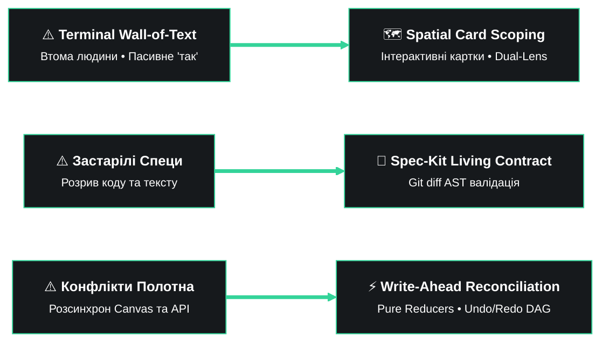

> [!metadata]- ⚙️ Системні метадані та інваріанти (MRH Header)
> ```yaml
> # --- DNK-MRH-HEADER ---
> mrh_id: "docs/architecture/adr/ADR-006-agentic-harness-and-spec-kit.md"
> purpose: "Architectural Decision Record establishing SOTA Agentic Harness, Spec-Kit living contracts, and write-ahead canvas reconciliation."
> canonical_source: true
> alters_files: []
> triggers_tasks: []
> status: "Active"
> version: "2.0.0"
> updated_at: "2026-11-18"
> author: "DNK-e.com Maksym & Antigravity"
> # --- END DNK-MRH-HEADER ---
> ```

> [!abstract] 🏛️ ADR-006: АРХІТЕКТУРА АГЕНТИВНОГО HARNESS ТА ЖИВИХ СПЕЦИФІКАЦІЙ
> Фіксує вирішення проблеми «Terminal Wall-of-Text», впровадження стандарту Spec-Kit для детермінованих машинних контрактів, Actor-модель агентів та механізм Write-Ahead Reconciliation для просторових полотен.

<div align="center" style="margin-bottom: 16px;">
  <span style="background-color: #102219; color: #38bdf8; padding: 4px 10px; border-radius: 9999px; font-size: 12px; font-weight: 600; border: 1px solid #38bdf8;">Статус: Approved</span>
  <span style="background-color: #102219; color: #34d399; padding: 4px 10px; border-radius: 9999px; font-size: 12px; font-weight: 600; border: 1px solid #34d399;">Категорія: Harness / Architecture</span>
  <span style="background-color: #102219; color: #c084fc; padding: 4px 10px; border-radius: 9999px; font-size: 12px; font-weight: 600; border: 1px solid #7c3aed;">Оптика: Dual-Lens</span>
</div>

`Навігація`: [[00_MOC_DNK_OS|🗺️ Головний MOC DNK OS]] ➔ [[docs/adr/ADR-001-microkernel-fastmcp-architecture|ADR-001]] ➔ **ADR-006**

---

## 🎯 1. Контекст та Проблематика (Context & Problem)

1. **Проблема термінального опитування (Terminal Wall-of-Text)**:
   При глибокому скоупінгу в CLI термінал перетворюється на нескінченний масив тексту. Людина втомлюється, втрачає контекст попередніх відповідей і схиляється до пасивного підтвердження («роби як знаєш»), що веде до серйозних архітектурних помилок та галюцинацій моделі.
2. **Розрив між кодом та документацією**:
   Традиційні специфікації застарівають у момент першого коміту. Специфікація повинна бути **машинним живим контрактом (Spec-Kit)**, який верифікується детермінованими тестами та оновлюється разом із `git diff`.
3. **Синхронізація просторових полотен (Spatial Canvas State Sync)**:
   При роботі з нескінченними графами (Obsidian / React Canvas) виникають конфлікти стану між фоновим Python-сервером та клієнтським UI при одночасному редагуванні.



---

## 🏛️ 2. Архітектурне Рішення (Architectural Decision)

Ми затверджуємо три фундаментальні підсистеми SOTA Harness:

### 2.1. Spec-Kit: Специфікація як Машинний Контракт
- Будь-яка специфікація в `specs/` зобов'язана бути детермінованим контрактом, що описує:
  1. Машинний інтерфейс (типи даних, DTO, протоколи FastMCP).
  2. Матрицю інваріантів (CHECK / EXPECT).
  3. Негативний скоуп (Anti-Scope) та білий список файлів.
- Специфікація оновлюється атомарно в тому ж PR/коміті, що й програмний код.

### 2.2. Захист від «Wall-of-Text» через Spatial Scoping
- Інтерв'ювання та скоупінг заборонено вести монолітними простирадлами тексту в терміналі.
- Скоупінг розділяється на структуровані картки рішень із вибором варіантів (`ask_question`) та візуальну фіксацію у вигляді нотаток `Do not Delete - Draft.md` / `whiteboards/Do not Delete - Draft.excalidraw.md`.

### 2.3. Write-Ahead Reconciliation та Undo/Redo DAG для Canvas
- Всі операції над просторовим полотном (додавання вузлів, зміна зв'язків) виконуються через чисті редуктори (pure reducers).
- Клієнт застосовує оптимістичні оновлення (optimistic UI), а FastMCP Microkernel гарантує транзакційну фіксацію в SQLite WAL.
- Історія редагування ведеться як спрямований ациклічний граф станів (**Undo/Redo DAG**), що дозволяє повертатися до будь-якої гілки роздумів.

### 2.4. Agentic Harness & Evals Framework
- **Текстова оптимізація скілів**: Запис траєкторій помилок у SCONES memory для автоматичного покращення інструкцій без зміни ваг моделі.
- **Детерміноване відтворення (Deterministic Replay)**: Можливість повторного прогону траєкторії агента за логами подій Action Bus.
- **Zero-Trust Агентна Безпека (10/10 OWASP Agentic Security)**: Кожна дія підписується ідентифікатором агента та перевіряється через HITL-міст.

---

## ⚖️ 3. Наслідки та Компроміси (Consequences & Trade-offs)

### Позитивні:
- **Zero Drift**: Код та специфікації завжди синхронізовані на рівні CI/CD.
- **Висока продуктивність людини**: Максим оцінює чіткі архітектурні зрізи за 15 секунд замість читання сотень рядків терміналу.
- **Безпека**: Неможливість виконати деструктивну операцію без попередження та підтвердження.

### Негативні (Компроміси):
- Потрібна підтримка валідаторів `markdown_schema_gate.py` та суворе дотримання формату карток.

---

## 🧪 4. Верифікаційний План (Quality Gate)
- Перевірка детермінованими тестами в `./scripts/verify_all.sh`.
- 100% проходження тестів шини дій та консистентності DAG.
