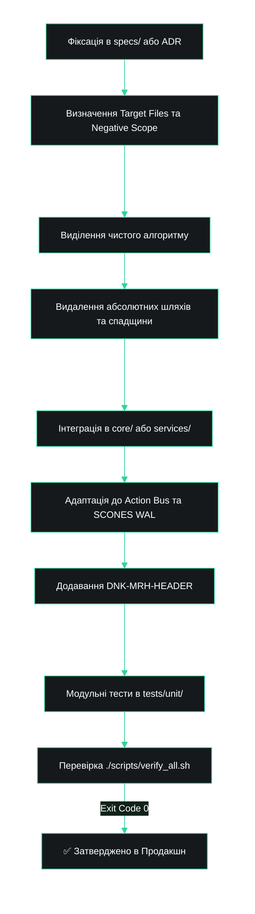

> [!metadata]- ⚙️ Системні метадані та інваріанти (MRH Header)
> ```yaml
> # --- DNK-MRH-HEADER ---
> mrh_id: "docs/architecture/adr/ADR-007-selective-brick-extraction-protocol.md"
> purpose: "Architectural Decision Record establishing the Selective Brick Extraction Protocol and enforcing repository sovereignty."
> canonical_source: true
> alters_files: []
> triggers_tasks: []
> status: "Active"
> version: "2.0.0"
> updated_at: "2026-11-18"
> author: "DNK-e.com Maksym & Antigravity"
> # --- END DNK-MRH-HEADER ---
> ```

> [!abstract] 🏛️ ADR-007: ПРОТОКОЛ СЕЛЕКТИВНОЇ ЕКСТРАКЦІЇ ЦЕГЛИНОК ТА СУВЕРЕНІТЕТ DNK_OS_APP
> Цей документ офіційно забороняє монолітні операції експорту, синхронізації або копіювання (`export_standalone_app.py`, `rsync`, `cp -r`) з R&D-хабу в суверенне ядро `DNK_OS_APP`. Встановлюється 4-фазний стандарт ізольованого перенесення бізнес-алгоритмів («цеглинок») за принципом Clean-Room Reverse Engineering з обов'язковою адаптацією до Action Bus, SCONES пам'яті та детермінованою верифікацією тестами.

<div align="center" style="margin-bottom: 16px;">
  <span style="background-color: #102219; color: #38bdf8; padding: 4px 10px; border-radius: 9999px; font-size: 12px; font-weight: 600; border: 1px solid #38bdf8;">Статус: Approved</span>
  <span style="background-color: #102219; color: #34d399; padding: 4px 10px; border-radius: 9999px; font-size: 12px; font-weight: 600; border: 1px solid #34d399;">Категорія: Core Governance</span>
  <span style="background-color: #102219; color: #c084fc; padding: 4px 10px; border-radius: 9999px; font-size: 12px; font-weight: 600; border: 1px solid #7c3aed;">Оптика: Dual-Lens</span>
</div>

`Навігація`: [[00_MOC_DNK_OS|🗺️ Головний MOC DNK OS]] ➔ [[docs/adr/ADR-006-agentic-harness-and-spec-kit|ADR-006]] ➔ **ADR-007**

---

## 🎯 1. Контекст та Проблематика (Context & Problem)

1. **Пастка монолітного експорту («The Export Trap»)**:
   В історичній R&D-структурі вважалося, що цільове клієнтське ядро є згенерованим артефактом, який перезаписується монолітним скриптом експорту зі старого моноліту. Запуск подібного перезапису знищив би Greenfield-архітектуру `DNK_OS_APP`: FastMCP мікроядро, SCONES пам'ять на SQLite WAL, 5 канонічних специфікацій та дизайн-систему Flat Green.
2. **Зараження спадщиною (Legacy Contamination)**:
   Сліпе перенесення файлів директоріями неминуче тягне абсолютні системні шляхи, старі глобальні змінні, сторонні неперевірені залежності та важкі дампи контексту, ламаючи детермінований лінтер `./scripts/verify_all.sh`.
3. **Ілюзія завершеності («Assimilation Theater»)**:
   Аналіз сторонніх репозиторіїв та напрацювань без написання працюючого коду на нативному Python створює оманливе відчуття прогресу без реальної працездатності в рантаймі.

---

## 🏗️ 2. Архітектурне Рішення: 4-Фазний Протокол Екстракції

Прийнято рішення зафіксувати **повний суверенітет репозиторію `DNK_OS_APP`**. Будь-який перенос напрацювань, ідей або алгоритмів здійснюється виключно за конвеєром «Селективної екстракції цеглинок»:



---

## ⚖️ 3. Обов'язкова Критика: 3 Ризики та Межі (3 Flaws Rule)

### ⚠️ 3 критичні ризики та захисні бар'єри
1. **Ризик розсинхронізації інтерфейсів (Interface Drift):**
   *Загроза:* Алгоритм, розроблений у R&D, може спиратися на іншу структуру подій, ніж стандартизована у `specs/01_CORE_AND_ACTION_BUS_SPEC.md`.
   *Бар'єр:* Фаза 1 вимагає точного опису вхідних та вихідних Pydantic-схем до написання коду.
2. **Ризик стекового забруднення (Runtime Contamination):**
   *Загроза:* Спроба напряму затягнути код на TypeScript, Bun чи Node.js (як у випадку з Freebuff).
   *Бар'єр:* Дозволена тільки реінженерія алгоритму на чистому Python 3.12 без додавання зовнішніх бінарних рантаймів.
3. **Ризик накопичення "мертвого" коду (Dead Code Bloat):**
   *Загроза:* Перенесення допоміжних скриптів, які не мають прямого виклику з ядра чи Task Forest.
   *Бар'єр:* Обов'язковий `Negative Scope` у кожній тасці, що відсікає тимчасові файли та чорновики.

### 🚧 Граничні умови (Boundary Conditions)
- Протокол діє **виключно в один бік**: з R&D-досліджень у `DNK_OS_APP`. Зворотний запис або експорт ядра назад у моноліт суворо заборонено.
- Якщо модуль не може бути протестований автономно через `pytest` без зовнішнього підключення до мережі, його перенесення блокується до створення локального ізольованого мока.

---

## 📊 4. Порівняльна Матриця: Монолітний Експорт проти Селективної Екстракції

| Критерій | Старий монолітний експорт | Канонічна селективна екстракція (ADR-007) |
|---|---|---|
| **Одиниця перенесення** | Вся кодова база або великі папки | Окрема ізольована цеглинка (Brick) |
| **Цілісність ядра** | Ризик 100% затирання нової архітектури | 0% ризику затирання; кожна цеглинка атомарна |
| **Шляхи до файлів** | Часто містить абсолютні системні шляхи | Тільки відносні шляхи (`./`, `../`) |
| **Критерій готовності** | Текстовий звіт або факт копіювання | Детермінований прогін `./scripts/verify_all.sh` (Exit 0) |
| **Сумісність шини** | Прямі імпорти хаотичних функцій | Реєстрація в Action Bus та збереження в SCONES |

---

## 🛡️ 5. Системні Інваріанти ADR-007

1. **[INVARIANT-SOVEREIGN-REPO]**: Репозиторій `DNK_OS_APP` є повністю автономним і суверенним. Заборонено будь-які імпорти, скрипти чи посилання, які ведуть за межі кореня сховища.
2. **[INVARIANT-NO-BLIND-COPY]**: Заборонено пряме копіювання каталогів за допомогою `rsync` або `cp -r`. Кожен файл створюється або адаптується згідно зі специфікацією.
3. **[INVARIANT-MACHINE-VERIFIED]**: Жодна перенесена функціональність не вважається прийнятою без покриття модульними тестами в `tests/unit/` та успішного проходження всіх 5 ступенів `./scripts/verify_all.sh`.

---

`Див. також`: [[specs/01_CORE_AND_ACTION_BUS_SPEC|01. Специфікація Ядра]] | [[docs/adr/ADR-006-agentic-harness-and-spec-kit|ADR-006: Agentic Harness]] | [[00_MOC_DNK_OS|Головний MOC]]
