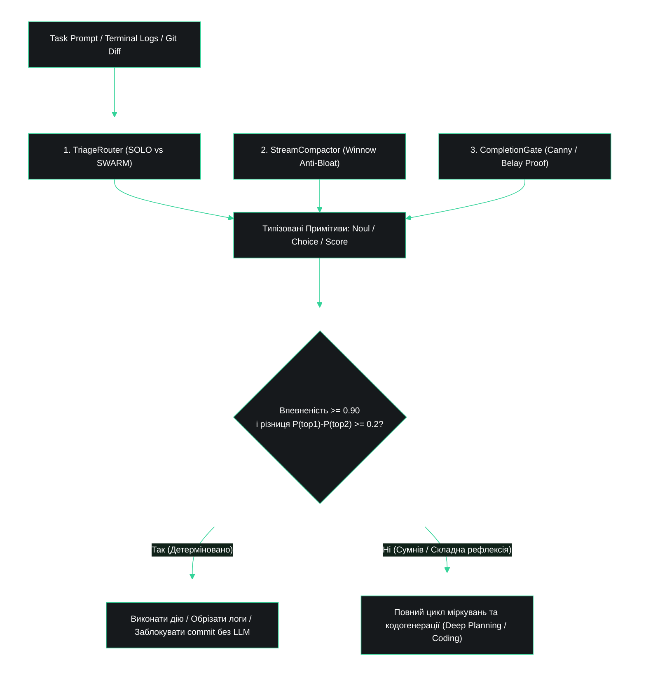
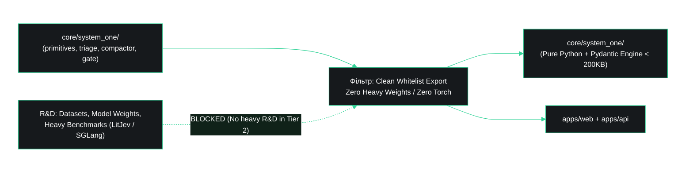

> [!metadata]- ⚙️ Системні метадані та інваріанти (MRH Header)
> ```yaml
> # --- DNK-MRH-HEADER ---
> mrh_id: "docs/architecture/adr/ADR-007_SYSTEM_ONE_JEV_ARCHITECTURE.md"
> purpose: "Architecture Decision Record for System One Machine-Native Intelligence, Jev Patterns & Two-Tier Export Protocol."
> canonical_source: true
> alters_files: []
> triggers_tasks: []
> status: "Active"
> version: "2.0.0"
> updated_at: "2026-11-18"
> author: "DNK-e.com Maksym & Antigravity"
> # --- END DNK-MRH-HEADER ---
> ```

# 🏛️ ADR-007: Архітектура System One (Jev Machine-Native Intelligence) та Протокол Експорту в DNK_OS_APP

## 1. Контекст та Проблематика (Context & Problem Statement)

У традиційній архітектурі агентів DNK OS (Gerych Prime та 14 Swarm Workers) більшість мета-операцій (тріаж складності, перевірка інваріантів, аналіз завершення задачі, очищення контексту) виконуються через виклики повнорозмірних генеративних LLM (Gemini Flash, Claude 3.5 Sonnet, Llama 3.3).

### Фактичні емпіричні обмеження генеративного підходу:
1. **Висока затримка (TTFT 1.5–3.5 секунди)**: Навіть просте бінарне рішення (наприклад: «Чи потрібен рой для цієї задачі?») змушує очікувати генерацію тексту та парсинг JSON.
2. **Контекстне ожиріння та ентропія уваги (ADR-006)**: Передача сирих логів терміналу (`pytest`, `git diff`, збірки Vite) витрачає до 15 000–30 000 токенів на ітерацію, розмиваючи увагу моделі та призводячи до галюцинацій на наступних кроках.
3. **Ризик вербальної симуляції (Violation of Epistemic Armor)**: Генеративні моделі схильні стверджувати «Завдання виконано успішно», навіть якщо у транскрипті відсутній машинний доказ (`exit code 0`, пройдений тест).

### Джерело асиміляції (SOTA Baseline):
Аналіз екосистеми **TypeSafe Jev (System One Machine-Native Intelligence)** та понад 100 відкритих проєктів довкола неї (`browser-use/jev-ultrafast`, `LitJev`, `winnow`, `fast-jev-compaction`, `Canny`, `tiershift`, `jevmlx`) показав життєздатність концепції **суб-секундного типізованого інференсу** (<50 мс, $0.0008), який повертає строго калібровані математичні примітиви замість тексту.

---

## 2. Архітектурне Рішення (The Decision)

Ми інтегруємо шар **System One** як детермінований фільтр першої лінії (L1 Filter) перед будь-яким викликом System Two (важких генеративних агентів). Шар System One реалізується як модульний пакет `core/system_one/` з нульовими важкими залежностями.



---

## 3. Чотири Ключові Компоненти Системи

### 3.1. Типізовані Примітиви (`core/system_one/primitives.py`)
Жоден компонент System One не повертає довільний текст. Усі відповіді строго типізовані через Pydantic:
* `Noul`: Бінарне рішення (Так/Ні) з каліброваною ймовірністю $P \in [0.0, 1.0]$.
* `Choice`: Категоріальний вибір із закритого `Enum` з розподілом ймовірностей Softmax.
* `Score`: Ранжування за шкалою (наприклад, оцінка релевантності чанка від 0 до 5).

### 3.2. Миттєвий Тріаж Складності (`core/system_one/triage.py`)
Забезпечує Step 0 протокол для `dnk_triage_task`:
* Вхід: текст запиту, список зачеплених файлів.
* Розрахунок формули складності: $C = F_{\text{files}} + 2 \cdot D_{\text{domains}} + 3 \cdot S_{\text{stages}}$.
* Вихід: `Choice[ExecutionMode]` (`SOLO`, `SWARM_PARALLEL`, `SWARM_SEQUENTIAL`).
* Швидкість: < 5 мс (детермінована евристика) або < 50 мс (локальний logit extraction через `LitJev` / `jevmlx`).

### 3.3. Контекстна Компакція Логів (`core/system_one/compactor.py` — Патерн Winnow)
Захищає контекстне вікно моделі (ADR-006):
* Фільтрує вивід терміналу перед поверненням в LLM:
  * Видаляє повторювані прогрес-бари, пусті рядки та успішні статус-повідомлення лінтерів.
  * Зберігає **буквально (verbatim)**: блоки `Traceback`, `FAILED`, точні рядки помилок та diffs.
* Економія: скорочення обсягу логів на 70–90% без втрати діагностичної інформації.

### 3.4. Машинний Гейт Завершення (`core/system_one/completion_gate.py` — Патерн Canny / Belay)
Реалізує інваріант **Run-Before-Report**:
* Перевіряє транскрипт сесії на наявність виконаного доказу:
  * Наявність виклику тестового раннера (`pytest`, `verify_all.sh`).
  * Перевірка `exit_code == 0`.
  * Валідація відсутності незакомічених абсолютних шляхів (`/Users/...`).
* Якщо доказу немає: автоматично блокує `git commit` та забороняє перехід задачі в статус `completed`.

---

## 4. Протокол Експорту в Новий Додаток (`../DNK_OS_APP`)

Згідно з `TWO_TIER_DEVELOPMENT_PROTOCOL.md`, перенесення в автономний клієнтський репозиторій (`../DNK_OS_APP`) підпорядковується суворим правилам чистоти дистрибуції.



### Правила пакування для `scripts/export_standalone_app.py`:
1. **Zero-Torch Invariant у Tier 2**:
   Клієнтський додаток `../DNK_OS_APP` повинен залишатися легким (розмір пакета ядра < 50 МБ). Усі базові компоненти System One (`primitives`, `compactor`, `triage`, `completion_gate`) реалізуються на чистому Python з використанням стандартної бібліотеки та `pydantic`.
2. **Ізоляція ваг та локальних серверів**:
   Будь-які експериментальні ваги моделей (GGUF, safetensors) або локальні інференс-сервери (`sglang`, `vllm`) залишаються в `DNK_HUB/infra/` або підключаються як опціональні плагіни через REST/FastMCP ендпоінти, а не прямими бінарними залежностями.
3. **Відносні шляхи**:
   Жоден конфігураційний файл або модуль у `../DNK_OS_APP` не повинен містити шляхів `DNK_HUB` чи абсолютних шляхів хоста.

---

## 5. Обов'язковий Критичний Аудит: 3 Ризики та Скептична Альтернатива (Anti-Sycophancy)

### 3 критичні ризики (Failure Modes)
1. **Ризик 1: Помилкова впевненість класифікатора (OOD Overconfidence)**:
   При отриманні нетипових, маніпулятивних або занадто розмитих промптів System One може видати $P \ge 0.95$ для помилкового режиму (наприклад, визначити складну багатодоменну задачу як `SOLO`).
   * *Запобіжник:* Якщо різниця між першим та другим кандидатом $P_{\text{top1}} - P_{\text{top2}} < 0.20$, вибір автоматично дискваліфікується і передається на аналіз у System Two (Gerych Prime).
2. **Ризик 2: Надмірна агресивність компакції логів (Over-truncation)**:
   Компонент Winnow може помилково вважати рядок «сміттям» і вирізати контекст, який містив неявне попередження бібліотеки або кастомний assertion.
   * *Запобіжник:* Завжди зберігати останні $N=40$ рядків виводу терміналу без змін, а також повний сирий лог у тимчасовий файл на диску з посиланням на нього.
3. **Ризик 3: Блокування не-кодових задач гейтом завершення (Gate Deadlock)**:
   Суворий `CompletionGate` вимагатиме проходження тестів для задач, які є суто дослідницькими або документаційними (оновлення README, написання ADR).
   * *Запобіжник:* Типізація типу задачі (`TaskType.DOCUMENTATION`, `TaskType.RESEARCH`, `TaskType.CODE`). Для не-кодових задач гейт перевіряє Markdown Linting та MRH-заголовки замість `pytest`.

### Скептична альтернатива (Minimalist Baseline)
Якщо інтеграція повноцінного нейромережевого System One виявиться занадто складною для підтримки в клієнтському дистрибутиві, ми використовуємо **Pure-Deterministic Rule Engine**:
* Тріаж: парсер AST імпортів + словник ключових слів + підрахунок файлів.
* Компакція: regex-фільтр ANSI-escape послідовностей та повторюваних статусних рядків.
* Це дає 85% користі Jev із нульовими витратами на інференс та 100% передбачуваністю.

---

## 6. План Впровадження (Actionable Next Steps)

1. [x] **ADR-007 затверджено**: Архітектура та межі зафіксовані в цьому документі.
2. [ ] **Створення модуля `core/system_one/`**:
   - `core/system_one/primitives.py` (Noul, Choice, Score).
   - `core/system_one/triage.py` (правило $C = F + 2D + 3S$).
   - `core/system_one/compactor.py` (фільтрація виводу терміналу).
   - `core/system_one/completion_gate.py` (валідація машинних доказів).
3. [ ] **Верифікація тестів**: Створити `tests/core/test_system_one.py` з покриттям 100% тест-кейсів.
4. [ ] **Оновлення пакувальника**: Додати `core/system_one/` до білого списку в `scripts/export_standalone_app.py`.
5. [ ] **Тестовий експорт**: Здійснити перевірочний експорт у `../DNK_OS_APP` та перевірити автономний запуск.
