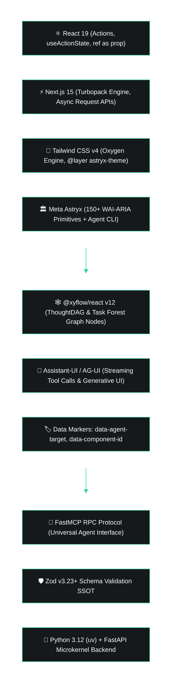

> [!metadata]- ⚙️ Системні метадані та інваріанти (MRH Header)
> ```yaml
> # --- DNK-MRH-HEADER ---
> mrh_id: "docs/architecture/adr/ADR-009-agent-native-react19-next15-astryx-architecture.md"
> purpose: "Architectural Decision Record defining the clean-slate Agent-Native frontend stack (React 19, Next.js 15, Tailwind v4, Meta Astryx, FastMCP) for DNK_OS_APP."
> canonical_source: true
> alters_files: []
> triggers_tasks: []
> status: "Active"
> version: "2.0.0"
> updated_at: "2026-11-18"
> author: "DNK-e.com Maksym & Antigravity"
> # --- END DNK-MRH-HEADER ---
> ```

> [!abstract] 🏛️ ADR-009: АГЕНТНО-ОРІЄНТОВАНА АРХІТЕКТУРА ФРОНТЕНДУ (REACT 19 + NEXT.JS 15 + TAILWIND V4 + META ASTRYX)
> Цей документ затверджує вибір технологічного стеку для побудови клієнтського інтерфейсу **DNK OS Standalone App** (`DNK_OS_APP`) з чистого аркуша. Оскільки проєкт створюється повністю автономними AI-агентами (Swarm / Gerych / Antigravity), архітектура оптимізована під машиночитність, мінімальний контекстний оверхед моделей, миттєвий HMR Turbopack, детермінований CLI-генератор компонентів Meta Astryx та уніфікований протокол інструментів FastMCP.

<div align="center" style="margin-bottom: 16px;">
  <span style="background-color: #16181b; color: #30cd90; padding: 4px 10px; border-radius: 9999px; font-size: 12px; font-weight: 600; border: 1px solid #30cd90;">Статус: Approved</span>
  <span style="background-color: #16181b; color: #38bdf8; padding: 4px 10px; border-radius: 9999px; font-size: 12px; font-weight: 600; border: 1px solid #38bdf8;">Стек: React 19 / Next.js 15 / Tailwind v4</span>
  <span style="background-color: #16181b; color: #b388ff; padding: 4px 10px; border-radius: 9999px; font-size: 12px; font-weight: 600; border: 1px solid #b388ff;">UI Engine: Meta Astryx</span>
  <span style="background-color: #16181b; color: #f59e0b; padding: 4px 10px; border-radius: 9999px; font-size: 12px; font-weight: 600; border: 1px solid #f59e0b;">Оптика: Agent-Native</span>
</div>

`Навігація`: [[00_MOC_DNK_OS|🗺️ Головний MOC DNK OS]] ➔ [[docs/adr/ADR-008-shopify-polaris-helix-design-system|ADR-008]] ➔ **ADR-009**

---

## 1. Контекст та Проблематика (Context & Motivation)

При створенні системи **DNK OS з чистого аркуша (`DNK_OS_APP`)** ми не обмежені застарілим кодом. Розробка ведеться автономними ШІ-агентами, тому ключовими критеріями вибору технологій є:
1. **Зниження витрат токенів (Context Budget):** Агенти не повинні читати тисячі рядків CSS-конфігів або нетипізованих файлів.
2. **Швидкість циклу зворотно структурованого зв'язку (Fast Iteration Loop):** HMR і перевірка білду мають займати менше 1 секунди (Turbopack).
3. **Машиночитність UI-компонентів:** Наявність детермінованого CLI, здатного повертати JSON-схеми пропсів без парсингу десятків файлів.
4. **Рідна підтримка React 19:** Використання сучасних Server Actions, оптимістичних оновлень (`useOptimistic`), переходу від `forwardRef` до нативного пропу `ref`.

---

## 2. Рішення / Architectural Decision (Approved Stack)



---

## 3. Деталізація Компонентів

### 3.1. Meta Astryx UI як стандарт для Агентів
- **Machine-Readable CLI:** Агенти використовують `npx @astryxdesign/cli search --json` та `swizzle` для створення інтерфейсів без ручної верстки з нуля.
- **Cascade Layers:** Токенний шар оголошується через CSS-шари `@layer astryx-theme`, що виключає специфічність стилів та конфлікти з Tailwind v4.
- **WAI-ARIA AAA:** 150+ компонентів повністю доступні з клавіатури, що критично для автоматизованого headless-тестування агентами.

### 3.2. Next.js 15 & Turbopack
- **Turbopack за замовчуванням:** Швидкість збірки в 10 разів вища за Webpack, що скорочує час верифікації агентів з 20 секунд до 200 мілісекунд.
- **Асинхронні параметри (Next.js 15 Invariant):**
  Усі сторінки та серверні функції суворо використовують асинхронні `params` та `searchParams`.

---

## 4. Золоті Патерни Коду (Golden Code Invariants для Агентів)

Для запобігання галюцинаціям моделей (навчених на застарілому синтаксисі React 18 / Next 14), впроваджуються такі канонічні правила:

### 4.1. Канонічний роут сторінки (Next.js 15 App Router)
```tsx
// apps/web/app/workspace/[workspaceId]/page.tsx
import { Suspense } from 'react';

interface PageProps {
  params: Promise<{ workspaceId: string }>;
  searchParams: Promise<{ [key: string]: string | string[] | undefined }>;
}

export default async function WorkspacePage({ params, searchParams }: PageProps) {
  const { workspaceId } = await params;
  const query = await searchParams;

  return (
    <main className="flex min-h-screen flex-col p-6" data-agent-target="workspace-container">
      <h1 className="text-2xl font-bold tracking-tight">Workspace: {workspaceId}</h1>
      {/* Node Graph & Canvas */}
    </main>
  );
}
```

### 4.2. React 19 Server Action з `useActionState`
```tsx
// components/AgentTaskLauncher.tsx
'use client';

import { useActionState, useOptimistic } from 'react';
import { dispatchAgentTaskAction } from '@/actions/agent-dispatch';

export function AgentTaskLauncher({ workspaceId }: { workspaceId: string }) {
  const [state, formAction, isPending] = useActionState(dispatchAgentTaskAction, {
    status: 'idle',
    taskId: null,
  });

  return (
    <form action={formAction} className="space-y-4">
      <input type="hidden" name="workspaceId" value={workspaceId} />
      <button 
        type="submit" 
        disabled={isPending}
        className="px-4 py-2 rounded-lg bg-emerald-600 text-white font-medium hover:bg-emerald-500 disabled:opacity-50"
      >
        {isPending ? 'Запуск агента...' : 'Запустити задачу рою'}
      </button>
    </form>
  );
}
```

### 4.3. Відмова від `forwardRef` (React 19 Ref-as-Prop)
```tsx
// components/ui/Card.tsx
import React from 'react';

interface CardProps extends React.HTMLAttributes<HTMLDivElement> {
  ref?: React.Ref<HTMLDivElement>;
  variant?: 'elevated' | 'glass';
}

export function Card({ ref, variant = 'elevated', className = '', children, ...props }: CardProps) {
  return (
    <div
      ref={ref}
      className={`rounded-xl border border-border p-4 ${className}`}
      {...props}
    >
      {children}
    </div>
  );
}
```

---

## 5. Наслідки, Компроміси та Ризики (Consequences & Trade-offs)

1. **Ризик 1 (Асинхронні API у Next.js 15)**: Старі генератори коду можуть забувати `await params`. *Захист*: закріплено в Golden Code Invariants (розділ 4.1).
2. **Ризик 2 (Перехід на Tailwind v4 CSS-first конфігурацію)**: Відсутність `tailwind.config.js` може спантеличити моделі зі старим тренувальним зрізом. *Захист*: явна директива `@layer astryx-theme` у `globals.css`.
3. **Ризик 3 (Великі графи @xyflow/react)**: Понад 100 нод можуть знижувати FPS. *Захист*: віртуалізація рендерингу `onlyRenderVisibleElements`.

### План Реалізації
1. **Ініціалізація `DNK_OS_APP/apps/web`:**
   - Розгортання Next.js 15 + React 19 + TypeScript 5.5 через `pnpm create next-app`.
   - Інсталяція Tailwind CSS v4 та налаштування `@layer astryx-theme`.
   - Встановлення `@astryx/core` та `@xyflow/react` v12.
2. **Оновлення `DNK_OS_APP/AGENTS.md`:**
   - Інжекція Golden Code Invariants для React 19 та Next.js 15.
   - Фіксація списку затверджених бібліотек (Dependency Whitelist).
3. **Підключення FastMCP клієнта:**
   - Створення базового сервісу комунікації між Next.js 15 та мікроядром FastAPI через FastMCP/SSE.

---

## 6. Зв'язок з іншими документами системи
- [[00_MOC_DNK_OS|🗺️ Головний MOC DNK OS]]
- [[docs/adr/ADR-008-shopify-polaris-helix-design-system|ADR-008: Дизайн-Система Shopify Polaris Helix]]
- [[docs/adr/ADR-006-agentic-harness-and-spec-kit|ADR-006: Agentic Harness & Spec Kit]]
- [[docs/adr/ADR-005-thoughtdag-spatial-knowledge-and-agent-interaction|ADR-005: ThoughtDAG Canvas Architecture]]
