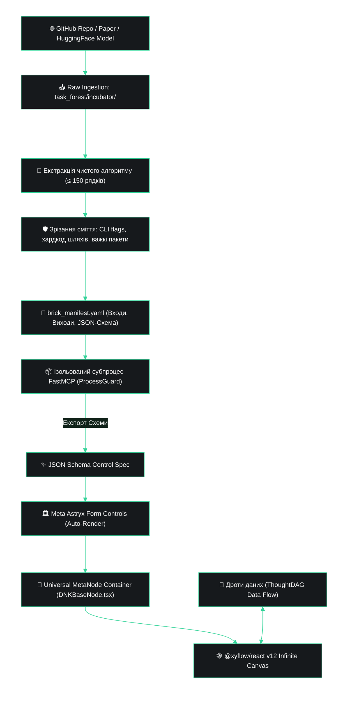

> [!metadata]- ⚙️ Системні метадані та інваріанти (MRH Header)
> ```yaml
> # --- DNK-MRH-HEADER ---
> mrh_id: "docs/architecture/adr/ADR-010-composable-bricks-and-open-source-assimilation.md"
> purpose: "Architectural Decision Record establishing the Composable Bricks standard, FastMCP Dynamic Isolation, and Geometric SOTA Open-Source Assimilation Pipeline."
> canonical_source: true
> alters_files: []
> triggers_tasks: ["TASK-CORE-COMPOSABLE-BRICKS-001"]
> status: "Active"
> version: "1.0.0"
> updated_at: "2026-10-05"
> author: "DNK-e.com Maksym, Antigravity & Gerych Prime"
> # --- END DNK-MRH-HEADER ---
> ```
> > [!summary] 📋 Контекст для ШІ-агента
> > Доповнення та надбудова над ADR-007 (Clean-Room Extraction) та ADR-009 (Frontend Stack). Визначає стандарт блочної архітектури («LEGO-цеглинки»), завдяки якій будь-який open-source алгоритм або AI-модель із GitHub інкапсулюється в універсальний FastMCP-мікроблок із декларативним JSON Schema UI та проектується на полотно Spatial Canvas через MetaNode без ручного переписування коду фронтенду.

<!-- AGENT_INGESTION_DIRECTIVE: schema_version="2.3" parse_mode="dual_optics" task_extractor="auto" dag_sync="enabled" archetype="DEV_SPEC" -->

> [!abstract] 🏛️ ADR-010: БЛОКОВА АРХІТЕКТУРА COMPOSABLE BRICKS ТА ГЕОМЕТРИЧНЕ МАСШТАБУВАННЯ
> **Стратегічна Мета**: Перетворити DNK OS на блочний конструктор (Lego-подібну систему), в якій засновник-вайбкодер (Максим) може підключати, комбінувати та замінювати будь-які передові моделі та алгоритми відкритого коду (GitHub / HuggingFace) у вигляді візуальних блоків на полотні Spatial Canvas. Швидкість додавання нового алгоритму: **≤ 10 хвилин**, нуль ручної верстки завдяки Generative UI, нуль конфліктів залежностей завдяки FastMCP ProcessGuard.

<div align="center" style="margin-bottom: 16px;">
  <span style="background-color: #102219; color: #38bdf8; padding: 4px 10px; border-radius: 9999px; font-size: 12px; font-weight: 600; border: 1px solid #38bdf8;">Статус: Active SSOT</span>
  <span style="background-color: #102219; color: #34d399; padding: 4px 10px; border-radius: 9999px; font-size: 12px; font-weight: 600; border: 1px solid #34d399;">Концепт: Composable Bricks (LEGO)</span>
  <span style="background-color: #102219; color: #c084fc; padding: 4px 10px; border-radius: 9999px; font-size: 12px; font-weight: 600; border: 1px solid #7c3aed;">Оптика: Dual-Lens</span>
  <span style="background-color: #102219; color: #ef4444; padding: 4px 10px; border-radius: 9999px; font-size: 12px; font-weight: 600; border: 1px solid #b91c1c;">Контроль: Суворий</span>
</div>

`Навігація`: [[00_MOC_DNK_OS|🗺️ Головний MOC DNK OS]] ➔ [[docs/adr/ADR-007-selective-brick-extraction-protocol|ADR-007]] ➔ [[docs/adr/ADR-009-agent-native-react19-next15-astryx-architecture|ADR-009]] ➔ **[[docs/adr/ADR-010-composable-bricks-and-open-source-assimilation|ADR-010]]**

---

## 🎨 1. Візуальна Топологія: Конвеєр Геометричної Асиміляції (Mermaid SSOT)

<!-- DAG_NODE: id="DAG-BRICK-TOPOLOGY" title="Composable Bricks & Assimilation Topology" type="visual_spec" agent="antigravity_mentor" -->



---

## 🎯 2. Смисловий Контекст: Чому ADR-009 Потребує Розширення

<!-- DAG_NODE: id="DAG-BRICK-HUMAN-UX" title="Human Intent & ADR-009 Gap Analysis" type="ux_standard" agent="gerych_builder" -->

### 2.1. Діагностика ADR-009: Чого не вистачає для геометричного зростання?
1. **ADR-009 фіксує статичний стек (React 19 + Next 15 + Astryx + XYFlow)**:
   Це міцний фундамент, але він описує *як писати код руками або через агентні промпти*. Якщо кожну нову модель або алгоритм із GitHub розробник чи агент змушений вручну верстати у вигляді нового React-компонента — швидкість розвитку лінійна, а не геометрична.
2. **Відсутність Контракту «Цеглинки» (Brick Manifest)**:
   Немає стандарту того, як зовнішній Python-скрипт або AI-модель повідомляє системі: «У мене є входи X та Y, виходи Z, і ось форма параметрів для керування».
3. **Загроза «UI-Франкенштейна»**:
   Коли у систему додається код із різних бібліотек, чужі стилі CSS ламають палітру Flat Green, а вбудовані форми перехоплюють події миші та блокують зум/панорамування полотна Spatial Canvas.

### 2.2. Головні Скарби із `Do not Delete - Draft.md`, які інтегруються в стандарт:
- **Solution Incubator (Розділ 4 & 12)**: Будь-який знайдений алгоритм фіксується у черзі інкубатора (`task_forest/incubator/`), проходить через сито архітектурного аудиту і лише потім стає блоком.
- **Anti-Frankenstein Protocol (Розділ 13.2)**:
  1. *Токенна ізоляція*: усі віджети зобов'язані наслідувати токени Polaris-Helix / Flat Green (`#16191c`, `#102219`, `#34d399`).
  2. *Подієвий сендбокс*: класи `nodrag nowheel` на всіх інтерактивних інпутах, щоб скрол форми не рухав полотно.
- **Патерн MetaNode (Розділ 13.3)**:
  Замість створення 100 окремих React Flow Node компонентів використовується **один універсальний контейнер `DNKBaseNode.tsx`**, всередину якого динамічно монтується UI-віджет на основі JSON Schema.

---

## 🛡️ 3. Epistemic Armor: 3 Приховані Ризики та Скептична Альтернатива (Mandatory Dissent)

<!-- DAG_NODE: id="DAG-BRICK-DISSENT" title="Mandatory Dissent & Risk Vectors" type="critique" agent="antigravity_mentor" -->

> [!danger] 🛑 МАНДАТОРНА КРИТИКА: Де ламається ідея «Геометричної Асиміляції відкритого коду»
> Спроба перетворити будь-який сторонній репозиторій на Lego-цеглинку несе 3 фундаментальні загрози:

### 3.1. Три Приховані Ризики (3 Critical Flaws):
1. **Пекло Залежностей (Dependency & CUDA Collisions)**:
   Open-source AI моделі використовують взаємовиключні версії PyTorch, TorchVision, transformers або CUDA. Спроба встановити їх в один загальний віртуальний простір гарантовано знищить рантайм `DNK_OS_APP`.
   - *Захисний інваріант*: Кожна складна цеглинка виконується в **ізольованому субпроцесі** (Virtualenv / Micro-container) і спілкується з ядром виключно через FastMCP JSON-RPC по `stdio`.
2. **Загроза Безпеки та Витік Даних (Supply Chain & Exfiltration)**:
   Сторонній код із GitHub може містити небезпечні виклики (`eval`, `os.system`), збір токенів оточення або звернення до сторонніх серверів.
   - *Захисний інваріант*: Суворий аудит перед інтеграцією (Clean-Room), виконання без прямого доступу до приватних `.env` (ключі передаються явно через конфіг цеглинки).
3. **Деградація DOM та Просідання FPS на Полотні (DOM Bloat)**:
   Якщо 50 нод на полотні будуть рендерити важкі кастомні React-дерева з власними стейтами, рендеринг `@xyflow/react` просяде нижче 20 FPS.
   - *Захисний інваріант*: Рендеринг через Meta Astryx примітиви; згортання неактивних нод у компактні карточки (LOD: Level of Detail).

### 3.2. Граничні Умови (Boundary Conditions):
Концепція блоків ламається на **надшвидких потокових даних у реальному часі** (наприклад, попіксельне відео 60 FPS через WebSocket) — тут JSON-RPC створює неприпустимий оверхед серіалізації. Для таких задач використовуються виділені нативні WebGL/WebRTC шини.

### 3.3. Скептична Альтернатива (Minimalist Baseline):
Замість складної системи динамічного завантаження сторонніх npm-модулів у браузер — використовувати **виключно FastMCP JSON Schema + декларативні форми Meta Astryx**. Бекенд віддає чистий JSON параметрів, фронтенд генерує інпути за 2 мілісекунди.

---

## 🤖 4. Машинний Контракт: Стандарт Касетної Цеглинки (Brick Manifest SSOT)

<!-- DAG_NODE: id="DAG-BRICK-MACHINE-CONTRACT" title="Brick Manifest & Machine Schema" type="agent_contract" agent="gerych_prime" -->

Кожна цеглинка в екосистемі DNK OS оформлюється як самодостатній каталог у `packages/bricks/<brick_name>/`:

```yaml
# packages/bricks/gemini_video_slicer/brick_manifest.yaml
schema_version: "1.0.0"
brick_id: "brick_gemini_video_slicer"
name: "Gemini Video Scene Slicer"
version: "1.2.0"
domain: "media"
author: "DNK OS Assimilation Engine"

# Контракт Входів та Виходів (Pins для Spatial Canvas):
inputs:
  video_url:
    type: "string"
    format: "uri"
    label: "Вхідне Відео (URL або Локальний файл)"
    required: true
  min_scene_length_s:
    type: "number"
    default: 2.5
    label: "Мінімальна довжина сцени (сек)"

outputs:
  scenes:
    type: "array"
    items:
      type: "object"
      properties:
        start_time: { type: "number" }
        end_time: { type: "number" }
        keyframe_url: { type: "string" }
    label: "Масив Виявлених Сцен"

# Декларативний UI для генерації MetaNode без коду:
ui_schema:
  icon: "Scissors"
  color_accent: "#34d399"
  widget_type: "form_with_preview"
  preview_field: "outputs.scenes[0].keyframe_url"
```

---

## ⚡ 5. MASE Розробка та Детерміноване Приймання

<!-- DAG_NODE: id="DAG-BRICK-MASE-VERIFICATION" title="Atomic Slices & Quality Gates" type="dev_standard" agent="gerych_auditor" -->

| ID | Фаза / Дія (CHECK) | Очікуваний результат (EXPECT) | Доказ виконання (EVIDENCE) |
| :---: | :--- | :--- | :--- |
| **GATE-BRICK-01** | Валідація схеми маніфесту `brick_manifest.yaml` | Відповідність JSON Schema draft-07 | `exit code 0` у валідаторі |
| **GATE-BRICK-02** | FastMCP ProcessGuard ізоляція | Субпроцес запускається і зупиняється без зависання пам'яті | Чистий graceful exit, 0 зомбі-процесів |
| **GATE-BRICK-03** | Auto-render у `DNKBaseNode.tsx` | Нода на полотні відображає поля вводу з маніфесту | DOM-тест у Vitest/Playwright |
| **GATE-BRICK-04** | Збереження 60 FPS на полотні | 100 активних MetaNode на `@xyflow/react` без фрізів | Lighthouse / Performance Trace > 55 FPS |

---

## 🌳 6. Виконувана Черга Задач Task Forest

<!-- DAG_NODE: id="DAG-BRICK-TASK-FOREST" title="Task Forest Executable DAG" type="task_spec" agent="gerych_prime" -->

- [x] (TASK-DNK-BRICK-001) [P0] @agent:antigravity_mentor | Scope: `docs/adr/ADR-010...` | Criteria: Архітектурний стандарт Lego-цеглинок зафіксовано в ADR-010
- [ ] (TASK-DNK-BRICK-002) [P0] @agent:dnk_dev_fullstack | Scope: `core/bricks/` | Criteria: Базовий клас `DNKBaseBrick` та валідатор `brick_manifest.yaml`
- [ ] (TASK-DNK-BRICK-003) [P0] @agent:gerych_builder | Scope: `apps/web/components/canvas/DNKBaseNode.tsx` | Criteria: Універсальний контейнер MetaNode з автогенерацією полів з `ui_schema`
- [ ] (TASK-DNK-BRICK-004) [P1] @agent:gerych_auditor | Scope: `tests/unit/test_brick_isolation.py` | Criteria: Тестування ProcessGuard на перехоплення падінь стороннього коду

---

## 🔗 7. Зв'язки та Контекстна Мережа

- [[00_MOC_DNK_OS|🗺️ Головний Кабінет Навігації DNK OS]]
- [[Do not Delete - Draft|Do not Delete - Draft.md (Архітектурний Консиліум: Розділи 4, 12, 13)]]
- [[docs/adr/ADR-007-selective-brick-extraction-protocol|ADR-007: Протокол Селективної Екстракції Цеглинок]]
- [[docs/adr/ADR-009-agent-native-react19-next15-astryx-architecture|ADR-009: Agent-Native Frontend Стек]]
- [[specs/05_SPATIAL_UI_AND_CANVAS_SPEC|05_SPATIAL_UI_AND_CANVAS_SPEC.md]]

---
<div align="center" style="color: #64748b; font-size: 12px; margin-top: 32px;">
  DNK OS Architecture Standard • Composable Bricks & Geometric Scaling • 2026
</div>
