> [!metadata]- ⚙️ Системні метадані та інваріанти (MRH Header)
> ```yaml
> # --- DNK-MRH-HEADER ---
> mrh_id: "docs/architecture/adr/ADR-011-agentic-skeleton-theme-blocks-v2-evolution.md"
> purpose: "Architectural Decision Record establishing the migration pathway from Shopify Sections 2.0 (DNK_Ecom_v1_0_0) through Theme Blocks 2.0 (Tinker) to the cutting-edge Agent-First block composition standard (Shopify Skeleton Theme), including third-party app injection reverse-engineering and conversion asset preservation."
> canonical_source: true
> alters_files: []
> triggers_tasks: ["TASK-SHOPIFY-AGENTIC-THEME-002"]
> status: "Active"
> version: "1.0.0"
> updated_at: "2026-10-09"
> author: "DNK-e.com Maksym, Antigravity & Gerych Prime"
> # --- END DNK-MRH-HEADER ---
> ```
> > [!summary] 📋 Контекст для ШІ-агента та Команди
> > Даний ADR фіксує фундамент нової тематичної екосистеми DNK OS. На ринку станом на сьогодні ще немає комерційних тем, побудованих на базі новітнього `Shopify/skeleton-theme`. Ми беремо лідерство у створенні Agent-First теми з нуля, об'єднуючи колосальний доробок конверсійних механік із `DNK_Ecom_v1_0_0` (105 секцій, 167 сніпетів, кастомний Cart Drawer з FOMO, гейміфіковані шкали безкоштовної доставки, бандли) та чисті патерни ізольованої інжекції з додатків Section Store і Design Packs, трансформуючи їх у чисту блокову архітектуру нового покоління під Shopify Canvas.

---

## 🎨 1. Візуальна Топологія: Три Епохи Архітектури Shopify Тем

```mermaid
%%{init: {'theme': 'base', 'themeVariables': { 'primaryColor': '#16191c', 'primaryTextColor': '#f3f4f6', 'primaryBorderColor': '#34d399', 'lineColor': '#34d399', 'secondaryColor': '#0f1113', 'tertiaryColor': '#1f2428'}}}%%
flowchart TB
    subgraph EPOCH_1["1. Епоха Sections 2.0 (2022) — Монолітний JSON & Секції"]
        E1_SRC["DNK_Ecom_v1_0_0\n(105 секцій, 167 сніпетів)"]
        E1_JSON["Шаблони templates/*.json\n(Статичні списки секцій)"]
        E1_CART["Cart Drawer Monolith\n(cart-drawer.liquid + 15 сніпетів)"]
        E1_SRC --> E1_JSON
        E1_SRC --> E1_CART
    end

    subgraph EPOCH_2["2. Епоха Theme Blocks 2.0 (2024-2025) — Вкладеність"]
        E2_SRC["Тема Tinker (#190353539374)"]
        E2_BLOCKS["Вкладені блоки в секціях\n(blocks/*.liquid всередині sections/*.liquid)"]
        E2_INJECT["App Injections:\n• Design Packs (_dpb_ blocks)\n• Section Store (ss-* sections)"]
        E2_SRC --> E2_BLOCKS
        E2_INJECT -.-> E2_BLOCKS
    end

    subgraph EPOCH_3["3. Епоха Agent-First & Canvas (2026+) — Block-First Composition"]
        E3_SRC["Shopify/skeleton-theme\n(Абсолютно НОВА парадигма)"]
        E3_PURE["Zero Sections / Zero JSON Templates\ntemplates/*.liquid = Composition Root"]
        E3_TAG["Новий тег: {% block 'name' %}...{% endblock %}"]
        E3_PARTIAL["Динамічний рендеринг: {% partial 'name' %}\n@shopify/partial-rendering"]
        E3_AGENT["Agentic Editor Ready\n(shop.features.agentic_editor_enabled)"]
        E3_SRC --> E3_PURE
        E3_PURE --> E3_TAG
        E3_PURE --> E3_PARTIAL
        E3_PURE --> E3_AGENT
    end

    EPOCH_1 -->|"Декомпозиція монолітів у блоки"| EPOCH_2
    EPOCH_2 -->|"Ліквідація секційного оверхеду"| EPOCH_3
    
    style EPOCH_1 fill:#162c2f,stroke:#224447,stroke-width:1px
    style EPOCH_2 fill:#112224,stroke:#35d5d5,stroke-width:1px
    style EPOCH_3 fill:#1e2022,stroke:#22c55e,stroke-width:2px
```



---

## 🎯 2. Смисловий Контекст: Чому Світ Переходить на Agent-First Skeleton

### 2.1. Проблеми та Обмеження Попередніх Архітектур

1. **Sections 2.0 (`DNK_Ecom_v1_0_0`)**:
   - Жорстка прив'язка до важких JSON-шаблонів (`templates/*.json`).
   - Будь-яка зміна структури сторінки вимагає перезапису величезного JSON-файлу через Theme Asset API, що створює ризик конфліктів та пошкодження конфігурації.
   - Секції є "закритими островами": вкладеність обмежена одним рівнем блоків, неможливо довільно комбінувати атомарні лейаут-примітиви (Grid, Flex, Container).
   - Велика кількість стороннього JS (Swiper, Flickity, кастомні валідатори), що перевантажує DOM та погіршує Google Lighthouse.

2. **Theme Blocks 2.0 (`Tinker`)**:
   - Дозволив вкладати блоки в блоки (`blocks/*.liquid`), що стало великим кроком уперед.
   - Проте зберіг концепцію обов'язкових секцій-обгорток (`sections/*.liquid`) та JSON-шаблонів.
   - Інжекції сторонніх додатків (як показав наш аудит Design Packs) призводять до запису блоків із дивними префіксами `_dpb_-_*` та прямого інвазивного редагування `index.json` та `settings_data.json`.

3. **Agent-First Skeleton Theme (`Shopify/skeleton-theme`)**:
   - **Повна відмова від папки `sections/`**: секцій більше немає. Взагалі.
   - **Повна відмова від `templates/*.json`**: сторінки описуються безпосередньо в Liquid (`templates/index.liquid`, `templates/product.liquid`).
   - **Композиційний корінь (Composition Root)**: сторінка збирається через блоки `container`, всередині яких викликаються дочірні блоки через новий офіційний тег ``.
   - **Динамічний частковий рендеринг**: тег `` замінює вантажні Ajax-запити на секції (`?section_id=...`). Бібліотека `@shopify/partial-rendering` оновлює тільки цільовий шматок DOM із збереженням фокусу форми та позиції скролу.
   - **Створена для ШІ-агентів**: код читається лінійно, валідується через `theme-check:recommended` без оверрайдів, не містить прихованих JSON-масивів.

---

## 🛡️ 3. Epistemic Armor: 3 Приховані Ризики та Скептична Альтернатива (Mandatory Dissent)

### 3.1. Три Приховані Ризики (3 Critical Flaws)
1. **Ризик несумісності зі звичайним Theme Editor (Merchant Lock-in)**:
   - Шаблони `templates/*.liquid` у Skeleton не дозволяють контент-менеджерам перетягувати секції мишкою в стандартному меню кастомізатора Shopify, якщо магазин не має активованого прапорця `shop.features.agentic_editor_enabled?` або підтримки Canvas.
2. **Ризик несумісності зі сторонніми додатками (App Bridge Failure)**:
   - 99% додатків з Shopify App Store (Judge.me, Loox, Klaviyo, Section Store) очікують наявність папки `sections/` або App Embeds у `layout/theme.liquid`. Додатки, які намагаються інжектувати код через модифікацію `index.json`, впадуть з помилкою 404/422, бо файлу `templates/index.json` фізично немає.
3. **Ризик втрати готових пресетів налаштувань**:
   - У `Shopify/skeleton-theme` заборонені `presets` всередині схеми блоків (`` без presets). Це означає, що конфігурація блоку має задаватися або вхідними параметрами в коді Liquid, або через Canvas-атрибути.

### 3.2. Граничні Умови (Boundary Conditions)
- Якщо магазин працює на класичному Shopify плані без доступу до нових beta-фіч Agentic Editor — чистий Skeleton без адаптера секцій призведе до обмеження можливості візуального редагування клієнтом.
- **Рішення DNK OS Dual-Engine**: Розробка гібридного моста, де тема підтримує як чистий Agent-First режим (`blocks/` + Liquid templates), так і автоматичну обгортку блоків у секції-адаптери для сумісності зі стандартним кастомізатором.

### 3.3. Скептична Альтернатива (Minimalist Baseline)
- Залишитися на чистій темі `Tinker` (Theme Blocks 2.0 з секціями), очікуючи офіційного релізу Canvas для 100% мерчантів.
- **Контр-аргумент**: Бути першими — це стратегічна перевага DNK OS. Коли Shopify відкриє Canvas глобально, у нас вже буде готова, протестована, висококонверсійна бібліотека, якої не буде в жодного конкурента.

---

## 🔍 4. Реверс-Інжиніринг Встановлених Додатків (Section Store vs Design Packs)

На основі live-викачування та аналізу diff'ів тем на магазині `test01010126` з'ясовано механіку роботи лідерів ринку:

| Критерій | Design Packs (DP) | Section Store (SS) | Висновок для DNK OS |
| :--- | :--- | :--- | :--- |
| **Місце інжекції** | `blocks/_dpb_-_*.liquid` + `sections/design_pack_-_design_system.liquid` | `sections/ss-*.liquid` | DNK використовує неймспейс `_dnkb_` для блоків та `dnk-` для секцій |
| **Зміни в шаблонах** | **Інвазивні**: переписує `templates/index.json` та `settings_data.json` | **Нульові**: не чіпає `index.json`, створює ізольовані `templates/product.<handle>.json` | Підхід SS безпечніший для магазину клієнта; підхід DP дає централізовану дизайн-систему |
| **Дизайн-система** | Централізована через керівну секцію (`design_pack_-_design_system.liquid`) | Децентралізована: кожна секція несе свої CSS змінні | **Беремо підхід DP**: єдиний блок токенів `_dnkb_design_system.liquid` |
| **CSS/JS ізоляція** | Інлайн-стилі зі змінними теми | Інлайн scoped CSS + vanilla JS у кожній секції | За стандартом Skeleton переносимо спільні утиліти в `assets/` |
| **Автономні лендінги** | Потребують ручного збирання в кастомізаторі | Генерує готовий шаблон продукту з 5 збалансованими секціями воронки | **Беремо фічу SS**: автоматична генерація конверсійних пресетів сторінок |

---

## 💎 5. Матриця Конверсії: Адаптація Багатств `DNK_Ecom_v1_0_0` у Нову Епоху

У темі `DNK_Ecom_v1_0_0` зосереджено 105 секцій та 167 сніпетів. Ми не викидаємо цей досвід, а трансформуємо його в атомарні блоки та паршали для Agent-First архітектури:

### 5.1. Cart Drawer: Від спагетті-сніпетів до Partial-компонентів
У `DNK_Ecom_v1_0_0` корзина складалася з 12 розрізнених файлів:
`cart-drawer.liquid`, `cart-checkpoints-bar.liquid`, `cart-progress-bar.liquid`, `cart-fomo-block.liquid`, `cart-gift.liquid`, `estimated-shipping-cart-block.liquid`, `upsell-block.liquid`, `moneybackcheckcart.liquid`.

**Нова Архітектура DNK Cart Drawer (Theme Blocks + Partials)**:
```
blocks/
├── cart-drawer.liquid              # Головний контейнер дровера
├── cart-free-shipping-bar.liquid   # Гейміфікована шкала прогресу з порогами (Checkpoints)
├── cart-fomo-countdown.liquid      # Таймер резервування замовлення (FOMO)
├── cart-tier-gift.liquid           # Автоматичне розблокування подарунка
├── cart-shipping-estimator.liquid  # Динамічний калькулятор доставки
├── cart-in-drawer-upsell.liquid    # Розумні рекомендації супутніх товарів
└── cart-trust-badges.liquid        # Гарантії повернення коштів та безпечної оплати
```
* **Механіка оновлення**: замість перезавантаження всієї секції через Ajax Cart API, використовується:
  ```liquid
  
    ...рендеринг позицій корзини...
  
  
    ...рендеринг шкали безкоштовної доставки...
  
  ```
  JavaScript викликає `partials.refresh('cart-items', 'cart-progress')`, оновлюючи тільки цифри та шкалу без миготіння екрану.

---

### 5.2. Висококонверсійні Секції Продукту: Трансформація у Блоки
| Модуль у `DNK_Ecom_v1_0_0` | Роль у конверсії | Новий формат в Agent-First |
| :--- | :--- | :--- |
| `bundle-deals.liquid` / `bundle-offer.liquid` | Збільшення AOV через tiered знижки (Купи 2 - отримай 10%) | `blocks/product-bundle-tier.liquid` |
| `comparison-slider.liquid` / `comparison-table.liquid` | Зняття заперечень через наочне порівняння До/Після або з конкурентами | `blocks/interactive-comparison.liquid` |
| `countdown-timer-bar.liquid` / `dnk-shipping-countdown-estimator.liquid` | Створення терміновості (Urgency): "Замовте протягом 2 год для відправки сьогодні" | `blocks/countdown-urgency-bar.liquid` |
| `product-block-in-stock-count.liquid` | Створення дефіциту (Scarcity): "Залишилося лише 4 шт на складі" | `blocks/inventory-scarcity.liquid` |
| `facebook-reviews.liquid` / `trustpilot-reviews-2.liquid` | Соціальний доказ (Social Proof) | `blocks/social-proof-masonry.liquid` |
| `sticky-image-with-text.liquid` | Утримання уваги під час довгого скролу (Storytelling) | `blocks/sticky-scrollytelling.liquid` |

---

## 🤖 6. Машинний Контракт: Стандарт Створення Agent-First Блоків

Кожен блок у новій бібліотеці DNK повинен відповідати правилам `Shopify/skeleton-theme`:

```liquid

  @name dnk-cart-progress-bar
  @description Багаторівнева шкала безкоштовної доставки та подарунків
  @param {number} [free_shipping_threshold=100] - Поріг безкоштовної доставки
  @param {number} [gift_threshold=150] - Поріг безкоштовного подарунка
  @param {string} [content] - Додатковий текстовий слот


<div 
  class="dnk-cart-progress" 
  {{ block.shopify_attributes }}
  data-free-shipping="{{ block.settings.free_shipping_threshold | default: free_shipping_threshold | default: 100 }}"
>
  
    <div class="dnk-cart-progress__bar">
      <div class="dnk-cart-progress__fill" style="width: {{ cart.total_price | times: 1.0 | divided_by: 100 }}%"></div>
    </div>
    <div class="dnk-cart-progress__status">
      {{ content }}
    </div>
  
</div>


{
  "name": "DNK Cart Progress Bar",
  "settings": [
    {
      "type": "number",
      "id": "free_shipping_threshold",
      "label": "Поріг безкоштовної доставки",
      "default": 100
    },
    {
      "type": "number",
      "id": "gift_threshold",
      "label": "Поріг подарунка",
      "default": 150
    }
  ]
}

```

### Ключові Інваріанти:
1. **LiquidDoc на початку файлу (``)**: чітко типізовані параметри для ШІ-агентів.
2. **`{{ block.shopify_attributes }}` обов'язковий**: дозволяє Shopify Canvas та Theme Editor ідентифікувати елемент при кліку.
3. **Жодних `presets` у схемі**: пресети регулюються кодом виклику або Canvas.
4. **Жодних `` / ``**: усі стилі використовують CSS змінні дизайн-системи, визначені в `assets/base.css`.

---

## ⚡ 7. MASE План Реалізації (Mandatory Atomic Slice Execution)

| Зріз (Slice) | Назва задачі | Цільові артефакти | Критерій верифікації |
| :--- | :--- | :--- | :--- |
| **Slice 1** | Фундамент репозиторію та дизайн-системи | `assets/base.css`, `blocks/container.liquid`, `blocks/design-system.liquid` | `shopify theme check` проходить без помилок |
| **Slice 2** | Конверсійний Cart Drawer на Partials | `blocks/cart-drawer.liquid`, `blocks/cart-progress.liquid`, `assets/cart-drawer.js` | Рендеринг у браузері, робота `@shopify/partial-rendering` |
| **Slice 3** | Блоки карток товару та цінових бандлів | `blocks/product-bundle-tier.liquid`, `blocks/inventory-scarcity.liquid` | Перевірка AST схеми та атрибутів |
| **Slice 4** | Блоки соціального доказу та порівнянь | `blocks/comparison-table.liquid`, `blocks/social-proof.liquid` | Візуальний тест responsive верстки |
| **Slice 5** | Адаптер сумісності для Sections 2.0 | `sections/dnk-canvas-bridge.liquid` | Можливість запуску на старих магазинах без втрати функціоналу |

---

## 🔗 8. Зв'язки та Контекстна Мережа
- [[07_SHOPIFY_AGENTIC_THEME_ARCHITECTURE_SPEC]] — Майстер-специфікація тематичного фреймворку DNK OS
- [[ADR-008-shopify-polaris-helix-design-system]] — Токени дизайн-системи Polaris Helix
- [[ADR-010-composable-bricks-and-open-source-assimilation]] — Блокова архітектура Composable Bricks
- `Shopify/skeleton-theme` — Канонічний репозиторій Shopify Agentic Theme
- `DNK_Ecom_v1_0_0` — Репозиторій-донор конверсійних механік та CRO-елементів
