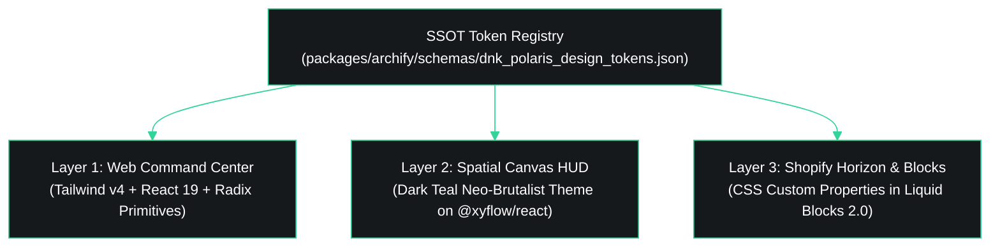

> [!metadata]- ⚙️ Системні метадані та інваріанти (MRH Header)
> ```yaml
> # --- DNK-MRH-HEADER ---
> mrh_id: "docs/architecture/adr/ADR-094-DNK-POLARIS-SPATIAL-DESIGN-SYSTEM.md"
> purpose: "Architecture Decision Record: Dual-Optics DNK Polaris-Spatial Design System (DPS-DS) uniting Shopify Polaris with Dark Teal Infinite Spatial Canvas."
> canonical_source: true
> alters_files: []
> triggers_tasks: []
> status: "Active"
> version: "2.0.0"
> updated_at: "2026-11-18"
> author: "DNK-e.com Maksym & Antigravity"
> # --- END DNK-MRH-HEADER ---
> ```

# 🏛️ ADR-094: DNK Polaris-Spatial Design System (DPS-DS)

## 📌 Context & Problem Statement
DNK OS operates across two fundamentally distinct visual environments:
1. **The Spatial Infinite Canvas (`apps/web`)**: A dark-mode, high-density, node-based workspace where humans and agents explore ideas, ThoughtDAGs, and TaskForests.
2. **The E-Commerce Front & Backoffice (`services/dnk_shopify`)**: Shopify Admin, Customizer Theme Blocks 2.0 (`blocks/*.liquid`), and high-converting storefronts governed by Shopify Polaris principles.

Previously, these two domains used conflicting UI primitives, causing design fragmentation, duplicate style maintenance, and cognitive friction for the founder (Vibecoder) and clients.

## 🎯 Decision: Dual-Optics Polaris-Spatial Architecture
We establish the **DNK Polaris-Spatial Design System (DPS-DS)** built on a 3-layer architecture:



### 1. Token SSOT
All color scales, typography scales, spatial spacing grids, elevation shadows, and motion timings are defined once in `packages/archify/schemas/dnk_polaris_design_tokens.json`.

### 2. Dual Themes
- **Canvas Spatial Theme (Dark Teal)**:
  - Background: `#091114` (Deep Abyssal Teal)
  - Surface: `#0f1d22`
  - Border: `#1e3842`
  - Accent / Focus: `#14b8a6` (Teal 500) & `#38bdf8` (Cyan 400)
  - Text Primary: `#f8fafc`
- **Shopify Polaris Parity (Light / High-Contrast E-Commerce)**:
  - Surface: `#ffffff`
  - Border: `#e1e3e5` (Polaris Border Subdued)
  - Interactive: `#008060` (Polaris Green) / `#005bd3` (Polaris Blue)
  - Text: `#202223` (Polaris Text Default)

### 3. Component Invariants
1. **Zero-Slop Rule**: Every component is backed by typed TypeScript props and JSON Schema contracts. No arbitrary inline style overrides.
2. **Decoupled Chat**: Real-time agent streaming chat components render exclusively inside the slide-out `GerychTaskChatDrawer`, keeping canvas node DOM footprints under 15 DOM nodes per card.
3. **Liquid Token Parity**: Every CSS Custom Property (`--dnk-p-*`) injected into Shopify themes shares the exact numeric tokens as the web canvas.

## 🛡️ Consequences & Verification
- **Positive**: Single design language for both vibe-coding canvas and merchant storefronts; 100% reusable design tokens; instant theme consistency.
- **Negative**: Requires maintaining token compilation pipelines (`scripts/system/compile_design_tokens.py`).
- **Verification Gate**: `pytest tests/unit/test_dnk_polaris_design_system.py` validates schema adherence and export completeness.
