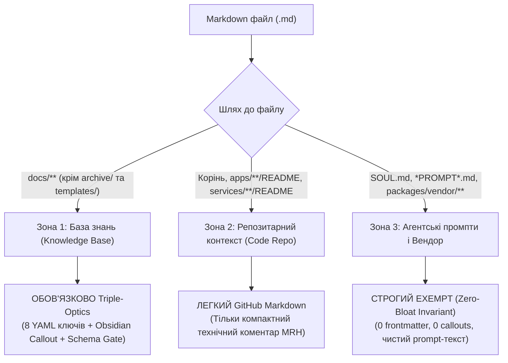

> [!metadata]- ⚙️ Системні метадані та інваріанти (MRH Header)
> ```yaml
> # --- DNK-MRH-HEADER ---
> mrh_id: "docs/architecture/adr/ADR-095-DOCUMENTATION-THREE-ZONE-TAXONOMY-AND-EXEMPTION-STANDARD.md"
> purpose: "Three-Zone Markdown Taxonomy, Exemption Standard, and Anti-Bloat Invariant for DNK OS."
> canonical_source: true
> alters_files: []
> triggers_tasks: []
> status: "Active"
> version: "2.0.0"
> updated_at: "2026-11-18"
> author: "DNK-e.com Maksym & Antigravity"
> # --- END DNK-MRH-HEADER ---
> ```

# 🏛️ ADR-095: Тризонна таксономія та правила винятків для Markdown документації

## 📋 1. Статус та Метадані
- **Поточний Статус**: `Accepted`
- **Дата Прийняття**: `2026-11-18`
- **Ініціатор / Автор**: `DNK-e.com Maksym & Antigravity`
- **Пов'язані Рішення**: `ADR-006` (Context Diet), `ADR-092` (Spatial Canvas), `DNK-STD-0075` (MRH Header).

---

## 🎯 2. Контекст та Проблематика (Context & Problem Statement)
Після впровадження стандарту **Triple-Optics** (FumaDocs YAML Frontmatter + Obsidian Metadata Callout) виникла небезпека сліпого насадження («Cargo Cult») важких веб-метаданих на всі без винятку Markdown-файли репозиторію.
Первинний тотальний аудит позначив 71 файл як «non-compliant» поза каталогом `docs/`. Серед них:
1. **Системні промпти агентів (`SOUL.md`)**: файли інструкцій, які напряму згодовуються в контекстне вікно LLM.
2. **Інженерні файли навігації GitHub (`README.md`, `AGENTS.md`)**: технічні описи підмодулів для браузера GitHub.
3. **Апстрім-бібліотеки та ліцензії (`packages/archify/`, `THIRD_PARTY_NOTICES.md`)**: сторонній код з фіксованими апстрім-структурами.

Насильне додавання 25 рядків YAML Frontmatter у `SOUL.md` порушує інваріант **Context Diet (DEC-146)**, спалює платні токени Gemini / Vertex AI та розмиває фокус моделі.

---

## ⚡ 3. Архітектурне Рішення (Architectural Decision)
Встановлюється сувора **Тризонна Таксономія Markdown-документів** у DNK OS:



### 3.1. Зона 1: База Знань (`docs/**`) — Обов'язковий Triple-Optics
- **Сфера дії**: Усі файли в `docs/` (ADR, специфікації, Task Specs, аудит-звіти, гайди, нотатки).
- **Вимоги**:
  1. Рядок 1: Валідний YAML Frontmatter (8 обов'язкових ключів: `title`, `description`, `mrh_id`, `status`, `archetype`, `version`, `updated`, `tags`).
  2. Відразу після Frontmatter (відступ <= 1 рядок): Згортний `> [!metadata]- ⚙️ Системні метадані...` без решіток `#` на властивостях.
  3. Відсутність абсолютних шляхів `/Users/...`.
  4. Проходження семантичних перевірок `markdown_schema_gate.py` (Anti-Scope, 3 Flaws, тощо).
- **Винятки всередині Зони 1**: Каталоги `docs/archive/` (заморожений архів) та `docs/templates/` (шаблони-каркаси).

### 3.2. Зона 2: Репозитарний Контекст (`README.md`, `AGENTS.md`) — Легкий Стандарт
- **Сфера дії**: Кореневий `README.md`, `AGENTS.md`, `apps/*/README.md`, `services/*/README.md`.
- **Призначення**: Навігація людини та агентів у GitHub веб-інтерфейсі та IDE.
- **Вимоги**:
  * Стандартний читабельний Markdown з заголовком H1.
  * Дозволяється компактний 3-рядковий коментар MRH:
    ```markdown
    <!-- mrh_id: "apps/web/README.md" -->
    ```
  * **ЗАБОРОНЕНО вимагати**: Веб-поля порталу `archetype`, `tags`, або обов'язковий Obsidian Callout.

### 3.3. Зона 3: Системні Промпти та Вендор — Строгий Zero-Bloat Exempt
- **Сфера дії**:
  * Системні промпти агентів: `**/SOUL.md`, `**/*PROMPT*.md`, `core/orchestrator/agents/**`.
  * Сторонні імпортовані пакети: `packages/archify/**`, `THIRD_PARTY_NOTICES.md`, `LICENSE.md`.
- **Інваріант**: **Zero-Bloat Invariant**. Будь-яке додавання Frontmatter або Obsidian Callouts у ці файли вважається порушенням гігієни контексту.
- **Вимоги**: Чистий текстовий промпт без сервісного сміття.

---

## ⚖️ 4. Наслідки, Компроміси та Ризики (Consequences, Trade-offs & Risks)

### Позитивні наслідки:
1. **0 спалених токенів**: Агенти завантажують `SOUL.md` без зайвих 200+ токенів метаданих на кожен системний запуск.
2. **0 хибних тривог**: Інструменти аудиту фокусуються лише на базі знань FumaDocs + Obsidian, показуючи чесні 100% відповідності реальної документації.
3. **Чистий Git Diff**: Апстрім-пакети не модифікуються штучними заголовками.

### Компроміси:
- Файли Зони 2 і Зони 3 не будуть індексуватися FumaDocs як окремі веб-сторінки бази знань (що є коректною поведінкою, оскільки їм там не місце).

---

## 🛡️ 5. Обов'язкова Дискусія: 3 Критичні Ризики (3 Flaws Rule)
1. **Ризик дрейфу формату в Зоні 2**: Якщо для `README.md` не вимагати суворого Frontmatter, розробники можуть забувати вказувати призначення модуля.  
   *Захист*: Перевірка наявності H1 заголовка та секції опису в `auto_precommit_guard.py`.
2. **Ризик плутанини між документацією та промптом**: Хтось може помістити гайд розробника у файл `SOUL.md`, щоб обійти аудит.  
   *Захист*: Файли `SOUL.md` дозволені виключно всередині `core/orchestrator/agents/`.
3. **Ризик випадкового потрапляння `docs/` файлів у винятки**:  
   *Захист*: Каталог `docs/` жорстко зафіксований як Зона 1 за замовчуванням. Жоден файл у `docs/` не може бути виключений без явної фіксації в `docs/archive/`.

---

## 🚧 6. Граничні Умови (Boundary Conditions)
* **Де правило ламається**: Якщо виникає необхідність опублікувати специфікацію системного промпта агента у публічній документації FumaDocs.
* **Рішення**: Створюється дзеркальний документ опису в `docs/architecture/specs/AGENT_PROMPT_SPEC.md` (Зона 1), який посилається на легкий вихідний файл `SOUL.md` (Зона 3).

---

## ✅ 7. Чек-лист Впровадження (Checklist)
- [x] Розробити та прийняти ADR-095.
- [x] Оновити логіку `scripts/system/dnk_md_triple_optics.py` з підтримкою правил винятків Зони 2 та Зони 3.
- [x] Оновити `scripts/system/audit_all_docs_compliance.py` для фільтрації зон.
- [x] Перегенерувати матрицю відповідності `docs/audit/DOCUMENTATION_COMPLIANCE_MATRIX.md`.
- [x] Підтвердити проходження `bash scripts/verify_all.sh` (Exit Code 0).
