> [!metadata]- ⚙️ Системні метадані та інваріанти (MRH Header)
> ```yaml
> # --- DNK-MRH-HEADER ---
> mrh_id: "docs/architecture/specs/01_CORE_AND_ACTION_BUS_SPEC.md"
> purpose: "Master Specification for DNK OS Microkernel, Agent Action Bus (AAB), FastMCP Plugin Protocol, and HITL Safety Gate."
> canonical_source: true
> alters_files: []
> triggers_tasks: ["TASK-CORE-KERNEL-001"]
> status: "Approved"
> version: "2.0.0"
> updated_at: "2026-09-24"
> author: "DNK-e.com Maksym & Antigravity"
> # --- END DNK-MRH-HEADER ---
> ```
> > [!summary] 📋 Контекст для ШІ-агента
> > Головний архітектурний контракт ядра DNK OS. Описує ультралегке мікроядро (`kernel.py`), асинхронну подієву шину дій (`action_bus/bus.py`) із SQLite WAL persistence, шлюз погодження руйнівних дій людиною (`hitl_bridge.py`) та протокол FastMCP для підключення доменних воркхорсів.

<!-- AGENT_INGESTION_DIRECTIVE: schema_version="2.3" parse_mode="dual_optics" task_extractor="auto" dag_sync="enabled" archetype="DEV_SPEC" -->

> [!abstract] 🧠 СПЕЦИФІКАЦІЯ МІКРОЯДРА, ШИНИ ДІЙ ТА FASTMCP ФАБРИКИ
> Цей документ формалізує центральну нервову систему **DNK OS**: ультралегке детерміноване мікроядро, асинхронну чергу дій на базі SQLite WAL, Human-in-the-Loop (HITL) шлюз для схвалення критичних операцій та безпечну ізоляцію інструментів через протокол FastMCP (JSON-RPC).

<div align="center" style="margin-bottom: 16px;">
  <span style="background-color: #1e293b; color: #38bdf8; padding: 4px 10px; border-radius: 9999px; font-size: 12px; font-weight: 600; border: 1px solid #0284c7;">Статус: Approved</span>
  <span style="background-color: #1e293b; color: #34d399; padding: 4px 10px; border-radius: 9999px; font-size: 12px; font-weight: 600; border: 1px solid #059669;">Домен: Core / Architecture</span>
  <span style="background-color: #1e293b; color: #c084fc; padding: 4px 10px; border-radius: 9999px; font-size: 12px; font-weight: 600; border: 1px solid #7c3aed;">Архетип: DEV_SPEC</span>
  <span style="background-color: #1e293b; color: #f43f5e; padding: 4px 10px; border-radius: 9999px; font-size: 12px; font-weight: 600; border: 1px solid #e11d48;">Версія: 2.0.0</span>
</div>

`Навігація`: [[00_MOC_DNK_OS|🗺️ Головний MOC DNK OS]] ➔ [[specs/|📁 Специфікації]] ➔ **[[specs/01_CORE_AND_ACTION_BUS_SPEC|01. Мікроядро та Шина Дій]]**

---

## 🎨 1. Візуальна Топологія (Mermaid Architecture SSOT)

```mermaid
%%{init: {
  'theme': 'base',
  'themeVariables': {
    'primaryColor': '#16191c',
    'primaryTextColor': '#ffffff',
    'primaryBorderColor': '#34d399',
    'lineColor': '#34d399',
    'secondaryColor': '#102219',
    'tertiaryColor': '#16191c',
    'tertiaryTextColor': '#ffffff',
    'titleColor': '#ffffff',
    'textColor': '#ffffff',
    'mainBkg': '#16191c',
    'nodeBorder': '#34d399',
    'clusterBkg': 'transparent',
    'clusterBorder': 'rgba(255, 255, 255, 0.16)',
    'edgeLabelBackground': '#102219',
    'fontSize': '13px'
  }
}}%%
flowchart LR
    K1["⚡ <b>Мікроядро (FastMCPKernel)</b><br/><small>• Диспетчеризація дій<br/>• DI контейнер сервісів</small>"]
    K2["🚌 <b>Agent Action Bus (AAB)</b><br/><small>• SQLite WAL черга<br/>• Ідемпотентні події</small>"]
    K3["🛡️ <b>HITL Approval Gate</b><br/><small>• Верифікація руйнівних дій<br/>• Ключ згоди Максима</small>"]
    K4["🔌 <b>FastMCP Fabric</b><br/><small>• stdio / SSE транспорт<br/>• 3 Робочі Конячки</small>"]

    U1["👤 <b>Вайбкодер / Засновник</b><br/><small>Миттєве схвалення • Огляд</small>"]
    U2["📊 <b>Аудит & Телеметрія</b><br/><small>Журнал дій • SpendGuard</small>"]

    %% Головна горизонтальна магістраль ядра:
    K1 ===>|"Асинхронний диспатч"| K2
    K2 ===>|"Критична операція"| K3
    K3 ===>|"Санкціонований запуск"| K4

    %% Людиноорієнтований зворотний зв'язок:
    K3 -->|"Запит на погодження"| U1
    U1 -->|"Підтвердження дії"| K3

    %% Фонова телеметрія:
    K2 -.->|"Append-Only лог"| U2
```

<!-- DAG_NODE: id="DAG-CORE-MERMAID-SSOT" title="Core & Action Bus Visual Topology" type="visual_spec" agent="gerych_builder" -->



---

## 🎯 2. Смисловий Контекст та UX (Рівень 1: Людина)

<!-- DAG_NODE: id="DAG-CORE-HUMAN-UX" title="Human Intent & Core UX" type="ux_standard" agent="gerych_builder" -->

### 2.1. Цільові Сценарії (User Stories)
- **Як Засновник (Максим)**, я хочу бути на 100% упевнений, що агент не може випадково видалити робочий простір чи зробити незворотні зміни без мого підтвердження через HITL-шлюз.
- **Як Вайбкодер**, я хочу запускати виконання складних задач в один клік, спостерігаючи за живим потоком подій у реальному часі через шину подій без підвисання UI.
- **Як Розробник Ядра**, я хочу мати модульне мікроядро без зайвих залежностей, де будь-яка зовнішня функція (Shopify, генерація медіа) підключається виключно як ізольований FastMCP плагін.

### 2.2. Ключові Архітектурні Принципи
1. **Ультралегке Ядро (Zero Monolith)**: Ядро не містить бізнес-логіки доменів. Воно відповідає виключно за маршрутизацію, безпеку та управління життєвим циклом дій.
2. **Асинхронна Ідемпотентна Шина (AAB)**: Будь-яка дія отримує UUID та зберігається у персистентній черзі SQLite з режимом Write-Ahead Logging (WAL). При перезапуску стан не втрачається.
3. **Дворівневий Шлюз Безпеки (HITL Invariant)**: Мутації файлів поза робочим простором, витрати бюджету та видалення даних вимагають обов'язкового сигналу згоди оператора.

---

## 🤖 3. Машинний Контракт, Системні Інваріанти та Межі (Рівень 2: Агент)

<!-- DAG_NODE: id="DAG-CORE-MACHINE-CONTRACT" title="Machine Contract & Invariants" type="agent_contract" agent="dnk_dev_fullstack" -->

### 3.1. Білий Список Цільових Файлів (Target File Whitelist)
| Шлях до файлу | Операція | Відповідальний агент | Призначення |
| :--- | :---: | :--- | :--- |
| `core/kernel.py` | `Create / Mutate` | `dnk_dev_fullstack` | Головна точка входу FastMCPKernel |
| `core/action_bus/bus.py` | `Create / Mutate` | `dnk_dev_fullstack` | Рушій AgentActionBus |
| `core/action_bus/hitl_bridge.py` | `Create / Mutate` | `dnk_dev_fullstack` | Шлюз Human-in-the-Loop |
| `core/action_bus/models.py` | `Create / Mutate` | `dnk_dev_fullstack` | Моделі подій та статусів задач |
| `core/action_bus/persistence.py` | `Create / Mutate` | `dnk_dev_fullstack` | Персистентність черги в SQLite WAL |
| `tests/unit/test_kernel.py` | `Create` | `gerych_auditor` | Модульні тести ядра та шини |

### 3.2. Негативний Скоуп та Заборони (Negative Scope / Anti-Scope)
- ❌ **Заборонено**: Вносити бізнес-логіку Shopify чи Media безпосередньо в `core/kernel.py` або `core/action_bus/`.
- ❌ **Заборонено**: Використовувати синхронні блокуючі виклики всередині Action Bus. Усі оператори діють через `asyncio`.
- ❌ **Заборонено**: Пропускати операції класу `CRITICAL` (видалення, деплой) в обхід `HitlApprovalBridge`.

### 3.3. Бюджет Інструментів та JIT Tooling
- **Дозволені інструменти**: `view_file`, `write_to_file`, `replace_file_content`, `run_command`.
- **Ліміт токенів сесії**: Standing context ≤ 6,000 токенів; робоче вікно ≤ 40,000 токенів.

---

## ⚡ 4. MASE Розробка та Верифікація (Рівень 3: Розробка)

<!-- DAG_NODE: id="DAG-CORE-MASE-VERIFICATION" title="MASE Slices & Acceptance" type="dev_standard" agent="gerych_auditor" -->

### 4.1. Атомарні Зрізи (Atomic Slices ≤ 25 дій per Slice)
- **Slice 1 (Контракти та Моделі Подій)**: Реалізація `models.py` та Pydantic-схем подій `BusEvent`, `ActionTask`.
- **Slice 2 (Action Bus & Персистентність)**: Реалізація `bus.py`, `persistence.py` з WAL-режимом та перевірка черги подій.
- **Slice 3 (HITL Bridge & Kernel Integration)**: Інтеграція `hitl_bridge.py` та фінальна збірка `kernel.py`.

### 4.2. Детермінована Матриця Приймання (Deterministic Acceptance Matrix)
| ID | Крок / Дія (CHECK) | Очікуваний результат (EXPECT) | Доказ виконання (EVIDENCE) |
| :---: | :--- | :--- | :--- |
| **GATE-01** | `python3 scripts/system/markdown_schema_gate.py --file "specs/01_CORE_AND_ACTION_BUS_SPEC.md"` | Валідний MRH, нуль заборонених токенів | `exit code 0` |
| **GATE-02** | `pytest tests/unit/test_kernel.py -v` | Усі тести шини дій та HITL шлюзу пройдені | `X passed, 0 failed, exit code 0` |
| **GATE-03** | Тест збереження черги при раптовому збої процесу | Події коректно вичитуються з SQLite WAL після рестарту | `assert len(recovered_events) == N` |

---

## 🌳 5. Граф Задач Task Forest (Рівень 4: Система)

<!-- DAG_NODE: id="DAG-CORE-TASK-FOREST" title="Task Forest DAG" type="task_spec" agent="gerych_prime" -->

- [ ] `[ ]` **TASK-CORE-01-01**: Створення та перевірка моделей `BusEvent` і `ActionTask` у `core/action_bus/models.py`
- [ ] `[ ]` **TASK-CORE-01-02**: Перенесення та очищення `bus.py` і `persistence.py` у `core/action_bus/`
- [ ] `[ ]` **TASK-CORE-01-03**: Налаштування `hitl_bridge.py` для блокування критичних операцій
- [ ] `[ ]` **TASK-CORE-01-04**: Реалізація компактного `core/kernel.py`
- [ ] `[ ]` **TASK-CORE-01-05**: Написання модульних тестів у `tests/unit/test_kernel.py` та верифікація через Exit Code 0

---

## 🔗 6. Навігаційний Граф Знань (Wikilinks Network)

- Вхідна точка: [[00_MOC_DNK_OS|🗺️ Головний MOC DNK OS]]
- Пов'язані специфікації:
  - [[specs/02_USER_IDENTITY_AND_SOUL_SPEC|02. Ідентичність Користувача, User Soul та Brand DNA]]
  - [[specs/03_MEMORY_SCONES_SPEC|03. 3-Рівнева Когнітивна Пам'ять SCONES]]
  - [[specs/04_THOUGHT_TO_PLAN_PIPELINE_SPEC|04. Пайплайн Думок: ThoughtDSL ➔ ThoughtDAG ➔ Task Forest]]
  - [[specs/05_SPATIAL_UI_AND_CANVAS_SPEC|05. Просторова Оболонка, Canvas та Інтерфейс]]
