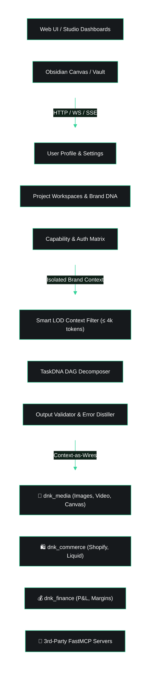
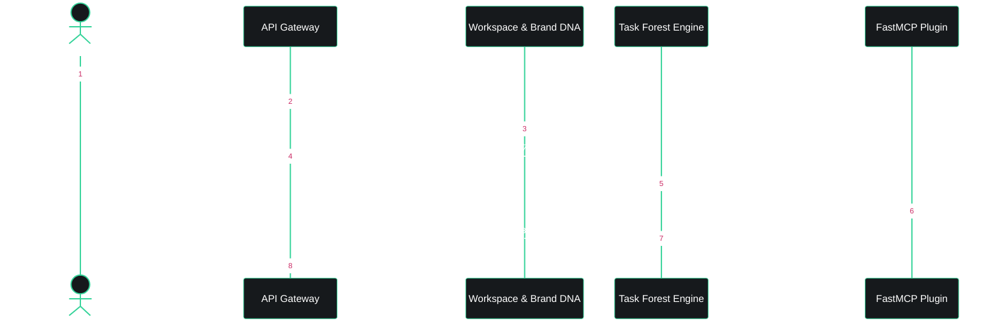

> [!metadata]- ⚙️ Системні метадані та інваріанти (MRH Header)
> ```yaml
> # --- DNK-MRH-HEADER ---
> # mrh_id: "docs/architecture/specs/01_CORE_ARCHITECTURE_SPEC.md"
> # purpose: "Master Architecture Specification for DNK OS Standalone Agentic Application."
> # canonical_source: true
> # alters_files: []
> # triggers_tasks: []
> # status: "Active"
> # version: "1.1.0"
> # updated_at: "2026-09-19"
> # author: "DNK-e.com Maksym & Gerych Prime"
> # --- END DNK-MRH-HEADER ---
> ```

> [!abstract] 🧠 МАЙСТЕР-СПЕЦИФІКАЦІЯ ЯДРА ТА СИСТЕМИ ПЛАГІНІВ
> DNK OS — це модульна агентивна операційна система для підприємців і творців. Система забезпечує реєстрацію користувача, налаштування Brand DNA у виділених робочих просторах та автономне виконання задач через інтелектуальне ядро та плагіни FastMCP.

<div align="center" style="margin-bottom: 16px;">
  <span style="background-color: #1e293b; color: #38bdf8; padding: 4px 10px; border-radius: 9999px; font-size: 12px; font-weight: 600; border: 1px solid #0284c7;">Домен: Core Architecture</span>
  <span style="background-color: #1e293b; color: #34d399; padding: 4px 10px; border-radius: 9999px; font-size: 12px; font-weight: 600; border: 1px solid #059669;">Статус: Active</span>
  <span style="background-color: #1e293b; color: #c084fc; padding: 4px 10px; border-radius: 9999px; font-size: 12px; font-weight: 600; border: 1px solid #7c3aed;">Оптика: Dual-Lens</span>
  <span style="background-color: #1e293b; color: #f59e0b; padding: 4px 10px; border-radius: 9999px; font-size: 12px; font-weight: 600; border: 1px solid #d97706;">Специфікація: 01</span>
</div>

`Навігація`: [[00_MOC_DNK_OS|🗺️ Головний MOC DNK OS]] ➔ [[docs/architecture/ARCHITECTURE_MAP|Карта Архітектури]] ➔ **01. Архітектура Ядра**

---

# 🧠 DNK OS MVP: Master Architecture & Plugin-Core Specification



---

## 🎯 1. Концепція та Мета
**DNK OS** — це швидка, модульна агентивна операційна система для підприємців і творців.
Користувач реєструється, описує себе, створює ізольовані проекти, наповнює їх матеріалами (Brand DNA, контекст, стиль, активи) та керує роботою через **Розумне Ядро**, яке підключає спеціалізовані плагіни (візуал, фінанси, дистрибуція, аналітика) для автономного виконання задач.

---

## 🏛️ 2. Ключові Модулі Ядра (Core Subsystems)

| Підсистема | Роль та Обов'язки | Ключові Інваріанти |
| :--- | :--- | :--- |
| **Identity & Workspaces** | Профілі користувача, ізоляція проектів, збереження Brand DNA та реєстр активів. | Повний Air-Gap між проектами ([[docs/adr/ADR-003-workspace-isolation-and-brand-dna|ADR-003]]). |
| **Context Router** | Вибірка мінімально необхідного контексту для воркерів (LOD Context Filtering). | Розмір вхідного зрізу ≤ 4,000 токенів. |
| **Task Forest DAG** | Топологічна декомпозиція задач та паралельне виконання мікро-воркерами. | Вузли графа передають контекст по дротах ([[docs/adr/ADR-002-task-forest-dag-execution|ADR-002]]). |
| **FastMCP Fabric** | Стандартизована шина підключення зовнішніх модулів та доменних агентів. | Відкритий протокол JSON-RPC FastMCP ([[docs/adr/ADR-001-microkernel-fastmcp-architecture|ADR-001]]). |

---

## 🔄 3. Життєвий Цикл Виконання Задачі (Execution Lifecycle)



---

## 🔗 4. Пов'язані Специфікації та Документи
- [[specs/02_USER_IDENTITY_AND_SOUL_SPEC|02. Профіль, Простори та Brand DNA]]
- [[specs/01_CORE_AND_ACTION_BUS_SPEC|03. Фабрика Плагінів FastMCP]]
- [[specs/04_THOUGHT_TO_PLAN_PIPELINE_SPEC|04. Task Forest DAG Engine]]
- [[specs/01_CORE_AND_ACTION_BUS_SPEC|05. Контракти API Gateway]]

---

`Див. також`: [[00_MOC_DNK_OS|🗺️ Головний MOC DNK OS]] | [[docs/architecture/ARCHITECTURE_MAP|Карта Архітектури]] | [[context/SYSTEM_INVARIANTS|Системні Інваріанти]]
