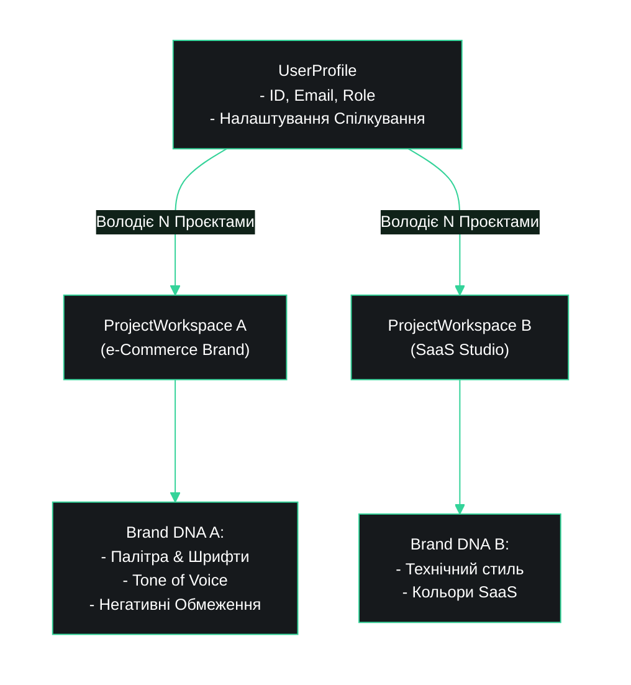

> [!metadata]- ⚙️ Системні метадані та інваріанти (MRH Header)
> ```yaml
> # --- DNK-MRH-HEADER ---
> # mrh_id: "docs/architecture/specs/02_IDENTITY_AND_PROJECTS_SPEC.md"
> # purpose: "Specification for User Identity, Project Workspaces, and Brand DNA in DNK OS."
> # canonical_source: true
> # alters_files: []
> # triggers_tasks: []
> # status: "Active"
> # version: "1.1.0"
> # updated_at: "2026-09-19"
> # author: "DNK-e.com Maksym & Gerych Prime"
> # --- END DNK-MRH-HEADER ---
> ```

> [!abstract] 👤 СПЕЦИФІКАЦІЯ ІДЕНТИЧНОСТІ ТА РОБОЧИХ ПРОСТОРІВ
> Цей документ формалізує контракти даних профілю користувача (`UserProfile`), схему ізоляції робочих просторів (`ProjectWorkspace`) та структуру маніфесту `Brand DNA`.

<div align="center" style="margin-bottom: 16px;">
  <span style="background-color: #1e293b; color: #38bdf8; padding: 4px 10px; border-radius: 9999px; font-size: 12px; font-weight: 600; border: 1px solid #0284c7;">Домен: Identity & Data</span>
  <span style="background-color: #1e293b; color: #34d399; padding: 4px 10px; border-radius: 9999px; font-size: 12px; font-weight: 600; border: 1px solid #059669;">Статус: Active</span>
  <span style="background-color: #1e293b; color: #c084fc; padding: 4px 10px; border-radius: 9999px; font-size: 12px; font-weight: 600; border: 1px solid #7c3aed;">Оптика: Dual-Lens</span>
  <span style="background-color: #1e293b; color: #f59e0b; padding: 4px 10px; border-radius: 9999px; font-size: 12px; font-weight: 600; border: 1px solid #d97706;">Специфікація: 02</span>
</div>

`Навігація`: [[00_MOC_DNK_OS|🗺️ Головний MOC DNK OS]] ➔ [[specs/01_CORE_AND_ACTION_BUS_SPEC|01. Архітектура Ядра]] ➔ **02. Ідентичність та Простори**

---

# 👤 Identity & Project Workspaces Specification



---

## 📋 1. Схема Користувача (`UserProfile`)

```json
{
  "user_id": "usr_99a8b7c6",
  "email": "creator@dnk-e.com",
  "name": "Maksym",
  "locale": "uk-UA",
  "default_llm_provider": "vertex/gemini-2.5-pro",
  "system_role": "Founder / Creative Director",
  "communication_style": {
    "conciseness": 0.85,
    "tone": "direct_technical",
    "language": "uk"
  },
  "created_at": "2026-09-18T10:00:00Z"
}
```

---

## 🏢 2. Схема Робочого Простору (`ProjectWorkspace`)

> [!tip] Ізоляція Контексту (Air-Gap)
> Кожен проект зберігається у виділеній теці з власною базою активів. Доступ агентів до активів сусіднього простору блокується згідно з [[docs/adr/ADR-003-workspace-isolation-and-brand-dna|ADR-003]].

```json
{
  "project_id": "prj_fashion_brand_01",
  "owner_id": "usr_99a8b7c6",
  "title": "DNK Minimal Wear",
  "slug": "dnk-minimal-wear",
  "description": "Преміальний мінімалістичний одяг для креаторів",
  "brand_dna": {
    "mission": "Мінімалізм, технологічність, функціональність",
    "target_audience": "Підприємці, дизайнери, 22-38 років",
    "visual_style": {
      "palette": ["#0F172A", "#F8FAFC", "#38BDF8"],
      "typography": "Inter / JetBrains Mono",
      "moodboard_tags": ["cyberpunk", "clean", "nordic", "monochrome"]
    },
    "tone_of_voice": "Bold, minimalistic, precise",
    "negative_constraints": ["No bright rainbow colors", "No cheap emojis", "No comic sans"]
  },
  "assets_manifest": [
    {"id": "ast_01", "type": "logo_svg", "path": "assets/logo.svg"},
    {"id": "ast_02", "type": "catalog_csv", "path": "assets/inventory_q3.csv"}
  ],
  "enabled_plugins": ["dnk_media", "dnk_finance", "dnk_commerce"],
  "updated_at": "2026-09-18T12:00:00Z"
}
```

---

## 🎯 3. Принцип Рівнів Деталізації (LOD Context Slicing)
При передачі контексту агентам підсистема `Context Router` фільтрує об'єкт `ProjectWorkspace`:
- **Для генерації копірайтингу/тексту**: передається тільки `brand_dna.tone_of_voice` та `mission`.
- **Для генерації зображень**: передається `brand_dna.visual_style` та `negative_constraints`.
- **Гарантія бюджету**: розмір вхідного промпту ніколи не перевищує **1,500 токенів**.

---

`Див. також`: [[specs/01_CORE_AND_ACTION_BUS_SPEC|01. Архітектура Ядра]] | [[docs/adr/ADR-003-workspace-isolation-and-brand-dna|ADR-003: Workspace Isolation]] | [[00_MOC_DNK_OS|Головний MOC]]
