> [!metadata]- ⚙️ Системні метадані та інваріанти (MRH Header)
> ```yaml
> # --- DNK-MRH-HEADER ---
> mrh_id: "docs/architecture/specs/02_USER_IDENTITY_AND_SOUL_SPEC.md"
> purpose: "Canonical Specification for User Profile, User SOUL Prompt Hydration, Brand DNA, and Pydantic v2 Domain Models."
> canonical_source: true
> alters_files: []
> triggers_tasks: ["TASK-CORE-IDENTITY-001"]
> status: "Approved"
> version: "2.0.0"
> updated_at: "2026-09-24"
> author: "DNK-e.com Maksym & Antigravity"
> # --- END DNK-MRH-HEADER ---
> ```
> > [!summary] 📋 Контекст для ШІ-агента
> > Контракт представлення людини у системі DNK OS. Описує профіль засновника (`UserProfile`), механізм гідратації персони вайбкодера (`UserSOUL`), маніфест естетики та обмежень бренду (`BrandDNA`) та ізольовані робочі простори (`ProjectWorkspace`). Фізичне втілення: `core/domain/identity_models.py`.

<!-- AGENT_INGESTION_DIRECTIVE: schema_version="2.3" parse_mode="dual_optics" task_extractor="auto" dag_sync="enabled" archetype="DEV_SPEC" -->

> [!abstract] 👤 СПЕЦИФІКАЦІЯ ІДЕНТИЧНОСТІ, ДУШІ КОРИСТУВАЧА ТА BRAND DNA
> DNK OS створюється навколо принципу: **«Людина — Ідеї та Естетика, Агенти — Виконавці»**. Цей документ визначає, як система пам'ятає стиль мислення засновника (User Soul), як забезпечується ізоляція проектів (Workspaces) та як інваріанти бренду (Brand DNA) транслюються у строгі Pydantic v2 DTO для агентів.

<div align="center" style="margin-bottom: 16px;">
  <span style="background-color: #1e293b; color: #38bdf8; padding: 4px 10px; border-radius: 9999px; font-size: 12px; font-weight: 600; border: 1px solid #0284c7;">Статус: Approved</span>
  <span style="background-color: #1e293b; color: #34d399; padding: 4px 10px; border-radius: 9999px; font-size: 12px; font-weight: 600; border: 1px solid #059669;">Домен: Core / Identity</span>
  <span style="background-color: #1e293b; color: #c084fc; padding: 4px 10px; border-radius: 9999px; font-size: 12px; font-weight: 600; border: 1px solid #7c3aed;">Архетип: DEV_SPEC</span>
  <span style="background-color: #1e293b; color: #f43f5e; padding: 4px 10px; border-radius: 9999px; font-size: 12px; font-weight: 600; border: 1px solid #e11d48;">Версія: 2.0.0</span>
</div>

`Навігація`: [[00_MOC_DNK_OS|🗺️ Головний MOC DNK OS]] ➔ [[specs/|📁 Специфікації]] ➔ **[[specs/02_USER_IDENTITY_AND_SOUL_SPEC|02. Ідентичність та Душа Користувача]]**

---

## 🎨 1. Візуальна Топологія (Mermaid Architecture SSOT)

```mermaid
%%{init: {
  'theme': 'base',
  'themeVariables': {
    'primaryColor': '#16191c',
    'primaryTextColor': '#ffffff',
    'primaryBorderColor': '#34d399',
    'lineColor': '#34d399',
    'secondaryColor': '#102219',
    'tertiaryColor': '#16191c',
    'tertiaryTextColor': '#ffffff',
    'titleColor': '#ffffff',
    'textColor': '#ffffff',
    'mainBkg': '#16191c',
    'nodeBorder': '#34d399',
    'clusterBkg': 'transparent',
    'clusterBorder': 'rgba(255, 255, 255, 0.16)',
    'edgeLabelBackground': '#102219',
    'fontSize': '13px'
  }
}}%%
flowchart LR
    I1["👤 <b>UserProfile & SOUL</b><br/><small>• Максим (Засновник)<br/>• Стиль спілкування та мова</small>"]
    I2["🏢 <b>ProjectWorkspace (Air-Gap)</b><br/><small>• Ізоляція файлів і контексту<br/>• Відносні шляхи ./</small>"]
    I3["🎨 <b>Brand DNA Manifest</b><br/><small>• Палітра, типографіка, тон<br/>• Negative Constraints</small>"]
    I4["🧬 <b>Pydantic v2 DTOs</b><br/><small>• identity_models.py<br/>• Строга валідація схем</small>"]

    U1["🧑‍💻 <b>Вайбкодер-Інтерфейс</b><br/><small>Obsidian SoulHUD • Налаштування</small>"]
    U2["🤖 <b>Swarm Workers Context</b><br/><small>LOD зрізи (Copy / Visual / Minimal)</small>"]

    %% Головна магістраль інжекції ідентичності:
    I1 ===>|"Вибір проекту"| I2
    I2 ===>|"Завантаження ДНК"| I3
    I3 ===>|"Типізація контракту"| I4

    %% Прямий зв'язок із користувачем:
    I1 -->|"Персоналізація діалогу"| U1

    %% Фонова інжекція контексту рою:
    I4 -.->|"Hydrate System Prompt"| U2
```

<!-- DAG_NODE: id="DAG-IDENTITY-MERMAID-SSOT" title="Identity & User Soul Visual Topology" type="visual_spec" agent="gerych_builder" -->



---

## 🎯 2. Смисловий Контекст та UX (Рівень 1: Людина)

<!-- DAG_NODE: id="DAG-IDENTITY-HUMAN-UX" title="Human Intent & Persona UX" type="ux_standard" agent="gerych_builder" -->

### 2.1. Цільові Сценарії (User Stories)
- **Як Засновник (Максим)**, я хочу, щоб кожен агент у системі знав мої вподобання (українська мова діалогу, технічна стислість без лестощів, чисті відносні шляхи) автоматично через `UserSOUL`.
- **Як Власник кількох Брендів**, я хочу відкривати окремий `ProjectWorkspace` (наприклад, Verdo чи інший магазин) і бути певним, що Brand DNA та активи одного бренду ніколи не змішаються з іншим.
- **Як Креатор**, я хочу задавати колірну палітру, тон комунікації та заборонені елементи у Brand DNA, а агент має бездоганно дотримуватися цих рамок у всіх генерованих артефактах.

### 2.2. Ключові Архітектурні Принципи
1. **Zero Contamination (Air-Gap Workspaces)**: Кожен проект живе у власній піддиректорії зі своїм маніфестом активів. Перехресне забруднення пам'яті суворо заборонено.
2. **User SOUL як Системна Ін'єкція**: Персона засновника та правила спілкування автоматично підмішуються у кожен системний промпт через `core/orchestrator/user_soul.py`.
3. **Строга Типізація Pydantic v2**: Будь-які конфігурації профілю чи бренду валідуються на стадії ініціалізації (валідація hex-кольорів, валідація відносних шляхів, захист від directory traversal `..`).

---

## 🤖 3. Машинний Контракт, Системні Інваріанти та Межі (Рівень 2: Агент)

<!-- DAG_NODE: id="DAG-IDENTITY-MACHINE-CONTRACT" title="Machine Contract & Pydantic Schemas" type="agent_contract" agent="dnk_dev_fullstack" -->

### 3.1. Білий Список Цільових Файлів (Target File Whitelist)
| Шлях до файлу | Операція | Відповідальний агент | Призначення |
| :--- | :---: | :--- | :--- |
| `core/domain/identity_models.py` | `Create / Mutate` | `dnk_dev_fullstack` | Канонічні Pydantic v2 схеми (UserProfile, BrandDNA) |
| `core/orchestrator/user_soul.py` | `Create / Mutate` | `dnk_dev_fullstack` | Модуль гідратації персони вайбкодера |
| `tests/unit/test_identity_models.py` | `Create` | `gerych_auditor` | Тести валідації ідентичності та Brand DNA |

### 3.2. Канонічні Моделі Pydantic v2 (Physical Schema)
```python
class CommunicationStyle(BaseModel):
    model_config = ConfigDict(frozen=True, extra="forbid")
    conciseness: float = Field(default=0.85, ge=0.0, le=1.0)
    tone: str = Field(default="direct_technical")
    language: str = Field(default="uk")

class UserProfile(BaseModel):
    model_config = ConfigDict(extra="forbid")
    user_id: str = Field(..., pattern=r"^usr_[a-zA-Z0-9_\-]+$")
    email: EmailStr
    name: str = Field(..., min_length=1)
    locale: str = Field(default="uk-UA")
    communication_style: CommunicationStyle = Field(default_factory=CommunicationStyle)

class BrandDNA(BaseModel):
    model_config = ConfigDict(extra="forbid")
    mission: str = Field(..., min_length=1)
    target_audience: str = Field(..., min_length=1)
    visual_style: VisualStyle
    tone_of_voice: str = Field(..., min_length=1)
    negative_constraints: List[str] = Field(default_factory=list)
```

### 3.3. Негативний Скоуп та Заборони
- ❌ **Заборонено**: Дозволяти абсолютні шляхи у `ProjectWorkspace.root_directory` (лише валідовані відносні шляхи).
- ❌ **Заборонено**: Пропускати інвалідацію hex-кольорів у Brand DNA палітрі (має відповідати `^#(?:[0-9a-fA-F]{3,8})$`).
- ❌ **Заборонено**: Дозволяти `extra="allow"` у моделях ідентичності — лише `extra="forbid"`.

---

## ⚡ 4. MASE Розробка та Верифікація (Рівень 3: Розробка)

<!-- DAG_NODE: id="DAG-IDENTITY-MASE-VERIFICATION" title="MASE Slices & Acceptance" type="dev_standard" agent="gerych_auditor" -->

### 4.1. Атомарні Зрізи (Atomic Slices ≤ 25 дій per Slice)
- **Slice 1 (Pydantic Валідатори)**: Створення `identity_models.py` з усіма перевірками безпеки та тестами.
- **Slice 2 (User SOUL Модуль)**: Інтеграція `core/orchestrator/user_soul.py` із підтримкою мовного протоколу (🇺🇦 / 🇬🇧).
- **Slice 3 (LOD Екстракція для Brand DNA)**: Реалізація методу `extract_lod_slice()` для економії токенів воркерів.

### 4.2. Детермінована Матриця Приймання (Deterministic Acceptance Matrix)
| ID | Крок / Дія (CHECK) | Очікуваний результат (EXPECT) | Доказ виконання (EVIDENCE) |
| :---: | :--- | :--- | :--- |
| **GATE-01** | `python3 scripts/system/markdown_schema_gate.py --file "specs/02_USER_IDENTITY_AND_SOUL_SPEC.md"` | 0 порушень схеми, коректні MRH метадані | `exit code 0` |
| **GATE-02** | `pytest tests/unit/test_identity_models.py -v` | Валідація hex-кольорів, relative paths, forbidden extra fields | `X passed, 0 failed, exit code 0` |
| **GATE-03** | Спроба передати абсолютний шлях `[workspace_root]/...` | Pydantic викидає `ValueError: Absolute paths are forbidden` | `pytest.raises(ValueError)` |

---

## 🌳 5. Граф Задач Task Forest (Рівень 4: Система)

<!-- DAG_NODE: id="DAG-IDENTITY-TASK-FOREST" title="Task Forest DAG" type="task_spec" agent="gerych_prime" -->

- [ ] `[ ]` **TASK-CORE-02-01**: Перенесення `identity_models.py` у `core/domain/` з підтримкою Pydantic v2
- [ ] `[ ]` **TASK-CORE-02-02**: Оновлення `core/orchestrator/user_soul.py` під протокол анти-сикофантії
- [ ] `[ ]` **TASK-CORE-02-03**: Реалізація тестів валідації шляхів та бренд-палітри в `tests/unit/test_identity_models.py`

---

## 🔗 6. Навігаційний Граф Знань (Wikilinks Network)

- Вхідна точка: [[00_MOC_DNK_OS|🗺️ Головний MOC DNK OS]]
- Пов'язані специфікації:
  - [[specs/01_CORE_AND_ACTION_BUS_SPEC|01. Мікроядро та Шина Дій]]
  - [[specs/03_MEMORY_SCONES_SPEC|03. 3-Рівнева Когнітивна Пам'ять SCONES]]
  - [[specs/04_THOUGHT_TO_PLAN_PIPELINE_SPEC|04. Пайплайн Думок: ThoughtDSL ➔ ThoughtDAG ➔ Task Forest]]
  - [[specs/05_SPATIAL_UI_AND_CANVAS_SPEC|05. Просторова Оболонка, Canvas та Інтерфейс]]
