> [!metadata]- ⚙️ Системні метадані та інваріанти (MRH Header)
> ```yaml
> # --- DNK-MRH-HEADER ---
> mrh_id: "docs/architecture/specs/03_MEMORY_SCONES_SPEC.md"
> purpose: "Master Specification for DNK OS 3-Tier Cognitive Memory Substrate (SCONES L1 Working, L2 Semantic Vector, L3 Relational Graph)."
> canonical_source: true
> alters_files: []
> triggers_tasks: ["TASK-CORE-MEMORY-001"]
> status: "Approved"
> version: "2.0.0"
> updated_at: "2026-09-24"
> author: "DNK-e.com Maksym & Antigravity"
> # --- END DNK-MRH-HEADER ---
> ```
> > [!summary] 📋 Контекст для ШІ-агента
> > Специфікація трирівневої когнітивної пам'яті DNK OS. Регламентує контекстну дієту L1 (≤ 20k токенів), векторний пошук рішень L2 (`sqlite-vec` / `pgvector`), реляційний граф знань L3 та 4-фазний протокол захисту від отруєння пам'яті (Anti-Poisoning Gate).

<!-- AGENT_INGESTION_DIRECTIVE: schema_version="2.3" parse_mode="dual_optics" task_extractor="auto" dag_sync="enabled" archetype="DEV_SPEC" -->

> [!abstract] 🧠 СПЕЦИФІКАЦІЯ 3-РІВНЕВОЇ КОГНІТИВНОЇ ПАМ'ЯТІ SCONES
> Система DNK OS використовує гібридну архітектуру довгострокової та робочої пам'яті. Це запобігає «галюцинаціям розмитої уваги» великих LLM і гарантує, що набутий інженерний та бізнес-досвід надійно зберігається у вигляді графів знань і перевірених векторних патернів.

<div align="center" style="margin-bottom: 16px;">
  <span style="background-color: #1e293b; color: #38bdf8; padding: 4px 10px; border-radius: 9999px; font-size: 12px; font-weight: 600; border: 1px solid #0284c7;">Статус: Approved</span>
  <span style="background-color: #1e293b; color: #34d399; padding: 4px 10px; border-radius: 9999px; font-size: 12px; font-weight: 600; border: 1px solid #059669;">Домен: Core / Memory</span>
  <span style="background-color: #1e293b; color: #c084fc; padding: 4px 10px; border-radius: 9999px; font-size: 12px; font-weight: 600; border: 1px solid #7c3aed;">Архетип: DEV_SPEC</span>
  <span style="background-color: #1e293b; color: #f43f5e; padding: 4px 10px; border-radius: 9999px; font-size: 12px; font-weight: 600; border: 1px solid #e11d48;">Версія: 2.0.0</span>
</div>

`Навігація`: [[00_MOC_DNK_OS|🗺️ Головний MOC DNK OS]] ➔ [[specs/|📁 Специфікації]] ➔ **[[specs/03_MEMORY_SCONES_SPEC|03. 3-Рівнева Когнітивна Пам'ять SCONES]]**

---

## 🎨 1. Візуальна Топологія (Mermaid Architecture SSOT)

```mermaid
%%{init: {
  'theme': 'base',
  'themeVariables': {
    'primaryColor': '#16191c',
    'primaryTextColor': '#ffffff',
    'primaryBorderColor': '#34d399',
    'lineColor': '#34d399',
    'secondaryColor': '#102219',
    'tertiaryColor': '#16191c',
    'tertiaryTextColor': '#ffffff',
    'titleColor': '#ffffff',
    'textColor': '#ffffff',
    'mainBkg': '#16191c',
    'nodeBorder': '#34d399',
    'clusterBkg': 'transparent',
    'clusterBorder': 'rgba(255, 255, 255, 0.16)',
    'edgeLabelBackground': '#102219',
    'fontSize': '13px'
  }
}}%%
flowchart LR
    M1["⚡ <b>L1: Working Context</b><br/><small>• Context Diet (≤ 20k tokens)<br/>• Зрізи view_file(Start, End)</small>"]
    M2["🔍 <b>L2: Semantic Vector</b><br/><small>• sqlite-vec / pgvector<br/>• Пошук помилок та рішень</small>"]
    M3["🏛️ <b>L3: Relational Graph</b><br/><small>• Трійки Сутність-Зв'язок<br/>• Brand DNA та онтологія</small>"]
    M4["🛡️ <b>Anti-Poisoning Gate</b><br/><small>• 4-фазний аудит інжекцій<br/>• Шлюз бібліотекаря</small>"]

    U1["🤖 <b>Swarm Agent Runtime</b><br/><small>JIT-підкачка релевантних фактів</small>"]
    U2["💾 <b>Unified Memory Broker</b><br/><small>Єдина точка виклику SCONES</small>"]

    %% Головна магістраль пам'яті:
    M1 ===>|"Кешування ембеддінгів"| M2
    M2 ===>|"Семантичний зв'язок"| M3
    M3 ===>|"Аудит фактів перед записом"| M4

    %% Прямий зв'язок із рантаймом агента:
    U1 <-->|"Дієтичний запит"| U2
    U2 <-->|"JIT Ін'єкція фактів"| M1

    %% Фоновий захист бази знань:
    M4 -.->|"Верифіковані факти"| M3
```

<!-- DAG_NODE: id="DAG-MEMORY-MERMAID-SSOT" title="SCONES Memory Visual Topology" type="visual_spec" agent="gerych_builder" -->



---

## 🎯 2. Смисловий Контекст та UX (Рівень 1: Людина)

<!-- DAG_NODE: id="DAG-MEMORY-HUMAN-UX" title="Human Intent & Memory UX" type="ux_standard" agent="gerych_builder" -->

### 2.1. Цільові Сценарії (User Stories)
- **Як Засновник (Максим)**, я хочу бути певним, що якщо ми один раз розібрали складний баг або виробили успішне дизайн-рішення, система збереже його в `SCONES L2/L3` і наступного разу агент застосує його миттєво без повторного циклу спроб і помилок.
- **Як Вайбкодер**, я не хочу вручну нагадувати агенту структуру проекту чи колірні коди бренду — пам'ять має підтягувати потрібний фрагмент контексту «на льоту» (JIT Context Diet).
- **Як Архітектор**, я вимагаю, щоб агенти не мали права прямого неконтрольованого запису у довгострокову пам'ять без фільтрації (захист від зациклення та галюцинацій).

### 2.2. Ключові Архітектурні Принципи
1. **Контекстна Дієта (Context Diet Invariant)**: Агент працює на зрізах файлів (`view_file(StartLine, EndLine)`). Робоче вікно утримується до ≤ 20,000 токенів для максимальної фокусованості моделі.
2. **Анти-Отруєння Пам'яті (Anti-Poisoning Gated Ingestion)**: Будь-який факт проходить ланцюг: `RESEARCH_RAW` ➔ `AUDIT_GATE` ➔ `FOUNDER_APPROVAL` ➔ `LIBRARIAN_INGEST`.
3. **Локальна Автономність**: Базовий векторний пошук підтримує вбудований бекенд (`sqlite-vec`), не вимагаючи обов'язкового зовнішнього важкого кластера для локальної розробки.

---

## 🤖 3. Машинний Контракт, Системні Інваріанти та Межі (Рівень 2: Агент)

<!-- DAG_NODE: id="DAG-MEMORY-MACHINE-CONTRACT" title="Machine Contract & SCONES Architecture" type="agent_contract" agent="dnk_dev_fullstack" -->

### 3.1. Білий Список Цільових Файлів (Target File Whitelist)
| Шлях до файлу | Операція | Відповідальний агент | Призначення |
| :--- | :---: | :--- | :--- |
| `core/memory/scones_memory.py` | `Create / Mutate` | `dnk_dev_fullstack` | Рушій пам'яті SCONES (L1/L2) |
| `core/memory/unified_memory_broker.py` | `Create / Mutate` | `dnk_dev_fullstack` | Фасад доступу UnifiedMemoryBroker |
| `core/memory/scones_l3_memory.py` | `Create / Mutate` | `dnk_dev_fullstack` | Графовий рушій сутностей і зв'язків |
| `tests/unit/test_scones_memory.py` | `Create` | `gerych_auditor` | Тести семантичного пошуку та збереження |

### 3.2. Негативний Скоуп та Заборони
- ❌ **Заборонено**: Зчитувати повні файли розміром понад 400 рядків в один прохід без використання лімітів рядків.
- ❌ **Заборонено**: Зберігати неперевірені сирі повідомлення користувача напряму в реляційний граф знань.
- ❌ **Заборонено**: Використовувати провайдери ембеддінгів із блокуючими синхронними сокетами всередині asyncio шини дій.

---

## ⚡ 4. MASE Розробка та Верифікація (Рівень 3: Розробка)

<!-- DAG_NODE: id="DAG-MEMORY-MASE-VERIFICATION" title="MASE Slices & Acceptance" type="dev_standard" agent="gerych_auditor" -->

### 4.1. Атомарні Зрізи (Atomic Slices ≤ 25 дій per Slice)
- **Slice 1 (L1/L2 Векторна Пам'ять)**: Реалізація `scones_memory.py` з підтримкою збереження векторів та підрахунку косинусної схожості.
- **Slice 2 (L3 Реляційний Граф)**: Реалізація структур трійок (Сутність ➔ Відношення ➔ Сутність) у `scones_l3_memory.py`.
- **Slice 3 (Unified Broker & Тести)**: Об'єднання через `unified_memory_broker.py` та покриття тестами верифікації точності пошуку.

### 4.2. Детермінована Матриця Приймання (Deterministic Acceptance Matrix)
| ID | Крок / Дія (CHECK) | Очікуваний результат (EXPECT) | Доказ виконання (EVIDENCE) |
| :---: | :--- | :--- | :--- |
| **GATE-01** | `python3 scripts/system/markdown_schema_gate.py --file "specs/03_MEMORY_SCONES_SPEC.md"` | 0 порушень схеми, коректні MRH метадані | `exit code 0` |
| **GATE-02** | `pytest tests/unit/test_scones_memory.py -v` | Успішне додавання спогаду та векторний пошук за запитом | `X passed, 0 failed, exit code 0` |
| **GATE-03** | Тест відсікання контексту за лімітом 20k токенів | Context Diet автоматично скорочує старі повідомлення | `assert token_count <= 20000` |

---

## 🌳 5. Граф Задач Task Forest (Рівень 4: Система)

<!-- DAG_NODE: id="DAG-MEMORY-TASK-FOREST" title="Task Forest DAG" type="task_spec" agent="gerych_prime" -->

- [ ] `[ ]` **TASK-CORE-03-01**: Перенесення очищеного `scones_memory.py` у `core/memory/`
- [ ] `[ ]` **TASK-CORE-03-02**: Інтеграція `unified_memory_broker.py` для асинхронного доступу з мікроядра
- [ ] `[ ]` **TASK-CORE-03-03**: Реалізація `scones_l3_memory.py` для зв'язків Brand DNA
- [ ] `[ ]` **TASK-CORE-03-04**: Покриття юніт-тестами в `tests/unit/test_scones_memory.py`

---

## 🔗 6. Навігаційний Граф Знань (Wikilinks Network)

- Вхідна точка: [[00_MOC_DNK_OS|🗺️ Головний MOC DNK OS]]
- Пов'язані специфікації:
  - [[specs/01_CORE_AND_ACTION_BUS_SPEC|01. Мікроядро та Шина Дій]]
  - [[specs/02_USER_IDENTITY_AND_SOUL_SPEC|02. Ідентичність Користувача, User Soul та Brand DNA]]
  - [[specs/04_THOUGHT_TO_PLAN_PIPELINE_SPEC|04. Пайплайн Думок: ThoughtDSL ➔ ThoughtDAG ➔ Task Forest]]
  - [[specs/05_SPATIAL_UI_AND_CANVAS_SPEC|05. Просторова Оболонка, Canvas та Інтерфейс]]
