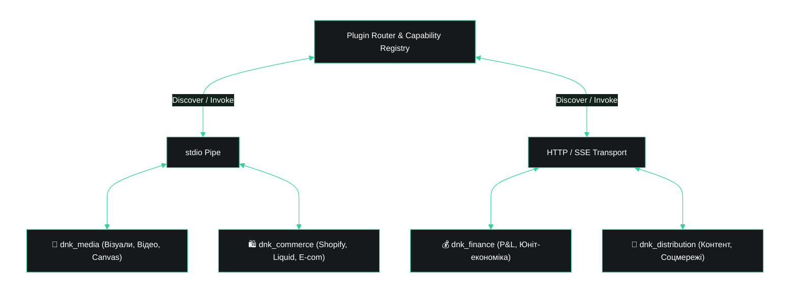

> [!metadata]- ⚙️ Системні метадані та інваріанти (MRH Header)
> ```yaml
> # --- DNK-MRH-HEADER ---
> # mrh_id: "docs/architecture/specs/03_PLUGIN_SYSTEM_FASTMCP_SPEC.md"
> # purpose: "FastMCP Plugin Fabric & Tool Interface Contract for DNK OS."
> # canonical_source: true
> # alters_files: []
> # triggers_tasks: []
> # status: "Active"
> # version: "1.1.0"
> # updated_at: "2026-09-19"
> # author: "DNK-e.com Maksym & Gerych Prime"
> # --- END DNK-MRH-HEADER ---
> ```

> [!abstract] 🧩 СПЕЦИФІКАЦІЯ ФАБРИКИ ПЛАГІНІВ FastMCP
> Стандартизація підключення автономних доменних інструментів та розширень DNK OS через легковажний протокол FastMCP (JSON-RPC) із декларуванням маніфестів та схем валідації.

<div align="center" style="margin-bottom: 16px;">
  <span style="background-color: #1e293b; color: #38bdf8; padding: 4px 10px; border-radius: 9999px; font-size: 12px; font-weight: 600; border: 1px solid #0284c7;">Домен: Plugins & MCP</span>
  <span style="background-color: #1e293b; color: #34d399; padding: 4px 10px; border-radius: 9999px; font-size: 12px; font-weight: 600; border: 1px solid #059669;">Статус: Active</span>
  <span style="background-color: #1e293b; color: #c084fc; padding: 4px 10px; border-radius: 9999px; font-size: 12px; font-weight: 600; border: 1px solid #7c3aed;">Оптика: Dual-Lens</span>
  <span style="background-color: #1e293b; color: #f59e0b; padding: 4px 10px; border-radius: 9999px; font-size: 12px; font-weight: 600; border: 1px solid #d97706;">Специфікація: 03</span>
</div>

`Навігація`: [[00_MOC_DNK_OS|🗺️ Головний MOC DNK OS]] ➔ [[specs/01_CORE_AND_ACTION_BUS_SPEC|01. Архітектура Ядра]] ➔ **03. Фабрика Плагінів FastMCP**

---

# 🧩 FastMCP Plugin System Specification



---

## 📄 1. Структура Маніфесту Плагіна (`plugin_manifest.json`)

> [!info] Декларативність Контексту
> Поле `required_context_fields` повідомляє підсистемі Context Router, які саме вузли Brand DNA потрібні плагіну, що забезпечує контекстну дієту (LOD Context Slicing).

```json
{
  "plugin_id": "dnk_media",
  "name": "DNK Media & Creative Studio",
  "version": "1.0.0",
  "entrypoint": "plugins.media.server:app",
  "transport": "stdio",
  "capabilities": ["image_generation", "video_scripting", "canvas_edit"],
  "tools": [
    {
      "name": "generate_product_visual",
      "description": "Створює промо-зображення товару згідно з Brand DNA проекту",
      "input_schema": {
        "type": "object",
        "properties": {
          "prompt": {"type": "string"},
          "aspect_ratio": {"type": "string", "enum": ["1:1", "9:16", "16:9"]},
          "style_preset": {"type": "string"}
        },
        "required": ["prompt"]
      }
    }
  ],
  "required_context_fields": ["brand_dna.visual_style", "brand_dna.negative_constraints"]
}
```

---

## 🛠️ 2. Стандартні Плагіни Ядра (Core Workhorse Plugins)

| Плагін | Домен | Основні Інструменти та Можливості |
| :--- | :--- | :--- |
| **`dnk_media`** | Медіа & Візуал | Генерація зображень, Remotion відео, рендеринг сторіс та мудбордів. |
| **`dnk_commerce`** | E-Commerce | Робота з каталогом товарів, генерація Shopify Liquid шаблонів, SEO. |
| **`dnk_finance`** | Фінанси | Фінансовий аудит, розрахунок собівартості (COGS), юніт-економіка. |
| **`dnk_distribution`** | Дистрибуція | Публікація контенту, адаптація постів для соцмереж, стрічки новин. |

---

`Див. також`: [[specs/01_CORE_AND_ACTION_BUS_SPEC|01. Архітектура Ядра]] | [[docs/adr/ADR-001-microkernel-fastmcp-architecture|ADR-001: FastMCP Architecture]] | [[docs/guides/DEVELOPER_GUIDE|Гайд Розробника]]
