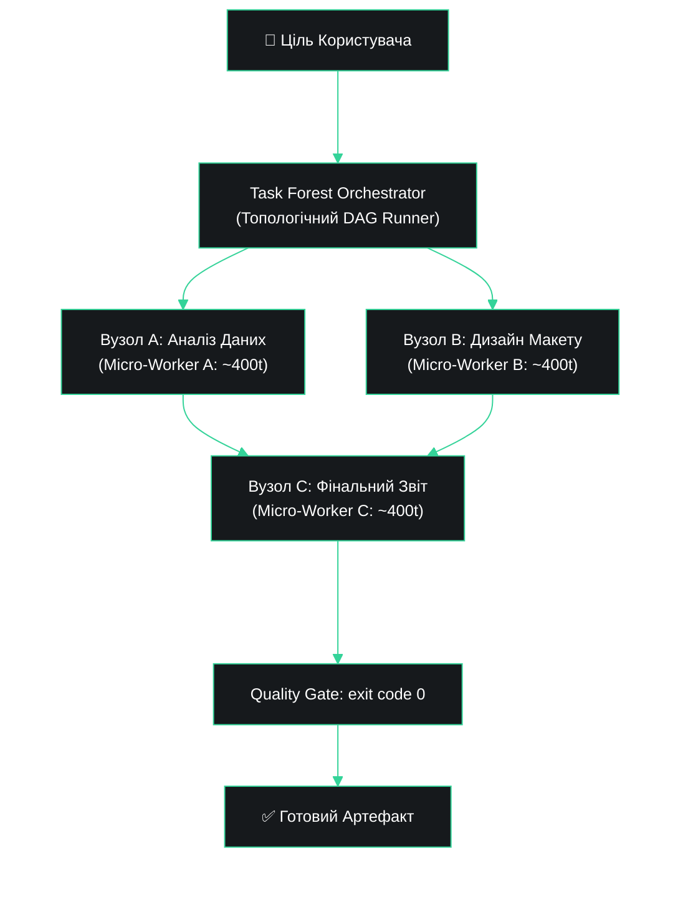

> [!metadata]- ⚙️ Системні метадані та інваріанти (MRH Header)
> ```yaml
> # --- DNK-MRH-HEADER ---
> # mrh_id: "docs/architecture/specs/04_TASK_FOREST_DAG_SPEC.md"
> # purpose: "Specification for Task Forest DAG Engine, Micro-Workers, and Context-as-Wires Execution."
> # canonical_source: true
> # alters_files: []
> # triggers_tasks: []
> # status: "Active"
> # version: "1.1.0"
> # updated_at: "2026-09-19"
> # author: "DNK-e.com Maksym & Gerych Prime"
> # --- END DNK-MRH-HEADER ---
> ```

> [!abstract] 🌲 СПЕЦИФІКАЦІЯ РУШІЯ Task Forest DAG
> Детермінована модель виконання задач у вигляді орієнтованого ациклічного графа (DAG) з принципом Context-as-Wires, що забезпечує ультралегкий контекст для кожного мікро-воркера (≤ 400–1,500 токенів).

<div align="center" style="margin-bottom: 16px;">
  <span style="background-color: #1e293b; color: #38bdf8; padding: 4px 10px; border-radius: 9999px; font-size: 12px; font-weight: 600; border: 1px solid #0284c7;">Домен: Execution Engine</span>
  <span style="background-color: #1e293b; color: #34d399; padding: 4px 10px; border-radius: 9999px; font-size: 12px; font-weight: 600; border: 1px solid #059669;">Статус: Active</span>
  <span style="background-color: #1e293b; color: #c084fc; padding: 4px 10px; border-radius: 9999px; font-size: 12px; font-weight: 600; border: 1px solid #7c3aed;">Оптика: Dual-Lens</span>
  <span style="background-color: #1e293b; color: #f59e0b; padding: 4px 10px; border-radius: 9999px; font-size: 12px; font-weight: 600; border: 1px solid #d97706;">Специфікація: 04</span>
</div>

`Навігація`: [[00_MOC_DNK_OS|🗺️ Головний MOC DNK OS]] ➔ [[specs/01_CORE_AND_ACTION_BUS_SPEC|01. Архітектура Ядра]] ➔ **04. Task Forest DAG**

---

# 🌲 Task Forest DAG & Micro-Worker Specification



---

## 🏛️ 1. Архітектурна Модель
Замість монолітної сесії агента, де історія повідомлень накопичується і деградує, DNK OS використовує **Task Forest DAG** (детермінований граф завдань із передачею контексту через проводи / Context-as-Wires).

> [!tip] Перевага Моделі Context-as-Wires
> Вузол C не отримує внутрішній діалог Вузла A чи B; він отримує виключно фінальний результат виконання (JSON/Markdown артефакт), що повністю виключає галюцинації та ентропію уваги.

---

## 💻 2. Специфікація Вузла Графа (`TaskForestNode`)

```python
from pydantic import BaseModel, Field
from typing import List, Dict, Any, Optional

class TaskForestNode(BaseModel):
    node_id: str
    title: str
    goal: str
    assigned_worker: str # e.g. "micro_worker" or "hermes_headless"
    depends_on: List[str] = Field(default_factory=list)
    target_files: List[str] = Field(default_factory=list)
    scoped_context: Dict[str, Any] = Field(default_factory=dict)
    status: str = "PENDING" # PENDING | RUNNING | COMPLETED | FAILED
    result_artifact: Optional[Dict[str, Any]] = None
    exit_code: Optional[int] = None
```

---

## ⚙️ 3. Виконавчі Бекенди (Execution Adapters)

| Адаптер | Призначення | Оверхед Контексту |
| :--- | :--- | :--- |
| **`micro_worker`** | Нативний Python worker на базі прямого виклику LLM API з обмеженим набором інструментів (read, patch, run). | **≤ 400 токенів** |
| **`hermes_headless`** | Резервний бекенд через CLI виклик `hermes -z -t file,terminal --ignore-rules` для складних системних операцій. | **≤ 1,500 токенів** |

---

`Див. також`: [[specs/01_CORE_AND_ACTION_BUS_SPEC|01. Архітектура Ядра]] | [[docs/adr/ADR-002-task-forest-dag-execution|ADR-002: Task Forest]] | [[00_MOC_DNK_OS|Головний MOC]]
