> [!metadata]- ⚙️ Системні метадані та інваріанти (MRH Header)
> ```yaml
> # --- DNK-MRH-HEADER ---
> mrh_id: "docs/architecture/specs/04_THOUGHT_TO_PLAN_PIPELINE_SPEC.md"
> purpose: "Master Specification for Transforming Human Thoughts into Deterministic Step-by-Step Task Execution Plans (ThoughtDSL -> ThoughtDAG -> TaskDNA -> Task Forest)."
> canonical_source: true
> alters_files: []
> triggers_tasks: ["TASK-CORE-THOUGHT-PLAN-001"]
> status: "Approved"
> version: "2.0.0"
> updated_at: "2026-09-24"
> author: "DNK-e.com Maksym & Antigravity"
> # --- END DNK-MRH-HEADER ---
> ```
> > [!summary] 📋 Контекст для ШІ-агента
> > Головний алгоритмічний конвеєр DNK OS для перетворення вільних думок засновника у детерміновані плани дій. Регламентує парсинг `ThoughtDSL`, детекцію циклів алгоритмом Кана у `ThoughtDAG`, синтез батьківських контекстів, генерацію генетичного паспорта `TaskDNA` та виконання у `Task Forest` через зрізи MASE (≤ 25 дій).

<!-- AGENT_INGESTION_DIRECTIVE: schema_version="2.3" parse_mode="dual_optics" task_extractor="auto" dag_sync="enabled" archetype="DEV_SPEC" -->

> [!abstract] 🌲 СПЕЦИФІКАЦІЯ КОНВЕЄРА «ДУМКА ➔ ГРАФ ➔ ПЛАН ➔ ДІЯ»
> Цей документ вирішує фундаментальну проблему агентивного програмування: **як перетворити хаотичний потік ідей та естетичних побажань користувача у математично вивірений, покроковий план задач без галюцинацій та зациклень**.

<div align="center" style="margin-bottom: 16px;">
  <span style="background-color: #1e293b; color: #38bdf8; padding: 4px 10px; border-radius: 9999px; font-size: 12px; font-weight: 600; border: 1px solid #0284c7;">Статус: Approved</span>
  <span style="background-color: #1e293b; color: #34d399; padding: 4px 10px; border-radius: 9999px; font-size: 12px; font-weight: 600; border: 1px solid #059669;">Домен: Core / Planning</span>
  <span style="background-color: #1e293b; color: #c084fc; padding: 4px 10px; border-radius: 9999px; font-size: 12px; font-weight: 600; border: 1px solid #7c3aed;">Архетип: DEV_SPEC</span>
  <span style="background-color: #1e293b; color: #f43f5e; padding: 4px 10px; border-radius: 9999px; font-size: 12px; font-weight: 600; border: 1px solid #e11d48;">Версія: 2.0.0</span>
</div>

`Навігація`: [[00_MOC_DNK_OS|🗺️ Головний MOC DNK OS]] ➔ [[specs/|📁 Специфікації]] ➔ **[[specs/04_THOUGHT_TO_PLAN_PIPELINE_SPEC|04. Пайплайн Думок у Плани]]**

---

## 🎨 1. Візуальна Топологія (Mermaid Architecture SSOT)

```mermaid
%%{init: {
  'theme': 'base',
  'themeVariables': {
    'primaryColor': '#16191c',
    'primaryTextColor': '#ffffff',
    'primaryBorderColor': '#34d399',
    'lineColor': '#34d399',
    'secondaryColor': '#102219',
    'tertiaryColor': '#16191c',
    'tertiaryTextColor': '#ffffff',
    'titleColor': '#ffffff',
    'textColor': '#ffffff',
    'mainBkg': '#16191c',
    'nodeBorder': '#34d399',
    'clusterBkg': 'transparent',
    'clusterBorder': 'rgba(255, 255, 255, 0.16)',
    'edgeLabelBackground': '#102219',
    'fontSize': '13px'
  }
}}%%
flowchart LR
    T1["💡 <b>ThoughtDSL</b><br/><small>• Легковажна нотація думок<br/>• Гіпотези, критика, синтез</small>"]
    T2["🕸️ <b>Kahn ThoughtDAG</b><br/><small>• Перевірка ациклічності<br/>• Дедуплікація предків</small>"]
    T3["🧬 <b>TaskDNA Synthesis</b><br/><small>• Генетичний контракт задачі<br/>• Whitelist + Anti-Scope</small>"]
    T4["🌲 <b>Task Forest (MASE)</b><br/><small>• Топологічна черга черг<br/>• Слайси ≤ 25 дій per turn</small>"]

    U1["👤 <b>Вайбкодер (Максим)</b><br/><small>Візуальний Canvas • Граф думок</small>"]
    U2["🤖 <b>Swarm Execution Workers</b><br/><small>Атомарне виконання завдань</small>"]

    %% Головна магістраль конвеєра планування:
    T1 ===>|"Парсинг та валідація"| T2
    T2 ===>|"Генерація генетичного коду"| T3
    T3 ===>|"Топологічна декомпозиція"| T4

    %% Прямий зв'язок з користувачем:
    T1 <-->|"Інтерактивне редагування"| U1

    %% Фонове виконання роєм:
    T4 -.->|"Призначення слайсів"| U2
```

<!-- DAG_NODE: id="DAG-THOUGHT-PLAN-MERMAID-SSOT" title="Thought-to-Plan Visual Pipeline" type="visual_spec" agent="gerych_builder" -->



---

## 🎯 2. Смисловий Контекст та UX (Рівень 1: Людина)

<!-- DAG_NODE: id="DAG-THOUGHT-PLAN-HUMAN-UX" title="Human Intent & Planning UX" type="ux_standard" agent="gerych_builder" -->

### 2.1. Цільові Сценарії (User Stories)
- **Як Вайбкодер (Максим)**, я хочу накидати на полотні чи у файлі кілька думок або гіпотез у простому синтаксисі, а система повинна сама виявити протиріччя, знайти цикли та звести це у послідовний робочий план.
- **Як Засновник**, я хочу бачити дерево задач (Task Forest) із точним відображенням прогресу (11 канонічних символів Obsidian: `[ ]`, `[/]`, `[x]`, `[-]`) прямо в Obsidian або веб-інтерфейсі.
- **Як Архітектор**, я вимагаю, щоб жодна задача не запускалася у монолітне виконання на кілька годин: кожна задача має бути порізана рушієм `ZeroWasteSlicer` на кванти до 25 дій.

### 2.2. Ключові Архітектурні Принципи
1. **Синтаксична Простота (ThoughtDSL)**: Дозволяє описувати вузли мислення у 1 рядок: `[hypothesis] H1: Нова структура ядра`, `[critique] C1: Ризик роздування`, `H1 -> C1`.
2. **Ациклічність за Каном (Kahn's Algorithm)**: Гарантує, що у графу думок немає взаємних блокувань (дедлоків) перед перетворенням у код.
3. **Context-as-Wires**: Контекст між задачами передається строго по зв'язках (Wires). Вузол бачить тільки своїх прямих предків, а не всю історію всесвіту (економія до 80% токенів).

---

## 🤖 3. Машинний Контракт, Системні Інваріанти та Межі (Рівень 2: Агент)

<!-- DAG_NODE: id="DAG-THOUGHT-PLAN-MACHINE-CONTRACT" title="Machine Contract & DSL Specs" type="agent_contract" agent="dnk_dev_fullstack" -->

### 3.1. Білий Список Цільових Файлів (Target File Whitelist)
| Шлях до файлу | Операція | Відповідальний агент | Призначення |
| :--- | :---: | :--- | :--- |
| `core/domain/thought_dsl.py` | `Create / Mutate` | `dnk_dev_fullstack` | Парсер ThoughtDSL, детекція циклів Кана |
| `core/domain/dag_models.py` | `Create / Mutate` | `dnk_dev_fullstack` | Моделі ThoughtDAGGraph, ThoughtNode, Wire |
| `core/orchestrator/task_dna_lifecycle.py` | `Create / Mutate` | `dnk_dev_fullstack` | Життєвий цикл генетичних завдань TaskDNA |
| `core/orchestrator/zero_waste_slicer.py` | `Create / Mutate` | `dnk_dev_fullstack` | Декомпозиція задач на слайси MASE (≤ 25 дій) |
| `tests/unit/test_thought_dsl.py` | `Create` | `gerych_auditor` | Тести парсингу DSL та детекції циклів |

### 3.2. Негативний Скоуп та Заборони
- ❌ **Заборонено**: Дозволяти виконання графа, якщо `detect_cycles_kahn()` повертає `has_cycles == True`.
- ❌ **Заборонено**: Генерувати атомарні слайси із бюджетом понад 25 викликів інструментів.
- ❌ **Заборонено**: Втрачати SHA256-відбиток предків (`upstream_fingerprint`) при злитті кількох гілок думок.

---

## ⚡ 4. MASE Розробка та Верифікація (Рівень 3: Розробка)

<!-- DAG_NODE: id="DAG-THOUGHT-PLAN-MASE-VERIFICATION" title="MASE Slices & Acceptance" type="dev_standard" agent="gerych_auditor" -->

### 4.1. Атомарні Зрізи (Atomic Slices ≤ 25 дій per Slice)
- **Slice 1 (ThoughtDSL & Алгоритм Кана)**: Перенесення `thought_dsl.py` та `dag_models.py`, верифікація ациклічності.
- **Slice 2 (TaskDNA Lifecycle Engine)**: Інтеграція фаз `RESEARCH ➔ AUDIT ➔ APPROVAL ➔ INGEST` у `task_dna_lifecycle.py`.
- **Slice 3 (ZeroWasteSlicer & MASE)**: Підключення топологічного слайсера та перевірка обмеження ≤ 25 викликів інструментів.

### 4.2. Детермінована Матриця Приймання (Deterministic Acceptance Matrix)
| ID | Крок / Дія (CHECK) | Очікуваний результат (EXPECT) | Доказ виконання (EVIDENCE) |
| :---: | :--- | :--- | :--- |
| **GATE-01** | `python3 scripts/system/markdown_schema_gate.py --file "specs/04_THOUGHT_TO_PLAN_PIPELINE_SPEC.md"` | 0 порушень схеми, коректні MRH метадані | `exit code 0` |
| **GATE-02** | `pytest tests/unit/test_thought_dsl.py -v` | 100% проходження тестів парсингу та циклів | `X passed, 0 failed, exit code 0` |
| **GATE-03** | Тест графа з циклом `A -> B -> A` | Алгоритм повертає `has_cycles=True`, список вузлів циклу | `assert result.has_cycles is True` |

---

## 🌳 5. Граф Задач Task Forest (Рівень 4: Система)

<!-- DAG_NODE: id="DAG-THOUGHT-PLAN-TASK-FOREST" title="Task Forest DAG" type="task_spec" agent="gerych_prime" -->

- [ ] `[ ]` **TASK-CORE-04-01**: Перенесення `thought_dsl.py` та `dag_models.py` у `core/domain/`
- [ ] `[ ]` **TASK-CORE-04-02**: Перенесення `task_dna_lifecycle.py` та `zero_waste_slicer.py` у `core/orchestrator/`
- [ ] `[ ]` **TASK-CORE-04-03**: Написання юніт-тестів перевірки ациклічності в `tests/unit/test_thought_dsl.py`

---

## 🔗 6. Навігаційний Граф Знань (Wikilinks Network)

- Вхідна точка: [[00_MOC_DNK_OS|🗺️ Головний MOC DNK OS]]
- Пов'язані специфікації:
  - [[specs/01_CORE_AND_ACTION_BUS_SPEC|01. Мікроядро та Шина Дій]]
  - [[specs/02_USER_IDENTITY_AND_SOUL_SPEC|02. Ідентичність Користувача, User Soul та Brand DNA]]
  - [[specs/03_MEMORY_SCONES_SPEC|03. 3-Рівнева Когнітивна Пам'ять SCONES]]
  - [[specs/05_SPATIAL_UI_AND_CANVAS_SPEC|05. Просторова Оболонка, Canvas та Інтерфейс]]
