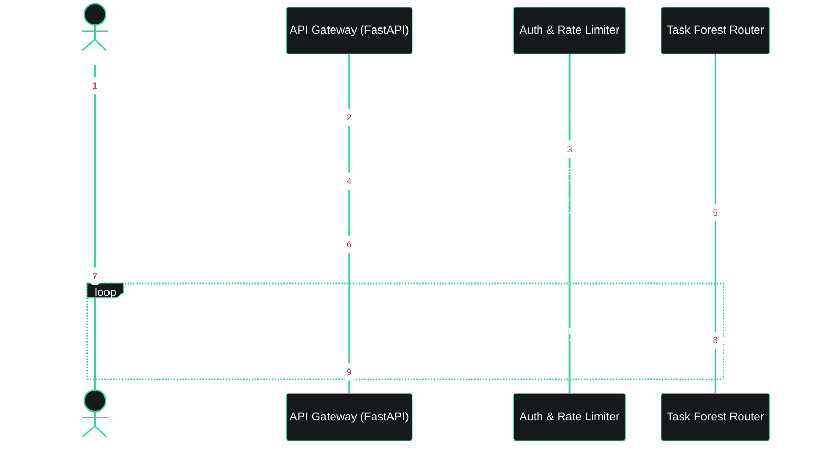

> [!metadata]- ⚙️ Системні метадані та інваріанти (MRH Header)
> ```yaml
> # --- DNK-MRH-HEADER ---
> # mrh_id: "docs/architecture/specs/05_API_GATEWAY_CONTRACTS.md"
> # purpose: "FastAPI REST, SSE, and WebSocket Gateway Contracts for DNK OS."
> # canonical_source: true
> # alters_files: []
> # triggers_tasks: []
> # status: "Active"
> # version: "1.1.0"
> # updated_at: "2026-09-19"
> # author: "DNK-e.com Maksym & Gerych Prime"
> # --- END DNK-MRH-HEADER ---
> ```

> [!abstract] 🌐 СПЕЦИФІКАЦІЯ КОНТРАКТІВ API GATEWAY
> Контракти взаємодії зовнішніх клієнтів (Web, Mobile, Obsidian) із ядром DNK OS: маршрути REST API, захист токенами авторизації та стрімінг прогресу задач через Server-Sent Events (SSE).

<div align="center" style="margin-bottom: 16px;">
  <span style="background-color: #1e293b; color: #38bdf8; padding: 4px 10px; border-radius: 9999px; font-size: 12px; font-weight: 600; border: 1px solid #0284c7;">Домен: API Gateway</span>
  <span style="background-color: #1e293b; color: #34d399; padding: 4px 10px; border-radius: 9999px; font-size: 12px; font-weight: 600; border: 1px solid #059669;">Статус: Active</span>
  <span style="background-color: #1e293b; color: #c084fc; padding: 4px 10px; border-radius: 9999px; font-size: 12px; font-weight: 600; border: 1px solid #7c3aed;">Оптика: Dual-Lens</span>
  <span style="background-color: #1e293b; color: #f59e0b; padding: 4px 10px; border-radius: 9999px; font-size: 12px; font-weight: 600; border: 1px solid #d97706;">Специфікація: 05</span>
</div>

`Навігація`: [[00_MOC_DNK_OS|🗺️ Головний MOC DNK OS]] ➔ [[specs/01_CORE_AND_ACTION_BUS_SPEC|01. Архітектура Ядра]] ➔ **05. Контракти API Gateway**

---

# 🌐 API Gateway Contracts & Endpoints



---

## 🔒 1. Безпека та Маршрутизація

> [!warning] Split-Route Security Gate
> Всі мутуючі роути (`POST`, `PUT`, `DELETE`, `PATCH`) суворо захищені Bearer JWT-токеном користувача. Будь-які wildcard-виключення заборонені.
> Публічними є виключно перевірки стану: `GET /api/v1/health` та `GET /api/v1/status`.

---

## 📡 2. REST API Ендпоінти

### 2.1. Projects & Workspaces
- `GET /api/v1/projects` — список проєктів користувача.
- `POST /api/v1/projects` — створення нового проєкту з Brand DNA.
- `GET /api/v1/projects/{project_id}` — отримання деталей та маніфесту ассетів.
- `PATCH /api/v1/projects/{project_id}/brand-dna` — оновлення параметрів Brand DNA.

### 2.2. Task Execution
- `POST /api/v1/tasks/dispatch` — створення та запуск нового графа Task Forest DAG.
- `GET /api/v1/tasks/{task_id}/status` — перевірка фінального або поточного статусу задачі.
- `GET /api/v1/tasks/{task_id}/stream` — Server-Sent Events (SSE) підключення для отримання подій виконання вузлів у реальному часі.

---

## 📦 3. Структура SSE Події Стрімінгу (`TaskEvent`)

```json
{
  "event_type": "node_progress",
  "task_id": "tsk_123",
  "node_id": "node_01",
  "status": "RUNNING",
  "message": "Генерація зображення товару...",
  "progress": 0.45,
  "timestamp": "2026-09-18T12:00:05Z"
}
```

---

`Див. також`: [[specs/01_CORE_AND_ACTION_BUS_SPEC|01. Архітектура Ядра]] | [[specs/04_THOUGHT_TO_PLAN_PIPELINE_SPEC|04. Task Forest DAG]] | [[00_MOC_DNK_OS|Головний MOC]]
