> [!metadata]- ⚙️ Системні метадані та інваріанти (MRH Header)
> ```yaml
> # --- DNK-MRH-HEADER ---
> mrh_id: "docs/architecture/specs/05_SPATIAL_UI_AND_CANVAS_SPEC.md"
> purpose: "Master Specification for Spatial Visual Shell, Obsidian Canvas JSON 1.0 Translator, Tauri v2 Desktop Client, and Real-Time SSE Event Streaming."
> canonical_source: true
> alters_files: []
> triggers_tasks: ["TASK-CORE-SPATIAL-UI-001"]
> status: "Approved"
> version: "2.0.0"
> updated_at: "2026-09-24"
> author: "DNK-e.com Maksym & Antigravity"
> # --- END DNK-MRH-HEADER ---
> ```
> > [!summary] 📋 Контекст для ШІ-агента
> > Специфікація клієнтського рівня та візуального простору DNK OS. Описує взаємодію тріади: Користувач ↔ Фронтенд/Canvas ↔ Мікроядро. Регламентує генерацію Obsidian JSON Canvas 1.0, роботу легковажного десктоп-клієнта на Tauri v2, REST/SSE шлюз та стрімінг мислення агентів у реальному часі.

<!-- AGENT_INGESTION_DIRECTIVE: schema_version="2.3" parse_mode="dual_optics" task_extractor="auto" dag_sync="enabled" archetype="DEV_SPEC" -->

> [!abstract] 🖥️ СПЕЦИФІКАЦІЯ ПРОСТОРОВОЇ ОБОЛОНКИ ТА CANVAS-ІНТЕРФЕЙСУ
> Користувач DNK OS керує системою не через вузьке вікно текстового чату, а через **просторовий інтерфейс (Spatial Canvas)**. Агент малює свої думки, схеми та пропозиції прямо на нескінченному полотні Obsidian або нативного десктопного додатку на базі Tauri v2.

<div align="center" style="margin-bottom: 16px;">
  <span style="background-color: #1e293b; color: #38bdf8; padding: 4px 10px; border-radius: 9999px; font-size: 12px; font-weight: 600; border: 1px solid #0284c7;">Статус: Approved</span>
  <span style="background-color: #1e293b; color: #34d399; padding: 4px 10px; border-radius: 9999px; font-size: 12px; font-weight: 600; border: 1px solid #059669;">Домен: Client / UI</span>
  <span style="background-color: #1e293b; color: #c084fc; padding: 4px 10px; border-radius: 9999px; font-size: 12px; font-weight: 600; border: 1px solid #7c3aed;">Архетип: DEV_SPEC</span>
  <span style="background-color: #1e293b; color: #f43f5e; padding: 4px 10px; border-radius: 9999px; font-size: 12px; font-weight: 600; border: 1px solid #e11d48;">Версія: 2.0.0</span>
</div>

`Навігація`: [[00_MOC_DNK_OS|🗺️ Головний MOC DNK OS]] ➔ [[specs/|📁 Специфікації]] ➔ **[[specs/05_SPATIAL_UI_AND_CANVAS_SPEC|05. Просторова Оболонка та Canvas]]**

---

## 🎨 1. Візуальна Топологія (Mermaid Architecture SSOT)

```mermaid
%%{init: {
  'theme': 'base',
  'themeVariables': {
    'primaryColor': '#16191c',
    'primaryTextColor': '#ffffff',
    'primaryBorderColor': '#34d399',
    'lineColor': '#34d399',
    'secondaryColor': '#102219',
    'tertiaryColor': '#16191c',
    'tertiaryTextColor': '#ffffff',
    'titleColor': '#ffffff',
    'textColor': '#ffffff',
    'mainBkg': '#16191c',
    'nodeBorder': '#34d399',
    'clusterBkg': 'transparent',
    'clusterBorder': 'rgba(255, 255, 255, 0.16)',
    'edgeLabelBackground': '#102219',
    'fontSize': '13px'
  }
}}%%
flowchart LR
    V1["🎨 <b>Obsidian Canvas / Vault</b><br/><small>• JSON Canvas 1.0 файл<br/>• Obsidian Local REST API</small>"]
    V2["⚡ <b>API Gateway (FastAPI)</b><br/><small>• REST команди керування<br/>• SSE стрімінг подій</small>"]
    V3["🚌 <b>Action Bus Broadcaster</b><br/><small>• Поширення подій ядра<br/>• Live HUD транслятор</small>"]
    V4["🖥️ <b>Tauri v2 Desktop Shell</b><br/><small>• Rust бінарник (~15 MB)<br/>• Reactflow просторовий вид</small>"]

    U1["👤 <b>Вайбкодер (Максим)</b><br/><small>Пряма маніпуляція нодами на полотні</small>"]
    U2["🤖 <b>Agent Thoughts Stream</b><br/><small>Миттєве відображення прогресу</small>"]

    %% Головна магістраль взаємодії інтерфейсу:
    V1 ===>|"REST вебхук"| V2
    V2 ===>|"Диспатч у шину"| V3
    V3 ===>|"SSE стрім стану"| V4

    %% Людиноорієнтований зворотний зв'язок:
    U1 <-->|"Drag & Drop, кнопки схвалення"| V1
    U1 <-->|"Нативний інтерфейс"| V4

    %% Фоновий стрім думок:
    V3 -.->|"Проекція думок"| U2
```

<!-- DAG_NODE: id="DAG-UI-CANVAS-MERMAID-SSOT" title="Spatial UI & Canvas Visual Topology" type="visual_spec" agent="gerych_builder" -->



---

## 🎯 2. Смисловий Контекст та UX (Рівень 1: Людина)

<!-- DAG_NODE: id="DAG-UI-CANVAS-HUMAN-UX" title="Human Intent & Spatial UX" type="ux_standard" agent="gerych_builder" -->

### 2.1. Цільові Сценарії (User Stories)
- **Як Вайбкодер (Максим)**, я хочу бачити роботу агента як живу динамічну діаграму на полотні, де кожна дія, думка чи згенерований артефакт з'являються у вигляді кольорових нод у реальному часі.
- **Як Засновник**, я хочу схвалювати або відхиляти пропозиції агента натисканням кнопки прямо на картці ноди в Canvas чи десктопному додатку.
- **Як Користувач**, я хочу мати надшвидкий легкий нативний клієнт на Tauri v2, який споживає до 50 МБ оперативної пам'яті (на відміну від важкого Electron) та миттєво синхронізується з Obsidian Vault.

### 2.2. Ключові Архітектурні Принципи
1. **Просторова Тріада (Spatial Triad)**: Користувач змінює розташування нод ➔ шлюз передає зміну в Action Bus ➔ агент враховує просторове групування при виконанні.
2. **Стандарт JSON Canvas 1.0**: Всі файли полотен генеруються у відкритому стандарті `jsoncanvas.org`, що гарантує сумісність із будь-якими інструментами візуалізації.
3. **Server-Sent Events (SSE) замість Polling**: Клієнт отримує оновлення через постійне легковажне HTTP-з'єднання без паразитного навантаження опитуванням.

---

## 🤖 3. Машинний Контракт, Системні Інваріанти та Межі (Рівень 2: Агент)

<!-- DAG_NODE: id="DAG-UI-CANVAS-MACHINE-CONTRACT" title="Machine Contract & Canvas Specs" type="agent_contract" agent="dnk_dev_fullstack" -->

### 3.1. Білий Список Цільових Файлів (Target File Whitelist)
| Шлях до файлу | Операція | Відповідальний агент | Призначення |
| :--- | :---: | :--- | :--- |
| `core/obsidian/json_canvas_builder.py` | `Create / Mutate` | `dnk_dev_fullstack` | Генератор файлів JSON Canvas 1.0 |
| `core/obsidian/wiki_canvas_translator.py` | `Create / Mutate` | `dnk_dev_fullstack` | Транслятор Markdown вікі-лінків у ноди |
| `core/action_bus/broadcaster.py` | `Create / Mutate` | `dnk_dev_fullstack` | Модуль розсилки подій через SSE |
| `tests/unit/test_canvas_builder.py` | `Create` | `gerych_auditor` | Тести коректності генерації Canvas JSON |

### 3.2. Негативний Скоуп та Заборони
- ❌ **Заборонено**: Генерувати невалідний синтаксис JSON Canvas (координати x, y, width, height повинні бути цілими числами).
- ❌ **Заборонено**: Блокувати цикл подій під час трансляції SSE-повідомлень.
- ❌ **Заборонено**: Модифікувати користувацькі файли `.canvas` без створення безпечного бекапу дельти змін.

---

## ⚡ 4. MASE Розробка та Верифікація (Рівень 3: Розробка)

<!-- DAG_NODE: id="DAG-UI-CANVAS-MASE-VERIFICATION" title="MASE Slices & Acceptance" type="dev_standard" agent="gerych_auditor" -->

### 4.1. Атомарні Зрізи (Atomic Slices ≤ 25 дій per Slice)
- **Slice 1 (JSON Canvas 1.0 Генератор)**: Перенесення `json_canvas_builder.py` та тестів структури нод і ребер.
- **Slice 2 (Broadcaster & SSE Gateway)**: Налаштування асинхронного розповсюдження подій у `broadcaster.py`.
- **Slice 3 (Obsidian Local REST API Інтеграція)**: Підключення команд оновлення та перезавантаження через REST-шлюз.

### 4.2. Детермінована Матриця Приймання (Deterministic Acceptance Matrix)
| ID | Крок / Дія (CHECK) | Очікуваний результат (EXPECT) | Доказ виконання (EVIDENCE) |
| :---: | :--- | :--- | :--- |
| **GATE-01** | `python3 scripts/system/markdown_schema_gate.py --file "specs/05_SPATIAL_UI_AND_CANVAS_SPEC.md"` | 0 порушень схеми, коректні MRH метадані | `exit code 0` |
| **GATE-02** | `pytest tests/unit/test_canvas_builder.py -v` | Валідація генерації JSON Canvas 1.0 схеми | `X passed, 0 failed, exit code 0` |
| **GATE-03** | Перевірка згенерованого `.canvas` файлу | Файл відкривається в Obsidian без помилок парсингу | `json.loads(canvas_content)` успішний |

---

## 🌳 5. Граф Задач Task Forest (Рівень 4: Система)

<!-- DAG_NODE: id="DAG-UI-CANVAS-TASK-FOREST" title="Task Forest DAG" type="task_spec" agent="gerych_prime" -->

- [ ] `[ ]` **TASK-CORE-05-01**: Перенесення `json_canvas_builder.py` у `core/obsidian/`
- [ ] `[ ]` **TASK-CORE-05-02**: Інтеграція `broadcaster.py` у `core/action_bus/` для SSE стрімінгу
- [ ] `[ ]` **TASK-CORE-05-03**: Створення тестів валідації Canvas у `tests/unit/test_canvas_builder.py`

---

## 🔗 6. Навігаційний Граф Знань (Wikilinks Network)

- Вхідна точка: [[00_MOC_DNK_OS|🗺️ Головний MOC DNK OS]]
- Пов'язані специфікації:
  - [[specs/01_CORE_AND_ACTION_BUS_SPEC|01. Мікроядро та Шина Дій]]
  - [[specs/02_USER_IDENTITY_AND_SOUL_SPEC|02. Ідентичність Користувача, User Soul та Brand DNA]]
  - [[specs/03_MEMORY_SCONES_SPEC|03. 3-Рівнева Когнітивна Пам'ять SCONES]]
  - [[specs/04_THOUGHT_TO_PLAN_PIPELINE_SPEC|04. Пайплайн Думок: ThoughtDSL ➔ ThoughtDAG ➔ Task Forest]]
