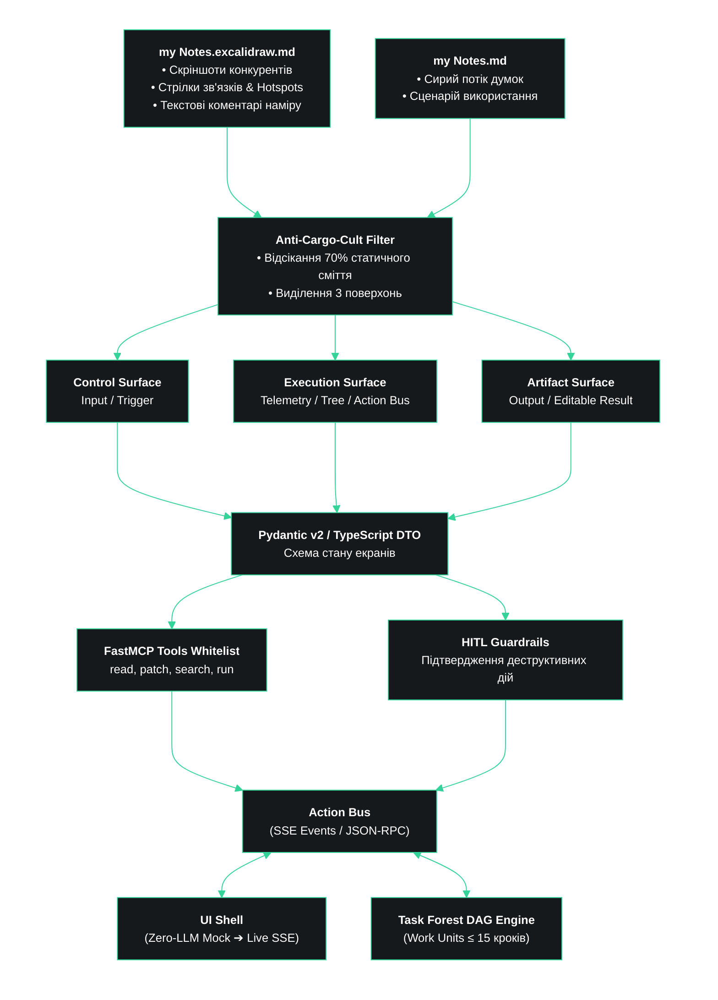

> [!metadata]- ⚙️ Системні метадані та інваріанти (MRH Header)
> ```yaml
> # --- DNK-MRH-HEADER ---
> mrh_id: "docs/architecture/specs/06_VISUAL_FIRST_AGENT_SYSTEM_SPEC.md"
> purpose: "Master Specification for Visual-First Agent System Design: Ingesting competitor screenshots and visual notes from my Notes.excalidraw.md, synthesizing state contracts, and generating sovereign micro-harness architecture."
> canonical_source: true
> alters_files: []
> triggers_tasks: ["TASK-CORE-VISUAL-SPEC-001"]
> status: "Review"
> version: "1.0.0"
> updated_at: "2026-10-02"
> author: "DNK-e.com Maksym & Gerych Prime"
> # --- END DNK-MRH-HEADER ---
> ```
> > [!summary] 📋 Контекст для ШІ-агента
> > Документ визначає інженерний регламент переходу від візуальних нарисів та скріншотів конкурентів (збережених у `my Notes.excalidraw.md`) до суверенної архітектури автономних агентів. Описує розбивку системи на 3 обов'язкові площини (Control, Execution/Telemetry, Artifact), ізоляцію UI від недетермінізму LLM через State Contract, та надає 3 конкретні технічні рішення на вибір засновника.

<!-- AGENT_INGESTION_DIRECTIVE: schema_version="2.3" parse_mode="dual_optics" task_extractor="auto" dag_sync="enabled" archetype="DEV_SPEC" -->

> [!abstract] 🧭 VISUAL-FIRST ARCHITECTURE PIPELINE: ВІД СКРІНШОТА ДО АВТОНОМНОГО ЯДРА
> **Головна мета**: Дати Максиму можливість проєктувати вигляд і ергономіку агентного інтерфейсу природними візуальними артефактами (скріншоти конкурентів, блоки Excalidraw, нотатки), а інженеру-агенту — детерміновано синтезувати з них контракти стану, FastMCP-інструменти та фоновий рантайм без застрягання у вербальних узгодженнях.

<div align="center" style="margin-bottom: 16px;">
  <span style="background-color: #16181b; color: #38bdf8; padding: 4px 10px; border-radius: 9999px; font-size: 12px; font-weight: 600; border: 1px solid #38bdf8;">Статус: Review (Очікує вибору)</span>
  <span style="background-color: #16181b; color: #34d399; padding: 4px 10px; border-radius: 9999px; font-size: 12px; font-weight: 600; border: 1px solid #34d399;">Домен: Core / Architecture</span>
  <span style="background-color: #16181b; color: #b388ff; padding: 4px 10px; border-radius: 9999px; font-size: 12px; font-weight: 600; border: 1px solid #b388ff;">Архетип: DEV_SPEC</span>
  <span style="background-color: #16181b; color: #38bdf8; padding: 4px 10px; border-radius: 9999px; font-size: 12px; font-weight: 600; border: 1px solid #38bdf8;">Visual: Mermaid Dark SSOT</span>
  <span style="background-color: #16181b; color: #fde047; padding: 4px 10px; border-radius: 9999px; font-size: 12px; font-weight: 600; border: 1px solid #fde047;">Версія: 1.0.0</span>
</div>

`Навігація`: [[00_MOC_DNK_OS|🗺️ Головний MOC DNK OS]] ➔ [[Do not Delete - Draft|Майстер-План Консиліуму]] ➔ [[Do not Delete - Example|Еталон Документації]] ➔ **[[specs/06_VISUAL_FIRST_AGENT_SYSTEM_SPEC|Специфікація 06: Visual-First Pipeline]]**

---

## 🎨 1. Візуальна Топологія (Mermaid Architecture SSOT)

<!-- DAG_NODE: id="DAG-VISUAL-REFERENCE-INGEST" title="Visual-to-Code Pipeline Topology" type="visual_spec" agent="gerych_builder" -->

### 🔀 Наскрізний Конвеєр: Скріншот ➔ Контракт Стану ➔ Автономний Рантайм



---

## 🎯 2. Смисловий Контекст та UX (Рівень 1: Людина)

<!-- DAG_NODE: id="DAG-STATE-CONTRACT-SYNTHESIS" title="Human Intent & Visual Deconstruction" type="ux_standard" agent="gerych_builder" -->

### 2.1. Чому підхід "Спочатку вигляд, потім код" — найшвидший для автономних систем
1. **Зниження невизначеності**: Коли є конкретне розташування елементів інтерфейсу, інженеру не треба вгадувати структуру даних. Кожна кнопка чи блок — це поле в моделі стану (`State DTO`) або подія в шині дій (`Action Bus Event`).
2. **Нуль галюцинацій в архітектурі**: Якщо інтерфейс вимагає показувати дерево думок або хід виконання кроків, бекенд автоматично отримує вимогу реалізувати стрімінг подій (`SSE`), а не блокуючий REST-запит.
3. **Швидка перевірка на зручність (Ergonomics Gate)**: Полотно на мокових даних збирається за 1 день. Якщо ним незручно користуватися вручну — жоден розумний агент не врятує продукт.

---

### 2.2. Як працювати зі скріншотами конкурентів у `my Notes.excalidraw.md`

Щоб копіювання рішень не перетворилося на створення непідйомного моноліту:
1. **Вставка скріншота**: Скріншот додається на дошку `my Notes.excalidraw.md`.
2. **Розмітка 3 зонами (Hotspots)**:
   - **🟢 Зона запуску (Trigger)**: де вводиться задача (промпт, селектор агента, кнопка старту).
   - **🟡 Зона процесу (Telemetry)**: де видно, що агент «думає», які інструменти викликає, де прогрес-бар або граф.
   - **🔵 Зона результату (Artifact)**: де з'являється результат (код, замітка, файл, таблиця).
3. **Текстовий коментар поряд зі скріншотом**:
   - «Що робить людина?»
   - «Що робить агент сам без запитання?»
   - «Що тут зайве і його треба викинути?» (Anti-Scope).

---

## ⚙️ 3. Три Архітектурні Розвилки (Рішення на вибір Максима)

Нижче наведено 3 варіанти реалізації архітектури, з яких ти обираєш один для впровадження:

### 🌟 Варіант А: "Sovereign Micro-Harness & Unified Canvas Shell" (РЕКОМЕНДОВАНО)
* **Концепція**: Власний легкий десктопний клієнт (Tauri v2 + React 19 / Fast Canvas) + надлегкий Python FastMCP мікро-харнес (asyncio, ≤ 1,000 рядків коду).
* **Плюси**:
  - Повний суверенітет: жодної прив'язки до оновлень Obsidian чи сторонніх плагінів.
  - Надшвидкий реактивний UI: нативна підтримка 60 FPS для стрімінгу агентних думок і маніпуляцій нодами на полотні.
  - Повна ізоляція пам'яті (SCONES WAL на SQLite) і безпеки (ProcessGuard).
* **Мінуси**: Потрібно зібрати базовий каркас полотна (але можна використати асимільовані донори `CopilotKit` / `Open Multi-Agent Canvas`).
* **Термін першого каркасу**: 3–4 дні.

---

### 📦 Варіант B: "Obsidian Direct Bridge" (Мінімалістичний швидкий старт)
* **Концепція**: Додатком слугує сам Obsidian. Логіка агента виноситься у фоновий FastMCP демон на Python, який спілкується з Obsidian через `Obsidian Local REST API` та мутує `.canvas` або `.excalidraw` файли безпосередньо на диску.
* **Плюси**:
  - Нуль витрат на розробку власного UI: Obsidian вже встановлено, дизайн темний, є Excalidraw та Canvas.
  - Запуск першого прототипу вже через 24 години.
* **Мінуси**:
  - Обмеженість можливостей UI: Obsidian Canvas не призначений для важкого високочастотного двостороннього стрімінгу подій (можливе миготіння або конфлікти запису файлів).
  - Складно реалізувати специфічні контрольні елементи (кастомні термінали, селектори моделей, вбудовані браузери).
* **Термін першого каркасу**: 1–2 дні.

---

### 🌐 Варіант C: "Next.js 15 / Astryx Standalone Web Studio"
* **Концепція**: Повноцінний автономний веб-інтерфейс на Next.js 15 + Shadcn UI + XYFlow (React Flow) / Tldraw, що підключається через WebSocket/SSE до локального ядра DNK OS.
* **Плюси**:
  - Найбагатша екосистема готових компонентів для агентних канвасів (React Flow, CopilotKit, LangGraph Studio UI).
  - Можливість відкривати інтерфейс з будь-якого пристрою в локальній мережі (Mac, iPad).
* **Мінуси**:
  - Більший технологічний оверхед (Node.js рантайм, залежності npm, збірка Next.js).
  - Потребує запуску двох процесів (веб-сервер + агентний бекенд).
* **Термін першого каркасу**: 4–5 днів.

---

## 🤖 4. Машинний Контракт, Системні Інваріанти та Межі (Рівень 2: Агент)

<!-- DAG_NODE: id="DAG-HARNESS-ENGINE-BINDING" title="Machine Contract & Execution Directives" type="agent_contract" agent="gerych_prime" -->

> [!agent] 🤖 ПРАВИЛО ДЛЯ АГЕНТА: Режим розробки за візуальною специфікацією
> Доки вигляд системи та вибір варіанту (A, B чи C) не підтверджено Максимом, агент зобов'язаний діяти **виключно в режимі проєктування контрактів та схем**. Створення важкого коду реалізації до погодження варіанту ЗАБОРОНЕНО.

### 4.1. Білий Список Цільових Файлів (Target File Whitelist)
| Шлях до файлу (Тільки відносні шляхи) | Операція | Відповідальний агент | Призначення |
| :--- | :---: | :--- | :--- |
| `specs/06_VISUAL_FIRST_AGENT_SYSTEM_SPEC.md` | `Create / Mutate` | `gerych_prime` | Поточна специфікація та фіксація вибору |
| `my Notes.excalidraw.md` | `Read-Only` | `gerych_researcher` | Джерело скріншотів та візуальних поміток |
| `my Notes.md` | `Read-Only` | `gerych_researcher` | Джерело сирих думок засновника |
| `core/action_bus/contracts.py` | `Create` | `dnk_dev_fullstack` | Pydantic DTO моделей стану після погодження |
| `tests/unit/test_visual_spec_contract.py` | `Create` | `gerych_auditor` | Валідатор повноти контрактів перед кодом |

### 4.2. Негативний Скоуп (Anti-Scope)
- ❌ **Заборонено**: Писати бекенд або бігти створювати сервіси, поки Максим не вкаже літеру варіанту (A, B або C).
- ❌ **Заборонено**: Створювати зовнішні сателітні файли або нові директорії верхнього рівня.
- ❌ **Заборонено**: Вносити неперевірені зміни в `Do not Delete - Draft.md` без маркування секції або відображення статусу.

---

## ⚡ 5. MASE Розробка та План Реалізації (Рівень 3: Розробка)

Робота виконується трьома чіткими атомарними зрізами:

### 5.1. Атомарні Зрізи (Atomic Slices ≤ 15 дій)
1. **Slice 1 (Вибір рішення та DTO стану)**:
   - Максим обирає варіант (A, B або C) і викладає перші 1–2 скріншоти в `my Notes.excalidraw.md`.
   - Агент формалізує `State DTO` (структуру даних екрана) у Python/Pydantic.
2. **Slice 2 (Синтетичний Mock UI)**:
   - Збірка каркасу екрана з трьома зонами (Trigger, Telemetry, Artifact) на синтетичних даних без підключення LLM.
   - Тестування клікабельності та швидкості сприйняття.
3. **Slice 3 (Підключення FastMCP Ядра)**:
   - Зв'язування інтерфейсу з подіями шини дій (`Action Bus`).
   - Підключення реального виконання задач через `Task Forest DAG`.
   - Запуск `verify_all.sh` з отриманням детермінованого `exit code 0`.

---

## 📋 6. Матриця Приймання та Детермінованої Верифікації

| ID Перевірки | Категорія | Критерій (CHECK) | Очікуваний результат (EXPECT) |
| :--- | :--- | :--- | :--- |
| `CHK-VIS-01` | Architecture | Вибір одного з 3 варіантів (A, B, C) | Зафіксовано в `specs/06_VISUAL_FIRST_AGENT_SYSTEM_SPEC.md` |
| `CHK-VIS-02` | Contract | Наявність Pydantic-схеми для екрана | Валідація `test_visual_spec_contract.py` проходить успішно |
| `CHK-VIS-03` | Ergonomics | Розділення екрана на 3 площини | Поля Trigger, Telemetry, Artifact чітко розмежовані |
| `CHK-VIS-04` | Quality Gate | Виконання тестів перевірки структури | `bash scripts/verify_all.sh` повертає `exit code 0` |
