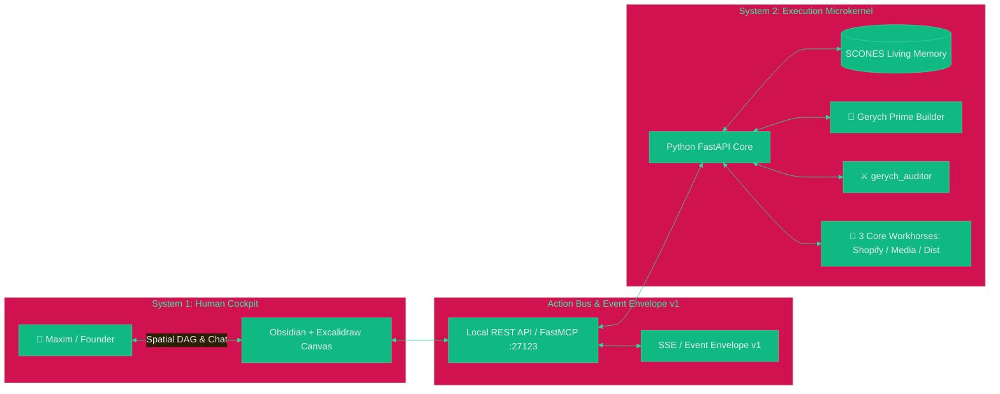

> [!metadata]- ⚙️ Системні метадані та інваріанти (MRH Header)
> ```yaml
> # --- DNK-MRH-HEADER ---
> mrh_id: "docs/architecture/specs/DNK_AGENTIC_BIO_ORGANISM_CORE_V1_SPEC.md"
> purpose: "Canonical Specification for DNK OS Agentic Bio-Organism Core v1, Dual-Surface Node Canvas, and Agent-Human Symbiosis Protocol."
> canonical_source: true
> alters_files: []
> triggers_tasks: []
> status: "Active"
> version: "1.0.0"
> updated_at: "2026-10-26"
> author: "DNK-e.com Maksym & Antigravity"
> # --- END DNK-MRH-HEADER ---
> ```
> > [!summary] 📋 Контекст для ШІ-агента
> > Канонічна специфікація Ядра v1 агентивної системи: двоповерхнева модель (Obsidian Excalidraw + FastMCP Microkernel), контракт вузлів полотна, чат з ADHD-протоколом та ліквідація застарілих рішень.

# 🧬 DNK OS: АГЕНТИВНИЙ БІО-ОРГАНІЗМ (CORE v1 SPECIFICATION)

## 1. Архітектурний Контракт Dual-Surface (Двоповерхнева Модель)

Система функціонує як скоординований біо-робот, розділений на два контури:
1. **System 1 (Human Spatial Cockpit — Сенсорика та Воля):**
   - Середовище: **Obsidian Visual Shell** (`.obsidian/` 11-плагінів SOTA стек) + **Excalidraw** infinite canvas (`.excalidraw.md`).
   - Призначення: Просторова декомпозиція задач (Task Forest DAG), концептуалізація, інтерактивне візуальне кермо для засновника (Maxim).
2. **System 2 (Execution Microkernel — Нервова Система та Моторика):**
   - Середовище: **Python FastAPI / FastMCP Microkernel** (`apps/api/`, `core/`, `services/`).
   - Призначення: Детерміноване виконання атомарних зрізів (MASE ≤ 25), AST-гейти якості (`scripts/verify_all.sh`), SCONES асоціативна пам'ять, IPC комунікація агентів через сокети/порт 27123.
3. **Action Bus (Нервові Синапси):**
   - Специфікація: `DNK-STUDIO-ARCH-001-event-envelope-v1.json`.
   - Події: `node.created`, `node.status_changed`, `agent.thought_streamed`, `gate.adversarial_reviewed`.



---

## 2. Специфікація Вузлів Візуального Канвасу (Node-Based Canvas Schema)

Кожен візуальний вузол на полотні Excalidraw / Node Canvas є проекцією структури **TaskDNA**:

| Поле | Тип | Опис |
| :--- | :--- | :--- |
| `id` | `UUID / NodeID` | Детермінований ідентифікатор вузла (напр. `TF-101`, `NODE-CORE-001`). |
| `title` | `string` | Лаконічна назва задачі/рішення (≤ 50 символів). |
| `status` | `enum` | `Planned` ➔ `In_Progress` ➔ `Review` ➔ `Completed` / `Blocked`. |
| `owner` | `string` | Відповідальний актор (`👤 Maxim`, `🤖 gerych_prime`, `🤖 dnk_shopify`). |
| `complexity`| `int (1..5)` | Рівень складності (C=1..2 Solo, C=3..5 Swarm Parallel). |
| `wikilink` | `string` | Двостороннє посилання на Markdown SSOT (`[[docs/...]]`). |
| `mase_slice`| `string` | Поточний зріз інструментів (напр. `Зріз: 1/3, ≤25 tools`). |

---

## 3. Чат-до-Канвасу: Стрімінг та Синхронізація Станів

1. **ADHD Cards Protocol у Чаті:**
   - Перший рядок повідомлення — конкретний вердикт або дія.
   - Заборонені неконструктивні вигуки та порожні словесні конструкції.
   - Максимум 1 екран інформації, 0 лекцій.
2. **Двостороннє Відображення:**
   - Коли агент починає крок: вузол на полотні змінює статус на `[ 🟡 IN PROGRESS ]` і підсвічується акцентним токеном `#34d399`.
   - Коли агент запускає перевірку: вузол переходить у `[ 🟣 AUDIT GATE ]` (Adversarial Review).
   - Коли `scripts/verify_all.sh` повертає `exit code 0`: вузол стає `[ 🟢 COMPLETED ]` і лінкується з хешем git-коміту.

---

## 4. Контракт Читання Механіки Агентом (Zero-Bloat Machine Onboarding)

Будь-який новий агент-воркер отримує контекст за 4 детерміновані кроки без засмічення вікна уваги:
1. **MRH Header Scan (<10ms):** Агент зчитує лише `DNK-MRH-HEADER` метадані цільових файлів.
2. **JIT Tooling Ceiling (≤ 6,000 токенів на кроці 0):** Важкі MCP відключені. Доступні лише файлові оператори та `scripts/verify_all.sh`.
3. **TaskDNA Retrieval:** Виклик `core/orchestrator/task_dna_lifecycle.py` для отримання списку вхідних залежностей і `Target File Whitelist`.
4. **SCONES Memory Pull:** Запит `scones_get_memories(topic)` для підтягування перевірених рішень минулих інцидентів.

---

## 5. Посібник Людини-Користувача (Human Cockpit Protocol)

1. **Постановка Задачі:**
   - Максим створює вузол або формулює ціль у чаті.
   - Система перевіряє гіпотезу через **Mandatory Dissent & 3 Flaws Rule** (3 приховані ризики, межові умови, скептична альтернатива).
2. **Контроль та Зворотний Зв'язок:**
   - У будь-який момент людина може зупинити процес командою `/stop` або зміною статусу вузла на `[ 🔴 BLOCKED ]`.
   - Жоден коміт не потрапляє в `main` без Adversarial Audit та зеленого гейта.

---

## 6. Зачистка Застарілих Рішень та Технологій (Pruning & Elimination)

У Ядрі v1 остаточно ліквідовано:
1. ❌ **Власний пропрієтарний Canvas бекенд з нуля:** Замінено на Obsidian Excalidraw + Local REST API (DEC-027). Економія місяців розробки та 0 багів власного 2D-рушія.
2. ❌ **Подвійний репозиторій (Split-Brain DNK_HUB vs DNK_OS_APP):** 100% консолідовано в єдиний монорепо `DNK_HUB` (DEC-028).
3. ❌ **TypeScript Nitro сервер:** Замінено на FastMCP Python Microkernel (DEC-026).
4. ❌ **Неавторизовані мікросервіси:** Розробка обмежена 3 робочими конячками (`services/dnk_shopify`, `services/dnk_media`, `services/dnk_distribution`).
