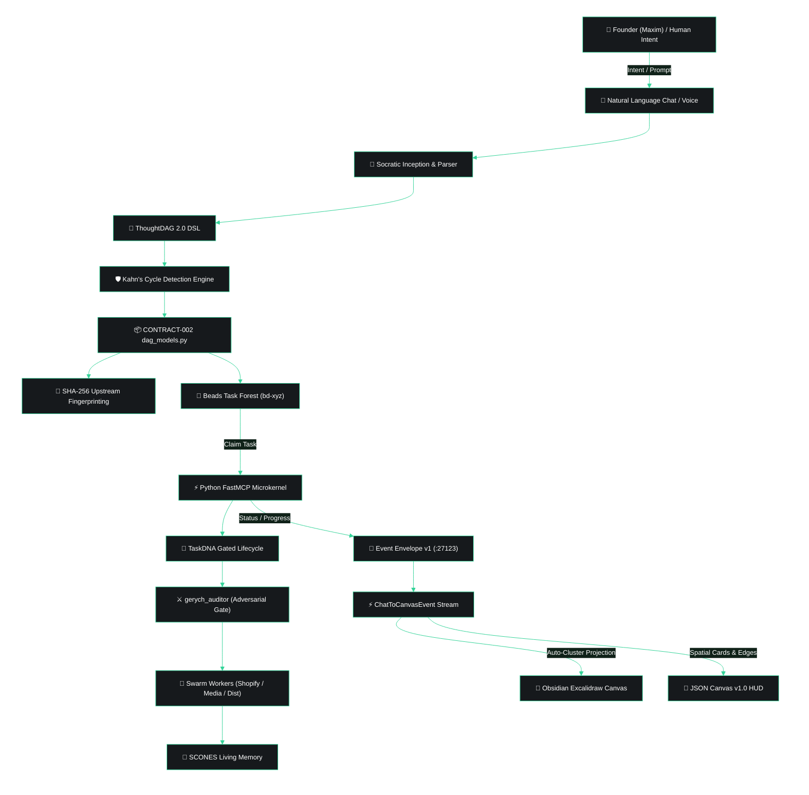
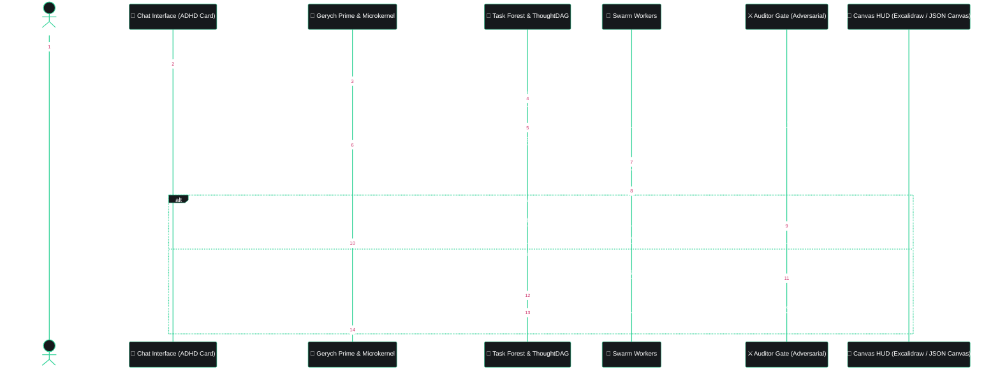
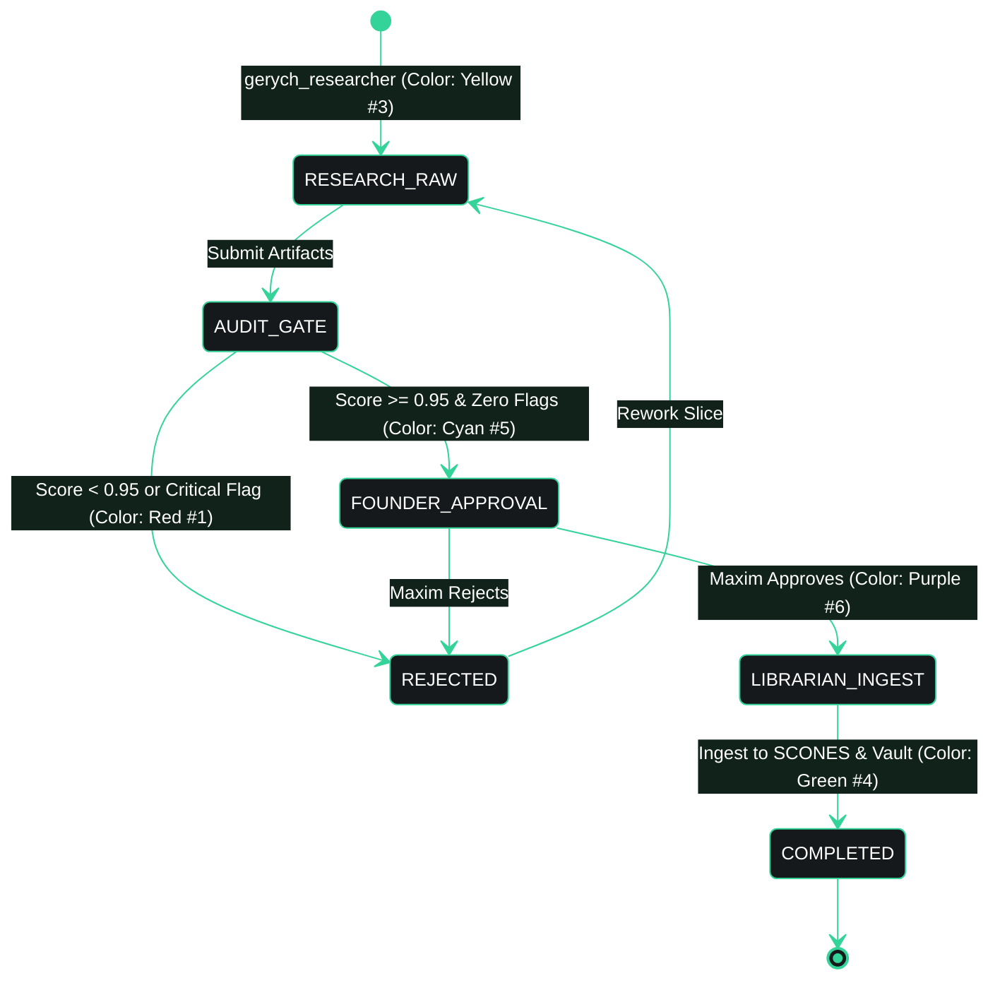

> [!metadata]- ⚙️ Системні метадані та інваріанти (MRH Header)
> ```yaml
> # --- DNK-MRH-HEADER ---
> # mrh_id: "docs/architecture/specs/DNK_TASKFOREST_CANVAS_DAG_SYNTHESIS.md"
> # purpose: "Master Specification & Synthesis of Task Forest, ThoughtDAG, Spatial Canvas Projection, and Chat-to-DAG Synchronization."
> # canonical_source: true
> # alters_files: []
> # triggers_tasks: []
> # status: "Active"
> # version: "1.0.0"
> # updated_at: "2026-10-27"
> # author: "DNK-e.com Maksym & Gerych Prime"
> # --- END DNK-MRH-HEADER ---
> ```
> > [!summary] 📋 Контекст для ШІ-агента
> > Єдина еталонна синтезована специфікація інтеграції Task Forest, ThoughtDAG, JSON Canvas v1.0 та Excalidraw у двоповерхневу модель DNK OS (DEC-029).

# 🌲🧬 DNK OS: TASK FOREST, CANVAS DAG & SPATIAL ORCHESTRATION ENGINE

## 1. Executive Summary & Dual-Surface Foundation

Система просторової та когнітивної оркестрації DNK OS об'єднує мислення людини, спрямовані ациклічні графи задач (Task Forest / ThoughtDAG) та автономне виконання роєм агентів під керуванням єдиного двоповерхневого контракту (**DEC-029: Agentic Bio-Organism Core v1**).

> [!important] Ключовий Інваріант Системи
> 1. **Людина мислить цілями та сенсами** у нескінченному візуальному просторі (System 1: Obsidian Excalidraw / Visual Shell Cockpit).
> 2. **Агенти мислять детермінованими діями, інструментами та кодом** (System 2: FastMCP Microkernel / Execution Swarm).
> 3. **Task Forest / ThoughtDAG** слугує нервовою системою (Shared Cognitive DAG), що пов'язує намір людини, топологічну чергу виконання та проекцію результатів на інтерактивне полотно.



---

## 2. Повний Цикл Синхронізації: Chat ➔ TaskDNA ➔ Tool ➔ Decision ➔ Canvas

Процес перетворення неструктурованого людського запиту на просторовий артефакт підпорядковується строгому 5-етапному конвеєру:



---

## 3. Модель Даних CONTRACT-002: ThoughtDAG & Context Wire Protocol

Файл реалізації: `./core/domain/dag_models.py`

### 3.1 Таксономія Вузлів (`NodeKind`)
Кожен вузол у когнітивному графі має сувору семантичну типізацію:

| `NodeKind` | Опис та Призначення | Відповідний Колір HUD |
| :--- | :--- | :--- |
| `project` | Контекст бренду, магазину або робочого простору | Dark Slate (`#16191c`) |
| `task` | Атомарне завдання лісу задач (`TaskDNA` / `Bead`) | Cyan (`#5` / `#34d399`) |
| `entity` | Фізичний чи цифровий об'єкт (товар, CAD, 3D, фото) | Blue (`#0284c7`) |
| `agent` | Виконавець рою (`dnk_shopify`, `dnk_dev_fullstack` тощо) | Orange (`#f97316`) |
| `skill` | Процедурна пам'ять та інструкція (`skills/` каталог) | Indigo (`#6366f1`) |
| `saap_tool` | Інструмент / FastMCP ендпоінт (ComfyUI, FFmpeg, Shopify API) | Amber (`#f59e0b`) |
| `artifact` | Кінцевий артефакт (відео, сторінка, блок, PR) | Green (`#4` / `#10b981`) |
| `note` | Просторова думка, гіпотеза або критика | Neutral (`#64748b`) |

### 3.2 Типи Зв'язків (`WireType`)
1. `context`: Спрямована передача контексту від предків до цільового вузла.
2. `data_stream`: Потокова передача важких даних між інструментами або агентами.
3. `dependency`: Жорстка часова залежність виконання (`depends_on`).

### 3.3 Upstream Fingerprinting & Context Staleness
Для запобігання використанню застарілого контексту обчислюється криптографічний відбиток SHA-256 по всіх батьківських вузлах у топологічному порядку:

$$\text{Fingerprint} = \text{SHA-256}\left(\bigoplus_{n \in \text{Ancestors}} \left( n.id \parallel n.kind \parallel n.mode \parallel n.text \parallel n.tags \right)\right)$$

Якщо будь-який батьківський вузол мутував, прапорець `is_stale` сигналізує агенту про необхідність рекомпіляції контексту.

---

## 4. Декларативний ThoughtDAG 2.0 DSL та Детекція Циклів

Файл реалізації: `./core/domain/thought_dsl.py`

### 4.1 Синтаксис Декларації
```text
[hypothesis] H1: Monolith Migration to Dual-Surface
[hypothesis] H2: Micro-frontend Isolation
[critique]   C1: Boundary & state synchronization risk
[synthesis]  S1: Hybrid FastMCP Core with Obsidian Visual Shell
H1 -> C1
H2 -> C1
C1 -> S1
```

### 4.2 Алгоритм Кана (Kahn's Algorithm) для Валідації Ациклічності
Перед будь-якою мутацією графа або запуском задач виконується детерміноване сортування за ступенями входу ($\text{in\_degree}$):

```python
def detect_cycles_kahn(node_ids: Set[str], edges: List[Tuple[str, str]]) -> Tuple[bool, List[str]]:
    in_degree = {nid: 0 for nid in node_ids}
    adj = {nid: [] for nid in node_ids}
    for u, v in edges:
        if u in node_ids and v in node_ids:
            adj[u].append(v)
            in_degree[v] += 1
    zero_in = deque([nid for nid in node_ids if in_degree[nid] == 0])
    visited = 0
    while zero_in:
        u = zero_in.popleft()
        visited += 1
        for v in adj[u]:
            in_degree[v] -= 1
            if in_degree[v] == 0:
                zero_in.append(v)
    if visited == len(node_ids):
        return False, []
    return True, [nid for nid, deg in in_degree.items() if deg > 0]
```

---

## 5. Ієрархія Beads Task Forest (`bd-xyz`)

Файл стандарту: `./core/orchestrator/agents/gerych_prime/skills/autonomous-ai-agents/beads-task-forest-integration/SKILL.md`

### 5.1 Ієрархічна Таксономія
- **Level 1 (Milestone / Goal)**: `bd-xyz`
- **Level 2 (Feature / Component)**: `bd-xyz.1`
- **Level 3 (Task / Issue)**: `bd-xyz.1.1`
- **Level 4 (Subtask / PR / Atomic Slice)**: `bd-xyz.1.1.1`

### 5.2 Двоетапний Адаптер (Zero-Binary Dual-Engine)
1. **Primary**: Нативний бінарний CLI `bd` або `dolt` у системному `$PATH`.
2. **Fallback**: Локальна вбудована база SQLite (`./.beads/beads.db`) з атомарним захопленням задач (`claimed_by`) для уникнення race conditions між агентами рою.

---

## 6. Машинний Контракт: Схема Подій `ChatToCanvasEvent`

Для асинхронної передачі стану виконання між System 2 (FastMCP) та System 1 (Canvas) застосовується типізований контракт подій:

```json
{
  "$schema": "http://json-schema.org/draft-07/schema#",
  "title": "ChatToCanvasEvent",
  "type": "object",
  "required": [
    "event_id",
    "timestamp",
    "event_type",
    "node_id",
    "status",
    "project_id",
    "payload"
  ],
  "properties": {
    "event_id": {
      "type": "string",
      "description": "Унікальний UUID події"
    },
    "timestamp": {
      "type": "string",
      "format": "date-time"
    },
    "event_type": {
      "type": "string",
      "enum": [
        "node_created",
        "node_updated",
        "node_status_changed",
        "wire_connected",
        "wire_disconnected",
        "agent_thought_streamed",
        "decision_locked",
        "layout_recalculated"
      ]
    },
    "node_id": {
      "type": "string",
      "description": "ID цільової ноди графа або Bead ID (bd-xyz)"
    },
    "status": {
      "type": "string",
      "enum": ["planned", "todo", "in_progress", "completed", "blocked", "failed", "cancelled"]
    },
    "color_code": {
      "type": "string",
      "enum": ["1", "2", "3", "4", "5", "6"],
      "description": "JSON Canvas 1.0 стандарт кольорів (1=Red, 3=Yellow, 4=Green, 5=Cyan, 6=Purple)"
    },
    "project_id": {
      "type": "string"
    },
    "payload": {
      "type": "object",
      "properties": {
        "title": { "type": "string" },
        "content_delta": { "type": "string" },
        "assigned_agent": { "type": "string" },
        "audit_score": { "type": "number", "minimum": 0.0, "maximum": 1.0 },
        "decision_ref": { "type": "string", "pattern": "^DEC-[0-9]{3}$" },
        "position": {
          "type": "object",
          "properties": {
            "x": { "type": "number" },
            "y": { "type": "number" },
            "cluster_id": { "type": "string" }
          }
        }
      }
    }
  }
}
```

---

## 7. Стратегія Автоматичного Кластерного Розміщення (Anti-Spaghetti Layout)

Файл реалізації: `./core/canvas/canvas_agent.py` та `./core/canvas/canvas_engine.py`

Щоб запобігти хаосу візуальних зв'язків («спагеті»), полотно розбивається на функціональні сектори зі стандартизованим просторовим кроком:

```mermaid
%%{init: {
  'theme': 'base',
  'themeVariables': {
    'primaryColor': '#16191c',
    'primaryTextColor': '#ffffff',
    'primaryBorderColor': '#34d399',
    'lineColor': '#34d399',
    'secondaryColor': '#102219',
    'tertiaryColor': '#16191c',
    'tertiaryTextColor': '#ffffff',
    'titleColor': '#ffffff',
    'textColor': '#ffffff',
    'mainBkg': '#16191c',
    'nodeBorder': '#34d399',
    'clusterBkg': 'transparent',
    'clusterBorder': 'rgba(255, 255, 255, 0.16)',
    'edgeLabelBackground': '#102219',
    'fontSize': '13px'
  }
}}%%
graph LR
    subgraph Col1 [Колонка 1: Research & Ideas (X: 0..400)]
        R1[Raw Ideas / Prompts]
        R2[SOTA Repo Assimilation]
    end

    subgraph Col2 [Колонка 2: TaskDNA Decomposition (X: 460..860)]
        T1[Epic: bd-001]
        T2[Task: bd-001.1]
    end

    subgraph Col3 [Колонка 3: Swarm Execution (X: 920..1320)]
        E1[Worker: dnk_shopify]
        E2[Worker: dnk_dev_fullstack]
    end

    subgraph Col4 [Колонка 4: Quality & Audit Gates (X: 1380..1780)]
        G1[⚔️ gerych_auditor]
        G2[🛡️ verify_all.sh Gate]
    end

    subgraph Col5 [Колонка 5: Ingest & Completed (X: 1840..2240)]
        C1[SCONES Cognitive Store]
        C2[Obsidian Vault MOCs]
    end

    Col1 --> Col2
    Col2 --> Col3
    Col3 --> Col4
    Col4 --> Col5
```

### 7.1 Геометричні Інваріанти
- **Horizontal Stride**: $460\text{px}$ між колонками.
- **Card Dimensions**: Ширина $250\text{px}$, базова висота $140\text{px}$.
- **Vertical Spacing**: $60\text{px}$ між картками всередині однієї колонки.
- **Edge Routing**: Вихід виключно `fromSide="right"`, вхід виключно `toSide="left"` з радіусом згладжування Безьє.

---

## 8. Безпековий Контур: TaskDNA Gated Lifecycle & Anti-Poisoning

Файл стандарту: `./docs/notes/ARCHIVE/historical_specs/177_taskdna_lifecycle_and_live_canvas_hud_architecture.md`

Для запобігання отруєнню довгострокової пам'яті (SCONES) та сховища знань (Obsidian Vault) неперевіреними артефактами діє 5-фазовий гейт:



---

## 9. Верифікація та Інструментальне Забезпечення

| Компонент / Шлях | Відповідальність | Механізм Тестування |
| :--- | :--- | :--- |
| `core/domain/dag_models.py` | Схеми Pydantic v2 та обчислення відбитків | `pytest tests/unit/core/test_dag_models.py` |
| `core/domain/thought_dsl.py` | Парсер DSL та алгоритм Кана | `pytest tests/unit/core/test_thought_dsl.py` |
| `core/canvas/canvas_agent.py` | FastMCP інструменти JSON Canvas 1.0 | `pytest tests/unit/core/test_canvas_agent.py` |
| `core/canvas/canvas_engine.py` | Рендерер компонентів та ReactFlow експорт | `pytest tests/unit/core/test_canvas_engine.py` |
| `scripts/system/doc_standard_guardian.py` | Аудит відповідності стандарту документації | `python3 scripts/system/doc_standard_guardian.py --file <path>` |

---

## 10. Перехресні Посилання та Нормативна База

- [[01_CORE_AND_ACTION_BUS_SPEC|01 Core & Action Bus Specification]]
- [[04_THOUGHT_TO_PLAN_PIPELINE_SPEC|04 Thought-to-Plan Pipeline Specification]]
- [[05_SPATIAL_UI_AND_CANVAS_SPEC|05 Spatial UI & Canvas Specification]]
- `docs/architecture/DECISION_REGISTRY_ADHD.md` (`DEC-029: Agentic Bio-Organism Core v1`)
- `docs/architecture/specs/DNK_AGENTIC_BIO_ORGANISM_CORE_V1_SPEC.md` (Канонічне ядро v1)
