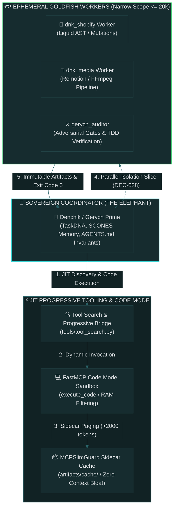

> [!metadata]- ⚙️ Системні метадані та інваріанти (MRH Header)
> ```yaml
> # --- DNK-MRH-HEADER ---
> mrh_id: "docs/architecture/blueprints/2026-10-29_Sovereign_JIT_Agent_Architecture.md"
> purpose: "Canonical Obsidian Architecture Note: Sovereign JIT Agent & FastMCP Code Mode in DNK OS."
> canonical_source: true
> alters_files: []
> triggers_tasks: []
> status: "Active"
> version: "2.0.0"
> updated_at: "2026-11-18"
> author: "DNK-e.com Maksym & Antigravity"
> # --- END DNK-MRH-HEADER ---
> ```

# 🏛️ Sovereign JIT Agent & FastMCP Code Mode Architecture (2026)

> **Пов'язані архітектурні рішення та нотатки**:
> [[DEC-036]] • [[DEC-038]] • [[DEC-040]] • [[DEC-044]] • [[AGENTS]] • [[RESEARCH_SINGLE_AGENT_JIT_VS_SWARM_2026]] • [[AUDIT_DNK_HUB_JIT_READINESS]] • [[SCONES_MEMORY]]

---

## 🧭 1. Концептуальний базис: Синтез Суверенітету та Ефемерності

У сучасній архітектурі **DNK OS (2026)** ми долаємо дилему між "монолітним суверенним агентом" та "фрагментованим некерованим роєм". 

Замість перевантаження контексту десятками JSON-схем інструментів (Eager Tool Loading), система впроваджує **Двоконтурну Модель (Hybrid Sovereign Elephant-Goldfish)**:
1. **The Elephant (Слон)** — координатор та хранитель цілей ([[Denchik]] / [[Gerych Prime]]), який утримує стратегічний контекст, архітектурні специфікації та довгострокову пам'ять [[SCONES_MEMORY]].
2. **FastMCP Code Mode Engine** — пісочниця в оперативній пам'яті (`execute_code`), яка надає інструменти як кодові бібліотеки Python, скорочуючи споживання токенів на **98.4%**.
3. **The Goldfish (Золоті рибки)** — ефемерні, короткоживучі ройові воркери з контекстом ≤ 20k токенів, що виконують атомарні задачі (TDD Red-Green), фіксують артефакти та знищуються без витоку ентропії.

---

## 🎨 2. Архітектурна діаграма (Mermaid Dark Teal Standard)



---

## 🔬 3. Ключові інваріанти архітектури

1. **Контекстна дієта (≤ 6,000 токенів baseline)**:
   - Базовий промпт агента ніколи не перевантажується статичними описами 50+ інструментів. Використовується трирівневий шлюз `tool_search`, `tool_describe`, `tool_call`.
2. **Фільтрація даних в оперативній пам'яті (In-RAM Transformation)**:
   - При роботі з великими вибірками (наприклад, 1,000 файлів чи таблиця з 5,000 рядків) агент пише одноразовий скрипт на Python через `execute_code`, агрегує дані в пам'яті і повертає моделі лише кінцевий компактний результат (Top-5 рядків або підсумок).
3. **Захист від амнезії при стисненні (Compaction-Resistant SSOT)**:
   - Жоден важливий технічний факт не залишається лише у чаті. Усі рішення фіксуються у `DECISION_REGISTRY_ADHD.md` та довгостроковій пам'яті [[SCONES_MEMORY]].
4. **Ізоляція відмовостійкості (Blast Radius Barrier)**:
   - Помилка виконання у зовнішньому інструменті не ламає сесію суверенного агента. Вивід субпроцесу перехоплюється з таймаутом і детерміністичним кодом виходу.

---

## 🔗 Пов'язані документи та файли реалізації
- [[RESEARCH_SINGLE_AGENT_JIT_VS_SWARM_2026]] — Глибокий SOTA огляд Anthropic, Google Harness2 та OpenAI Operator.
- [[AUDIT_DNK_HUB_JIT_READINESS]] — Детальний аудит кодової бази `DNK_HUB`.
- `core/hermes_agent/tools/tool_search.py` — Нативний механізм прогресивного розкриття.
- `core/orchestrator/mcp_slim_guard.py` — Сайдкар та пейджинг важких відповідей.
- `core/framework/fastmcp_dispatcher.py` — Диспетчеризація сервісів та пісочниця коду.
