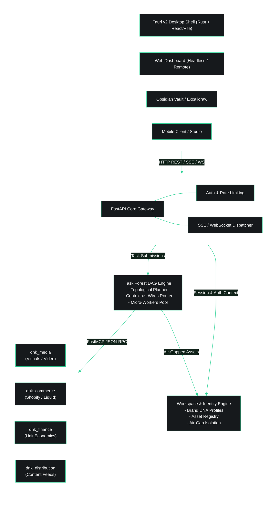

> [!metadata]- ⚙️ Системні метадані та інваріанти (MRH Header)
> ```yaml
> # --- DNK-MRH-HEADER ---
> mrh_id: "docs/architecture/blueprints/ARCHITECTURE_MAP.md"
> purpose: "Master Architecture Map and Component Interaction Diagram for DNK OS."
> canonical_source: true
> alters_files: []
> triggers_tasks: []
> status: "Active"
> version: "2.0.0"
> updated_at: "2026-11-18"
> author: "DNK-e.com Maksym & Antigravity"
> # --- END DNK-MRH-HEADER ---
> ```

> [!abstract] 🗺️ МАЙСТЕР-КАРТА АРХІТЕКТУРИ СИСТЕМИ
> Комплексна просторова та функціональна схема взаємодії клієнтського рівня, API-шлюзу, рушія Task Forest DAG, підсистеми ізоляції Workspace/Brand DNA та фабрики FastMCP плагінів.

<div align="center" style="margin-bottom: 16px;">
  <span style="background-color: #1e293b; color: #38bdf8; padding: 4px 10px; border-radius: 9999px; font-size: 12px; font-weight: 600; border: 1px solid #0284c7;">Домен: System Architecture</span>
  <span style="background-color: #1e293b; color: #34d399; padding: 4px 10px; border-radius: 9999px; font-size: 12px; font-weight: 600; border: 1px solid #059669;">Статус: Active</span>
  <span style="background-color: #1e293b; color: #c084fc; padding: 4px 10px; border-radius: 9999px; font-size: 12px; font-weight: 600; border: 1px solid #7c3aed;">Оптика: Dual-Lens</span>
  <span style="background-color: #1e293b; color: #f59e0b; padding: 4px 10px; border-radius: 9999px; font-size: 12px; font-weight: 600; border: 1px solid #d97706;">Рівнів: 4 Тіри</span>
</div>

`Навігація`: [[00_MOC_DNK_OS|🗺️ Головний MOC DNK OS]] ➔ [[specs/01_CORE_AND_ACTION_BUS_SPEC|🏛️ Специфікація Ядра]] ➔ **Карта Архітектури**

---

# 🗺️ Master Architecture Map: DNK OS Application



---

## 🏛️ Рівні Архітектури та Їх Відповідальність

### 1. Клієнтський Рівень (Client Tier)
- **Tauri v2 Desktop Shell**: Канонічний нативний клієнт (Rust runtime + React/Vite/Tailwind UI). Надає системний трей, нативні сповіщення, глобальні хоткеї та апаратне прискорення з мінімальним споживанням RAM (~30–50 МБ). Див. [[docs/adr/ADR-004-tauri-desktop-client-architecture|ADR-004]].
- **Obsidian Workspace**: Первинне середовище фіксації знань, перегляду специфікацій та взаємодії з агентом через [[Do not Delete - Draft|Draft.md]].
- **Visual Canvas**: Графічне відображення процесів у палітрі Flat Green (`#16382b` / `#86efac`) без налізань тексту.
- **Web / Studio UI**: Легковажні вебінтерфейси для віддаленого керування проектами та моніторингу задач.

### 2. Рівень Шлюзу (API Gateway Layer)
- Детермінована валідація вхідних запитів (Pydantic V2).
- Маршрутизація SSE-стрімів для передачі прогресу виконання підзадач у реальному часі.
- Детальні контракти описані в [[specs/01_CORE_AND_ACTION_BUS_SPEC|05_API_GATEWAY_CONTRACTS.md]].

### 3. Мікроядро (Core Microkernel)
- **Task Forest DAG Engine**: Планувальник топологічного графа задач. Забезпечує принцип Context-as-Wires, де кожен воркер отримує лише цільовий зріз даних (LOD ≤ 4k токенів). Див. [[specs/04_THOUGHT_TO_PLAN_PIPELINE_SPEC|04_TASK_FOREST_DAG_SPEC.md]] та [[docs/adr/ADR-002-task-forest-dag-execution|ADR-002]].
- **ThoughtDAG Spatial Brain**: Граф спрямованих думок, топологічний мердж та детекція циклів алгоритмом Кана для спільної роботи користувача та агента на полотні. Див. [[specs/05_SPATIAL_UI_AND_CANVAS_SPEC|06_USER_FRONTEND_AGENT_INTERACTION_SPEC.md]] та [[docs/adr/ADR-005-thoughtdag-spatial-knowledge-and-agent-interaction|ADR-005]].
- **Workspace & Identity**: Повна фізична ізоляція контексту між проектами користувача, збереження Brand DNA та налаштувань. Див. [[specs/02_USER_IDENTITY_AND_SOUL_SPEC|02_IDENTITY_AND_PROJECTS_SPEC.md]] та [[docs/adr/ADR-003-workspace-isolation-and-brand-dna|ADR-003]].

### 4. Фабрика Плагінів FastMCP (Plugin Fabric)
- Усі інструменти та доменні агенти підключаються як ізольовані мікросервіси через легковажний JSON-RPC протокол FastMCP.
- Стандарти створення описані в [[specs/01_CORE_AND_ACTION_BUS_SPEC|03_PLUGIN_SYSTEM_FASTMCP_SPEC.md]] та [[docs/adr/ADR-001-microkernel-fastmcp-architecture|ADR-001]].

---

`Див. також`: [[specs/01_CORE_AND_ACTION_BUS_SPEC|Специфікація Ядра]] | [[specs/05_SPATIAL_UI_AND_CANVAS_SPEC|Взаємодія Користувача і Фронтенду з Агентом]] | [[00_MOC_DNK_OS|Головний MOC]] | [[docs/guides/DEVELOPER_GUIDE|Гайд Розробника]]
