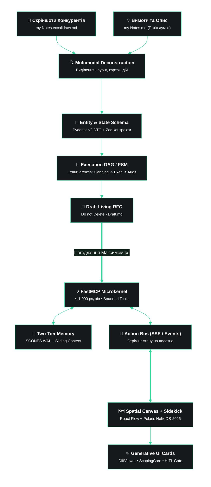

> [!metadata]- ⚙️ Системні метадані та інваріанти (MRH Header)
> ```yaml
> # --- DNK-MRH-HEADER ---
> mrh_id: "docs/architecture/blueprints/AUTONOMOUS_SYSTEM_DECISION_MATRIX.md"
> purpose: "Architectural options, reverse-engineering methodology from competitor screenshots, and decision matrix for DNK OS Autonomous Multi-Agent System."
> canonical_source: true
> alters_files: []
> triggers_tasks: ["TASK-CORE-DECISION-MATRIX-001"]
> status: "Active"
> version: "1.0.0"
> updated_at: "2026-10-02"
> author: "DNK-e.com Maksym & Antigravity"
> # --- END DNK-MRH-HEADER ---
> ```
> > [!summary] 📋 Контекст для ШІ-агента
> > Документ фіксує відповіді на стратегічний запит Максима: (1) методологія перетворення скріншотів конкурентів і візуальних нотаток із `my Notes.excalidraw` на стійку архітектуру, (2) 5 ключових архітектурних розвилок з оцінкою ризиків і вартості, (3) інженерний регламент побудови автономних мультиагентних систем у 2026 році. Оформлений строго за еталонним стандартом `Do not Delete - Example.md`.

<!-- AGENT_INGESTION_DIRECTIVE: schema_version="2.3" parse_mode="dual_optics" task_extractor="auto" dag_sync="enabled" archetype="ARCH_RFC" -->

> [!abstract] 🧭 АРХІТЕКТУРНИЙ КОНСИЛІУМ: ВІД СКРІНШОТІВ ДО АВТОНОМНОЇ СИСТЕМИ
> **Мета документа**: Надати Максиму стислий, структурований у стилі ADHD перелік інженерних варіантів побудови системи. Кожен блок містить варіанти вибору (Options), критику ризиків (Mandatory Dissent), оцінку складності та пряму рекомендацію для голосування.

<div align="center" style="margin-bottom: 16px;">
  <span style="background-color: #16181b; color: #30cd90; padding: 4px 10px; border-radius: 9999px; font-size: 12px; font-weight: 600; border: 1px solid #30cd90;">Статус: Active Consensus</span>
  <span style="background-color: #16181b; color: #38bdf8; padding: 4px 10px; border-radius: 9999px; font-size: 12px; font-weight: 600; border: 1px solid #38bdf8;">Домен: System Architecture</span>
  <span style="background-color: #16181b; color: #b388ff; padding: 4px 10px; border-radius: 9999px; font-size: 12px; font-weight: 600; border: 1px solid #b388ff;">Оптика: Dual-Lens</span>
  <span style="background-color: #16181b; color: #f59e0b; padding: 4px 10px; border-radius: 9999px; font-size: 12px; font-weight: 600; border: 1px solid #f59e0b;">Дизайн: Polaris-Helix (2026)</span>
  <span style="background-color: #16181b; color: #38bdf8; padding: 4px 10px; border-radius: 9999px; font-size: 12px; font-weight: 600; border: 1px solid #38bdf8;">Версія: 1.0.0</span>
</div>

`Навігація`: [[00_MOC_DNK_OS|🗺️ Головний MOC DNK OS]] ➔ [[Do not Delete - Draft|💬 Майстер-План Консиліуму]] ➔ **[[AUTONOMOUS_SYSTEM_DECISION_MATRIX|Матриця Архітектурних Рішень]]**

---

## 🎨 1. Візуальна Топологія: Конвеєр «Скріншот ➔ Архітектура ➔ Рантайм»

<!-- DAG_NODE: id="DAG-DECISION-TOPOLOGY" title="Screenshot-to-Architecture Pipeline Topology" type="visual_spec" agent="antigravity_mentor" -->



---

## 🎯 2. Смисловий Контекст: 5 Ключових Архітектурних Розвилок (Рівень 1: Людина)

<!-- DAG_NODE: id="DAG-DECISION-HUMAN-OPTIONS" title="Human Architectural Choices & Decision Matrix" type="architecture_decision" agent="antigravity_mentor" -->

> [!tip] 💡 Як користуватися цим розділом
> Ознайомся з 5 розвилками нижче. Кожна розвилка містить 2–3 варіанти з їхніми плюсами, мінусами та ризиками. Обери бажаний варіант, поставивши позначку `[x]` у відповідному чекбоксі або написавши номер у чаті.

---

### 🔀 РОЗВИЛКА 1: Парадигма Інтерфейсу (Front-End Shell)

> **Питання**: Як саме ми матеріалізуємо систему перед очима Максима на екрані?

* [ ] **Варіант 1.1: Pure Infinite Canvas (Тільки Нескінченне Полотно)**
  * *Суть*: Все живе на нескінченній площині (`@xyflow/react`). Чат — це рухома нода, код — це сусідня нода, термінал — нижня нода, задачі — деревоподібний граф.
  * *Переваги*: 100% просторове мислення, наочний зв'язок між ідеєю та кодом.
  * *Ризики (Flaws)*: Високе споживання пам'яті DOM, когнітивний параліч при > 100 нодах, незручно працювати з довгими текстами/файлами.
* [x] **(Рекомендовано) Варіант 1.2: Dual-Mode Studio (Spatial Canvas + Sidekick Dock)**
  * *Суть*: Гібридний форм-фактор за стандартом **Shopify Helix 2026**:
    1. Полотно (Canvas) слугує глобальною мапою архітектури, дерев задач та схем.
    2. Плаваючий Sidekick Dock (фіолетовий бейдж/вікно) забезпечує фокусний чат та швидкі команди без втрати полотна.
    3. При необхідності поглибленого кодингу — відкривається фокусна панель інспектора/редактора.
  * *Переваги*: Найкраща ергономіка для тривалої роботи, нуль візуального шуму, оптимізований рендеринг.
  * *Ризики (Flaws)*: Потребує налаштування синхронізації між станом Sidekick та нодами полотна.
* [ ] **Варіант 1.3: Класичний 3-Панельний IDE (IDE-First / Cursor Style)**
  * *Суть*: Дерево файлів ліворуч, редактор по центру, чат праворуч. Полотно доступне лише як додаткова вкладка.
  * *Переваги*: Звично, швидко будується на готових бібліотеках.
  * *Ризики (Flaws)*: Втрата унікальної просторової парадигми DNK OS; скочування до банального клону VS Code.

---

### 🔀 РОЗВИЛКА 2: Механізм Реверс-Інжинірингу зі Скріншотів (Screenshot Ingestion Engine)

> **Питання**: Як перетворювати скріншоти конкурентів із `my Notes.excalidraw` на працюючу архітектуру?

* [ ] **Варіант 2.1: Direct Vision-to-Code (Швидкий кодинг «в лоб»)**
  * *Суть*: Скріншот відправляється в мультимодальну модель (Gemini 3.8 Flash), яка одразу генерує верстку HTML/Tailwind або код React.
  * *Переваги*: Миттєвий прототип за 30 секунд.
  * *Ризики (Flaws)*: Фатальна відсутність архітектури. Отримуємо «мертву картинку» без типізованого бекенду, без стейт-менеджменту та без розуміння логіки агентів.
* [x] **(Рекомендовано) Варіант 2.2: 3-Етапний Детермінований Конвеєр (Vision ➔ Contract ➔ Synth)**
  * *Суть*:
    1. **Етап А (Деконструкція елементів)**: ШІ аналізує скріншот і виділяє сутності: віджети, списки, кнопки дій, індикатори статусу.
    2. **Етап Б (Машинний контракт State Schema)**: Створюється Pydantic/TypeScript DTO з описом даних, які стоять за цими віджетами (хто постачальник даних, які події генеруються).
    3. **Етап В (Генерація коду)**: Герич будує фронтенд-компоненти, які строго прив'язані до Action Bus ядра.
  * *Переваги*: Нуль галюцинацій, надійний production-код, легка заміна стилів без переписування логіки.
  * *Ризики (Flaws)*: Потребує на 1 крок більше часу на узгодження контракту.
* [ ] **Варіант 2.3: DOM & CSS Harvester (Глибокий скрапінг)**
  * *Суть*: Використання Chrome DevTools / Playwright для витягування живого DOM та стилів із веб-додатків конкурентів.
  * *Переваги*: 100% точність пікселів.
  * *Ризики (Flaws)*: Заборонено для десктопних додатків без вебу; брудний мініфікований код (obfuscated CSS).

---

### 🔀 РОЗВИЛКА 3: Двигун Оркестрації Агентів (Agent Harness Runtime)

> **Питання**: На чому базувати внутрішній цикл автономності агентів?

* [x] **(Рекомендовано) Варіант 3.1: Sovereign Micro-Harness (smolcoder + FastMCP Core)**
  * *Суть*:
    - Мікроядро на Python asyncio (≤ 1,000 рядків) per [[docs/adr/ADR-001-microkernel-fastmcp-architecture|ADR-001]].
    - Зовнішній план хоста (Host-Managed Plan) замість внутрішнього хаосу в промпті.
    - Жорстко обмежені інструменти (Bounded Tools: `read`, `patch`, `search`, `run`).
    - Ліміт ≤ 15 кроків на атомний зріз MASE.
    - Стоячий оверхед ≤ 1,500 токенів (Vertex AI Cache hit > 95%).
  * *Переваги*: Швидкість блискавки, нульове споживання пам'яті, повний контроль, відсутність залежностей від важких фреймворків.
  * *Ризики (Flaws)*: Необхідність власноруч підтримувати диспетчер задач.
* [ ] **Варіант 3.2: Готовий Фреймворк Графів (LangGraph / AutoGen / CrewAI)**
  * *Суть*: Використання стандартних важких бібліотек агентних графів.
  * *Переваги*: Сотні готових туторіалів в інтернеті.
  * *Ризики (Flaws)*: Стоячий контекст > 25,000 токенів; некеровані цикли повторів; неможливість кастомізації під інваріанти DNK OS.
* [ ] **Варіант 3.3: Дворівневий Сварм (Leader LLM + CLI Subprocesses)**
  * *Суть*: Головний агент Antigravity лише планує, а виконання цілком делегується окремим екземплярам CLI (як Claude Code або gerych.sh).
  * *Переваги*: Максимальна ізоляція контекстів.
  * *Ризики (Flaws)*: Вища вартість API за рахунок частих холодних стартів процесів.

---

### 🔀 РОЗВИЛКА 4: Пайплайн Асиміляції Знань (Solution Mining Queue)

> **Питання**: Як працювати з 1,700+ репозиторіями та щоденним потоком відео/статей, щоб не засмічувати ядро?

* [ ] **Варіант 4.1: Mass Bulk Ingestion (Масове сканування в базу)**
  * *Суть*: Запустити парсер на всі 1,700 репозиторіїв та векторну базу прямо зараз.
  * *Переваги*: Гігантська база знань за один клік.
  * *Ризики (Flaws)*: «Синдром плюшкіна» (Solution Hoarding): тисячі застарілих фрагментів, шум у пошуку, нуль релізів продукту.
* [x] **(Рекомендовано) Варіант 4.2: JIT-Інкубатор Патернів (Just-In-Time Extraction Queue)**
  * *Суть*:
    1. У `task_forest/incubator/` створюються структуровані картки рішень лише за запитом активної задачі.
    2. Кожна картка містить: джерело, суть алгоритму, доменну прив'язку та план чистої екстракції без спадщини (Clean-Room per [[docs/adr/ADR-007-selective-brick-extraction-protocol|ADR-007]]).
    3. Асиміляція в активний код відбувається **тільки тоді**, коли задача стає пріоритетною в спринті.
  * *Переваги*: Чисте ядро без мертвого коду, фокус на поточній задачі Максима.
  * *Ризики (Flaws)*: Вимагає дисципліни не відволікатися на цікаві, але неактуальні технології.

---

### 🔀 РОЗВИЛКА 5: Детермінізм та Контроль Якості (Quality Gates)

> **Питання**: Як гарантувати, що створена система працює автономно і не бреше про результати?

* [x] **(Рекомендовано) Варіант 5.1: Live Runtime Anti-Mock Gates (Машинний Доказ)**
  * *Суть*:
    - Жодна задача не вважається виконаною без підтвердженого `exit code 0` у скрипті верифікації (`scripts/verify_all.sh`).
    - Для бекенду: перевірка живого API через FastMCP/HTTP.
    - Для фронтенду: перевірка DOM та скріншота через безголовий браузер (DevTools MCP).
    - Заборона словесних запевнень («Я все зробив») per `AGENTS.md` Section 7.
  * *Переваги*: Залізобетонна надійність, впевненість засновника у працездатності.
  * *Ризики (Flaws)*: Вимагає підтримки тестів при зміні контрактів.
* [ ] **Варіант 5.2: Unit Mocking Only (Тільки синтетичні тести)**
  * *Суть*: Перевірка функцій за допомогою `unittest.mock` без запуску реальних процесів.
  * *Переваги*: Миттєве виконання за 0.2 секунди.
  * *Ризики (Flaws)*: Ілюзія стабільності — у тестах все зелене, а в реальному браузері інтерфейс падає з білим екраном.

---

### 📊 Зведена Матриця Рішень (Decision Matrix Summary)

| Архітектурна Зона | Варіант A | Варіант B (Рекомендовано) | Варіант C | Оцінка Складності | Швидкість MVP |
| :--- | :--- | :--- | :--- | :---: | :---: |
| **1. UI Shell** | Pure Canvas | **Dual-Mode Studio (Canvas + Sidekick)** | Classic IDE 3-Pane | Середня | ⚡⚡⚡ (3-4 дні) |
| **2. Screenshot Ingestion** | Vision-to-Code | **3-Stage Contract Synthesis** | DOM Harvester | Низька | ⚡⚡⚡⚡ (2 дні) |
| **3. Harness Engine** | **Sovereign Micro-Harness** | Heavy LangGraph | Hybrid CLI Swarm | Середня | ⚡⚡⚡⚡ (3 дні) |
| **4. Solution Mining** | Bulk Indexing | **JIT Incubator Queue** | On-Demand Search | Низька | ⚡⚡⚡⚡⚡ (1 день) |
| **5. Quality Gates** | **Live Anti-Mock Gates** | Synthetic Unit Mocks | Manual Review Only | Низька | ⚡⚡⚡⚡ (1 день) |

---

## 🤖 3. Машинний Контракт, Системні Інваріанти та Межі (Рівень 2: Агент)

<!-- DAG_NODE: id="DAG-DECISION-MACHINE-CONTRACT" title="Machine Contract & Execution Bounds" type="agent_contract" agent="gerych_prime" -->

> [!agent] 🤖 ПРАВИЛО ДЛЯ АГЕНТА: No Whitelist = No Code
> Цей розділ визначає непорушні межі дій для всіх агентів консиліуму. Будь-які модифікації файлів за межами білого списку суворо заборонені.

### 3.1. Білий Список Цільових Файлів (Target File Whitelist)
| Шлях до файлу (Відносний) | Дія | Відповідальний | Призначення |
| :--- | :---: | :--- | :--- |
| `docs/architecture/AUTONOMOUS_SYSTEM_DECISION_MATRIX.md` | `Mutate` | `antigravity_mentor` | Цей документ: фіксація погоджених рішень |
| `Do not Delete - Draft.md` | `Mutate` | `antigravity_mentor` | Синхронізація Master Plan із вибором Максима |
| `specs/01_CORE_AND_ACTION_BUS_SPEC.md` | `Mutate` | `dnk_dev_fullstack` | Оновлення DTO схем під обраний варіант харнесу |
| `specs/05_SPATIAL_UI_AND_CANVAS_SPEC.md` | `Mutate` | `dnk_dev_fullstack` | Оновлення специфікації полотна під Dual-Mode Studio |
| `my Notes.excalidraw.md` | `Read-Only` | `antigravity_mentor` | Джерело скріншотів та візуальних скетчів Максима |
| `tests/unit/test_decision_invariants.py` | `Create` | `gerych_auditor` | Валідація структурної цілісності матриці |

### 3.2. Негативний Скоуп та Заборони (Negative Scope / Anti-Scope)
- ❌ **Заборонено**: Створювати нові директорії верхнього рівня (дозволено лише 8 канонічних).
- ❌ **Заборонено**: Писати важкий код реалізації до моменту, поки Максим не поставить позначки `[x]` навпроти обраних варіантів.
- ❌ **Заборонено**: Застосовувати абсолютні системні шляхи. Лише відносні (`./`, `../`).
- ❌ **Заборонено**: Використовувати некритичні лестощі та сикофантію (діємо за протоколом ADHD).

### 3.3. Бюджет Інструментів та Токенів (Sanctioned Whitelist)
- **Дозволені інструменти**: `view_file`, `replace_file_content`, `write_to_file`, `run_command`, `grep_search`.
- **Контекстний бюджет**: Standing Overhead ≤ 5,000 токенів; робоча сесія ≤ 35,000 токенів.

---

## ⚡ 4. MASE Розробка та Детермінована Верифікація (Рівень 3: Розробка)

<!-- DAG_NODE: id="DAG-DECISION-MASE-SLICES" title="MASE Slices & Gate Matrix" type="dev_standard" agent="gerych_auditor" -->

### 4.1. Атомарні Зрізи Реалізації (Atomic Slices ≤ 25 дій per Slice)
1. **Slice 1 (Вибір та Фіксація)**: Максим обирає конфігурацію в документі ➔ Antigravity оновлює контракти в `specs/`.
2. **Slice 2 (Скелет Фронтенду)**: Герич розгортає Dual-Mode Studio каркас (Canvas + Sidekick Dock) на базі наших інженерних напрацювань.
3. **Slice 3 (Інтеграція Мікроядра)**: Підключення FastMCP Action Bus та передача живих подій у віджети Generative UI.
4. **Slice 4 (Anti-Mock Верифікація)**: Запуск `scripts/verify_all.sh` з отриманням детермінованого `exit code 0`.

### 4.2. Детермінована Матриця Приймання (Acceptance Gate Matrix)
| ID Гейту | Команда Перевірки (CHECK) | Очікуваний Результат (EXPECT) | Доказ (EVIDENCE) |
| :---: | :--- | :--- | :--- |
| **GATE-DEC-01** | `python3 scripts/system/markdown_schema_gate.py --file "docs/architecture/AUTONOMOUS_SYSTEM_DECISION_MATRIX.md"` | Валідний MRH-заголовок, 0 помилок лінтера | `exit code 0` |
| **GATE-DEC-02** | Пошук незаповнених обов'язкових виборів | Мінімум 5 прапорців вибору зафіксовано | `5 selections marked` |
| **GATE-DEC-03** | `bash scripts/verify_all.sh --affected` | Пройдено AST, Markdown та Typecheck | `ALL GATES PASSED (exit 0)` |

---

## 🌳 5. Граф Задач Task Forest & План Голосування (Рівень 4: Система)

<!-- DAG_NODE: id="DAG-DECISION-TASK-FOREST" title="Task Forest DAG & Voting Queue" type="task_spec" agent="gerych_prime" -->

### 5.1. Черга Дій для Засновника (Максима):
- [x] (TASK-DEC-001) [P0] @agent:antigravity_mentor | Створити канонічну матрицю рішень та методологію перетворення скріншотів у код.
- [ ] (TASK-DEC-002) [P0] @user:maksym | **Ознайомитися з 5 розвилками Розділу 2 та відзначити прапорцями обрані варіанти**.
- [ ] (TASK-DEC-003) [P1] @user:maksym | **Вставити перші скріншоти конкурентів у `my Notes.excalidraw.md`** із короткими підписами бажаних фіч.
- [ ] (TASK-DEC-004) [P1] @agent:antigravity_mentor | Провести деконструкцію вставлених скріншотів за схемою Варіанту 2.2.
- [ ] (TASK-DEC-005) [P1] @agent:gerych_builder | Сформувати каркас Dual-Mode Studio в `apps/web/` за обраним рішенням.

---

## 🔗 6. Зв'язки, MOC та Контекстна Мережа ([[Wikilinks]])

<!-- DAG_NODE: id="DAG-DECISION-WIKILINKS" title="Wikilinks & Context Network" type="standard" -->

- **Головна Карта Системи**: [[00_MOC_DNK_OS|🗺️ Головний MOC DNK OS]]
- **Майстер-План Консиліуму**: [[Do not Delete - Draft|Do not Delete - Draft.md (Living RFC)]]
- **Робочий Скетчпад Скріншотів**: [[my Notes.excalidraw|my Notes.excalidraw.md (Excalidraw Полотно)]]
- **Сирі Ідеї Максима**: [[my Notes|my Notes.md (Потік думок)]]
- **Золотий Стандарт Документації**: [[Do not Delete - Example|Do not Delete - Example.md]]
- **Специфікація Мікроядра**: [[specs/01_CORE_AND_ACTION_BUS_SPEC|01_CORE_AND_ACTION_BUS_SPEC]]
- **Специфікація Полотна**: [[specs/05_SPATIAL_UI_AND_CANVAS_SPEC|05_SPATIAL_UI_AND_CANVAS_SPEC]]
- **Архітектурні Рішення**:
  - [[docs/adr/ADR-001-microkernel-fastmcp-architecture|ADR-001: Microkernel FastMCP]]
  - [[docs/adr/ADR-006-agentic-harness-and-spec-kit|ADR-006: SOTA Agentic Harness & Spec-Kit]]
  - [[docs/adr/ADR-007-selective-brick-extraction-protocol|ADR-007: Selective Brick Extraction Protocol]]
  - [[docs/adr/ADR-008-shopify-polaris-helix-design-system|ADR-008: Shopify Polaris & Helix 2026 Design System]]
