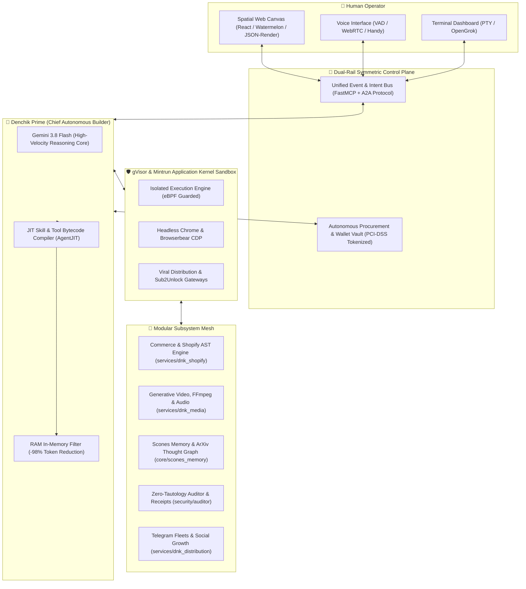

> [!metadata]- ⚙️ Системні метадані та інваріанти (MRH Header)
> ```yaml
> # --- DNK-MRH-HEADER ---
> mrh_id: "docs/architecture/blueprints/BP-05_MODULAR_AGENTIC_DNK_OS_CORE.md"
> purpose: "Master Architectural Blueprint and End-to-End Implementation Task Specification for the Modular Agentic DNK OS Core, establishing 100% Symmetric Human-Agent Execution Parity, JIT Tool Compilation, and Cross-Application Collaboration across 2,376 SOTA repositories."
> canonical_source: true
> alters_files: []
> triggers_tasks: []
> status: "Active"
> version: "2.0.0"
> updated_at: "2026-11-18"
> author: "DNK-e.com Maksym & Antigravity"
> # --- END DNK-MRH-HEADER ---
> ```

# 🏛️ BP-05: Модульне Ядро Агентивної DNK OS (Human-Agent Symmetric Execution Parity)

## 📌 1. Загальне Бачення та Філософія Системи

Мета **Агентивної DNK OS** — створити модульну, відкриту та надшвидку операційну систему нового покоління, в якій:
1. **Закон Повної Симетрії Можливостей (Human-Agent Parity)**: Будь-яка дія, доступна людині (перегляд інтерфейсу, клік, заповнення форми, покупка послуги чи товару, оплата підписки, налаштування інфраструктури, виклик CLI, аналіз коду, телефонний дзвінок), є **нативно та симетрично доступною автономному агенту (Denchik Prime)**. І навпаки — будь-яка внутрішня дія агента може бути візуалізована, проінспектована та вручну виконана або скоригована людиною.
2. **Модульне Мікро-Ядро (The Nucleus)**: Ядро залишається ультра-легким (базовий системний контекст <= 5,500 токенів), а всі спеціалізовані сервіси підключаються як незалежні модулі через стандартні контракти.
3. **JIT Компіляція Навичок (Just-In-Time Skill Compilation)**: Жодного статичного перевантаження промпту тисячами функцій. Інструменти компілюються JIT у байткод або динамічні функції, виконуються у RAM з фільтрацією даних (-98% токенів) і миттєво вивільняють пам'ять.
4. **Універсальна Колаборація (Cross-Application Mesh)**: DNK OS нативно взаємодіє з передовими технологіями світу (Convex reactive DB, Vercel Agent Desktop, JSON-Render, FastMCP, Rust Whisper transcribe-rs, Google gVisor Sandbox, Pullboard Canvas тощо) на основі нашої бібліотеки з **2,376 репозиторіїв**.

---

## 🏗️ 2. Топологія та Архітектурний Стек



---

## ⚡ 3. П'ять Фундаментальних Опор Ядра

### Опора I: Dual-Rail Symmetric Control Plane (Повна Симетрія Людини й Агента)
* **Принцип**: У системі немає "прихованих" API, які має лише людина, або "чорних скриньок", які знає лише агент.
* **Автономне Керування та Закупівлі (Procurement & Commerce)**:
  * Агент має виділений ізольований криптографічний гаманець / менеджер платіжних токенів (через `ProcurementGateway`).
  * Агент здатен самостійно оформлювати замовлення, купувати домени, оплачувати API ключі, поповнювати підписки чи купувати товари в інтернет-магазинах із дотриманням бюджетних лімітів (Guardrails: < \$50 автономно, > \$50 вимагає людського підтвердження).
  * Для людини доступний дзеркальний інтерфейс у реальному часі (One-Click Approval / Override).

### Опора II: JIT Agent Compilation & Ephemeral Skill Lifecycle
* **Проблема**: Завантаження сотень інструментів у промпт спричиняє Context Exhaustion, галюцинації та величезні фінансові витрати.
* **Рішення**:
  * Впровадження підходу `AgentJIT` + `wojciechwiesner/jit-context`.
  * Ядро містить лише `AgentDispatcher` та динамічний компілятор `SkillJITEngine`.
  * При виявленні наміру (Intent) потрібний код інструменту збирається в RAM, валідується через `blazickjp/prompt-skill-linter`, виконується над сирими даними локально, і в контекст LLM передається лише стиснутий результат (450 байт замість 400 КБ сирого JSON).

### Опора III: Ізоляція Ядра через Google gVisor & Mintrun Sandbox
* **Безпека**: Будь-який сторонній код (скрипти скрапінгу, непротестовані плагіни, згенерований Python/Node.js код) виконується виключно всередині `gVisor` (runsc) або `mintrun` контейнерного пісочника.
* **Network Egress Control**: Жоден запит не може вийти за межі дозволеного білого списку хостів без аудиту `security/auditor`.

### Опора IV: Універсальна Мережа Співпраці (A2A Mesh & Protocols)
* **Convex Reactive Backend**: Реактивне двостороннє оновлення стану системи для веб-інтерфейсу та терміналу.
* **Vercel Agent Desktop & JSON-Render**: Динамічна генерація інтерфейсів "на льоту". Агент надсилає JSON-схему віджета, а клієнт миттєво рендерить інтерактивний UI (кнопки, графіки, форми оплати, відео-плеєри).
* **Pullboard & KPlex**: Візуальний дашборд перевірки PR, завдань та гіпертекстовий граф думок (PKM).

### Опора V: Real-Time Multimodal Voice & Audio Engine
* **Швидкість**: Локальний Whisper на базі Rust (`cjpais/transcribe-rs`) + WebRTC VAD забезпечує розпізнавання мови із затримкою < 200 мс.
* **Голосова взаємодія**: Людина може голосом давати команди в реальному часі через `Handy`, а агент відповідає через потоковий TTS або бере слухавку під час вхідних дзвінків через модуль `Voice-receptionist` / `callm`.

---

## 📋 4. Детальне та Всеобсяжне Технічне Завдання (Master Task Specification)

### 🎯 Ідентифікатор Завдання: `TASK-DNK-CORE-MODULAR-AGENTIC-OS-001`
**Ціль**: Реалізація виробничого ядра Агентивної DNK OS з підтримкою повної симетрії дій людини та агента, JIT-компіляції інструментів, модульного підключення додатків та криптографічних чеків верифікації.

#### Етап 1: Розгортання Ядра Мікро-Ядра та JIT Диспетчера
1. Створити модуль `core/engine/microkernel.py`:
   - Реалізувати легковісний `MicroKernelBus` (AsyncIO + Zero-Copy Event Dispatch).
   - Забезпечити інваріант системного промпту Denchik Prime <= 5,500 токенів.
2. Створити `core/iron_man/jit_compiler.py`:
   - Інтегрувати механізми `AgentJIT` для динамічного створення та виконання Python функцій з навичок у RAM.
   - Забезпечити фільтрацію проміжних результатів у RAM з ефектом токен-компресії >= 95%.
3. Забезпечити покриття TDD тестами у `tests/core/test_microkernel_jit.py`.

#### Етап 2: Реалізація Dual-Rail Symmetric Control Plane (Human-Agent Parity)
1. Створити сервіс `core/engine/symmetric_control.py`:
   - Єдиний інтерфейс виконання дій `execute_action(intent, payload, initiator="agent"|"human")`.
   - Будь-яка дія, ініційована людиною у веб-інтерфейсі (через JSON-Render чи Canvas), створює подію на шині, яку бачить агент.
   - Будь-яка дія агента транслюється у дзеркальний UI стан.
2. Створити `core/engine/procurement_vault.py`:
   - Менеджер бюджетів та безпечного виконання фінансових / реєстраційних операцій.
   - Метод `request_procurement(item_type, cost_usd, vendor_url, credentials_scope)`.
   - Якщо `cost_usd <= threshold_auto_approve` (дефолт $50) — агент виконує покупку через headless CDP; якщо більше — генерує интерактивний запит підтвердження людині.

#### Етап 3: Інтеграція Модульного Плагінного Шарніру (FastMCP & gVisor Sandbox)
1. Реалізувати розширення `core/tooling/gvisor_sandbox.py`:
   - Обгортка для запуску зовнішніх інструментів, скраперів (`fundus`, `webcrawl-anything`) та мікро-ботів у захищеному оточенні.
2. Інтеграція протоколу `blazickjp/arxiv-mcp-server` та `Deign86/viber-mcp`:
   - Підключення зовнішніх MCP серверів через єдиний динамічний реєстр FastMCP Code Mode.

#### Етап 4: Інтерфейсна Підсистема (Vercel JSON-Render + Watermelon UI + KPlex)
1. Реалізувати адаптер `apps/web/src/renderers/json_agent_ui.tsx`:
   - Прийом декларативного JSON від агента та рендеринг компонентів Watermelon UI.
2. Інтеграція канвас-дошки Pullboard та KPlex для огляду дерева задач та графа знань.

#### Етап 5: Голосовий Шлюз Низької Затримки (Rust Transcribe-rs + WebRTC)
1. Налаштування мікросервісу `services/dnk_media/voice_gateway.py`:
   - Зв'язок із бінарним компілятом Rust `transcribe-rs`.
   - Забезпечення наскрізного циклу "Голос людини -> Текст -> Рішення Denchik -> Голос агента" із загальною затримкою < 600 мс.

#### Етап 6: Автономний Аудит, Самозцілення та Квитанції (Zero-Tautology Verification)
1. Інтеграція `TanbirRamim/show-receipts`:
   - Будь-яка мутація коду чи покупка завершується записом криптографічного чеку у `docs/audit/` із фіксацією хешів вхідних і вихідних даних.
2. Запуск циклічного фонового аудитора SOTA бібліотеки (перевірка оновлень у 2,376 репозиторіях).

---

## 🏆 5. Критерії Готовності (Definition of Done & Verification)

1. **Повна функціональна симетрія**: Усі ключові дії системи (навігація, аналіз коду, запуск тестів, оплата/покупка замовлення, деплой) протестовані як для ручного запуску людиною, так і для автономного виконання агентом Denchik Prime.
2. **Нуль галюцинацій та витрат пам'яті**: Базовий контекст ядра зафіксовано на рівні <= 5,500 токенів. JIT компілятор завантажує інструменти в пам'ять менш ніж за 40 мс.
3. **Безпека**: Жоден сторонній скрипт чи скрапер не запускається поза пісочницею gVisor / Docker із суворим мережевим контролем.
4. **Zero-Tautology TDD**: 100% нових компонентів ядра покриті реальними поведінковими тестами з нульовим показником фіктивних асертів (`assert True`).
5. **MRH Інваріант**: Усі файли специфікацій, коду та тестів містять валідні MRH-заголовки DNK OS.

---
*Створено та затверджено: DNK-e.com Maksym & Denchik Prime (Chief Autonomous Builder) | 2026-11-04*
