> [!metadata]- ⚙️ Системні метадані та інваріанти (MRH Header)
> ```yaml
> # --- DNK-MRH-HEADER ---
> mrh_id: "docs/architecture/blueprints/DECISION_MATRIX_SPATIAL_AGENTIC_SYSTEM.md"
> purpose: "Comprehensive Architectural Analysis and Decision Matrix for Spatial Canvas, Chat-as-a-Node, Pattern Mining Pipeline, and Screenshot-to-Code Loop."
> canonical_source: true
> alters_files: []
> triggers_tasks: []
> status: "Draft"
> version: "1.0.0"
> updated_at: "2026-10-02"
> author: "DNK-e.com Maksym & Antigravity"
> # --- END DNK-MRH-HEADER ---
> ```
> > [!summary] 📋 Контекст для ШІ-агента
> > Стратегічний документ консиліуму та вибору інженерних рішень перед розробкою інтерфейсу та ядра DNK OS. Деконструює нотатки з `my Notes.md` / `my Notes.excalidraw.md`, зв'язує їх із майстер-планом `Do not Delete - Draft.md` та пропонує конкретні альтернативи для затвердження Максимом.

<!-- AGENT_INGESTION_DIRECTIVE: schema_version="2.3" parse_mode="dual_optics" archetype="DECISION_MATRIX" -->

> [!abstract] 🧭 МАТРИЦЯ АРХІТЕКТУРНИХ РІШЕНЬ ТА СТРАТЕГІЧНИЙ ВИБІР
> Цей документ фіксує результати аналізу бачення засновника щодо побудови **DNK OS**: нескінченне просторове полотно (Spatial Canvas), чат як динамічна нода, декомпозиція задач у Task Forest, протокол перетворення скріншотів конкурентів на інтерфейс та автоматизована черга асиміляції патернів із 1,700+ репозиторіїв.

<div align="center" style="margin-bottom: 16px;">
  <span style="background-color: #16181b; color: #30cd90; padding: 4px 10px; border-radius: 9999px; font-size: 12px; font-weight: 600; border: 1px solid #30cd90;">Статус: Draft / For Review</span>
  <span style="background-color: #16181b; color: #38bdf8; padding: 4px 10px; border-radius: 9999px; font-size: 12px; font-weight: 600; border: 1px solid #38bdf8;">Домен: System Architecture</span>
  <span style="background-color: #16181b; color: #b388ff; padding: 4px 10px; border-radius: 9999px; font-size: 12px; font-weight: 600; border: 1px solid #b388ff;">Оптика: Dual-Lens</span>
  <span style="background-color: #16181b; color: #f59e0b; padding: 4px 10px; border-radius: 9999px; font-size: 12px; font-weight: 600; border: 1px solid #f59e0b;">Стек: React 19 / FastMCP</span>
</div>

`Навігація`: [[00_MOC_DNK_OS|🗺️ Головний MOC DNK OS]] ➔ [[Do not Delete - Draft|Чернетка Консиліуму]] ➔ **Матриця Рішень Просторово-Агентної Системи**

---

## 🎨 1. Візуальна Архітектурна Топологія (Mermaid SSOT)

```mermaid
%%{init: {
  'theme': 'base',
  'themeVariables': {
    'primaryColor': '#16191c',
    'primaryTextColor': '#ffffff',
    'primaryBorderColor': '#34d399',
    'lineColor': '#34d399',
    'secondaryColor': '#102219',
    'tertiaryColor': '#16191c',
    'tertiaryTextColor': '#ffffff',
    'titleColor': '#ffffff',
    'textColor': '#ffffff',
    'mainBkg': '#16191c',
    'nodeBorder': '#34d399',
    'clusterBkg': 'transparent',
    'clusterBorder': 'rgba(255, 255, 255, 0.16)',
    'edgeLabelBackground': '#102219',
    'fontSize': '13px'
  }
}}%%
flowchart TD
    subgraph Input["1. Джерела Наміру та Референсів (Founder Scratchpad)"]
        N1["my Notes.md: Сирі думки та завдання"]
        N2["my Notes.excalidraw.md: Скріншоти та візуальні референси"]
        N3["1,700+ Репозиторіїв та Відео: Зовнішні донори"]
    end

    subgraph Deconstruction["2. Деконструкція та Витяг (Vision & Extractor Engine)"]
        D1["Vision Analyzer: Розбір UI-скріншотів на блоки"]
        D2["ADR-007 Brick Extractor: Витяг бойових алгоритмів"]
        D3["Idea & Pattern Queue: Структурований беклог"]
    end

    subgraph Consensus["3. Інженерний Консиліум (Spec-Kit Incubator)"]
        C1["Do not Delete - Draft.md: Погодження рішень"]
        C2["UI/UX Living Specs: Контракти взаємодії"]
        C3["ADR: Архітектурні рішення (ADR-001 - ADR-009)"]
    end

    subgraph Runtime["4. Реалізація та Середовище (Agentic App)"]
        R1["Spatial Canvas (2D): Чат як Нода + Вузли Task Forest"]
        R2["FastMCP Microkernel Host: Асинхронна шина дій"]
        R3["User SOUL & Brand DNA: Персоналізація та пам'ять SCONES"]
    end

    Input --> Deconstruction
    Deconstruction --> Consensus
    Consensus --> Runtime

    classDef mintNode fill:#16191c,stroke:#34d399,stroke-width:1px,color:#d4d8db;
    classDef activeNode fill:#102219,stroke:#34d399,stroke-width:2px,color:#ffffff;
    classDef warnNode fill:#1f1910,stroke:#f59e0b,stroke-width:1px,color:#fde047;

    class N1,N2,N3 mintNode;
    class D1,D2,D3 warnNode;
    class C1,C2,C3 activeNode;
    class R1,R2,R3 activeNode;

    linkStyle default stroke:#34d399,stroke-width:1.5px;
```

<!-- DAG_NODE: id="DAG-SPATIAL-DECISION-TOPOLOGY" title="Spatial Agentic Architecture Topology" type="visual_spec" agent="antigravity_mentor" -->



---

## 🏛️ 2. Концепція "Spatial Canvas & Чат як Нода": Вибір Рушія

### 2.1. Проблематика
Згідно з нотатками в [[my Notes|my Notes.md]]:
> *"Ядро — безкінечне полотно з можливістю реалізовувати чат як ноду, а всередині ноди — задачі створюються як додаткові ноди всередині Task Forest... До ноди чату додати опцію додавати додаткові елементи: Excalidraw-полотно, документи, медіа, інші полотна."*

Чат перестає бути статичною бічною колонкою (1D) і стає повноправним просторовим об'єктом (2D), який має координати `(x, y)`, може масштабуватися, згортатися в плашку, прикріплюватися стрілками до документів, ініціювати розгалуження (forking) думок і породжувати підзадачі Task Forest прямо на полотні.

### 2.2. Матриця Технологічних Альтернатив для Полотна

| Параметр | Варіант A: React Flow (xyflow) + Astryx (Рекомендовано) | Варіант B: Вбудований Tldraw / Excalidraw SDK | Варіант C: Obsidian JSON Canvas Bridge |
| :--- | :--- | :--- | :--- |
| **Суть рішення** | Кастомне 2D-полотно на `@xyflow/react` у React 19 / Next.js 15. Кожна нода — це повноцінний React-компонент (Astryx). | Полотно для малювання з можливістю додавати кастомні HTML-шейпи. | Використання файлів `.canvas` Obsidian із двосторонньою синхронізацією через WebSocket/FastMCP. |
| **Швидкодія** | 60–120 FPS, віртуалізація вузлів, GPU-прискорення. | Висока при малюванні, але падає при складних вкладених React-формах. | Залежить від Obsidian, обмежена масштабованість для веб-клієнта. |
| **Чат як Нода** | **100% гнучкість**: будь-які форми, стрімінг токенів, таби, вкладені термінали, кнопки погодження (HITL). | Складніше: обгортка React усередині SVG/Canvas шейпа. | Обмежено нативними картками Obsidian Canvas (текст або iframe). |
| **Підтримка вкладених Canvas/Excalidraw** | Нода може рендерити міні-Excalidraw полотно через `@excalidraw/excalidraw` компонент. | Вкладене полотно в полотні створює конфлікти жестів панорамування/зуму. | Підтримується через вкладення файлів `.excalidraw.md`. |
| **Вердикт Ментора** | **Переможець для автономної Web Studio.** Дає повний контроль над UI/UX, ідеально лягає на ADR-009. | Підходить для скетчингу, але не для бойової операційної системи агентів. | Відмінно як додатковий адаптер експорту, але не як головний клієнтський рантайм. |

---

## 📸 3. Механіка "Скріншоти Конкурентів ➔ Інженерна Архітектура"

### 3.1. Як працює конвеєр витягу рішень
Ти зберігаєш скріншоти конкурентів у полотно [[my Notes.excalidraw|my Notes.excalidraw.md]], додаєш текстові стрілочки або коментарі в [[my Notes|my Notes.md]]. 

Далі запускається **4-кроковий протокол деконструкції екранів**:

```mermaid
%%{init: {
  'theme': 'base',
  'themeVariables': {
    'primaryColor': '#16191c',
    'primaryTextColor': '#ffffff',
    'primaryBorderColor': '#34d399',
    'lineColor': '#34d399',
    'secondaryColor': '#102219',
    'tertiaryColor': '#16191c',
    'mainBkg': '#16191c',
    'nodeBorder': '#34d399',
    'fontSize': '13px'
  }
}}%%
flowchart LR
    S1["1. Скріншот із my Notes.excalidraw"] --> S2["2. Vision & Semantic Deconstruction"]
    S2 --> S3["3. Фільтр: Золото vs Сміття"]
    S3 --> S4["4. Living UI Spec + Mockup у Draft.md"]

    classDef stepNode fill:#102219,stroke:#34d399,stroke-width:1.5px,color:#ffffff;
    class S1,S2,S3,S4 stepNode;
    linkStyle default stroke:#34d399,stroke-width:1.5px;
```



1. **Vision & Semantic Deconstruction**:
   - Агент розпізнає не "дизайн", а **інженерні вузли**:
     * Grid / Layout: Де сайдбар, де полотно, де плаваючі доки.
     * Information Density: Скільки інформації показується за 1 погляд.
     * Action Points: Де користувач приймає рішення (кнопки Approve/Reject, вибір моделі, запуск агента).
     * Feedback Loops: Як система показує статус агента (прогрес-бар, стрімінг думок, бейджі).
2. **Фільтр "Золото vs Сміття" (Anti-Cargo Culting)**:
   - Відкидаємо: застарілі патерни чат-ботів (довгі простирадла тексту без дій), незручні модальні вікна, що блокують екран.
   - Беремо: вдалі компактні картки, просторові переходи, інтерактивні тултіпи, системи розгалуження.
3. **Генерація інтерактивного вайрфрейму**:
   - Агент формує опис розкладки компонентів у `Do not Delete - Draft.md` з чіткими розмірами, станами та поведінкою.
4. **Погодження (Approval Gate)**:
   - Ти затверджуєш вайрфрейм ➔ Агент підбирає компоненти Meta Astryx / Tailwind v4 та генерує код.

---

## 📚 4. Бібліотека Патернів та Черга Рішень із 1,700+ Джерел

### 4.1. Проблематика
Згідно з нотатками в [[my Notes|my Notes.md]]:
> *"Чи можна створити таку структуру розробки, при якій роблячи аудит ресурсів, репозиторіїв, відео Агент створює задачі з патернів та технічних рішень... і зберігати їх в необхідній директорії, яка буде слугувати чергою рішень на реалізацію в процесі розробки DNK OS? Тобто якщо ідея не виконана та не асимільована в репозиторій DNK_OS_APP, вона залишається ідеєю..."*

Це класична проблема **управління архітектурним беклогом (Architectural Staging Pipeline)**. Якщо ідеї просто записувати текстом, вони втрачаються. Якщо одразу тягнути код у репозиторій — система перетвориться на звалище несумісних залежностей.

### 4.2. Інженерне Рішення: Дворівневий Банк Патернів (Pattern Staging Vault)

Створюється спеціалізована структура у `task_forest/pattern_bank/` та база знань у SQLite:

```
task_forest/pattern_bank/
├── 00_PATTERN_CATALOG_MOC.md       # Каталог усіх витягнутих патернів зі статусами
├── staging/                        # Черга ідей (Pending Assimilation)
│   ├── PAT-001-smolcoder-planner.md
│   ├── PAT-002-claude-code-ratchet.md
│   └── PAT-003-tldraw-infinite-canvas.md
└── assimilated/                    # Патерни, впроваджені в код core/ або apps/
    ├── PAT-000-fastmcp-kernel.md
    └── PAT-000-scones-sqlite-wal.md
```

#### Статусний Життєвий Цикл Патерна:
1. `status: mined` (Патерн знайдено в репозиторії-донорі або відео, витягнуто суть алгоритму).
2. `status: staged` (Патерн описано за шаблоном `EXCALIDRAW_TASK_TEMPLATE.md` з оцінкою складності та сумісності).
3. `status: queued_for_sprint` (Максим обрав цей патерн у `Do not Delete - Draft.md` для реалізації).
4. `status: assimilated` (Алгоритм перенесено в `core/` згідно з протоколом ADR-007, протестовано детермінованими тестами).

---

## 👤 5. Користувацькі Профілі, Tone-of-Voice та "User SOUL"

Згідно з [[my Notes|my Notes.md]], система повинна підтримувати:
> *"створення акаунтів користувачів, їх опису, тон оф войс, памʼяті, душі та стилю спілкування та роботи, проєкти та можливість підключати сервіси як плагіни".*

Ця функціональність вже закладена в архітектурні контракти системи:
- **[[specs/02_USER_IDENTITY_AND_SOUL_SPEC|02_USER_IDENTITY_AND_SOUL_SPEC]]**: Описує об'єкти `UserProfile`, `BrandDNA`, `UserSOUL`.
- **[[docs/adr/ADR-003-workspace-isolation-and-brand-dna|ADR-003]]**: Гарантує строгу ізоляцію робочих просторів (Workspaces) та пам'яті.
- **[[core/orchestrator/user_soul.py|core/orchestrator/user_soul.py]]**: Реалізує інжекцію тону, стилю та персональних правил у системний промпт агентів.

### Як це відображається на просторовому полотні:
1. **Картка Профілю / SOUL Node**: Кожен робочий простір має кореневу ноду "SOUL", де візуально налаштовуються повзунки автономності (L1–L4), тон комунікації, ключові стоп-слова та бренд-гайди.
2. **Плагіни як роз'єми (Service Connectors)**: Зовнішні сервіси (Shopify, Telegram, GitHub, Notion, PostgreSQL) відображаються як порти підключення на полотні.

---

## ⚖️ 6. Матриця Рішень: Що обираємо для Реалізації?

Нижче наведено 4 ключові розвилки, де потрібен твій вибір для переходу до проектування інтерфейсу:

### Розвилка 1: Технологія Просторово-Нодового Інтерфейсу
- [ ] **Варіант 1.A (Рекомендовано Ментором)**: **React Flow (`@xyflow/react`) + Tailwind v4 + Meta Astryx**. Максимальна гнучкість, 60fps, нативна підтримка будь-яких React-компонентів усередині нод чату.
- [ ] **Варіант 1.B**: **Вбудований Excalidraw SDK** у якості головного екрана. Плюс: легкий скетчинг. Мінус: важко вбудовувати складні інтерактивні форми чату та живий термінал.

### Розвилка 2: Формат "Ноди Чату"
- [ ] **Варіант 2.A (Омні-Нода Sidekick)**: Чат може жити як плаваюча картка на полотні (Shopify Sidekick style), перетягуватися в будь-яку точку, згортатися в плашку або докатися в правий край як у Cursor/Windsurf.
- [ ] **Варіант 2.B (Тільки вільно плаваючий чат)**: Чат живе тільки на полотні як один із багатьох вузлів графу думок (ThoughtNode).

### Розвилка 3: Зберігання Черги Патернів (1700+ репозиторіїв)
- [ ] **Варіант 3.A (Гібрид: Markdown SSOT + SQLite SCONES)**: Патерни зберігаються як структуровані картки в `task_forest/pattern_bank/staging/`, а ядро індексує їх у SQLite для швидкого пошуку агентами.
- [ ] **Варіант 3.B (Лише Markdown)**: Патерни живуть виключно як нотатки в репозиторії.

### Розвилка 4: Протокол затвердження UI
- [ ] **Варіант 4.A (Двоетапний: Ескіз ➔ Специфікація ➔ Код)**: Ти завантажуєш скріншот у `my Notes.excalidraw.md` ➔ Я роблю деконструкцію та пропоную вайрфрейм у `Do not Delete - Draft.md` ➔ Після твого "ОК" пишемо специфікацію та код.

---

## 🎯 7. Рекомендований Наступний Крок

1. **Твій вибір у Матриці Рішень**: Підтверди рекомендовані опції (1.A, 2.A, 3.A, 4.A) або вкажи свої коригування.
2. **Перший референс у `my Notes.excalidraw.md`**: Завантаж 1–3 перших скріншоти конкурентів, які тобі найбільше подобаються (наприклад, вікно чату, полотно або сайдбар), та напиши короткий коментар.
3. **Старт деконструкції**: Я розберу ці скріншоти на складові та підготую першу інтерактивну специфікацію головного екрана в `Do not Delete - Draft.md`.
