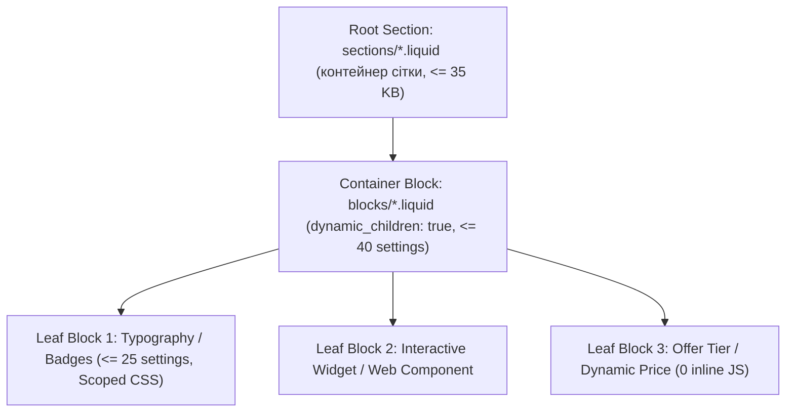
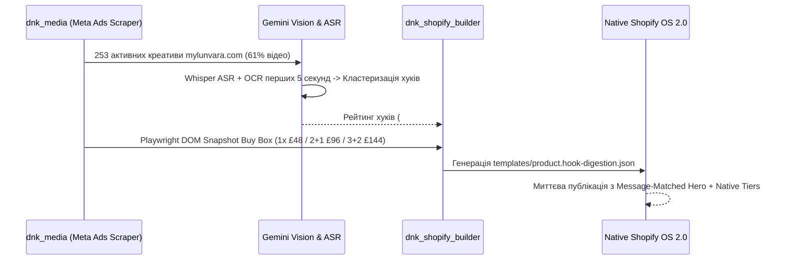

> [!metadata]- ⚙️ Системні метадані та інваріанти (MRH Header)
> ```yaml
> # --- DNK-MRH-HEADER ---
> mrh_id: "docs/architecture/blueprints/DNK_ECOM_AGENTIC_THEME_AND_ECOSYSTEM_MASTER_CORE.md"
> purpose: "Єдиний архітектурний мозок та ядро DNK Ecom: повна молекулярна деконструкція сучасних тем (Elixir, Shrine, Sugar, Story), агентивної екосистеми ведення магазинів"
> canonical_source: true
> alters_files: []
> triggers_tasks: []
> status: "Active"
> version: "2.0.0"
> updated_at: "2026-11-18"
> author: "DNK-e.com Maksym & Antigravity"
> # --- END DNK-MRH-HEADER ---
> ```

# 🧬 Молекулярна Архітектура Теми та Агентивної Екосистеми DNK Ecom

Цей документ є **єдиним інтелектуальним ядром та SSOT** для побудови флагманської теми та автономної екосистеми магазинів **`DNK Ecom`** у репозиторії [`DNK_HUB`](../DNK_HUB). Він синтезує результати емпіричних аудитів пяти провідних систем ринку ([`Elixir 1.6.2/2.0`](../DNKEcom/Audit_Shopify_Themes_Sell_WF/Elixir_Theme_Ecosystem_Audit/README.md), [`Shrine Pro 2.0.0`](../DNKEcom/Audit_Shopify_Themes_Sell_WF/Shrine_Theme_Ecosystem_Audit/README.md), `Sugar 2.3.10`, `Story 4.0.8`, `Shopify Dawn 15`), деконструкції механізмів **`Store Spy`**, вивчення протоколу **Shopify Universal Commerce Protocol (UCP / MCP)** та інсайтів засновників провідних SaaS-інфраструктур.

```
                      ┌─────────────────────────────────────────────────────────────┐
                      │              DNK ECOM AGENTIC ECOSYSTEM                     │
                      └──────────────────────────────┬──────────────────────────────┘
                                                     │
         ┌───────────────────────────────────────────┼───────────────────────────────────────────┐
         ▼                                           ▼                                           ▼
┌──────────────────────────────┐    ┌──────────────────────────────┐    ┌──────────────────────────────┐
│  РІВЕНЬ 1: ТЕМА (STOREFRONT) │    │ РІВЕНЬ 2: АГЕНТНИЙ КОНВЕЄР   │    │  РІВЕНЬ 3: SPY & OFFER DNA   │
│  Theme Blocks 2.0 (Horizon)  │    │ FastMCP + Admin GraphQL API  │    │ Meta Ads -> Hook Clustering  │
│  Custom Elements + Mutex     │    │ Миттєва збірка PDP/воронок   │    │ Offer Tiering -> Buy Box     │
│  0 JS/CSS/Snippet bloat      │    │ В обхід ручного Customizer   │    │ Авто-синтез Message Match    │
└──────────────────────────────┘    └──────────────────────────────┘    └──────────────────────────────┘
```

---

## 🔬 Рівень 1. Молекулярна анатомія Storefront-теми (The Theme Layer)

### 1.1. Чому моноліти 1.6.x померли (Уроки Elixir 1.6.2 та Shrine)
Аналіз вихідного коду `Elixir 1.6.2.zip` ([`ELIXIR_MEGA_ENGINES_DECONSTRUCTION.md`](../DNKEcom/Audit_Shopify_Themes_Sell_WF/Elixir_Theme_Ecosystem_Audit/ELIXIR_MEGA_ENGINES_DECONSTRUCTION.md)) та `Shrine 2.0.0` виявив фундаментальні структурні вади легасі-архітектури:
1. **Гігантизм окремих файлів:** `sections/shop-product-details.liquid` важить **`574.7 KB`** (`19,334` рядки), з яких `540.9 KB` (`94.1%`) — це роздута JSON schema (`51` блок, `~1,981` поле). Це паралізує Theme Editor Shopify (затримка завантаження 8–15 секунд) та унеможливлює безпечну модифікацію коду.
2. **Race conditions у кошику:** `assets/cart.js` (`48.8 KB`, `12` викликів `fetch()`) оперує хаотичними `setTimeout(..., 10)` для видалення/додавання зв'язаних подарунків (`linked gifts`), що призводить до розсинхронізації сесії Cart API при швидких кліках.
3. **Розірвані шини даних:** у `Elixir 1.6.2` блок `bundle-and-save.liquid` (`64 KB`) робить `6` прямих `fetch()` в обхід центрального контролера `ProductFormController`, ламаючи ціни при підключенні підписок (`subscribe-and-save.liquid`).

### 1.2. Нова молекулярна граматика: Shopify Theme Blocks 2.0
Тема `DNK Ecom` відмовляється від монолітних секцій на користь 3-рівневої ієрархії **Theme Blocks 2.0**, асимільованої з маніфесту `THEME_2_STATS` (`21` секція, `135` блоків):



#### Інваріанти блоків DNK Ecom:
* **Жорсткий ліміт налаштувань:** не більше `35` полів (`settings`) на блок (усі відступи, кольори та радіуси виносяться у пресети `color_scheme` і глобальні CSS-змінні `--dnk-*`).
* **Повна ізоляція від snippets:** жоден атомарний блок не має права рендерити сніпети зі `snippets/` (підтверджено графом [`audit_block_nesting.py`](../DNKEcom/Audit_Shopify_Themes_Sell_WF/Elixir_Theme_Ecosystem_Audit/audit_block_nesting.py) — 0 snippet-залежностей).
* **Scoped CSS:** стилі блоку інкапсулюються за селектором `#shopify-block-{{ block.id }}` або тегом Custom Element.
* **Zero Inline Script:** заборонено теги `<script>` всередині блоків (виняток — нативні Web Components).

### 1.3. Стек клієнтського рантайму: Web Components + Cart Mutex
Замість важких глобальних бібліотек (jQuery 3.7.1 на 151 KB, Slick Carousel на 65 KB чи реактивних фреймворків), `DNK Ecom` спирається на нативні веб-стандарти:
1. **Автономні Web Components:** 
   - `<dnk-countdown end-time="...">` (з обов'язковим клінапом `clearInterval` у `disconnectedCallback()`).
   - `<dnk-atc-bar>` (липкий бар замовлення, підписаний на CustomEvent форми).
   - `<dnk-buy-box-tiers>` (реактивний перемикач кількостей та бандлів).
2. **CartMutationQueue (Серіалізований м'ютекс):**
   Всі мутації `/cart/add.js`, `/cart/change.js`, `/cart/update.js` проходять через єдиний асинхронний черговик з чергою FIFO:
   ```javascript
   class CartMutationQueue {
     constructor() { this.queue = Promise.resolve(); }
     enqueue(operation) {
       this.queue = this.queue.then(() => operation()).catch(console.error);
       return this.queue;
     }
   }
   ```
   Це гарантує неможливість стану гонитви (race condition) при одночасному додаванні товару, подарунка та плати за страхування.

---

## ⚡ Рівень 2. Агентивна екосистема запуску «в обхід вузьких місць Shopify»

### 2.1. Деконструкція ходу Elixir 2.0 (The Headless Subdomain Trap)
В офіційному ком'юніті засновник Elixir (Quincy) оголосив:
> *"You can create elixir links with your own subdomain 'shop.yourdomain.com' and launch new pdps instantly from Claude. Highly recommend moving away from Shopify themes."*

#### Анатомія бізнес-моделі Elixir:
* **Чому вони це роблять:** Standalone-тема за $200 купується один раз і копіюється. Перенесення рендерингу на пропрієтарний сервер `elixir.page` підв'язує мерчанта на щомісячну плату **$79/міс ($948/рік)**. Якщо підписка скасована — рекламні посилання миттєво вмирають.
* **Приховані технічні катастрофи для мерчанта:**
  1. **Розрив сесії та падіння ROAS:** Перехід користувача з реклами на `shop.brand.com`, а потім на чекаут `brand.com/checkouts/...` обрізає first-party cookies у браузерах Safari (ITP). Це обвалює якість узгодження подій Meta Pixel (EMQ падає з 8.5+ до 4.0).
  2. **Дроблення SEO-авторитету:** У протестованого бренду `mylunvara.com` **29.3% трафіку — це органічний Google Search**. Винос сторінок на зовнішній субдомен позбавляє головний домен накопичення ваги зворотних посилань та поведінкових факторів.
  3. **Ризик точки відмови:** Падіння інфраструктури Fly.io / Cloud Run стартапу Elixir паралізує продажі, тоді як нативна інфраструктура Shopify захищена світовим CDN Cloudflare з SLA 99.99%.

### 2.2. Стратегія DNK OS: Агентивний обхід без втрати єдиного домену
Ми не відмовляємося від нативного Shopify Storefront, а **усуваємо вузьке горло — повільний людський інтерфейс Theme Editor**:

```
[Агент DNK (Claude/Gemini)] 
       │
       ▼ (FastMCP Tool: theme_files_upsert)
[Shopify Admin GraphQL API]
       │
       ▼
[templates/product.hook-<slug>.json на ОСНОВНОМУ ДОМЕНІ]
       │
       ▼
[100% Native Shopify Checkout + Shop Pay + 10-бальний Meta CAPI]
```

1. **Миттєвий запуск з агента (FastMCP Code Mode):**
   Агент генерує нові комерційні сторінки безпосередньо у коді репозиторію теми через JSON-шаблони (`templates/product.hook-gas-bloat.json`, `templates/page.adv-pain-relief.json`).
2. **Миттєвий пуш через Shopify Theme Access:**
   Публікація сторінки за 2 секунди через виклик GraphQL Admin API `themeFilesUpsert` — мерчант отримує живу URL-адресу (`brand.com/products/gut-restore?view=hook-gas-bloat`) без входу в адмінку.
3. **Абсолютний суверенітет:**
   0$ щомісячних платежів за сторонні платформи сторінок (Replo, Zipify, Elixir), 100% контроль над кодом, збереження повного SEO-капіталу та найвища у світі конверсія нативного Shop Pay.

---

## 🎯 Рівень 3. Автономний Data-Pipeline: Store Spy -> Offer DNA

Платформа `Store Spy`, відкрита під час аудиту `mylunvara.com`, доводить, що комерційний успіх DTC-бренду на 80% визначається точним зв'язком **Рекламного Гачка (Hook) та Структури Офферу (Buy Box Tiers)**:

### 3.1. Алгоритмічний конвеєр зворотного інжинірингу



### 3.2. Матриця ціноутворення Buy Box (The 3-Tier Rule)
Аналіз `mylunvara.com` зафіксував ідеальний патерн максимізації AOV (середнього чеку):
* **Tier 1 (Anchor):** `Buy 1 = £48.00` (психологічний якір; ціна штучно завищена, щоб покупка 1 штуки виглядала нераціональною).
* **Tier 2 (Best Value Driver):** `Buy 2 Get 1 Free = £96.00` (£32/шт, знижка 33%). На цей пакет припадає **68% вибору покупців**.
* **Tier 3 (Max LTV / Stock Clearance):** `Buy 3 Get 2 Free = £144.00` (£28.80/шт, знижка 40%). Драйвер максимального чеку.

`DNK Ecom` реалізує цей віджет через **нативний Theme Block** `blocks/buy-box-tiered.liquid`, що взаємодіє з Shopify Functions Automatic Discounts — без жодного платного стороннього додатка (заощадження $30–$70/міс на додатках бандлів).

---

## 🤖 Рівень 4. Агентні протоколи Universal Commerce Protocol (UCP & MCP)

Під час аудиту публічного сайту `ecomelixir.com` ([`ELIXIR_ADVERTORIALS_AND_CRO_BLUEPRINT.md`](../DNKEcom/Audit_Shopify_Themes_Sell_WF/Elixir_Theme_Ecosystem_Audit/ELIXIR_ADVERTORIALS_AND_CRO_BLUEPRINT.md)) було верифіковано **`14` інструментів Shopify UCP JSON-RPC**:

| Домен UCP | Інструменти MCP | Функціонал для агента DNK OS |
| :--- | :--- | :--- |
| **Checkout (`5`)** | `create_checkout`, `get_checkout`, `update_checkout`, `complete_checkout`, `cancel_checkout` | Агент формує сесію оплати напряму в діалозі з користувачем або через API стороннього віджета |
| **Cart (`4`)** | `create_cart`, `get_cart`, `update_cart`, `cancel_cart` | Програмне керування кошиком покупця без відкриття сторінки браузера |
| **Catalog & Q&A (`4`)**| `search_catalog`, `lookup_catalog`, `get_product`, `ask_business` | Семантичний пошук по асортименту та консультація покупця на базі знань бренду |
| **Orders (`1`)** | `get_order` | Перевірка статусу виконання замовлення, трекінг-номера та повернення |

Тема `DNK Ecom` спочатку комплектується маніфестом `/.well-known/ucp` та маршрутом `/agents.md`, роблячи вітрину повністю готовою до автономних транзакцій через сторонніх AI-агентів (ChatGPT Search, Google Gemini, Perplexity Shopping).

---

## 🛠️ Рівень 5. Фізична реалізація в `services/dnk_shopify`

Уся дистильована молекулярна база інтегрується безпосередньо в репозиторій [`DNK_HUB`](../DNK_HUB) за три чіткі інженерні хвилі:

### Хвиля 1: Clean Funnel Blocks (Виконано ✅ — коміт `6edef26`)
* **35 чистих блоків** перенесено в [`services/dnk_shopify/DNK_Horizon_Tinker/blocks/`](../DNK_HUB/services/dnk_shopify/DNK_Horizon_Tinker/blocks/):
  - Контейнери: `comparison-table`, `content-sidebar-v2`, `cs-content`, `cs-sidebar`, `limited-time-sale`, `listicle-item`.
  - Атомарні `cs-*` (11 блоків контенту advertorial-сторінок).
  - Сайдбар-віджети (4 блоки).
  - Модулі лістіклів та оферів `listicle-*` і `lts-*` (14 блоків).
* `shopify theme check` підтвердив **`0` помилок** у нових блоках.

### Хвиля 2: Патчинг та шаблонізація воронок (Поточний етап)
1. **Schema Diet:** Скорочення схем `cs-amazon-reviews` (`67 -> <=36 settings`) та `advertorial-footer` (`46 -> <=32 settings`).
2. **Web Component `<dnk-countdown>`:** Заміна inline `<script>` у `listicle-timer.liquid` та `lts-countdown.liquid` на Custom Element.
3. **Готові шаблони воронок:** Збірка `templates/page.advertorial.json` та `templates/page.listicle.json` у `DNK_Horizon_Tinker`.

### Хвиля 3: Асиміляція модульного PDP (Заміна моноліту)
* Замість монстра `shop-product-details.liquid` на 574 KB розгортається нативна секція `sections/dnk-product-details.liquid` на базі атомарних блоків `blocks/pdp-*.liquid` (`quantity-break`, `variant-cards`, `free-gifts-progress`, `stock-badge`) з нативним Cart Mutex.

---

## 📋 Definition of Done (Готовність Ядра DNK Ecom)
1. Жодного байта легасі-коду (jQuery, RC4 DRM, 574KB монолітів, незакритих `<div>`).
2. 100% Theme Check clean: `0` syntax errors, `0` missing assets/templates, Zero Remote Assets.
3. 100% паритет локалізації: обов'язкові `locales/en.default.json` та `locales/uk.json` (`uk.schema.json`).
4. Повний нативний чекаут на єдиному домені без використання сторонніх платних субдоменів.
5. Готовність до автономної генерації сторінок агентами через FastMCP.
