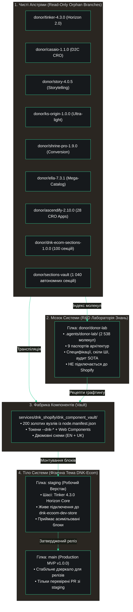

> [!metadata]- ⚙️ Системні метадані та інваріанти (MRH Header)
> ```yaml
> # --- DNK-MRH-HEADER ---
> mrh_id: "docs/architecture/blueprints/DNK_ECOM_THEME_BLOCKS_2_0_MASTER_BLUEPRINT.md"
> purpose: "Canonical Master Blueprint for DNK-Ecom Theme Blocks 2.0, Molecular Donor Lab, Component Vault, and Upstream Assimilation Pipeline (2026-2031)."
> canonical_source: true
> alters_files: []
> triggers_tasks: []
> status: "Active"
> version: "2.0.0"
> updated_at: "2026-11-18"
> author: "DNK-e.com Maksym & Antigravity"
> # --- END DNK-MRH-HEADER ---
> ```

# 👑 DNK-ECOM THEME BLOCKS 2.0 & CANVAS MASTER BLUEPRINT (2026–2031)

> **Єдине Джерело Правди (SSOT)**: Повна архітектурна стратегія створення флагманської теми **DNK-Ecom**, молекулярної фабрики **`dnk_component_vault`**, R&D Лабораторії **`donor/donor-lab`** та пайплайну вертикальних зрізів (MASE).

---

## 🗺️ 1. Топологія Репозиторію та Двоконтурна Система (Git SSOT)

Ми розділили систему на два ізольовані світи: **«Мозок» (Лабораторія R&D)** та **«Тіло» (Фізична Тема в Shopify)**.



### Матриця Гілок та Доступів:

| Гілка / Шлях | Роль у Системі | Підключення до Shopify | Статус |
| :--- | :--- | :--- | :--- |
| **`main`** | **Production MVP v1.0.0**. Стабільне дзеркало. | Бойовий клієнтський магазин. | Чекає на перший релізний мерж. |
| **`staging`** | **Робочий верстак асиміляції**. Шасі Tinker 4.3.0. | **`dnk-ecoom-dev-store`** (Dev-стор). | **Активна (коміт `89024f1`)**. |
| **`donor/donor-lab`** | **R&D Лабораторія**. Паспорти, 2 538 молекул, знання. | **НЕ підключається**. | Активна (коміт `b577ac5`). |
| **`donor/*`** (9 гілок) | **Апстрім-еталони тем**. Недоторкані orphan-гілки. | Не підключаються (Read-Only). | Зафіксовані в Git Object Pool. |
| **`dnk_component_vault/`** | **Канонічна фабрика вузлів**. Поза Git теми. | Захищена від ліміту 50 MB. | Готова до наповнення. |

---

## 🏛️ 2. Базове Шасі Ядра: Чому Tinker 4.3.0 (Horizon 2026–2031)

Затверджено безальтернативного переможця для ядра — **Shopify Horizon v4.3.0 (Tinker 4.3.0 DNK)**:

1. **Генетична сумісність із Casaio 1.1.0**: обидві теми побудовані на базі Horizon. Їхній базовий JS-клас `Component` (`assets/component.js`) однаковий. Блоки Casaio (`_quantity-breaks`, `_cart-progress-bar`, `sticky-atc`) стають у Tinker як рідні без переписування.
2. **View Transitions API + `morph.js`**: 145 точок безшовного розгортання карток, кошика та фільтрів на рівні GPU браузера без блимання екрана.
3. **Готова Українська Локалізація**: 1 412 ключів (`uk.json` + `uk.schema.json`) вже вшито.
4. **Статична типізація LiquidDoc**: 100% компонентів мають типізовані контракти `` під Shopify Sidekick та AI-агентів.
5. **CSS Subsetting**: Базовий CSS важить лише 49 KB; стилі блоків дедуплікуються автоматично через Shopify CDN.

---

## ⚗️ 3. Архітектура DNK Component Vault (`dnk_component_vault/`)

Щоб тема не роздувалася понад 50 MB, відібрані «Золоті Молекули» зберігаються в окремому сховищі `services/dnk_shopify/dnk_component_vault/`:

```
services/dnk_shopify/dnk_component_vault/
├── registry.json                       # Головний граф вузлів для Node Canvas
├── atoms/                              # Атоми (button, badge, price, icon, timer)
├── molecules_pdp/                      # Модулі картки товару (quantity-breaks, gifts)
├── molecules_cart/                     # Модулі кошика (progress-bar, upsells)
├── organisms_cro_sections/             # Автономні CRO-секції (reviews, comparison)
└── [Кожна папка компонента]/
    ├── node.manifest.json              # Контракт вузла для візуального Canvas
    ├── block.liquid                    # Адаптований Liquid під Theme Blocks 2.0
    ├── style.css                       # Scoped CSS на токенах --dnk-*
    └── component.js                    # Ізольований Web Component (<dnk-*>)
```

### 4 Операції Конвеєра при Транспіляції:
1. **Декомпозиція монолітів**: Вирізання блоків із гігантських `sections/main-product.liquid` (Dawn/Ascendify) в атомарні файли `blocks/_*.liquid`.
2. **Гармонізація токенів**: Заміна кастомних змінних на єдиний словник `--dnk-bg`, `--dnk-surface`, `--dnk-text`, `--dnk-accent`, `--dnk-border`, `--dnk-radius`.
3. **Ізоляція Web Components**: Упаковка інтерактиву в нативні Custom Elements (`<dnk-quantity-breaks>`) із підтримкою Customizer API (`shopify:block:select`).
4. **Двомовна Схема**: Автоматичне додавання ключів `t:` для англійської та української адмінки.

---

## 🕸️ 4. Стандарт Вузла (Node Contract) для Visual Canvas

Кожна молекула описується у файлі `node.manifest.json` через 3 порти:

1. 🟢 **INPUT PORTS (Контекст даних)**:
   - Які об'єкти Shopify потрібні: `product`, `variant`, `cart`, або параметри схеми (`settings.discount_value`).
2. ⚡ **STATE / EVENT BUS (Шина подій)**:
   - Вузол слухає або випромінює події: `dnk:variant:change`, `dnk:quantity:override`, `dnk:cart:updated`.
   - **Обов'язковий міст для пікселів**: шина транслює події в `window.Shopify.analytics` (Meta Pixel, GA4, TikTok бачать усі додавання в кошик).
3. 🔵 **SLOTS / OUTPUT PORTS (Контейнерні слоти)**:
   - Мапінг на фізичні контейнери `blocks/_group.liquid` (Auto-Layout у Figma/Canvas) з обов'язковою декларацією `"accepts": ["@theme", "@app"]`.

---

## ⚡ 5. План Впровадження: Вертикальні Слайси (MASE Protocol)

Ми відкидаємо застарілу водоспадну модель (аудит 9 тем за абеткою). Замість цього розгортаємо **функціональні зрізи прямо на живому магазині `dnk-ecoom-dev-store`**:

| Слайс | Назва Функціоналу | Джерела Донорів | Результат на Вітрині |
| :---: | :--- | :--- | :--- |
| **Слайс 1** | **PDP Conversion Engine** | `donor/casaio-1.1.0` + `donor/ks-origin-1.0.0` | Оптові знижки (`_quantity-breaks`), живі свотчі варіантів, липка панель (`sticky-atc`). |
| **Слайс 2** | **Cart Drawer & FOMO** | `donor/casaio-1.1.0` + `donor/story-4.0.5` + `donor/ks-origin-1.0.0` | Шкала безкоштовної доставки з подарунком, промокод `<cart-discount>`, таймер броні кошика. |
| **Слайс 3** | **Social Proof & Compare** | `donor/ascendify-2.10.0` + `donor/dnk-ecom-sections-1.0.0` | Таблиця порівняння з конкурентами (`comparison-v3`), блок відгуків Trustpilot v2. |
| **Слайс 4** | **Marketing Landing Pages** | `donor/casaio-1.1.0` + `donor/sections-vault` | Шаблони воронки: Advertorial, Listicle, Bundle Deals. |

---

## 🛡️ 6. Захисні Інваріанти та Граничні Умови (Epistemic Armor)

1. **Граничні Умови (Що заборонено дробити на мікроблоки)**:
   - Кошик (`<cart-drawer>`), вибір варіантів (`<variant-selects>`) та фільтри — **залишаються цілісними Web Components**. Їхнє дроблення ламає розрахунок знижок та чекаут.
2. **Підтримка Сторонніх Додатків (`@app`)**:
   - Усі ключові контейнери зобов'язані містити `"accepts": ["@theme", "@app"]`, щоб мерчант міг вільно вставляти віджети Klaviyo, Judge.me, Loox.
3. **Ізоляція від `shopify[bot]`**:
   - Лабораторія `donor/donor-lab` захищена від адмінки.
   - Тема `staging` захищена файлом `.shopifyignore` (`.git`, `.github`, `.agents`, `docs`, `*.md`).

---

## 📋 7. Чекліст Старту Слайсу 1 (Готовий до Виконання)

- [x] Репозиторій очищено (Clean Slate).
- [x] Гілка `staging` розгорнута на чистому ядрі Tinker 4.3.0 (коміт `89024f1`).
- [x] Створено захисний `.shopifyignore`.
- [x] Зафіксовано 9 донорів в ізольованих orphan-гілках.
- [ ] **КРОК 1**: Створити каталог `services/dnk_shopify/dnk_component_vault/molecules_pdp/quantity-breaks/`.
- [ ] **КРОК 2**: Витягти молекулу `_quantity-breaks` із `donor/casaio-1.1.0`, адаптувати токени `--dnk-*`.
- [ ] **КРОК 3**: Змонтувати блок у `staging` (`blocks/_dnk-quantity-breaks.liquid`), запушити в GitHub і перевірити в Customizer `dnk-ecoom-dev-store`.
