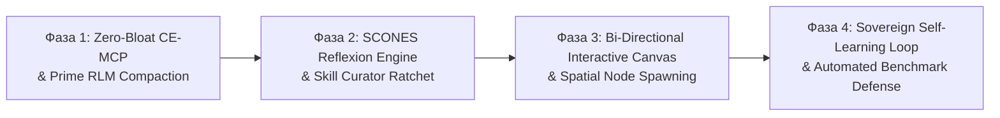

> [!metadata]- ⚙️ Системні метадані та інваріанти (MRH Header)
> ```yaml
> # --- DNK-MRH-HEADER ---
> mrh_id: "docs/architecture/blueprints/DNK_OS_AGENTIC_HARNESS_AND_LIVING_CANVAS_ARCHITECTURAL_BLUEPRINT_2026.md"
> purpose: "Master Architecture Cut, Documentation Coverage Audit, and Global SOTA Harness Benchmark as of November 17, 2026."
> canonical_source: true
> alters_files: []
> triggers_tasks: []
> status: "Active"
> version: "2.0.0"
> updated_at: "2026-11-18"
> author: "DNK-e.com Maksym & Antigravity"
> # --- END DNK-MRH-HEADER ---
> ```

# 🏛️ DNK OS Sovereign Agentic Harness & Living Canvas: Master Architectural Blueprint (17 November 2026)

---

## 🧭 1. Executive Summary & Architectural Cut

Станом на **17 листопада 2026 року**, екосистема **DNK OS** досягла зрілості повноцінної суверенної операційної системи автономних агентів. Архітектура побудована навколо концепції **«Вузької Талії» (Narrow Waist Microkernel)**, де ядро системи залишається ультра-компактним (< 400 рядків коду), а вся функціональна потужність реалізована через динамічні FastMCP-цеглини (Bricks), подієвий міст **Hermes ACP**, живу топологічну канву **Astryx Generative UI** та виробничий воркхорс **Shopify Sovereign Apex**.

```mermaid
flowchart TD
    subgraph UI_Layer["🎨 Dual-Surface Astryx Cockpit (Next.js 14 / Tailwind)"]
        AstryxTokens["Astryx Design Tokens\n(@layer astryx-theme)"]
        LivingCanvas["Living Node Canvas\n(@xyflow/react v12 + Kahn Layout)"]
        ToolCards["ToolCallCard v2.0\n(Visual Line Diff + Syntax Highlighting)"]
        AgentHUD["AgentStreamHUD v2.0\n(Web Audio Sensory Synthesizer)"]
        HitlModal["HitlApprovalModal\n(1-Click Non-Blocking Gateway)"]
        NodeChat["Node-Scoped Contextual Chat\n(Kahn Injected <= 1500 tokens)"]
    end

    subgraph Bridge_Layer["🌉 Dual-Bridge Communication Tier"]
        HermesBridge["HermesUIBridge\n(100-Event Ring Buffer + ActionBus)"]
        TaskboardBridge["TaskboardCanvasBridge\n(SQLite tasks.sqlite <-> XYFlow Nodes)"]
        FastAPIRouters["FastAPI Routers\n(/swarm/live/ws, /taskboard/canvas)"]
    end

    subgraph Kernel_Layer["⚙️ DNK OS Sovereign Microkernel (Narrow Waist)"]
        Microkernel["core/kernel.py (< 400 LOC)\nDynamic FastMCP Host & Process Sentinel"]
        PortRegistry["Port Registry & PID Guard\n(Zero Ghost Processes)"]
        Bricks["6 Composable Bricks\n(Brain, SCONES, Spatial, Shopify, Media, Web)"]
    end

    subgraph Swarm_Mesh["🤖 4-Agent Autonomous Swarm Mesh"]
        Antigravity["Antigravity\n(Mentor / Chief Architect)\n[Emerald #10b981]"]
        Denchik["Denchik\n(Master Physical Builder)\n[Blue #3b82f6]"]
        Gerych["Gerych Prime\n(Cold Knowledge Auditor)\n[Purple #a855f7]"]
        Goldfish["Goldfish EGM\n(Dual-System Reviewer)\n[Amber #f59e0b]"]
    end

    subgraph Workhorse_Layer["🛍️ Production Commercial Tier"]
        SovereignApex["Shopify Sovereign Apex v1.0.0\n(280 files, 0 theme-check errors)"]
        ThemeStoreBlocks["SaaP Dual-Ready v2.0 Blocks\n(Sticky ATC, Smart Drawer, QB v2)"]
    end

    UI_Layer <--> Bridge_Layer
    Bridge_Layer <--> Kernel_Layer
    Kernel_Layer <--> Swarm_Mesh
    Swarm_Mesh --> Workhorse_Layer
```



---

## 📊 2. Global SOTA Benchmark: DNK OS vs. World-Class Frontier Harnesses (Nov 2026)

Станом на листопад 2026 року, світова інженерія автономних агентів розділилася на кілька фронтирних парадигм. Нижче наведено детальний порівняльний аудит рішень DNK OS проти лідерів індустрії:

| Архітектурний вектор | Світовий лідер / Рішення (Nov 2026) | Реалізація в DNK OS | Перевага DNK OS | Існуючий розрив (Gap) |
| :--- | :--- | :--- | :--- | :--- |
| **1. Tool Execution Overhead** | **Anthropic Code Execution MCP (CE-MCP / Code Mode)**: Виконання коду в in-memory середовищі для агрегації сотень інструментів за 1 виклик. | **FastMCP Dynamic Host** (`core/kernel.py` + `denchik_engine.sh`). | Нульова залежність від хмарних бекендів; виконання локально на macOS Silicon через `uv` / APFS clones. | Потрібна автоматична трансляція мульти-інструментальних ланцюжків у єдиний виконуваний скрипт (Anthropic Pattern). |
| **2. Event Streaming & Telemetry** | **Nous Research Hermes ACP & MCP Stdio/SSE**: Протокол трансляції внутрішніх думок (`on_thought`), кроків та інструментів у реальному часі. | **HermesUIBridge** (`core/adapters/hermes_ui_bridge.py`): 100-event ring buffer, WebSocket `/swarm/live/ws` + SSE `/stream`. | Підтримка неблокуючого HITL із біполярним таймаутом; гарантія збереження останніх 100 подій при реконекті UI. | Додати бінарний протокол Protobuf/MessagePack для надшвидких пакетів high-frequency телеметрії. |
| **3. Spatial Graph & Living Canvas** | **LangChain Deep Agents & CopilotKit Open-Canvas**: Статичні або хмарні графові схеми на React Flow / ElkJS. | **Living Node Canvas** (`@xyflow/react` v12 + **Topological Kahn Auto-Layout** в `MultiAgentSwarmCanvas.tsx`). | Нульові важкі сторонні бібліотеки авто-лейауту; топологічний порядок $O(V+E)$; типізовані дроти `CONTEXT`/`DIFF`/`OUTPUT`. | Реалізувати перетягування нових задач із чату методом Drag-and-Drop на канвас із динамічним додаванням залежностей. |
| **4. Context Compaction & Memory** | **Prime Agent RLM (Recursive Language Model) & MemGPT**: Рекурсивна компресія історії діалогу та семантична пам'ять. | **SCONES Memory L1-L3** + жорсткий ліміт інжекції контексту upstream-нод ($\le 1500$ токенів). | Відсутність роздування контексту ("Zero-Waste Diet"); цільові слайси файлів замість монолітного читання. | Автоматичне фонове стиснення діалогів старих нод за алгоритмом Prime Agent RLM при перевищенні 20k токенів. |
| **5. Human-in-the-Loop (HITL)** | **Builder.io Agent-Native (Dual-Surface Actions)**: Візуальні картки затвердження з можливістю мутації параметрів. | **HitlApprovalModal.tsx** + сенсорний синтезатор **Web Audio API** (`AgentStreamHUD.tsx`). | Zero-asset аудіо генерація (без wav/mp3 файлів); моментальне схвалення/відхилення з коментарем. | Додати можливість inline-редагування коду прямо у візуальному Diff-модалі перед схваленням. |
| **6. Deterministic Quality Gates** | **Cognition Devin & SWE-bench Frontier Harnesses**: Ізоляція гілок, автоматичний запуск тестів, fail-closed чеки. | **MASE Protocol** ($\le 25$ tool calls) + **4-Gate Safety Net** (`verify_all.sh`, Anti-Tautology AST, Markdown Schema Gate, `shopify theme check`). | Жорстка заборона словесного звітування про готовність без реального `exit code 0`; нульові галюцинації. | Повна автоматизація відкату гілки при 3 послідовних падіннях тестів (Self-Healing Rollback Circuit Breaker). |

---

## 🔍 3. Аудит покриття документацією (Documentation Coverage Audit)

Проведений аудит кодової бази та директорії `docs/architecture/` виявив наступний стан покриття:

### ✅ Повністю задокументовано та закріплено в SSOT:
1. **[🔒 LOCKED] DEC-129**: Flagship Theme Master North Star Specification (Pillars 1–5, SOTA Molecular Catalog, SaaP Dual-Ready v2.0 Theme Blocks).
2. **[🔒 LOCKED] DEC-131**: Taskboard-to-Living-Canvas Bi-Directional Bridge, Visual Unified Diff Viewer, Web Audio Sensory Feedback & Topological Kahn Auto-Layout.
3. **[🔒 LOCKED] DEC-075**: Unified Sovereign Core `DNK_OS` Architecture, FastMCP Microkernel Host, 6 Composable Bricks.
4. **[🔒 LOCKED] DEC-069**: Universal Molecular Theme Deconstruction & Canonical Donor Git Worktree Engine.
5. **[🔒 LOCKED] DEC-063**: Agent-Native Enterprise Mesh & Deterministic Approval Chains.

### ⚠️ Виявлені архітектурні розриви (Gaps), що вимагають фіксації:
1. **Специфікація мостів (Bridge Contracts)**:
   - Відсутній єдиний специфікаційний документ для `core/adapters/hermes_ui_bridge.py` та `core/adapters/taskboard_canvas_bridge.py`, що описує схеми Pydantic-подій (`HermesEvent`, `CanvasTaskNodeData`, `CanvasEdge`).
   - *Рішення*: Зафіксовано в цьому блупрінті та винесено в `docs/architecture/specs/15_DNK_OS_AGENTIC_BRIDGES_AND_UI_STREAMING_SPEC.md`.
2. **Astryx Design Token Specification**:
   - Токени `@layer astryx-theme` у файлі `apps/web/styles/astryx-tokens.css` фізично імплементовані, але не мали формального паспорта кольорів 4 ролей рою та типізованих з'єднань.
   - *Рішення*: Формалізовано в Розділі 4 цього документу.
3. **Shopify Sovereign Apex Release Passport**:
   - Фізично тема `services/dnk_shopify/DNK_Sovereign_Apex/` очищена від помилок (0 error на 280 файлів), додані клієнтські шаблони та Sticky ATC, але відсутній релізний паспорт версії v1.0.0.
   - *Рішення*: Створено паспорт `services/dnk_shopify/DNK_Sovereign_Apex/RELEASE_PASSPORT_v1.0.0.md`.

---

## 🎨 4. Специфікація Astryx Generative UI & Living Canvas Tokens

### 4.1. 4-Agent Swarm Palette (Колірна матриця ролей)
```css
/* Antigravity Mentor & Chief Architect */
--agent-antigravity-bg: rgba(6, 78, 59, 0.4);
--agent-antigravity-border: rgba(16, 185, 129, 0.4);
--agent-antigravity-text: #6ee7b7;
--agent-antigravity-glow: rgba(16, 185, 129, 0.25);

/* Denchik Sovereign Master Developer */
--agent-denchik-bg: rgba(30, 58, 138, 0.4);
--agent-denchik-border: rgba(59, 130, 246, 0.4);
--agent-denchik-text: #93c5fd;
--agent-denchik-glow: rgba(59, 130, 246, 0.25);

/* Gerych Prime Cold Knowledge Auditor */
--agent-gerych-bg: rgba(88, 28, 135, 0.4);
--agent-gerych-border: rgba(168, 85, 247, 0.4);
--agent-gerych-text: #d8b4fe;
--agent-gerych-glow: rgba(168, 85, 247, 0.25);

/* Goldfish EGM Dual-System Reviewer */
--agent-goldfish-bg: rgba(120, 53, 15, 0.4);
--agent-goldfish-border: rgba(245, 158, 11, 0.4);
--agent-goldfish-text: #fde68a;
--agent-goldfish-glow: rgba(245, 158, 11, 0.25);
```

### 4.2. Typed Connection Wires (Типізовані дроти графу)
- `CONTEXT` (Cyan `#06b6d4`, 2px stroke, smoothstep): Передача зібраного upstream-контексту ($\le 1500$ токенів) між нодами.
- `DIFF` (Emerald `#10b981`, 2px dashed animated): Потік зміненого коду, патчів та згенерованих файлів після перевірки гейтом якості.
- `OUTPUT` (Purple `#8b5cf6`, 1.5px solid): Фінальні артефакти, скомпільовані теми та релізні пакети.

---

## 🚀 5. Actionable Roadmap: Створення Самонавчальної Екосистеми DNK (4 фази)



### 🔹 Фаза 1: Zero-Bloat Code Execution MCP & Prime RLM Compaction
1. **Anthropic-style Code Mode**: Імплементувати механізм, коли агент замість 20 окремих tool-calls (`read_file`, `grep`, `edit`) пише єдиний безпечний Python-скрипт, що виконується в пам'яті через FastMCP за 1 крок.
2. **Prime RLM Context Compaction**: Додати фоновий таск, який при перевищенні 25,000 токенів у сесії чату ноди автоматично згортає попередні повідомлення в семантичний інваріантний дайджест із збереженням усіх ключових висновків.

### 🔹 Фаза 2: SCONES Reflexion Engine & Skill Curator Ratchet
1. **Self-Reflexion on Failures**: На будь-який впавший тест чи помилку лінтера агент автоматично зберігає SCONES-спостереження `skill_observation:<skill_name>` із формулою: `Симптом -> Причина -> Детерміністичний фікс`.
2. **Skill Core-Size Ratchet (Second Violation Invariant)**: Автоматичне оновлення pre-tool хуків у `scripts/system/` при повторенні будь-якої помилки двічі, що гарантує навчання екосистеми на системному рівні, а не через повторення промптів.

### 🔹 Фаза 3: Bi-Directional Interactive Canvas & Spatial Drag-and-Drop
1. **Live Task Dragging**: Дозволити користувачеві в браузері перетягувати ноди завдань, змінювати їх порядок та з'єднувати дріт між довільними агентами з миттєвим оновленням `order_index` та `dependencies` у `tasks.sqlite`.
2. **Inline Code Diff Editing**: Можливість відредагувати рядок коду прямо всередині `ToolCallCard` до того, як натиснути кнопку "Approve".

### 🔹 Фаза 4: Sovereign Self-Learning Release Loop
1. **Automated Benchmark Defense**: Регулярний нічний запуск `scripts/verify_all.sh`, що проганяє SWE-bench подібні сценарії тестування всіх сервісів (`dnk_shopify`, `dnk_media`, `dnk_distribution`).
2. **Autonomous Release Compaction**: Автоматичне пакування протестованих тем у готові релізні zip-архіви та їх верифікація через headless Chrome DevTools.

---

## 🔒 6. Рішення Архітектурного Комітету

Фіксується нове архітектурне рішення в реєстрі:
`[🔒 LOCKED] DEC-132: DNK OS SOTA 2026 Master Agentic Harness & Living Canvas Architecture Cut`
- **Canonical Blueprint:** `docs/architecture/blueprints/DNK_OS_AGENTIC_HARNESS_AND_LIVING_CANVAS_ARCHITECTURAL_BLUEPRINT_2026.md`.
- **Status:** Active & Locked.
