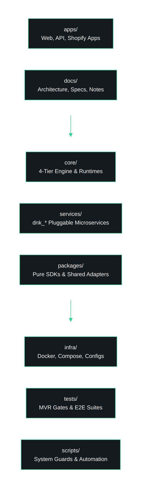
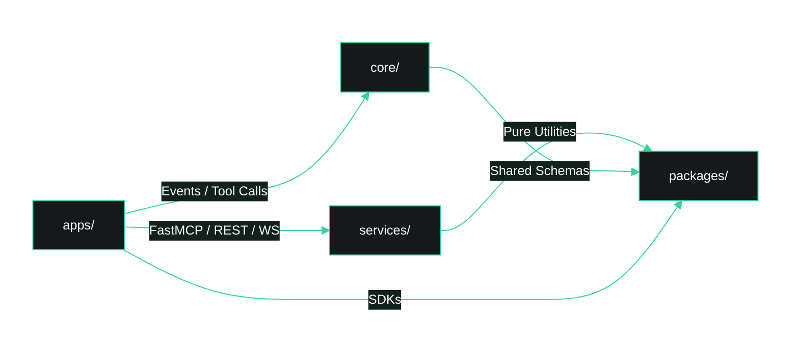
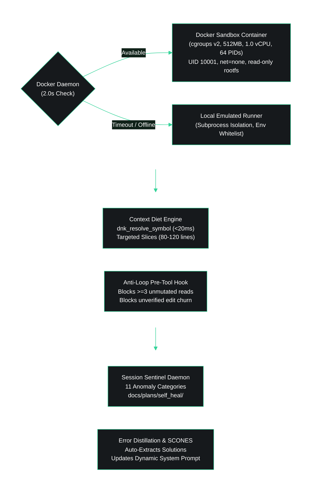
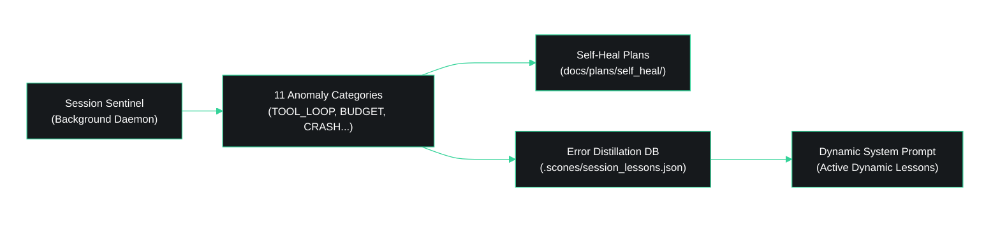
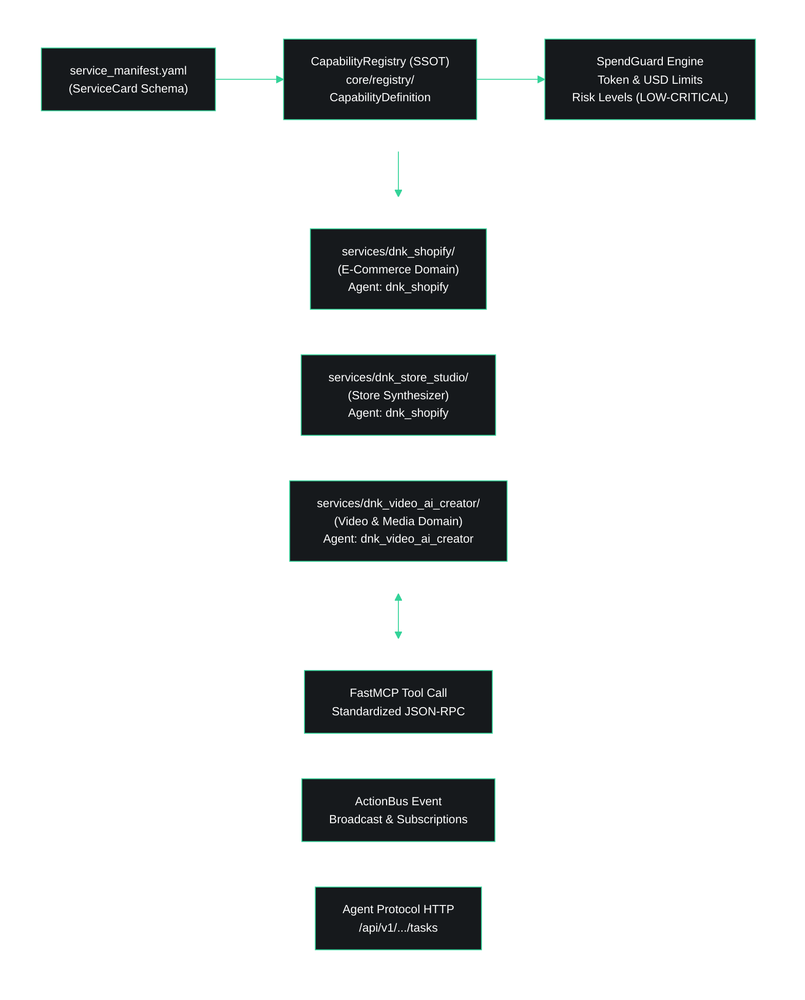
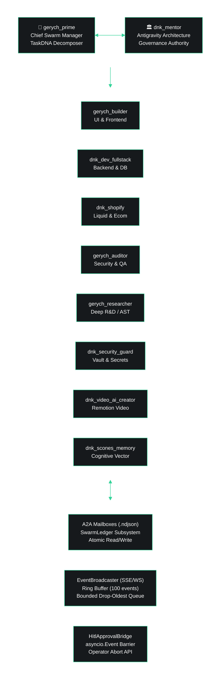

> [!metadata]- ⚙️ Системні метадані та інваріанти (MRH Header)
> ```yaml
> # --- DNK-MRH-HEADER ---
> mrh_id: "docs/architecture/blueprints/DNK_OS_SYSTEM_FOUNDATION_AND_SWARM_SYNTHESIS_v1.0.md"
> purpose: "Gold Master Blueprint: 8-Domain Repository Layout, 4-Tier Core Zoning, Agent Harness Sandboxing, Service as a Plugin (SaaP), and A2A Swarm Collaboration."
> canonical_source: true
> alters_files: []
> triggers_tasks: []
> status: "Active"
> version: "2.0.0"
> updated_at: "2026-11-18"
> author: "DNK-e.com Maksym & Antigravity"
> # --- END DNK-MRH-HEADER ---
> ```

# 🏛️ DNK OS System Foundation & Swarm Synthesis (v1.0.0 Gold Master)

> **Architectural Blueprint & Single Source of Truth (SSOT)**  
> **Target System**: DNK OS Autonomous Multi-Agent Operating System  
> **Governing Protocol**: Zero-Waste Swarm Protocol (ZWSP v4.3) & Mandatory Atomic Slice Execution (MASE)  
> **Status**: Active / Production Foundation  

---

## 📑 Table of Contents

1. [Executive Architectural Vision & Core Paradigm](#1-executive-architectural-vision--core-paradigm)
2. [Pillar I: Canonical 8-Domain Workspace Topology & Root Invariants](#2-pillar-i-canonical-8-domain-workspace-topology--root-invariants)
   - [2.1 The Canonical Eight Domains](#21-the-canonical-eight-domains)
   - [2.2 The Four Canonical Root Files](#22-the-four-canonical-root-files)
   - [2.3 Domain Responsibility Matrix & Import Boundary Rules](#23-domain-responsibility-matrix--import-boundary-rules)
   - [2.4 Workspace Hygiene & The Zero-Pollution Janitor](#24-workspace-hygiene--the-zero-pollution-janitor)
3. [Pillar II: The 4-Tier Core Zoning Hierarchy](#3-pillar-ii-the-4-tier-core-zoning-hierarchy)
   - [3.1 Layer 1: Domain & Declarative Manifests](#31-layer-1-domain--declarative-manifests)
   - [3.2 Layer 2: Orchestration & State Bus](#32-layer-2-orchestration--state-bus)
   - [3.3 Layer 3: Agent Runtime & Swarm Execution](#33-layer-3-agent-runtime--swarm-execution)
   - [3.4 Layer 4: Security, Quality & Self-Healing Gates](#34-layer-4-security-quality--self-healing-gates)
   - [3.5 Unidirectional Dependency Invariant](#35-unidirectional-dependency-invariant)
4. [Pillar III: Agent Harness & Sandboxed Execution Architecture](#4-pillar-iii-agent-harness--sandboxed-execution-architecture)
   - [4.1 Containerized Isolation Subsystem & Resource Constraints](#41-containerized-isolation-subsystem--resource-constraints)
   - [4.2 Dual-Mode Graceful Fallback](#42-dual-mode-graceful-fallback)
   - [4.3 Context & Token Diet Optimization](#43-context--token-diet-optimization)
   - [4.4 Autonomous Self-Healing & Anomaly Remediation Loop](#44-autonomous-self-healing--anomaly-remediation-loop)
5. [Pillar IV: Service as a Plugin (SaaP) & Modular Service Isolation](#5-pillar-iv-service-as-a-plugin-saap--modular-service-isolation)
   - [5.1 Service Topology & Strict dnk_* Identity](#51-service-topology--strict-dnk_-identity)
   - [5.2 Zero-Host & Zero-Coupling Invariant](#52-zero-host--zero-coupling-invariant)
   - [5.3 Pluggable Dynamic Registration & Capability Manifests](#53-pluggable-dynamic-registration--capability-manifests)
   - [5.4 Enterprise SpendGuard & Rate-Limiter Integration](#54-enterprise-spendguard--rate-limiter-integration)
6. [Pillar V: Multi-Agent Swarm Collaboration & A2A Protocols](#6-pillar-v-multi-agent-swarm-collaboration--a2a-protocols)
   - [6.1 The 14 Specialized Swarm Agents](#61-the-14-specialized-swarm-agents)
   - [6.2 Inter-Agent Messaging & Mailbox Subsystem](#62-inter-agent-messaging--mailbox-subsystem)
   - [6.3 Non-Blocking Event Streaming & Real-Time Telemetry](#63-non-blocking-event-streaming--real-time-telemetry)
   - [6.4 Human-in-the-Loop (HITL) Bridge & Operator Abort Protocol](#64-human-in-the-loop-hitl-bridge--operator-abort-protocol)
   - [6.5 Swarm Parallel Join Barrier & Consensus Patterns](#65-swarm-parallel-join-barrier--consensus-patterns)
7. [Verification Gates & Enforcement Protocols](#7-verification-gates--enforcement-protocols)

---

## 1. Executive Architectural Vision & Core Paradigm

DNK OS is an autonomous, multi-agent operating system designed to engineer, deploy, and scale high-performance digital commerce products and AI-native applications. To achieve founder-level operational leverage, high execution velocity, and zero agent confusion, the system adheres to four foundational engineering laws:

1. **Extreme Structural Clarity (The Rule of Eight)**: The codebase is partitioned into exactly 8 top-level domains. No agent or developer may introduce a 9th domain.
2. **Unidirectional Tiered Intelligence**: The central core (`core/`) is organized into 4 downward-dependent layers. Lower layers provide declarative truth and events; higher layers execute, audit, and self-heal.
3. **Zero Host Leakage & Strict Relative Addressing**: Hardcoded absolute paths (`/Users/...`) are completely eliminated. All system paths, tools, configurations, and imports resolve relative to the repository root (`./`, `../`).
4. **Zero Status Laundering & Verifiable Evidence**: Narrative claims of success are rejected without deterministic test outputs, verifiable exit codes, and cryptographic or structural evidence.

---

## 2. Pillar I: Canonical 8-Domain Workspace Topology & Root Invariants



### 2.1 The Canonical Eight Domains

The repository root is strictly frozen to eight functional directories. Each domain is governed by a dedicated `DOMAIN_RULES.md` specification:

| Domain | Primary Purpose & Bounded Context | Governing Document |
| :--- | :--- | :--- |
| `apps/` | User-facing fullstack applications, Next.js spatial canvas, API Gateway, and Shopify admin extensions. | [`apps/DOMAIN_RULES.md`](./apps/DOMAIN_RULES.md) |
| `core/` | Central OS intelligence, 4-tier engine, action bus, agent harnesses, task orchestration, and self-healing. | [`core/DOMAIN_RULES.md`](./core/DOMAIN_RULES.md) |
| `services/` | Pluggable, isolated microservices prefixed with `dnk_*` (`dnk_shopify`, `dnk_store_studio`, `dnk_video_ai_creator`). | [`services/DOMAIN_RULES.md`](./services/DOMAIN_RULES.md) |
| `packages/` | Pure shared libraries, adapters, SDKs, and foundational utilities with zero application-state dependencies. | [`packages/DOMAIN_RULES.md`](./packages/DOMAIN_RULES.md) |
| `infra/` | Container definitions (Dockerfiles), compose orchestration, reverse proxies, Alembic migrations, and observability. | [`infra/DOMAIN_RULES.md`](./infra/DOMAIN_RULES.md) |
| `docs/` | Single Source of Truth (SSOT) for technical architecture, specifications (`DNK-STD-*`), handoffs, and Obsidian notes. | [`docs/DOMAIN_RULES.md`](./docs/DOMAIN_RULES.md) |
| `tests/` | Automated test suites, MVR quality gates, verification harnesses, and zero-pollution sandbox assertions. | [`tests/DOMAIN_RULES.md`](./tests/DOMAIN_RULES.md) |
| `scripts/` | System hygiene guards (`root_hygiene_guard.py`), build automation, and the master gate pipeline (`verify_all.sh`). | [`scripts/DOMAIN_RULES.md`](./scripts/DOMAIN_RULES.md) |

### 2.2 The Four Canonical Root Files

To eliminate root pollution, the repository root permits exactly four project configuration files:

1. `AGENTS.md`: Unified governance rules, Zero-Waste Protocol invariants, and swarm directives.
2. `README.md`: High-level system overview, quickstart instructions, and developer orientation.
3. `pyproject.toml`: SSOT Python project configuration, dependencies, and tool settings (`pytest`, `ruff`, `mypy`).
4. `requirements.txt`: Locked dependency manifest managed via `uv`.

*(Managed tool lockfiles like `uv.lock` and hidden dot-configurations like `.gitignore`, `.env`, `.python-version` are permitted under strict guard validation).*

### 2.3 Domain Responsibility Matrix & Import Boundary Rules

To prevent spaghetti architecture and circular dependencies, cross-domain imports are strictly enforced:



- **Rule 1 (Core Isolation)**: `core/` MUST NEVER import from `apps/` or directly from `services/` implementations. Core is domain-agnostic and interacts with services exclusively through declared interfaces and FastMCP capability registries.
- **Rule 2 (Service Decoupling)**: Services (`services/dnk_*`) MUST NEVER import internal private code from peer services (`import services.dnk_video...` inside `dnk_shopify` is strictly forbidden). Cross-service communication flows through the `AgentActionBus` or FastMCP tools.
- **Rule 3 (Pure Packages)**: `packages/` must remain pure providers. They MUST NEVER import from `apps/`, `core/`, or `services/`.
- **Rule 4 (App Consumption)**: `apps/` may consume `packages/` and connect to `services/` and `core/` via network contracts or API gateways.

### 2.4 Workspace Hygiene & The Zero-Pollution Janitor

Automated agents often pollute the repository root with ephemeral files, logs, and caches. DNK OS prevents workspace degradation through automated fail-closed guards:

#### Automated Cleanup: `scripts/system/workspace_janitor.py`
The workspace janitor actively sanitizes the environment across four dimensions:
1. **Git Worktree Pruning**: Reaps stale, disconnected worktrees via `git worktree prune -v`.
2. **Orphan Lock Cleaning**: Scans `/tmp/dnk_agent_locks` and `core/orchestrator/agents/*/*.lock`. If the associated PID is dead, the stale lock is safely unlinked.
3. **Ephemeral Directory Purging**: Wipes temporary artifacts from `.worktrees/`, `.extracted_assets/`, `output/`, `temp/`, `artifacts/`, `cache/`, `logs/`, `telemetry/`, and unauthorized root `skills/`.
4. **Enforced Skill Location**: Skills must ALWAYS be written to `core/skills/` or `core/orchestrator/agents/<agent>/skills/`. Any `skills/` directory created at the root level is treated as an ephemeral pollution and automatically purged by `workspace_janitor.py`.

#### Fail-Closed Guard: `scripts/system/root_hygiene_guard.py`
Integrated into the pre-commit hook and CI pipeline, `root_hygiene_guard.py` checks the root filesystem on every cycle. Any unauthorized file or folder immediately halts execution with an explicit violation report.

---

## 3. Pillar II: The 4-Tier Core Zoning Hierarchy

The `core/` domain hosts the central operating intelligence. To prevent circular dependencies and maintain modularity across 14 specialized swarm agents, `core/` is divided into 4 strict architectural layers:

```mermaid
%%{init: {
  'theme': 'base',
  'themeVariables': {
    'primaryColor': '#16191c',
    'primaryTextColor': '#ffffff',
    'primaryBorderColor': '#34d399',
    'lineColor': '#34d399',
    'secondaryColor': '#102219',
    'tertiaryColor': '#16191c',
    'tertiaryTextColor': '#ffffff',
    'titleColor': '#ffffff',
    'textColor': '#ffffff',
    'mainBkg': '#16191c',
    'nodeBorder': '#34d399',
    'clusterBkg': 'transparent',
    'clusterBorder': 'rgba(255, 255, 255, 0.16)',
    'edgeLabelBackground': '#102219',
    'fontSize': '13px'
  }
}}%%
flowchart TD
    subgraph Layer4["Layer 4: Security, Quality & Self-Healing Gates"]
        direction LR
        L4_G["core/guards<br/>(CompletionGate, PathHygiene)"]
        L4_A["core/auditor<br/>(AdversarialGate, Red/Blue Audit)"]
        L4_ED["core/error_distillation<br/>(Self-Healing Distiller)"]
        L4_SB["core/sandbox<br/>(Docker cgroups v2 Runner)"]
    end

    subgraph Layer3["Layer 3: Agent Runtime & Swarm Execution"]
        direction LR
        L3_H["core/hermes_agent<br/>(Runner & Process Engine)"]
        L3_SK["core/skills<br/>(Assimilated Skill Registry)"]
        L3_OB["core/obsidian<br/>(Visual Canvas & DualSync)"]
        L3_TM["core/telemetry<br/>(Spender & Execution Traces)"]
    end

    subgraph Layer2["Layer 2: Orchestration & State Bus"]
        direction LR
        L2_O["core/orchestrator<br/>(Task Triage & Blast Radius)"]
        L2_AB["core/action_bus<br/>(AgentActionBus & SwarmRouter)"]
        L2_Q["core/queues<br/>(Priority Queues & Mailboxes)"]
        L2_F["core/flows<br/>(TaskDNA Workflows & Pipelines)"]
    end

    subgraph Layer1["Layer 1: Domain & Declarative Manifests"]
        direction LR
        L1_M["core/manifests<br/>(dnk_manifest.yaml, Schemas)"]
        L1_R["core/registry<br/>(Capability & Node Registries)"]
        L1_D["core/data<br/>(Task Graph & State Archives)"]
    end

    Layer4 --> Layer3
    Layer3 --> Layer2
    Layer2 --> Layer1
```



### 3.1 Layer 1: Domain & Declarative Manifests
- **Subsystems**: `core/manifests/`, `core/registry/`, `core/data/`
- **Responsibilities**:
  - Acts as the foundational ground-truth for DNK OS.
  - Maintains declarative capability manifests, node schemas, and system-level configuration files (`dnk_manifest.yaml`, `runtime_registry.yaml`).
  - Stores declarative task graph states and historical event logs without executing business logic.
- **Invariant**: Pure state schemas. Exactly zero upward dependencies on runtime, execution engines, or UI.

### 3.2 Layer 2: Orchestration & State Bus
- **Subsystems**: `core/orchestrator/`, `core/action_bus/`, `core/queues/`, `core/flows/`, `core/supervisor/`
- **Responsibilities**:
  - **Task Triage & Deconstruction**: Evaluates task complexity (`dnk_triage_task`) and decomposes requests into evolutionary DAGs (`TaskDNA`).
  - **Decoupled Event Bus (`AgentActionBus`)**: Central nervous system routing events between agents, services, and visual canvases.
  - **Swarm Router (`SwarmRouter`)**: Directs tasks to specialized worker mailboxes (`inbox.ndjson`).
  - **Supervisors**: Maintains state synchronization and background consistency across external platforms (Shopify, Git, Cloud).
- **Invariant**: Orchestrates workflows and state transitions. Never imports concrete frontend display components or direct presentation layouts.

### 3.3 Layer 3: Agent Runtime & Swarm Execution
- **Subsystems**: `core/hermes_agent/`, `core/skills/`, `core/obsidian/`, `core/telemetry/`
- **Responsibilities**:
  - **Agent Runtime**: The physical harness executing agent tool-call loops, prompt synthesis, and tool execution.
  - **Skills Engine**: Ingests, validates, and serves modular skills (`SKILL.md`) to workers on demand using Level-of-Detail (LOD) progressive loading.
  - **Obsidian Visual Bridge**: Synchronizes agent task forest states with Obsidian JSON Canvas and Excalidraw visual graphs.
  - **Telemetry Store**: Tracks token spend, latency, and tool-call metrics in real time.
- **Invariant**: Consumes Layer 2 state bus and Layer 1 schemas to physically execute autonomous coding and research tasks.

### 3.4 Layer 4: Security, Quality & Self-Healing Gates
- **Subsystems**: `core/guards/`, `core/auditor/`, `core/error_distillation/`, `core/sandbox/`, `core/ports/`, `core/services/`
- **Responsibilities**:
  - **Completion Gates (`CompletionGate`)**: Physically blocks unverified git commits or false "completed" claims without green test runs.
  - **Adversarial Audit (`AdversarialReview`)**: 2-Agent audit (Red-Team Auditor vs Blue-Team Builder) validating diffs against security vulnerabilities.
  - **Error Distillation Engine**: Captures exceptions, clusters failure patterns, queries the self-healing database, and generates automated fixes.
  - **Ephemeral Sandbox Runner**: Executes untrusted code inside isolated Docker containers with strictly enforced cgroups limits.
- **Invariant**: Intercepts, validates, and audits all agent actions prior to git commit, deployment, or state release.

### 3.5 Unidirectional Dependency Invariant

Dependencies within `core/` strictly flow downward:
$$\text{Layer 4 (Security)} \longrightarrow \text{Layer 3 (Runtime)} \longrightarrow \text{Layer 2 (Orchestration)} \longrightarrow \text{Layer 1 (Domain)}$$

- Layer 1 never imports Layer 2, 3, or 4.
- Layer 2 may import Layer 1, but never Layer 3 or 4.
- Layer 3 may import Layers 1 and 2, but never Layer 4.
- Layer 4 may audit and inspect all lower layers.

---

## 4. Pillar III: Agent Harness & Sandboxed Execution Environment



### 4.1 The Ephemeral Docker Sandbox (`DockerSandboxRunner`)

Untrusted, generated, or third-party code within DNK OS is executed strictly inside ephemeral, resource-constrained container environments managed by `core/sandbox/docker_runner.py`.

#### Ephemeral Lifecycle
Every execution follows an immutable 5-stage lifecycle:
$$\text{ALLOCATE} \longrightarrow \text{START} \longrightarrow \text{RUNNING} \longrightarrow \text{TERMINATION} \longrightarrow \text{CLEANUP}$$
The sandbox environment is completely wiped and discarded after each evaluation, leaving zero persistent root filesystem traces.

#### cgroups v2 Hard Resource Limits
To protect the host system from runaway code, fork bombs, and memory leaks, each sandbox container enforces strict Linux cgroups v2 resource constraints:
- **Memory**: Hard ceiling of 512MB RAM (`--memory 512m`).
- **Swap**: Zero swap allocation (`--memory-swap 512m`), triggering deterministic OOM-kill rather than host paging.
- **CPU Quota**: Exactly 1.0 vCPU (`--cpu-period 100000`, `--cpu-quota 100000`).
- **Process Limit**: Hard ceiling of 64 concurrent tasks/threads (`--pids-limit 64`), preventing fork-bomb attacks.

#### Hard Containment & Network Isolation
- **Non-Root Execution**: Container runs strictly under unprivileged UID/GID `10001:10001` (`dnkrunner`).
- **Network Isolation**: Default network mode is `--network none`. Arbitrary outbound sockets are blocked unless an explicit egress whitelist proxy is authorized.
- **Read-Only Root Filesystem**: `--read-only` rootfs prevents any tampering with system binaries or runtime interpreters.
- **Scratchpad tmpfs**: Temporary files are constrained to ephemeral memory mounts:
  - `/tmp`: `rw,noexec,nosuid,nodev,size=128m`
  - `/run`: `rw,noexec,nosuid,nodev,size=16m`
- **Capability Stripping**: Drops all Linux capabilities (`--cap-drop ALL`), forbidding root escalation (`--security-opt no-new-privileges:true`).
- **AppArmor & Seccomp**: Enforces the `dnk-sandbox-strict` profile to block unauthorized syscalls.
- **Mount Boundaries**: Input payloads are mounted strictly read-only (`-v input.json:/workspace/input.json:ro`), and outputs are retrieved via an isolated volume (`-v output_dir:/workspace/output:rw`).

#### Asynchronous Timeout & OOM Supervision
Execution duration is guarded by an asynchronous watchdog:
- Default execution timeout: **10.0 seconds** (configurable up to a hard ceiling of 30.0s).
- If execution exceeds the deadline, the runner issues an immediate container kill (`docker kill`) and marks the result as `timed_out: true`.
- If memory consumption breaches 512MB, the Linux kernel terminates the container, and the runner captures an explicit `oom_killed: true` telemetry marker.

---

### 4.2 Dual-Mode Fallback Architecture

To guarantee high engineering velocity across local developer workstations, air-gapped test harnesses, and CI environments without a running Docker daemon, the runner incorporates an autonomous **Dual-Mode Fallback**:

```python
# Bounded non-blocking check with 2.0s timeout to prevent daemon hangs
res = subprocess.run([self.docker_bin, "info"], timeout=2.0)
```

1. **Primary Mode (Docker Sandbox)**: If the Docker daemon is responsive within 2.0 seconds, code executes inside the containerized sandbox.
2. **Fallback Mode (Local Emulated Runner)**: If Docker is absent, uninstalled, or fails to respond within 2.0s, the system smoothly transitions to `mode: "emulated"`. The local runner executes the payload in a sandboxed temporary directory (`tempfile.mkdtemp`), enforcing process-level timeouts, environment variable whitelisting, and immediate post-run directory purging.
3. **Fail-Safe Guarantee**: Workflows and test suites never crash due to an offline Docker daemon; instead, they transparently execute with clear telemetry markers indicating emulation mode.

---

### 4.3 Context Diet & Anti-Bloat Invariants

Large language models executing complex codebase tasks face degradation from context rot, repetitive tool-loops, and tool budget exhaustion (e.g. 150/150 call limits). DNK OS enforces four anti-bloat mechanisms:

1. **AST Fast Symbol Resolution (`dnk_resolve_symbol`)**:
   Instead of performing 10–20 exploratory `search_files` or `read_file` calls across the codebase, agents call `dnk_resolve_symbol(symbol="<Name>")`. The symbol index locates definitions, file paths, and exact line numbers in **<20ms**.
2. **Targeted Code Slices**:
   Agents are strictly forbidden from dumping massive files (1000+ lines) into context. Code inspection is performed via targeted slices (`limit: 80` to `120` lines) around identified symbols.
3. **Anti-Read-Loop Circuit Breaker**:
   The Pre-Tool Hook (`scripts/system/hermes_pre_tool_hook.py`) monitors file read frequencies. If an agent attempts to read the same unmutated file $\ge 3$ times consecutively, the hook physically blocks the call with a circuit-breaker exception, directing the agent to use its existing context.
4. **Anti-Churn Modification Gate**:
   Consecutive edits to the same file without intermediary verification runs (`pytest` or `tsc`) are flagged. Agents must verify changes before modifying the file again.

---

### 4.4 Session Sentinel & Autonomous Self-Healing

The self-healing architecture continuously audits agent execution, detects failure anomalies, and autonomously synthesizes remediation plans.



#### The 11 Anomaly Categories
The `SessionSentinel` background daemon monitors running agent processes and audits conversation transcripts against 11 failure patterns:
1. `AUTH_ERROR`: Authentication or credential validation failures.
2. `MODEL_REASONING`: Hallucinated tool calls or format collapse.
3. `RUNTIME_CRASH`: Unhandled Python or Node.js runtime exceptions.
4. `TOOL_LOOP`: Repetitive execution of identical tool sequences without progress.
5. `BUDGET_BREACH`: Exceeding allotted turn iterations or token spend.
6. `PATH_VIOLATION`: Constructing unauthorized absolute paths (`/Users/...`).
7. `MRH_MISSING`: Creating code or docs lacking `DNK-MRH-HEADER`.
8. `TEST_FAILURE`: Unresolved test suite regressions.
9. `FALSE_COMPLIANCE`: Claiming success without executable proof or exit code 0.
10. `ERROR_LOOP`: Repeatedly hitting the same exception without querying error distillation.
11. `CI_CD_VIOLATION`: Breaking pre-commit or git hygiene invariants.

#### Dynamic Feedback & Knowledge Injection
- When an anomaly is detected, `SessionSentinel` automatically drafts an actionable fix specification in `docs/plans/self_heal/TASK-DNK-SELFHEAL-<timestamp>.md`.
- Solved bugs and workarounds are distilled into `.scones/session_lessons.json` via `core/error_distillation/`.
- On future sessions, these lessons are dynamically injected into the system prompt under `## Active Dynamic Lessons`, ensuring the agent never repeats historical mistakes.

---

## 5. Pillar IV: Service as a Plugin (SaaP) Architecture



### 5.1 Mandatory `dnk_*` Prefix & Service Identity

The `services/` directory is the canonical domain boundary for all domain capabilities within DNK OS. Each service is packaged as an autonomous, self-describing plugin:

#### Naming Convention & Directory Invariant
- **Mandatory Prefix**: Every service directory MUST strictly follow the `dnk_*` naming convention (e.g. `services/dnk_shopify/`, `services/dnk_store_studio/`, `services/dnk_video_ai_creator/`).
- **Autonomous Isolation**: Each service represents a distinct business capability. Services must never assume or rely upon the host's directory layout; all runtime configuration, ports, and resource handles are injected dynamically via environment variables, configuration manifests, or the workspace vault.

#### Standardized Lifecycle State Machine
Every DNK service adheres to a strictly governed, asynchronous lifecycle:
$$\text{REGISTERED} \longrightarrow \text{INITIALIZING} \longrightarrow \text{HEALTHY} \longleftrightarrow \text{SERVING} \longrightarrow \text{DRAINING} \longrightarrow \text{SHUTDOWN}$$

Each service exposes standard asynchronous lifecycle hooks:
1. `initialize()`: Asynchronously loads ML weights, pre-warms database connection pools, verifies Vault secret references, and validates runtime dependencies.
2. `healthcheck()`: Returns an HTTP 200 payload containing service status, memory footprint, active task counts, and upstream dependency readiness (`/health` endpoint).
3. `shutdown()`: Flushes in-flight task queues, releases network sockets, gracefully drains persistent connections, and releases locks without dropping pending client updates.

---

### 5.2 Declarative Service Cards (`service_manifest.yaml`)

Every service declares its operational contract, exposed tools, dependencies, and risk envelope via a declarative manifest validated against `docs/schemas/service_card.schema.yaml`.

#### Schema Structure (`dnk.os/v1alpha1` `ServiceCard`)

```yaml
# Canonical DNK Service Card Example
apiVersion: dnk.os/v1alpha1
kind: ServiceCard

metadata:
  service_id: dnk_store_studio
  name: "DNK Store Studio - Shopify Theme & Store Synthesizer"
  description: "Agentic service for synthesizing high-conversion Shopify stores and Horizon Tinker theme blocks."
  version: "1.0.0"
  owner: "agent:dnk_shopify"
  tier: "tier-2-satellite"       # tier-1-core | tier-2-satellite | tier-3-community
  lifecycle: "production"         # experimental | incubating | production | deprecated

spec:
  domain: "ecommerce"
  entrypoint: "services.dnk_store_studio.src.router:router"
  docs_path: "services/dnk_store_studio/docs/SPECIFICATION.md"

  protocol:
    task_api:
      standard: "agent-protocol"  # agent-protocol | custom-fastapi | mcp-only
      version: "v1"
      compatibility: "native"

  depends_on:
    capabilities:
      - "core.security_gate"
    resources:
      - secret_ref: "shopify_admin_token"   # Secret key reference in Vault (never raw tokens)

  provides_apis:
    agent_protocol: "/api/v1/dnk_store_studio/tasks"
    mcp_tools:
      - name: "dnk_store_studio_migrate_theme"
        description: "Migrates legacy Shopify theme assets into DNK E-com Tinker blocks."
      - name: "dnk_store_studio_synthesize_store"
        description: "Synthesizes high-conversion store from natural language prompt and competitor audit."
      - name: "dnk_store_studio_generate_blocks"
        description: "Generates atomic Horizon Tinker theme blocks."

  consumes_apis: []

  operations:
    health_endpoint: "/api/v1/dnk_store_studio/health"
    metrics_endpoint: "/api/v1/dnk_store_studio/metrics"
    spend_guard:
      max_tokens_per_task: 40000
      max_cost_usd_per_run: 0.15
```

---

### 5.3 Zero Cross-Service Coupling (Strict Isolation Invariant)

To maintain true architectural modularity, prevent dependency spaghetti, and enable services to be deployed as independent micro-containers:

#### The Zero Direct Import Rule
Direct cross-service Python module imports are strictly prohibited:
- ❌ **FORBIDDEN**:
  ```python
  # ILLEGAL: Direct cross-service internal import
  from services.dnk_video_ai_creator.internal.renderer import render_video
  ```
- ✅ **ALLOWED**:
  ```python
  # LEGAL: Importing shared data contracts and schemas from packages/
  from packages.contracts.media import VideoRenderRequest
  # LEGAL: Invoking capability via Swarm Dispatcher or FastMCP Tool Call
  result = await swarm_dispatcher.call_tool("dnk_video_render", payload)
  ```

#### Triad of Decoupled Inter-Service Communication
All communication between services must traverse one of three authorized boundary transports:
1. **FastMCP Tool Calls**: Synchronous or streaming request-response tool invocations mediated by the Swarm Router.
2. **Standardized REST / Agent Protocol**: HTTP JSON endpoints adhering to the standard `/api/v1/{service}/tasks` specification.
3. **ActionBus Event Streaming**: Asynchronous domain events published across Redis or in-memory pub/sub (`ActionBus`), allowing subscribers to react without knowing publisher internals.

---

### 5.4 Dynamic Discovery & Capability Registry (`CapabilityRegistry`)

Dynamic capability routing and discovery in DNK OS is centralized in `core/registry/capability_registry.py`:

#### SSOT Capability Model (`CapabilityDefinition`)
Every capability exposed by any core engine or pluggable service is registered with strict governance metadata:

```python
@dataclass
class CapabilityDefinition:
    id: str                 # Unique namespaced ID (e.g. 'ecom.generate_liquid')
    name: str               # Human-readable capability name
    domain: str             # Business domain (e.g. 'ecommerce', 'media', 'core')
    node_type: str          # Corresponding TaskDNA node type ('TaskNode', 'ArtifactNode')
    assigned_agent: str     # Default swarm specialist ('dnk_shopify', 'gerych_builder')
    risk_level: RiskLevel   # LOW, MEDIUM, HIGH, CRITICAL
    description: str        # Detailed semantic description for LLM tool selection
```

#### SpendGuard & Token Ceilings
To prevent financial exhaustion from rogue agent loops:
- Every capability registration defines an operational `risk_level`.
- `HIGH` and `CRITICAL` capabilities require explicit Human-in-the-Loop (HITL) approval tokens before execution.
- `SpendGuard` continuously meters cumulative prompt and completion tokens against `max_tokens_per_task` and `max_cost_usd_per_run`, immediately aborting any run that breaches declared limits.

---

## 6. Pillar V: Multi-Agent Swarm Collaboration & A2A Protocols



### 6.1 The 14 Specialized Swarm Agents (Roster & Role Distribution)

DNK OS utilizes a coordinated swarm of 14 specialized worker agents, dynamically orchestrated by `gerych_prime` via the Dynamic Router (`core/action_bus/swarm_router.py`):

| Agent Identifier | Formal Role | Technical Domain & Responsibilities | Key Capabilities / Triggers |
| :--- | :--- | :--- | :--- |
| `gerych_prime` | Chief Swarm Manager | High-level goal decomposition, DAG scheduling, supervisor loops, swarm synchronization. | `orchestrate`, `plan`, `triage`, `meta`, `decompose` |
| `gerych_builder` | UI & Frontend Systems Engineer | React, Tailwind CSS, TypeScript, Canvas visual tree synthesis, layout engines. | `ui`, `frontend`, `react`, `canvas`, `tailwind` |
| `gerych_researcher` | Deep R&D & Repo Assimilator | AST signature extraction, academic paper retrieval, open-source repo assimilation. | `ast`, `github`, `research`, `paper`, `assimilate` |
| `gerych_auditor` | Adversarial Security & QA | Red-team adversary, vulnerability scans, pre-commit quality gates, test certification. | `security`, `audit`, `verify`, `test`, `precommit` |
| `dnk_dev_fullstack` | Backend & Cloud Architect | FastAPI routers, SQLAlchemy ORM, SQLite/PostgreSQL schemas, background runners. | `backend`, `api`, `fastapi`, `database`, `sqlalchemy` |
| `dnk_shopify` | E-Commerce Specialist | Shopify Liquid AST mutations, Storefront API, Checkout UI extensions, catalog sync. | `shopify`, `liquid`, `store`, `checkout`, `theme` |
| `dnk_video_ai_creator`| Generative Video Producer | Programmatic Remotion video compositions, motion graphics, audio sync, story clips. | `video`, `remotion`, `composition`, `motion`, `render` |
| `dnk_security_guard` | Vault & Secrets Officer | Workspace secret encryption, token isolation, permission ACLs, secret leak sweeps. | `guard`, `vault`, `secret`, `auth`, `token`, `encrypt` |
| `dnk_scones_memory` | Cognitive Memory Keeper | SCONES episodic memory recall, vector embeddings, cross-session facts distillation. | `scones`, `memory`, `recall`, `embedding`, `vector` |
| `dnk_analytics` | Telemetry & Metrics Analyst | Execution latency, token spend tracking, Prometheus metrics, operational dashboards. | `analytics`, `metric`, `telemetry`, `prometheus` |
| `dnk_erp_supply` | ERP & Supply Logistics | Inventory tracking, order processing, supplier catalogs, fulfillment automation. | `erp`, `supply`, `inventory`, `order`, `warehouse` |
| `dnk_finance_cfo` | Unit Economics Strategist | COGS analysis, pricing optimization, margin forecasting, financial governance. | `finance`, `cfo`, `budget`, `pricing`, `margin`, `cogs` |
| `dnk_marketing_cmo` | Growth & Marketing Strategist| High-conversion ad copy, landing page headlines, acquisition funnel design. | `marketing`, `cmo`, `campaign`, `growth`, `copy` |
| `herich_librarian` | Obsidian Vault Curator | Architectural Decision Records (ADRs), Obsidian [[wikilinks]], PKM knowledge graphs. | `librarian`, `obsidian`, `vault`, `notes`, `adr`, `wiki` |

---

### 6.2 Agent-to-Agent (A2A) Mailbox Subsystem

Direct agent-to-agent communication is decoupled from model context windows via the `SwarmLedger` mailbox subsystem (`core/orchestrator/swarm_ledger.py`):

#### Physical Storage & Concurrency Model
- **Mailbox Path**: Each agent owns a private, append-only newline-delimited JSON mailbox at `core/data/swarm_artifacts/mailboxes/<agent_id>/inbox.ndjson`.
- **Thread Safety**: Access is synchronized via process-level `_rw_lock` (Reader-Writer Lock).
- **Atomic State Updates**: Marking messages as read uses atomic replacement via temporary files (`.tmp` -> rename) to prevent state corruption during concurrent agent access.

#### `SwarmArtifact` Data Contract
```python
@dataclass
class SwarmArtifact:
    artifact_id: str            # Unique UUID of the artifact
    producer_agent: str         # Source agent (e.g. 'dnk_dev_fullstack')
    recipient_agent: str        # Target agent or '*' for broadcast (e.g. 'gerych_auditor')
    artifact_type: str          # Semantic type ('schema_definition', 'code_diff', 'test_report')
    payload: Dict[str, Any]     # Structured data payload
    timestamp: float            # UNIX timestamp of creation
    is_read: bool = False       # Read status flag
```

---

### 6.3 Decoupled Event Broadcasting (`EventBroadcaster`)

Real-time telemetry and state distribution to WebSockets, Canvas UI, and Server-Sent Events (SSE) is managed by `EventBroadcaster` (`core/action_bus/broadcaster.py`):

- **Non-Blocking Guarantee**: Slow or stalled consumers (e.g., lagging browser tabs) can never block backend agent execution loops.
- **Bounded Overflow Queue**: Subscriptions use an `asyncio.Queue` capped at `max_queue_size=200` with an automatic drop-oldest policy when saturated.
- **Ring Buffer History**: Maintains a sliding memory window of the last 100 events (`collections.deque(maxlen=100)`) via `StreamEnvelope`, enabling newly connected UI clients to instantly rehydrate canvas state without querying the database.
- **Standard Envelope**: All events encapsulate `event_id`, `event_type`, `task_id`, `timestamp`, `agent`, `payload`, and optional `artifact_uri`.

---

### 6.4 Human-in-the-Loop (HITL) Bridge & Operator Abort Protocol

DNK OS implements a fail-closed Human-in-the-Loop approval architecture (`core/action_bus/hitl_bridge.py`):

#### Async Approval Gates
- **Critical Operation Gating**: High-risk actions (e.g. production deployments, database drops, live secret rotation) trigger `APPROVAL_REQUESTED` events.
- **Non-Blocking Suspension**: The executing task pauses using an in-memory `asyncio.Event()` barrier. The agent thread does not spin or consume CPU cycles while awaiting human judgment.
- **Resolution**: An operator responds via `POST /api/v1/mvr/hitl/decide` (`APPROVED` or `REJECTED`). The event triggers `approval_event.set()`, resuming task execution or rolling back state.

#### Operator Abort API (`SimulationAbort`)
Any running simulation, multi-agent pipeline, or long-running Docker task can be abruptly terminated:
1. Operator issues `POST /api/v1/mvr/simulation/{simulation_id}/abort`.
2. The ActionBus locates the corresponding `asyncio.Task` in the active registry and calls `task.cancel()`.
3. The worker container intercepts `asyncio.CancelledError`, immediately sends `SIGTERM`/`SIGKILL` to container child processes, and emits a `SIMULATION_ABORTED` event to the Canvas UI.

---

### 6.5 Swarm Parallel Join Barrier & Autonomous 4-Stage Pipeline

To orchestrate complex workflows across multiple specialized workers without context rot:

#### `SwarmParallelBarrier` Concurrency
- **Concurrent Dispatch**: Subtasks are executed simultaneously via `asyncio.gather` across assigned workers.
- **Fail-Fast Mode**: When `fail_fast=True`, tasks are executed via `asyncio.as_completed`. If any subtask fails, all remaining pending tasks in the batch are cancelled immediately (`p.cancel()`), preventing wasted token spend.
- **SpendGuard Enforcement**: Execution duration, token counters, and USD costs are aggregated and compared against the task's declared token diet.

#### The Autonomous 4-Stage Gerych Swarm Pipeline
For high-integrity software synthesis, DNK OS standardizes on a 4-stage sequential handoff:
1. **Stage 1 (Plan - `gerych_prime`)**: Decomposes user goal into TaskDNA DAG and defines explicit file boundaries (`target_files`).
2. **Stage 2 (Research - `gerych_researcher`)**: Extracts AST signatures, imports, and design patterns from existing code or reference repos.
3. **Stage 3 (Build - `gerych_builder` / `dnk_dev_fullstack`)**: Implements code changes strictly within the assigned target files.
4. **Stage 4 (Audit - `gerych_auditor`)**: Executes adversarial red-team review, validates test suites, and enforces pre-commit quality gates before completion.

---

## 7. Verification Gates & Enforcement Protocols

Every modification to the system foundation is continuously guarded by automated gates:

```bash
# 1. Verify Canonical 8-Root Directory Hygiene
python3 scripts/system/root_hygiene_guard.py

# 2. Verify Git Workspace Cleanliness & Zero Untracked State
python3 scripts/system/git_hygiene_guard.py

# 3. Verify Sandbox & MVR Test Suites (100% Green Requirement)
.venv/bin/pytest tests/sandbox/ tests/mvr/ -q

# 4. Verify Machine-Readable Header (MRH) Standards
python3 scripts/system/check_path_hygiene.py
```

---
*Authored by Gerych Prime & Antigravity under the DNK OS Zero-Waste Protocol v4.3.*
