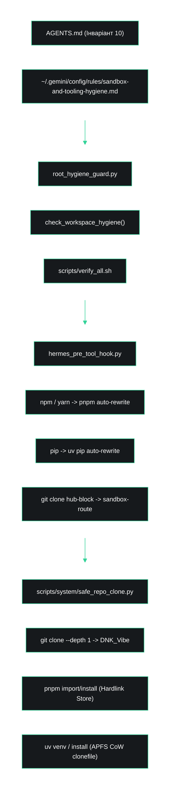

> [!metadata]- ⚙️ Системні метадані та інваріанти (MRH Header)
> ```yaml
> # --- DNK-MRH-HEADER ---
> mrh_id: "docs/architecture/blueprints/REPOSITORY_INTAKE_AND_SANDBOX_PROTOCOL.md"
> purpose: "Canonical Architecture SSOT & Operational Protocol for External Repository Intake, Sandbox Isolation, and Zero-Bloat Tooling."
> canonical_source: true
> alters_files: []
> triggers_tasks: []
> status: "Active"
> version: "2.0.0"
> updated_at: "2026-11-18"
> author: "DNK-e.com Maksym & Antigravity"
> # --- END DNK-MRH-HEADER ---
> ```

# 🛡️ Repository Intake & Sandbox Isolation Protocol (SSOT)

> **Статус**: `Active SSOT`  
> **Область**: Інфраструктура, Управління середовищами, Захист робочого простору IDE  
> **Нормативна база**: `DNK_HUB/AGENTS.md` (Інваріант 10), `ADR-007-B`, `DNK-STD-0075`

---

## 📌 1. Контекст та Проблема (Threat Model)

Історично під час дослідження сторонніх GitHub-репозиторіїв та SOTA-моделей агенти клонували репозиторії безпосередньо в робочий простір або монтували директорію пісочниці `DNK_Vibe` у файл робочого простору `DNK_HUB.code-workspace`.

Це призводило до системних збоїв:

1. **Катастрофічний індексаційний оверхед**: Індексатор IDE (Antigravity / VS Code) брав на моніторинг **632,816 файлів** (понад 21 ГБ). Це спричиняло постійне обертання індикатора завантаження, 100% завантаження процесора (CPU) та витік оперативної пам'яті (RAM).
2. **Дублювання пакетів (Node.js)**: Кожен репозиторій запускав сирий `npm install`, що створювало локальні `node_modules` вагою по 1–2 ГБ з тисячами дублікатів файлів замість використання єдиного сховища.
3. **Дублювання віртуальних середовищ (Python)**: Використання звичайного `pip install` без APFS Copy-on-Write витрачало гігабайти дискового простору SSD на однакові бінарні wheel-пакети.

---

## 🏛️ 2. Чотирирівнева Архітектура Захисту (4-Layer Defense)



---

## ⚙️ 3. Нормативні Інваріанти

### Інваріант 1: Повна Ізоляція Пісочниці (`DNK_Vibe`)

- Усі зовнішні репозиторії, форки, клоновані бібліотеки та експерименти розміщуються **виключно** у пісочниці:
  `../DNK_Vibe/<repo_name>`
- Агентам **суворо заборонено** клонувати сторонні репозиторії в корінь чи підпапки `DNK_HUB`.

### Інваріант 2: Чистота Робочого Простору IDE

- `DNK_Vibe` **ніколи** не монтується у `DNK_HUB.code-workspace`.
- Робочий простір містить тільки виробничі кореневі модулі:

  - `.` (`DNK_HUB`)
  - `../DNK_OS_APP`
  - `../SHOPIFY/DNKShopify/...`
- Файл `DNK_HUB.code-workspace` зобов'язаний містити виключення:

  ```json
  "files.watcherExclude": {
      "**/node_modules/**": true,
      "**/.venv/**": true,
      "**/artifacts/**": true
  }
  ```

- Гейт `root_hygiene_guard.py` детерміновано перевіряє цей інваріант при кожному запуску `./scripts/verify_all.sh`.

### Інваріант 3: Обов'язкові Пакетні Менеджери Zero-Bloat

1. **Node.js**:

   - Тільки `pnpm`.
   - Загальний конфіг `~/.npmrc`:

     ```ini
     engine-strict=false
     auto-install-peers=true
     ```

   - Усі пакети лінкуються через нативні APFS Hardlinks до глобального сховища `~/Library/pnpm/store/v10`.
   - При встановленні 10 різних проєктів реальне споживання SSD становить лише 2.3 ГБ замість 20+ ГБ.

2. **Python**:

   - Тільки `uv`.
   - Загальний конфіг `~/.config/uv/uv.toml`:

     ```toml
     link-mode = "clone"
     python-preference = "managed"
     ```

   - Завдяки `link-mode = "clone"` операційна система macOS APFS використовує системний виклик `clonefile()` (Copy-on-Write). Віртуальні оточення створюються за <100мс і дублюють 0 байт на SSD.

3. **Docker**:

   - Образи та білд-кеш регулярно очищаються командою `docker builder prune -f`.
   - Фізичний розмір контейнерів контролюється через перевірку розрідженого файлу `Docker.raw`.

---

## 🚀 4. Інструкція Використання: `safe_repo_clone.py`

Для безпечного клонування будь-якого зовнішнього репозиторію агент або розробник запускає:

```bash
# Базове клонування (автоматично shallow clone depth=1 у ../DNK_Vibe)
python3 scripts/system/safe_repo_clone.py https://github.com/owner/repository.git

# Клонування з кастомною назвою папки
python3 scripts/system/safe_repo_clone.py owner/repository --name my_sandbox_test

# Клонування конкретної гілки без авто-інсталяції залежностей
python3 scripts/system/safe_repo_clone.py owner/repository --branch feat/experimental --skip-install
```

### Що відбувається автоматично під час виконання

1. Виконується неглибоке клонування (`git clone --depth 1`).
2. Якщо виявлено `package.json`:

   - Видаляються застарілі `package-lock.json` та `yarn.lock`.
   - Запускається `pnpm install --prefer-offline` з використанням глобального стору hardlinks.
3. Якщо виявлено `requirements.txt` / `pyproject.toml`:

   - Створюється `uv venv .venv` з APFS clone-mode.
   - Залежності встановлюються через `uv pip install`.
4. Перевіряється цілісність `DNK_HUB.code-workspace`, гарантуючи відсутність забруднення головного робочого простору.

---

## 🛡️ 5. Автоматичний Контроль та Санітизація

| Компонент | Точка Контролю | Дія при спробі порушення |
| :--- | :--- | :--- |
| **Hermes Pre-Tool Hook** | Перед викликом команди в терміналі | `npm install` ➔ авто-перезапис на `pnpm install`; `pip install` ➔ авто-перезапис на `uv pip install`; `git clone` всередині `DNK_HUB` ➔ **Жорстке блокування** з підказкою. |
| **Root Hygiene Guard** | Перед комітом / у `verify_all.sh` | Перевіряє `DNK_HUB.code-workspace`. При виявленні `DNK_Vibe` повертає `exit code 1` і блокує виконання. |
| **Global Gemini Rule** | Системний контекст кожного агента | Інструктує модель на системному рівні дотримуватися ізоляції пісочниці. |
