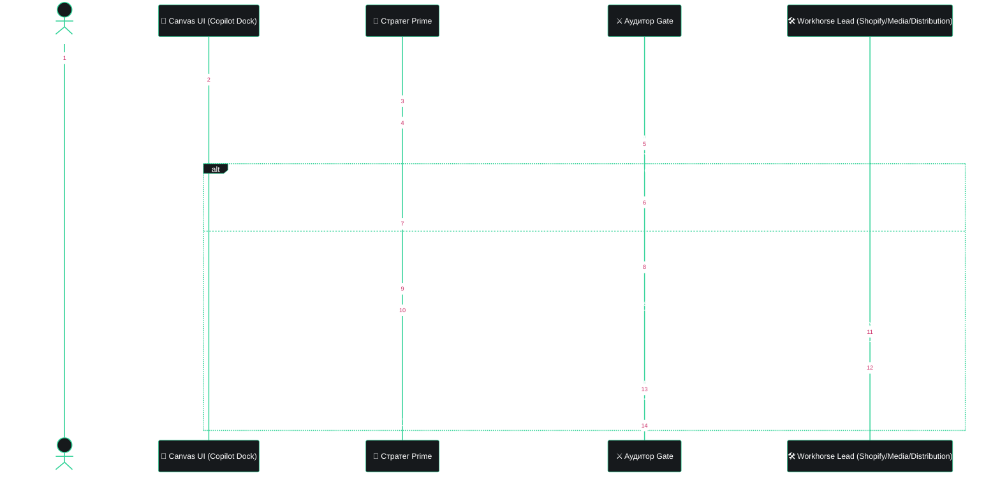

> [!metadata]- ⚙️ Системні метадані та інваріанти (MRH Header)
> ```yaml
> # --- DNK-MRH-HEADER ---
> mrh_id: "docs/architecture/blueprints/TWO_TIER_AGENT_HANDOFF_PROTOCOL.md"
> purpose: "Architecture specification for C-Suite Tandem (Strategist + Auditor) and Folder-as-Harness Handoff to 3 Core Workhorses (DEC-025)."
> canonical_source: true
> alters_files: []
> triggers_tasks: []
> status: "Active"
> version: "2.0.0"
> updated_at: "2026-11-18"
> author: "DNK-e.com Maksym & Antigravity"
> # --- END DNK-MRH-HEADER ---
> ```

# 🏛️ Дворівнева Архітектура Агентів та Протокол Handoff (DEC-025)

## 1. Концепція та Мета
Протокол дворівневої організації агентів реалізує засади рішення **DEC-025 (Folder as Harness & Subagent Folding Protocol)**:
1. **Tier-1 (C-Suite Штаб)**: Керуючий тандем двох головних персон у `core/orchestrator/agents/`:
   - **Стратег Prime 👑** (`core/orchestrator/agents/strategist/`): Chief Spatial Orchestrator & TaskDNA Master. Керує полотном `apps/canvas/`, декомпонує задачі на DAG-графи, формує контекстні дроти та готує специфікації для доменних лідів.
   - **Аудитор Gate ⚔️** (`core/orchestrator/agents/auditor/`): Adversarial Security & Quality Gatekeeper. Забезпечує нуль підлабузництва (Anti-Sycophancy), обов'язковий Pre-Mortem, 3-Flaws Rule, граничні умови та детермінований Machine Proof (`exit code 0`).
2. **Tier-2 (Core Workhorses / Folder-as-Harness)**:
   - Спеціалізовані доменні ліди без standing context bloat:
     - `services/dnk_shopify/` (Shopify Lead — Liquid AST, Themes, Cart Drawer)
     - `services/dnk_media/` (Media & VTON Lead — Video Generation, Remotion, Audio/Subtitles)
     - `services/dnk_distribution/` (Distribution & Logistics Lead — Orders, Inventory, Fulfillment)

---

## 2. Діаграма Потоку Делегування (Sequence Diagram)



---

## 3. Правила та Інваріанти Протоколу Handoff

1. **Folder-as-Harness**:
   Кожен сервісник у `services/` є самостійним ізольованим харнесом з власним `service_manifest.yaml` та FastMCP роутером. Заборонено прямий крос-сервісний імпорт внутрішніх функцій.
2. **Нуль Мутацій без Сертифіката Аудитора**:
   Будь-який кодосинтез у `services/` блокується без наявності `AuditorCertificate` зі статусом `APPROVED`.
3. **Строгий Target File Whitelist & Negative Scope**:
   Стратег зобов'язаний явно декларувати білий список файлів для модифікації. Будь-які модифікації за межами `services/<workhorse>/` відхиляються.
4. **Тільки Відносні Шляхи**:
   Усі шляхи в специфікаціях повинні бути відносними (`./`, `../`). Абсолютні шляхи заборонені.
