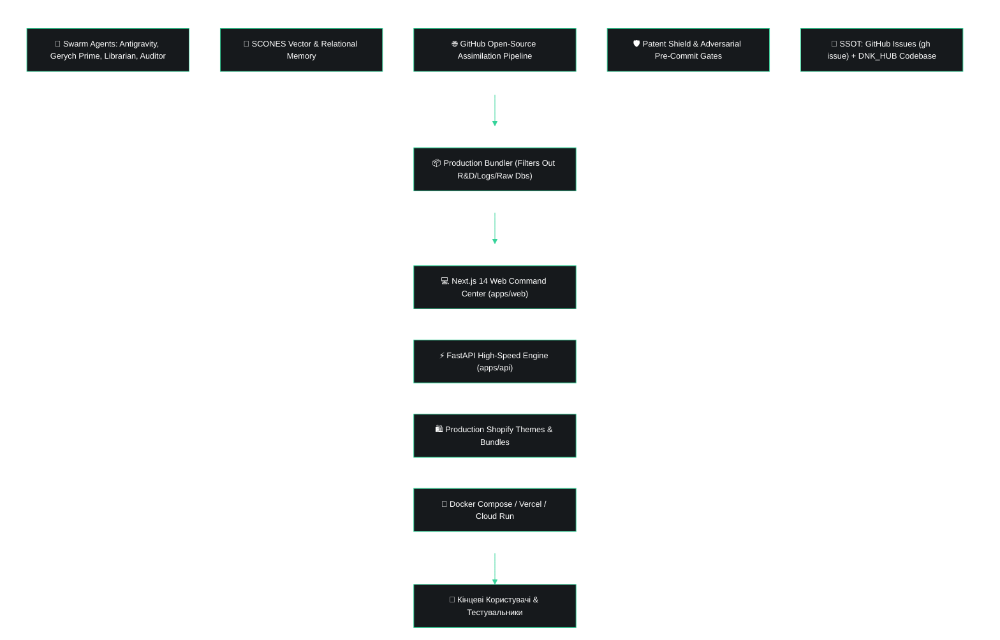

> [!metadata]- ⚙️ Системні метадані та інваріанти (MRH Header)
> ```yaml
> # --- DNK-MRH-HEADER ---
> mrh_id: "docs/architecture/blueprints/TWO_TIER_DEVELOPMENT_PROTOCOL.md"
> purpose: "Official Two-Tier Development, GitHub Issues SSOT & Clean Distribution Protocol for DNK OS."
> canonical_source: true
> alters_files: []
> triggers_tasks: []
> status: "Active"
> version: "2.0.0"
> updated_at: "2026-11-18"
> author: "DNK-e.com Maksym & Antigravity"
> # --- END DNK-MRH-HEADER ---
> ```

# 🏛️ DNK OS Two-Tier Architecture & Clean Distribution Protocol

## 1. Концептуальна модель (Two-Tier Model)

Система DNK OS розділена на два чітких функціональних рівні:



---

## 2. Розподіл обов'язків (Responsibilities)

### Рівень 1: `DNK_HUB` (R&D & Swarm Center)
- **Призначення:** Центр розробки, асиміляції світових opensource-технологій, накопичення пам'яті SCONES, тестування та навчання агентів.
- **Дійові особи:**
  - **Antigravity (Mentor/Architect):** Задає стандарти, керує архітектурою та контролює якість.
  - **Герич (Gerych Prime - Swarm Builder):** Асимілює патерни, генерує код, виправляє помилки.
  - **Herich Librarian:** Організовує документацію та базу знань.
  - **Auditor:** Проводить стрес-тести, перевірку інваріантів та верифікацію безпеки.

### Рівень 2: `DNKOS_APP` / Standalone Репозиторії (Клієнтський Продукт)
- **Призначення:** Чисті, легкі репозиторії (~30-50 MB), оптимізовані для швидкого розгортання (Vercel, Docker, Cloud Run) та тестування реальними користувачами.
- **Вміст:** Лише скомпільований продакшн-код без внутрішніх логів агентів, чернеток та R&D-скриптів.

---

## 2.1. Єдине Джерело Правди (Single Source of Truth — SSOT Invariant)

Для уникнення розриву контексту та галюцинацій впроваджено два непорушні стовпи SSOT:

1. **Трекер Задач (Task Tracker SSOT) = GitHub Issues**:
   - Всі задачі, беклог, декомпозиції та баг-репорти ведуться виключно в **GitHub Issues**.
   - Агенти та розробники взаємодіють з трекером напряму через GitHub CLI (`gh issue create`, `gh issue view`, `gh issue close`, `gh issue list`) з використанням системного `$GH_TOKEN`.
   - Будь-яка задача обов'язково прив'язується до номера issue (`#<ISSUE_NUMBER>`).
   - Локальні таски оформлюються за стандартом `docs/templates/GERYCH_TASK_TEMPLATE.md` з обов'язковим зазначенням зв'язаного GitHub Issue ID.

2. **Кодова База (Codebase SSOT) = Монорепозиторій `DNK_HUB`**:
   - Увесь первинний код, тести, FastMCP-інструменти, правила рою та сховище знань знаходяться виключно в корені `DNK_HUB`.
   - Суворе дотримання **Канонічного 8-Кореневого Інваріанту**: дозволені виключно директорії `apps/`, `core/`, `services/`, `packages/`, `infra/`, `docs/`, `tests/`, `scripts/`. Створення нових кореневих папок суворо заборонено.
   - **Правило 3 Робочих Конячок (The 3 Core Workhorses)**: у директорії `services/` дозволені тільки `services/dnk_shopify`, `services/dnk_media` та `services/dnk_distribution`. Будь-яка інша розробка ведеться всередині них або в `core/`.

3. **Протокол Чекпоінтів та Передачі Контексту (Handoff SSOT — ADR-006)**:
   - При вичерпанні ліміту сесії (>= 20 викликів інструментів або >= 40k токенів) чи зупинці за правилом **ADR-006 Cognitive Guardrails**, агент зобов'язаний зафіксувати стан через шаблон `docs/templates/HANDOFF_TEMPLATE.md` з обов'язковою прив'язкою до GitHub Issue.

---

## 3. Протокол генерації релізу (Release Generation)

Для генерації чистого проєкту використовується скрипт:
```bash
python3 scripts/export_standalone_app.py ../DNKOS_APP_STANDALONE
```

### Що автоматично включається в чистий репозиторій:
1. `apps/web/` — Next.js 14 фронтенд з Canvas V3, Visual Shell, Liquid Inspector, Whiteboard.
2. `apps/api/` — FastAPI високошвидкісний бекенд.
3. `services/dnk_shopify/` — Shopify 3.0 рушії, Liquid AST та візуальна студія компонентів (`studio/`).
4. `services/dnk_media/` — уніфікований медіа-рушій (відеогенерація, субтитри, аналіз утримання аудиторії, YouTube Ingest).
5. `services/dnk_distribution/` — омнеканальна дистрибуція та публікація.
6. `core/` — ядро виконання та FastMCP-інтерфейси.
7. `Dockerfile`, `Dockerfile.web`, `Dockerfile.api`, `docker-compose.yml`.
8. Чистий `.env.example` та автоматично ініціалізований `git` на гілці `main`.

---

## 4. Правила для агентів (Agent Invariants)
1. **Ніяких абсолютних шляхів (`/Users/...`):** Завжди використовувати відносні шляхи (`./`, `../`).
2. **Єдиний корінь `DNK_HUB`:** Будь-які вкладені дублюючі підпапки повністю видалені. Будь-які імпорти мають вигляд `import services...`, `import apps...`, `import core...`.
3. **Fail-Closed Pre-Commit Hook:** Перед кожним пушем або коммітом перевіряються лінтинг, відносні шляхи та цілісність тестів (`scripts/system/verify_all.sh`).
4. **GitHub Native Fast-Path:** Всі операції з гілками, PR та Issues виконуються через `gh` CLI з успадкуванням `$GH_TOKEN`. Коміти та PR маркуються прив'язкою до issues (`Closes #...` або `Refs #...`).
5. **Когнітивна Гігієна ADR-006:** Сесії, що досягають порогу уваги моделі, зупиняються та фіксуються через `docs/templates/HANDOFF_TEMPLATE.md`.

