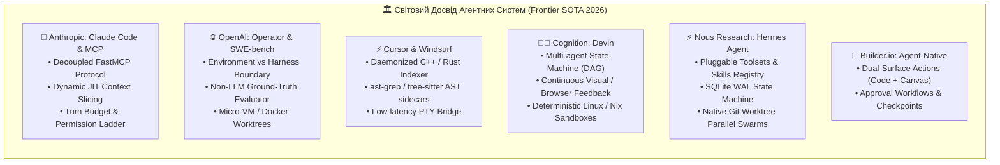
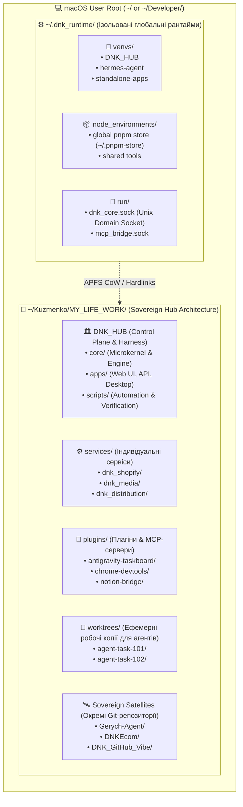
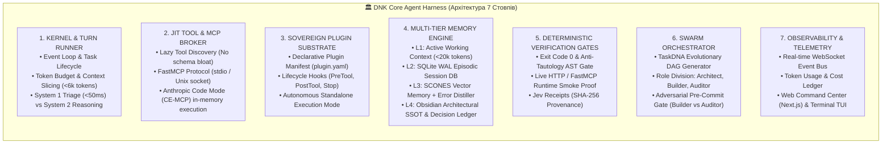
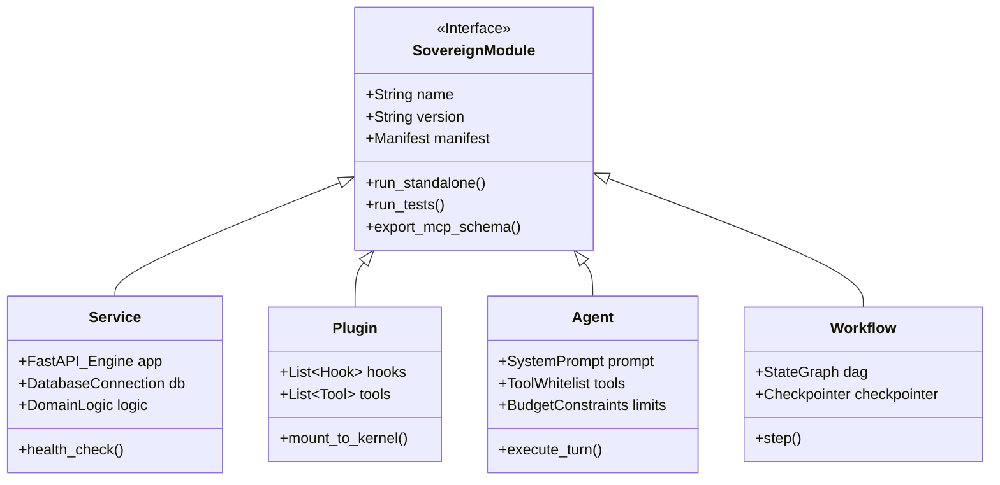

> [!metadata]- ⚙️ Системні метадані та інваріанти (MRH Header)
> ```yaml
> # --- DNK-MRH-HEADER ---
> mrh_id: "docs/architecture/reports/DNK_CORE_AGENT_HARNESS_AND_REPO_ARCHITECTURE_MASTER_REPORT.md"
> purpose: "Master Architectural Blueprint: Frontier SOTA Agent Harnesses, MacBook Repository Topology, and Sovereign Decoupled Ecosystem for DNK Core / DNK OS."
> canonical_source: true
> alters_files: []
> triggers_tasks: []
> status: "Active"
> version: "2.0.0"
> updated_at: "2026-11-18"
> author: "DNK-e.com Maksym & Antigravity"
> # --- END DNK-MRH-HEADER ---
> ```

# 🏛️ DNK Core Agent Harness & MacBook Repository Architecture Master Blueprint


---

## ⚡ 1. Executive Summary & Core Verdict (ADHD Card)

> [!IMPORTANT]
> **Головна парадигма 2026 року**: **Сила та надійність AI-агента визначається не вагами LLM, а зовнішнім Execution Harness.**
> Foundation model (Gemini 3.8, Claude 3.7, GPT-5) — це лише обчислювальний процесор. **Agent Harness (DNK Core)** — це материнська плата, операційна система, контролер пам’яті, шина інструментів та захисний саркофаг.

### Ключові принципи розбудови DNK Core:
1. **Ядро як Агентний Харнес (Kernel, Not App)**: DNK Core не містить бізнес-логіки. Воно надає 7 базових примітивів: *Turn Lifecycle Loop, JIT Tool Broker (FastMCP), Sovereign Plugin Substrate, L1-L4 Memory Hierarchy, Deterministic Verification Gate, Swarm Orchestrator, Unified Event Bus*.
2. **Суверенна модульність (Sovereign Decoupled Substrates)**: Кожен сервіс (`services/dnk_*`), плагін (`plugins/*`), агент (`agents/*`) та воркфлоу (`workflows/*`) розробляється як **автономний модуль**:
   - Має власний дискретний тест-сьют (`pytest tests/`, `vitest`).
   - Має власний локальний CLI/FastMCP інтерфейс і може запускатися окремо від усієї системи.
   - Має суворий типізований маніфест (`manifest.yaml` / Pydantic contract).
   - Підключається до DNK Core через нульовий оверхед декларативного JIT-виявлення.
3. **MacBook Local Storage & Zero-Waste Architecture (Apple Silicon)**:
   - **APFS Copy-on-Write (CoW)** і глобальні віртуальні сховища: `pnpm` global store + `uv` global cache дають **0 байт дублювання залежностей** між 50+ модулями.
   - **Zero-Local-Venv**: Централізований каталог `~/.dnk_runtime/venvs/` із симлінками у репозиторії.
   - **Git Worktree Pool**: Паралельні агенти працюють у тимчасових воркстрі (`../worktrees/<agent-id>`), ніколи не бруднячи робочу гілку розробника у VS Code.
   - **Sub-millisecond IPC**: Unix Domain Sockets (`/tmp/dnk_core.sock`) + FastMCP stdio + SQLite WAL.

---

## 🌐 2. Аналіз передового світового досвіду (Frontier SOTA)

Як найсильніші команди світу (Anthropic, OpenAI, Cursor, Cognition Devin, Nous Research, Builder.io, Google Research) структурують свої репозиторії та агентні харнеси:



### 2.1 Anthropic (Claude Code & Model Context Protocol — MCP)
- **Архітектурний патерн**: *Decoupled Protocol Architecture*.
- **Як влаштовано**: Claude Code сам по собі є мінімалістичним CLI-харнесом. Усі інструменти виносяться у зовнішні процеси через **MCP (Model Context Protocol)**. MCP-сервери підключаються або як локальні дочірні процеси через `stdio`, або як мережеві мікросервіси через `SSE` / `HTTP`.
- **Контекстна гігієна**: Використовується *Level-of-Detail (LOD)* фільтрація. Інструменти не завантажують свої повні схеми та документацію у системний промпт відразу. Модель спочатку бачить короткі дескриптори, і лише коли інструмент потрібен — підтягує детальну схему.
- **Драбина дозволів (Permission Ladder)**: Читання файлів — зелена зона (автоматично). Виконання команд у bash або запис у файли — жовта/червона зона (вимагає підтвердження або криптографічного токена довіри).

### 2.2 OpenAI (Operator, SWE-bench Runner, Research Harnesses)
- **Архітектурний патерн**: *Environment-Harness Decoupling*.
- **Як влаштовано**: Чітке розмежування на три сутності:
  1. **Agent Policy**: LLM + промпт + цикл генерації думок.
  2. **Execution Harness**: Середовище запуску, що перехоплює дії, контролює таймаути та ліміти токенів.
  3. **Target Environment**: Ізольована пісочниця (контейнер, worktree або micro-VM), де живе досліджуваний проєкт.
- **Ground-Truth Evaluator**: Оцінка успішності ніколи не довіряється самій моделі («Завдання виконано успішно»). Успіх фіксує незалежний скрипт верифікації (`evaluator.py`), який повертає числовий score або `exit code 0`.

### 2.3 Cursor (Anysphere) & Windsurf (Codeium)
- **Архітектурний патерн**: *High-Performance Daemon Sidecar*.
- **Як влаштовано**: IDE не запускає важкі операції пошуку чи парсингу всередині основного UI-потоку. У бекграунді працює автономний демон (написаний на Rust/C++), який підтримує актуальний індекс кодової бази через `tree-sitter` та векторні ембедінги.
- **PTY Management**: Агент взаємодіє з системою через керовані PTY (псевдотермінали), що дозволяє перехоплювати ANSI-коди, розриви з'єднання та інтерактивні запити програм без зависання.

### 2.4 Cognition (Devin)
- **Архітектурний патерн**: *Multi-Role State Machine & Nix Reproducibility*.
- **Як влаштовано**: Замість одного монолітного промпта діє кінцевий автомат (State Machine), що перемикає ролі: *Planner -> Coder -> Browser Navigator -> Reviewer/Tester*.
- **Deterministic Sandboxes**: Для кожної таски піднімається чиста пісочниця. Агент не може змінити системне оточення операційної системи розробника.

### 2.5 Nous Research (Hermes Agent / Gerych Core)
- **Архітектурний патерн**: *Sovereign Toolsets & SQLite WAL State Persistence*.
- **Як влаштовано**:
  - `tools/` розбиті на ізольовані провайдери.
  - Усі переходи станів, сесії та траєкторії пишуться в транзакційну БД SQLite у режимі `WAL` (`state.db`).
  - **Git Worktree Swarm (`--worktree`)**: Можливість миттєво відгалузити ізольовану робочу копію репозиторію для запуску паралельних агентів, що унеможливлює конфлікти у файловій системі.

---

## 💻 3. Архітектура репозиторію та директорій на робочому MacBook

Розробка на Apple Silicon (M1/M2/M3/M4) має унікальні переваги файлової системи **APFS (Apple File System)**: миттєве копіювання файлів без витрати місця через copy-on-write (`clonefile`) та жорсткі посилання (hardlinks).



### 3.1 Топологія: «Sovereign Hub + Worktree Satellites»
Найгірша помилка — створення «мега-моноліту», де все звалено в одну купу і падіння одного тесту блокує весь проєкт, або «хаосу з 30 розрізнених репозиторіїв», де неможливо узгодити типи.

Передовий стандарт — **Sovereign Hub Architecture**:
1. **DNK_HUB — Центр керування та координації (Control Plane)**:
   Тут знаходяться спільні контракти (Pydantic schemas), мікроядро (DNK Core), документація, пам’ять SCONES та загальні скрипти верифікації.
2. **Індивідуальні модулі як суверенні елементи**:
   - `services/` — незалежні бекенд-воркхорси.
   - `plugins/` — плагіни розширення можливостей харнесу.
   - `packages/` — внутрішні SDK та бібліотеки (наприклад, `packages/dnk_core_sdk`).
3. **Зовнішні сателітні репозиторії (Satellites)**:
   Живуть поруч (`../Gerych-Agent`, `../DNKEcom`) як незалежні git-репозиторії, зв’язані через чіткі контракти та відносні шляхи.

### 3.2 Нульове дублювання дисків (Zero-Waste APFS Invariant)
На макбуці з диском 512GB або 1TB типова проблема агентних розробок — забиття SSD гігабайтами `node_modules` та віртуальних середовищ `venv`.

**Рішення DNK OS:**
- **Node.js / TypeScript**: Жорстке використання **`pnpm`** із глобальним сховищем у `~/.pnpm-store` / `~/Library/pnpm/store/v10`.
  Усі 30 проєктів ділять однакові пакети через жорсткі посилання (hardlinks). Витрата дискового простору — **0 додаткових байт** на спільні бібліотеки.
- **Python**: Жорстке використання **`uv`** (від Astral).
  `uv` використовує нативні системні виклики macOS APFS `clonefile()` (reflink / copy-on-write). Створення нового venv займає **15 мілісекунд** і не споживає фізичного місця на диску, доки файл не буде реально модифіковано.
- **Централізація рантаймів (`Zero-Local-Venv`)**:
  Всі venv фізично розташовані в `~/.dnk_runtime/venvs/`, а всередині репозиторіїв створюються лише легкі симлінки (`.venv -> ~/.dnk_runtime/venvs/DNK_HUB`). Це запобігає випадковому видаленню оточень клінерами дисків та прискорює пошук Spotlight.

### 3.3 Ізоляція паралельних агентів через Git Worktrees
Коли автономний агент (наприклад, Denchik або Gerych) модифікує код, він **НЕ ПОВИНЕН** писати напряму в основну гілку, де в цей момент працює розробник.

**Механізм Git Worktree:**
```bash
# Агент отримує завдання і миттєво створює паралельний робочий простір:
git worktree add ../worktrees/task-402 -b feature/task-402

# Агент виконує тести, змінює файли, білдить:
cd ../worktrees/task-402 && pytest && npm run build

# Після проходження верифікації (exit code 0):
git push origin feature/task-402
git worktree remove ../worktrees/task-402
```
Це дає **100% захист від конфліктів файлів на диску** та дозволяє запускати 5 агентів одночасно на одному макбуці.

---

## ⚙️ 4. Анатомія Агентного Харнесу «DNK Core»

DNK Core є фундаментальною основою DNK OS. Це не кінцева програма, а **агентний мікрокернел**.



### Деталізація 7 стовпів харнесу:

### 1. Kernel & Turn Runner (Ядро виконання)
- Керує станами задачі: `IDLE -> PLANNING -> EXECUTING -> VERIFYING -> COMPLETED / FAILED`.
- **System 1 Triage (<50ms)**: Швидка перевірка складності задачі без виклику дорогої LLM за формулою:
  $$C = F_{files} + 2 \times D_{domains} + 3 \times S_{stages}$$
  Якщо $C < 3$ — виконує легкий агент або однорядковий тул. Якщо $C \ge 3$ — запускається Swarm DAG.
- **Жорсткий ліміт стоячого контексту (Zero-Bloat Invariant)**: Системний промпт разом із описами інструментів на старті не перевищує **6,000 токенів**.

### 2. JIT Tool & FastMCP Broker (Шина інструментів)
- Інструменти не підвантажуються всі відразу. DNK Core реєструє лише метадані.
- При потребі виконати дію харнес динамічно інжектує конкретний інструмент.
- Підтримка **Anthropic Code Mode (CE-MCP)**: замість передачі десятків JSON-схем агент пише короткий Python/TypeScript скрипт, який викликає локальні функції безпосередньо в оперативній пам'яті.

### 3. Sovereign Plugin Substrate (Суверенна підкладка плагінів)
- Будь-який компонент оформлюється як суверенний пакет з маніфестом `manifest.yaml`.
- Життєвий цикл плагіна контролюється перехоплювачами:
  - `PreInvocationHook`: перевірка прав, санітизація вхідних даних.
  - `PreToolUseHook`: перевірка безпеки шляхів (заборона абсолютних шляхів `/Users/...`, заборона видалення важливих системних папок).
  - `PostToolUseHook`: верифікація виводу, очищення чутливих даних (API ключів).

### 4. L1–L4 Multi-Tier Memory Engine (Ієрархія пам'яті)
- **L1 (Робочий контекст)**: Активний список файлів (Whitelist) та поточні дифи. Суворо < 20,000 токенів.
- **L2 (Епізодична сесія)**: Повна історія кроків у SQLite з WAL-режимом (`state.db`), миттєве відновлення після перезапуску.
- **L3 (SCONES Семантична пам'ять)**: Векторні ембедінги уроків, патернів та рішень помилок. При падінні тесту агент миттєво запитує: «Як ця помилка вирішувалася раніше?».
- **L4 (Архітектурний SSOT)**: Документи Obsidian, ADR (Architectural Decision Records) та реєстр рішень `DECISION_REGISTRY_ADHD.md`.

### 5. Deterministic Verification Gate (Детермінована верифікація)
- **Zero Verbal Simulation Invariant**: Заборонено оголошувати задачу завершеною на основі текстових запевнень агента.
- Завершення вимагає машинного доказу:
  1. `scripts/verify_all.sh` повертає `exit code 0`.
  2. AST-лінтер підтверджує відсутність тавтологічних мок-тестів (`assert True`).
  3. Живий HTTP/CLI запит підтверджує працездатність рантайму.

### 6. Swarm Orchestrator (Оркестратор агентів)
- Рольовий поділ праці:
  - **Antigravity**: Mentor / Architect / Orchestration Lead.
  - **Denchik (Денчік)**: Sovereign Master Developer & Chief Autonomous Builder (пише код, білдить, чинить).
  - **Gerych (Герич)**: Cold Knowledge Archivist & Retrospective Historical Auditor (перевіряє логи, веде ретроспективи).
  - **Доменні воркери**: `dnk_shopify`, `dnk_media`, `dnk_dev_fullstack`.

### 7. Observability & Telemetry (Спостережливість та шина подій)
- Будь-яка подія в харнесі (`turn_start`, `tool_call`, `verification_pass`, `error`) публікується в локальну шину подій (Unix Socket або WebSocket).
- Візуальний інтерфейс (Next.js Command Center або Terminal TUI) відображає прогрес у реальному часі без опитування (zero polling).

---

## 🧩 5. Архітектура суверенних модулів: Сервіси, Плагіни, Агенти та Воркфлоу

Головна вимога Максима: **«Кожен сервіс, плагін, агент — розробляється як індивідуальний елемент, який може працювати окремо від системи і виправлятися, покращуватися та вдосконалюватися»**.

Як це досягається на практиці:



### 5.1 Як влаштований індивідуальний Суверенний Сервіс (`services/dnk_*`)
Візьмемо, наприклад, `services/dnk_shopify`:
1. **Повна автономність**:
   Знаходиться у власній папці `services/dnk_shopify/`. Має власний `pyproject.toml` (або секцію в монорепо), власні тести `services/dnk_shopify/tests/` та власний запуск `python -m services.dnk_shopify.cli`.
2. **Подвійний режим роботи (Dual-Mode Entrypoint)**:
   - **Standalone Mode (Автономний режим розробника)**: Максим або агент може перейти в `cd services/dnk_shopify` і тестувати тільки його:
     ```bash
     pytest tests/
     python cli.py audit-theme --theme Dawn
     ```
     Для цього **не потрібно піднімати всю DNK OS**, не потрібен веб-інтерфейс і не потрібні інші сервіси.
   - **Orchestrated Mode (Режим у складі DNK Core)**: Сервіс експортує інтерфейс FastMCP. DNK Core бачить його як `FastMCPServiceAdapter` і звертається до нього через локальний сокет або виклик функції.

### 5.2 Як влаштований індивідуальний Плагін (`plugins/*`)
Плагін — це пакет розширення (наприклад, `plugins/shopify_cro_blocks` або `plugins/antigravity-taskboard`):
1. **Канонічний маніфест `plugin.yaml`**:
   ```yaml
   name: shopify_cro_blocks
   version: 1.2.0
   description: "CRO Block Synthesizer for Shopify Tinker Themes"
   entrypoint: "./src/index.ts"
   capabilities:
     - tools: ["synthesize_block", "audit_block_contrast"]
     - hooks: ["PreToolUse", "PostToolUse"]
   dependencies:
     python: ">=3.12"
     pnpm: ">=9.0"
   standalone_test_command: "pnpm test"
   ```
2. **Ізольоване тестування**:
   Плагін містить у собі моки оточення і тести. Виправлення помилки в плагіні виконується локально: `pnpm test` -> коміт. DNK Core просто підхоплює оновлену версію.

### 5.3 Як влаштований індивідуальний Агент (`agents/*`)
Агент — це не просто промпт, а конфігурація спеціалізованого робітника:
- `agents/dnk_shopify/AGENT.md`:
  - **Роль та компетенції**.
  - **Negative Scope**: Що агенту суворо заборонено робити (наприклад, чіпати файли ядра `core/`).
  - **Whitelisted Tools**: Чіткий перелік дозволених інструментів.
  - **Тестовий бенчмарк агента (`evals/`)**: Набір еталонних завдань, на яких перевіряється якість роботи агента після будь-яких правок промпту чи харнесу.

### 5.4 Як влаштований Воркфлоу (`workflows/*`)
- Воркфлоу — це декларативний або кодовий DAG (граф задач), наприклад, `workflows/theme_ingestion_dag.py`.
- Кожен крок графу приймає типізований вхід і повертає типізований вихід.
- Воркфлоу можна запустити на одному тестовому файлі локально через CLI без запуску всієї екосистеми.

---

## 🗂️ 6. Фізична схема директорій DNK Core & DNK OS на MacBook

Нижче наведено канонічну структуру файлової системи, розроблену спеціально під робочий MacBook Максима:

```
~/Kuzmenko/MY_LIFE_WORK/
├── DNK_HUB/                                # 🏛️ ГОЛОВНИЙ ХАБ & ХАРНЕС (Control Plane)
│   ├── .agents/                            # Локальні правила та плагіни Antigravity
│   │   └── plugins/
│   │       └── antigravity-taskboard/      # Автономна канбан-дошка задач
│   ├── core/                               # ⚡ DNK CORE (Агентний Харнес / Мікроядро)
│   │   ├── kernel/                         # Життєвий цикл задачі, шедулер, System 1 тріаж
│   │   │   ├── turn_runner.py              # Turn Lifecycle & Context Guard
│   │   │   └── scheduler.py                # Complexity Metric & Dispatcher
│   │   ├── broker/                         # JIT Tool Broker & FastMCP адаптери
│   │   │   ├── registry.py                 # Декларативний реєстр інструментів
│   │   │   └── mcp_client.py               # Клієнт локальних FastMCP сервісів
│   │   ├── memory/                         # L1-L4 Ієрархія пам'яті
│   │   │   ├── active_context.py           # L1 Target Whitelist & Token Pruning
│   │   │   ├── session_wal.py              # L2 SQLite WAL епізодична історія
│   │   │   └── scones_bridge.py            # L3 SCONES векторна пам'ять & дистилятор
│   │   ├── security/                       # Ring 0 - Ring 2 Захисні гейти
│   │   │   ├── pre_tool_hook.py            # Інваріанти шляхів, анти-видалення
│   │   │   └── verify_gate.py              # Exit code 0, AST-лінтинг, smoke-тести
│   │   └── bus/                            # Event Bus (Unix Domain Socket / WebSocket)
│   │       └── ipc_server.py
│   ├── apps/                               # 🖥️ Користувацькі інтерфейси
│   │   ├── web/                            # Next.js 14 Command Center (Canvas + Dashboard)
│   │   ├── api/                            # FastAPI High-Speed Engine
│   │   └── tui/                            # Термінальний інтерфейс швидкого керування
│   ├── services/                           # ⚙️ СУВЕРЕННІ СЕРВІСИ (Окремі робочі конячки)
│   │   ├── dnk_shopify/                    # E-commerce, Liquid AST, Shopify Functions
│   │   │   ├── src/
│   │   │   ├── tests/                      # Власні тести сервісу (pytest)
│   │   │   ├── cli.py                      # Власний незалежний CLI сервісу
│   │   │   └── manifest.yaml               # Маніфест контракту для DNK Core
│   │   ├── dnk_media/                      # Генерація відео, HyperFrames, аудіо
│   │   │   ├── tests/
│   │   │   └── manifest.yaml
│   │   └── dnk_distribution/               # Експорт чистих автономних репозиторіїв
│   ├── plugins/                            # 🧩 ПЛАГІНИ РОЗШИРЕННЯ (Суверенні модулі)
│   │   ├── chrome-devtools/                # Браузерне тестування та автоматизація
│   │   └── shopify_cro_blocks/             # Бібліотека CRO блоків
│   ├── packages/                           # 📦 СПІЛЬНІ SDK ТА КОНТРАКТИ
│   │   ├── dnk_core_sdk/                   # Python SDK для розробки плагінів та сервісів
│   │   └── dnk_shared_types/               # TypeScript типізація Pydantic-контрактів
│   ├── scripts/                            # 🛠️ Скрипти оркестрації та системної гігієни
│   │   ├── verify_all.sh                   # Головний детермінований гейт якості
│   │   └── export_standalone_app.py        # Експорт продукту для клієнтів (Two-Tier)
│   └── docs/                               # 📚 Архітектурний SSOT (Obsidian Vault MOCs)
│       └── architecture/
│           ├── DECISION_REGISTRY_ADHD.md   # Реєстр зафіксованих рішень
│           └── adr/                        # Архітектурні рішення (ADR-091 тощо)
│
├── Gerych-Agent/                           # 🛰️ САТЕЛІТ 1: Архіваріус & Історичний аудитор
├── DNKEcom/                                # 🛰️ САТЕЛІТ 2: Робочі Shopify-теми та додатки
├── DNK_GitHub_Vibe/                        # 🛰️ САТЕЛІТ 3: Карантинна пісочниця для R&D
└── worktrees/                              # 🌿 Тимчасові ізольовані робочі копії для агентів
    ├── agent-builder-101/                  # Автономний простір Denchik
    └── agent-auditor-102/                  # Автономний простір Gerych
```

---

## 🚀 7. Покроковий план впровадження (Roadmap)

### Етап 1: Стабілізація фундаменту та маніфестів (Дні 1–3)
1. Зафіксувати Pydantic SSOT контракти в `packages/dnk_core_sdk/contracts.py`:
   - `ModuleManifest` (ім'я, версія, тули, хуки, команда автономного тесту).
   - `TaskRequest` та `VerificationReceipt`.
2. Додати `manifest.yaml` до кожного з 3 базових сервісів (`services/dnk_shopify`, `services/dnk_media`, `services/dnk_distribution`).
3. Забезпечити, щоб кожен сервіс мав команду `pytest` або `pnpm test`, яка успішно проходить ізольовано в його власній папці.

### Етап 2: Реалізація JIT Tool Broker & FastMCP у DNK Core (Дні 4–7)
1. Реалізувати `core/broker/registry.py`: авто-дискавері сервісів та плагінів за маніфестами.
2. Впровадити протокол FastMCP для комунікації через Unix Domain Sockets:
   - Миттєвий виклик локального інструменту сервісу (<5 мс).
   - Нульове засмічення системного промпту стоячими схемами.
3. Додати `pre_tool_hook.py` для жорсткої санітизації шляхів та лімітів.

### Етап 3: Автоматизація паралельних агентів через Git Worktrees (Дні 8–10)
1. Налаштувати скрипт `scripts/system/spawn_agent_worktree.sh`:
   - Створення ізольованого worktree для завдання за 1 секунду.
   - Запуск суб-агента (Denchik / Gerych) в ізольованому просторі.
   - Автоматичний запуск тестів перед мерджем в основну гілку.
2. Підключити це до `antigravity-taskboard` для виконання тасок у бекграунді.

### Етап 4: Уніфікована панель керування та шина подій (Дні 11–14)
1. Підняти локальну шину подій `core/bus/ipc_server.py`.
2. Зв'язати з веб-інтерфейсом `apps/web` (Next.js) для візуалізації виконання DAG-графів та метрик вартості токенів у реальному часі.
3. Провести фінальну верифікацію наскрізного циклу: створення нового плагіна -> автономне тестування -> реєстрація в DNK Core -> виклик через агентний воркфлоу.
