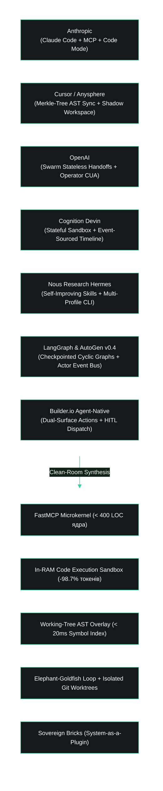
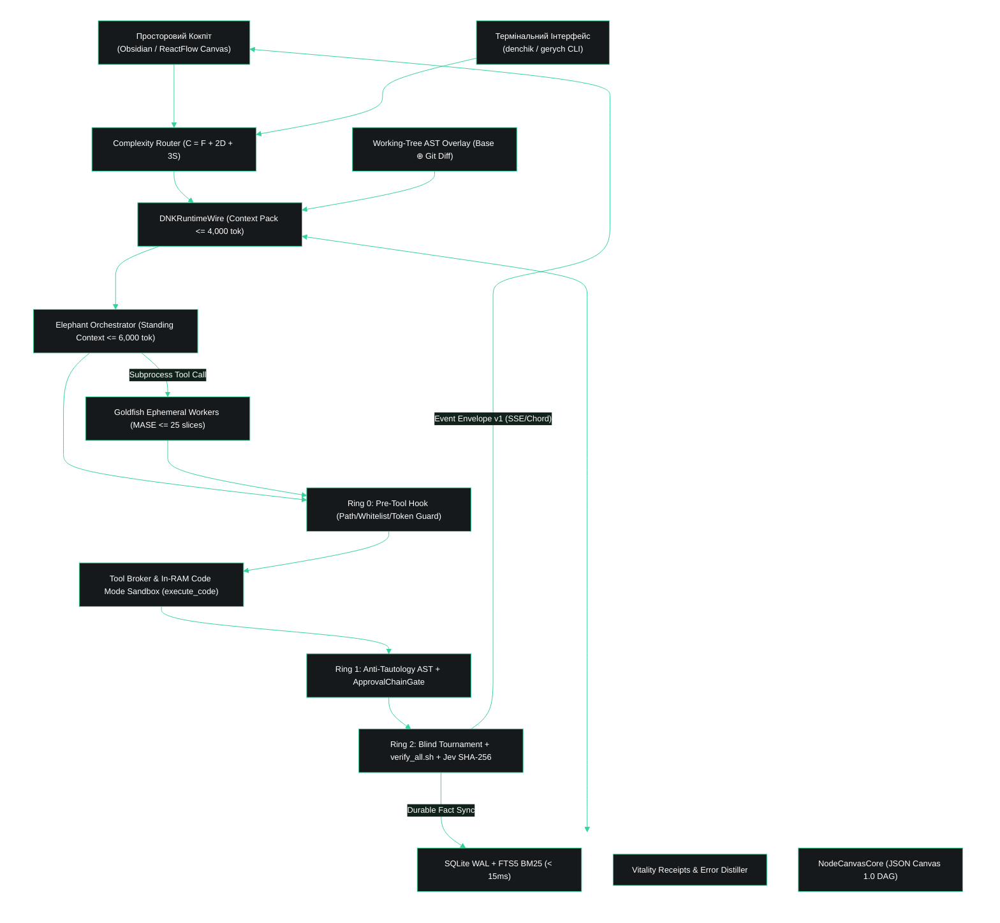

> [!metadata]- ⚙️ Системні метадані та інваріанти (MRH Header)
> ```yaml
> # --- DNK-MRH-HEADER ---
> mrh_id: "docs/architecture/reports/GERYCH_ROOT_AGENT_HARNESS_REPO_ARCHITECTURE_REPORT.md"
> purpose: "FastMCP Dual-Surface Server exposing Sovereign Shopify Brick both standalone and to DNK Core."
> canonical_source: true
> alters_files: []
> triggers_tasks: []
> status: "Active"
> version: "2.0.0"
> updated_at: "2026-11-18"
> author: "DNK-e.com Maksym & Antigravity"
> # --- END DNK-MRH-HEADER ---
> ```

# 🏛️ Архітектура Agent-First Систем, Agent Harnesses та Суверенна Топологія Репозиторіїв DNK Core на macOS

> **Головний інженерний вердикт:** У 2026 році якість, швидкість і автономність AI-систем визначаються не розміром базової LLM, а архітектурою **Agent Execution Harness** (рантайм-оболонки) та фізичною топологією файлової системи. Щоб **DNK Core** оркестрував усі розробки як єдиний центр керування, а кожен сервіс, плагін і агент залишався суверенною одиницею (здатною запускатися, тестуватися й ремонтуватися ізольовано), система будується за моделлю **Zero-Framework Agentic Microkernel + Sovereign FastMCP Bricks + APFS Zero-Waste Worktree Topology**.

---

## 🌍 Розділ 1. Аналіз світового досвіду (Frontier SOTA)

Провідні технологічні лабораторії відмовилися від «всезнаючих монолітних чат-ботів» та «балакучих роїв» (де агенти спалюють десятки тисяч токенів у діалогах між собою) на користь детермінованих харнесів із жорстким контролем контексту, типізованими протоколами інструментів та ізольованими середовищами виконання.



### 1.1. Детальний розбір архітектур світових лідерів

#### 1. Anthropic: Claude Code, Model Context Protocol (MCP) та Code Execution Mode (CE-MCP)
- **Філософія ядра:** Тонкий клієнтський ReAct-цикл без внутрішнього RAG-індексатора. Замість завантаження всього репозиторію у векторну базу, агент використовує швидкі системні примітиви (`ripgrep`, `glob`, точкове читання зрізів файлу) та ієрархічні файли правил (`CLAUDE.md` / `AGENTS.md`).
- **Model Context Protocol (MCP):** Універсальний протокол JSON-RPC 2.0 (поверх `stdio` або `SSE/Streamable HTTP`), який повністю відокремлює ядро агента від конкретних інтеграцій. Кожен сервіс (GitHub, Postgres, Shopify, локальна пам'ять) виступає окремим MCP-сервером.
- **Прорив 2026 — Code Mode with MCP (CE-MCP):** Класичний покроковий виклик інструментів (`LLM -> JSON tool_call -> Tool Result у промпт -> LLM`) катастрофічно роздуває контекст, коли потрібно обробити 100+ записів або викликати 10 тулів підряд. У CE-MCP інструменти монтуються як типізовані SDK-функції всередині пісочниці: агент пише один короткий Python/TypeScript скрипт, який у RAM циклом опитує MCP-сервери, фільтрує сирі гігабайти даних і повертає в промпт лише фінальний агрегований результат (економія **98.7%–99% токенів**).
- **Субагентна ізоляція:** Делегування задач (`Task` / `delegate_task`) створює ефемерного дочірнього агента з окремим контекстним вікном; батьківський процес отримує лише стислий текстовий підсумок, що захищає основний контекст від засмічення.

#### 2. Cursor (Anysphere): Shadow Workspaces, Merkle-Tree Sync та Fast-Apply
- **Керування контекстом кодової бази:** Замість повторної індексації з нуля Cursor будує локальне **дерево Меркла (Merkle Tree)** хешів файлів і синхронізує лише змінені вузли. Глибоке розв'язання символів спирається на Language Server Protocol (LSP) та Tree-sitter AST.
- **Shadow Workspace (Тіньовий робочий простір):** Приховане вікно/процес, у якому агент застосовує сгенерований код у фоні, проганяє компілятор/лінтер (TypeScript/Pyright) і бачить помилки діагностики **до того**, як показати диф користувачу.
- **Розділення Planning vs Speculative Edit:** Важка модель генерує компактний семантичний скетч змін, а спеціалізована надшвидка модель (Fast-Apply) зі швидкістю ~1000 токенів/с зливає патч у цільовий файл без помилок рядків.

#### 3. OpenAI: Swarm (Stateless Handoffs), Codex CLI та Operator (CUA)
- **Stateless Handoff Pattern (Swarm / Agents SDK):** Відмова від важких об'єктно-орієнтованих оркестраторів. Агент — це просто функція конфігурації (`Instructions + Tools`). Передача керування іншому спеціалісту (`handoff_to_shopify_agent()`) — це звичайний tool call, який підміняє системний промпт і список доступних інструментів на наступному кроці циклу.
- **Codex CLI (`sandbox-exec` на macOS):** Локальний термінальний харнес OpenAI використовує нативний механізм ядра macOS **Seatbelt (`sandbox-exec`)** із декларативними профілями доступу: агенту дозволено писати виключно у поточний `WORKDIR` та `$TMPDIR`, тоді як мережевий вихід і зміна системних папок заблоковані на рівні ОС.
- **Verification Loop (Operator):** Кожна мутація зовнішнього стану супроводжується обов'язковим кроком верифікації стану (State Snapshot -> Action -> Post-Action Diff -> Check Gate).

#### 4. Cognition Devin: Stateful Sandbox & Event-Sourced Timeline
- **Повна тріада середовища:** Кожен воркер отримує власну ізольовану пісочницю з трьома синхронізованими поверхнями: Shell (PTY), Code Editor (AST/LSP) та Headless Browser (CDP).
- **Event-Sourced Execution Ledger:** Уся робота агента записується як незмінний журнал подій (`CommandExecuted`, `FilePatched`, `TestFailed`, `BrowserSnapshotted`). Це дозволяє робити миттєвий Time-Travel Rollback (відкат файлової системи та стану пам'яті до будь-якого кроку, де тести ще були зеленими).
- **Knowledge Triggers:** Короткі правила пам'яті не висять у промпті постійно, а мають чіткий тригер активації (наприклад, «підвантажувати це правило лише коли агент редагує файли `sections/*.liquid`»).

#### 5. Nous Research: Hermes Agent
- **Процедурна само-еволюція через Skills (`SKILL.md`):** На відміну від статичних агентів, Hermes накопичує процедурну пам'ять у форматі модульних скілів (`SKILL.md` + `references/` + `scripts/`), які динамічно підвантажуються за потребою (`skill_view`) та оновлюються через атомарний `skill_manage`.
- **Мультипрофільність та Prompt-Cache Invariant:** Архітектура `~/.hermes/profiles/<name>/` дозволяє тримати повністю ізольованих агентів на одній машині. Жорстке правило: **ніколи не мутувати системний промпт або список схем інструментів посеред сесії**, щоб не інвалідувати префіксний кеш провайдера (Prompt Caching).
- **Deferred Tool Catalog (`tool_search` / `tool_describe` / `tool_call`):** Замість завантаження 80+ JSON-схем на старті, другорядні інструменти та конектори відкладені у каталог і підвантажуються динамічно за ключовим запитом.

#### 6. LangGraph & Microsoft AutoGen v0.4
- **LangGraph (State Machine & Checkpointers):** Представляє оркестрацію як орієнтований граф зі спільним типізованим станом (`TypedDict` / `Pydantic`), явними ребрами переходів та `SqliteSaver`/`PostgresSaver` чекпойнтерами. Підтримує `interrupt_before` для зупинки графа перед небезпечною дією (Human-in-the-Loop) та відновлення з того ж байта після схвалення.
- **AutoGen v0.4 (Asynchronous Actor Mesh):** Повний редизайн від синхронних чатів (v0.2) до асинхронної подієвої архітектури акторів (Actor Model). Кожен агент підписаний на типізовану шину подій (`TopicId`), а оркестратор (`Magentic-One`) веде окремий **Task Ledger** (факти, план) та **Progress Ledger** (перевірка зациклення, stall detection).

#### 7. Builder.io Agent-Native & AG-UI Protocol
- **Dual-Surface Actions (`defineAction`):** Ліквідація розриву між UI для людини та інструментами для агента. Одна типізована схема (Zod / Pydantic) одночасно компілюється у FastMCP-інструмент для агента та у API/React-хук для веб-інтерфейсу.
- **Human-in-the-Loop Dispatch Queue:** Небезпечні дії (деплой теми, списання коштів, видалення даних) не виконуються напряму, а створюють `ApprovalTicket` у спільній черзі стану, яку фаундер схвалює в 1 клік.

---

### 1.2. Порівняльна матриця SOTA архітектур та позиціонування DNK Core

| Архітектурна вісь | Anthropic Claude Code / MCP | Cursor (Anysphere) | OpenAI Swarm / Codex CLI | Cognition Devin | Nous Hermes Agent | LangGraph / AutoGen v0.4 | Builder.io Agent-Native | **DNK Core (ADR-091 / DEC-073)** |
| :--- | :--- | :--- | :--- | :--- | :--- | :--- | :--- | :--- |
| **Ядро (Kernel)** | ReAct CLI + Subagent Tasks | IDE Host + Shadow Daemon | Stateless Loop + Seatbelt | Cloud VM Container | Python CLI + Gateway | Graph FSM / Actor Runtime | Nitro Action Dispatcher | **Zero-Framework Microkernel (<400 LOC)** |
| **Протокол тулів** | MCP + CE-MCP Code Mode | Native IDE RPC + MCP | JSON Function Calling | Internal Sandbox RPC | Tool Registry + Deferred | LangChain Tools / Actor Msg | `defineAction` Zod Schema | **FastMCP + In-RAM Code Mode (`execute_code`)** |
| **Стоячий контекст** | ~8k–12k токенів | Динамічний віконний | ~4k–8k токенів | Великий (State + DOM) | Налаштовуваний (Toolsets) | Залежить від вузлів графа | Високий при багатьох діях | **Жорсткий ліміт ≤ 6,000 токенів (`SurfaceSpec`)** |
| **Індексація коду** | Ripgrep + Read Slices | Merkle Tree + LSP + Embeddings | Ripgrep + Git status | LSP + Shell Index | Ripgrep (`search_files`) | Сторонній RAG | Статичний імпорт | **Working-Tree AST Overlay (`Base ⊕ Git Diff`, <20ms)** |
| **Пам'ять (Memory)** | `CLAUDE.md` файли | `.cursor/rules/*.mdc` | Сесійна | Knowledge Triggers | `MEMORY.md` + `SKILL.md` | Checkpointer DB | SQLite / Postgres | **SCONES 6-Layer SQLite WAL + FTS5 BM25 + Vitality** |
| **Ізоляція воркерів** | Subagent Context + Worktree | Shadow Workspace | `sandbox-exec` + Worktree | Окрема VM на сесію | `delegate_task` + `hermes -w` | Вузол графа / Actor | Окремий запит | **Goldfish Subprocess (`04-as-tool`) + Git Worktrees** |
| **Верифікація (Gates)** | Pre/Post Tool Shell Hooks | Фоновий LSP Linter | Sandbox Exit Code | Тести + Browser Check | Code Health Ratchets | Умовні ребра графа | HITL Approval Queue | **Ring 0 Hook + Anti-Tautology AST + Jev SHA-256** |
| **Модульність** | Зовнішні MCP сервери | VS Code Extensions | Python функції | Монолітний образ | Skills + Plugins | Пакетні графи | Monorepo пакети | **Sovereign FastMCP Bricks (`brick.manifest.yaml`)** |

---

## 💻 Розділ 2. Архітектура файлової системи та директорій на робочому MacBook

Головна хвороба розробників агентних систем на macOS — **«Дискова та Індексаторна Шизофренія»**: коли десятки агентних проєктів, клонованих донорів, Shopify-тем та мікросервісів створюють сотні локальних папок `node_modules/` (по 500–900 МБ кожна) і `.venv/` (по 400–800 МБ), дублюють кеші, вішають macOS Spotlight / VS Code / Cursor TypeScript Server і перетворюють репозиторії на неповоротких «Франкенштейнів».

### 2.1. Вибір топології репозиторіїв: Monorepo vs Multi-repo vs Sovereign Hub + Satellite Worktrees

| Топологія | Як влаштована | Переваги | Чому ламається в агентній розробці | Статус у DNK OS |
| :--- | :--- | :--- | :--- | :--- |
| **1. Класичний Monorepo** *(Turborepo / Nx)* | Весь код ядра, всіх тем, клієнтських додатків і R&D-експериментів у єдиному `.git`. | Легкий рефакторинг спільних типів, єдиний PR. | 1) Загальний `git status` і LSP сповільнюються від сотень тисяч файлів; 2) Агенти випадково зачіпають сусідні сервіси (Blast Radius); 3) Неможливо віддати клієнту чистий репозиторій одного сервісу. | ❌ Відхилено для зовнішніх продуктів та R&D |
| **2. Розкиданий Multi-repo** | Кожен сервіс і плагін живе у своєму окремому репозиторії без єдиного центру. | Повна ізоляція історії Git та деплою. | 1) «Розмовна амнезія» між репо; 2) Дублювання правил `AGENTS.md`, скілів і контрактів; 3) Оркестратор не бачить повної картини системи. | ❌ Відхилено (відсутність SSOT) |
| **3. Sovereign Control Hub + Modular Bricks + Satellite Worktrees** *(Home Repo Standard / DEC-073)* | **Ядро (`DNK_OS`)** тримає контракти, оркестратор і суверенні цеглинки (`core/bricks/`, `services/dnk_*`), а зовнішні теми, додатки та R&D-донори підключені як **суверенні сателіти** у сусідніх просторах з ізоляцією через `git worktree`. | 1) Миттєва швидкість Git та IDE (<50ms); 2) 100% автономність кожного сервісу/плагіна; 3) Нуль конфліктів при паралельній роботі кількох агентів. | Потребує суворої дисципліни маніфестів (`brick.manifest.yaml`) та реєстру портів (`port_registry.yaml`). | ✅ **Канонічний стандарт DNK OS** |

### 2.2. Фізика Zero-Waste на macOS APFS: Дедуплікація `uv` та `pnpm`

Файлова система Apple **APFS (Apple File System)** підтримує на рівні блоків SSD дві критичні операції: **Copy-on-Write Clones (`clonefile(2)` / `cp -c`)** та **Hardlinks (жорсткі посилання на один `inode`)**. Правильне налаштування пакетних менеджерів дозволяє мати 50+ суверенних сервісів і `git worktree` на MacBook із **0 байт фізичного дублювання пакетів на диску**.

```
+-----------------------------------------------------------------------------------+
|                 macOS APFS PHYSICAL SSD BLOCKS (Single Inode / CoW)               |
+-----------------------------------------------------------------------------------+
         ▲                                                   ▲
         | APFS Copy-on-Write Clone (0 MB extra)             | Hardlink (Same Inode, 0 MB extra)
         |                                                   |
+--------+----------------------------------+       +--------+----------------------------------+
| ~/.dnk_runtime/uv-cache/                  |       | ~/Library/pnpm/store/v10/                 |
| (Global Wheel & Unpacked Archive Cache)   |       | (Content-Addressable CAS Blob Store)      |
+--------+----------------------------------+       +--------+----------------------------------+
         |                                                   |
         +---> ~/.dnk_runtime/venvs/dnk-core/                +---> ~/.dnk_runtime/pnpm-virtual-store/
         +---> ~/.dnk_runtime/venvs/brick-shopify/           +---> apps/web/node_modules/.pnpm/
         +---> ../DNK_GitHub_Vibe/wt-task-01/.venv           +---> ../DNKEcom/Apps/app-1/node_modules/
```

#### Конфігурація Python (`~/.config/uv/uv.toml`)
```toml
# --- DNK-MRH-HEADER ---
# mrh_id: "config/uv/uv.toml"
# purpose: "Global Astral uv configuration enforcing APFS Copy-on-Write clones and centralized cache."
# canonical_source: true
# status: "Active"
# version: "1.0.0"
# --- END DNK-MRH-HEADER ---

# Використовувати нативний системний виклик macOS clonefile(2) (Copy-on-Write)
link-mode = "clone"

# Єдине глобальне сховище кешу коліс та розпакованих пакетів
cache-dir = "~/.dnk_runtime/uv-cache"

# Заборона завантаження випадкових версій інтерпретатора в локальні папки
python-install-dir = "~/.dnk_runtime/python-toolchains"
python-preference = "managed"
compile-bytecode = false
```

#### Конфігурація Node.js (`~/.npmrc` та `pnpm-workspace.yaml`)
```ini
# ~/.npmrc — Глобальна конфігурація pnpm для APFS Hardlink Deduplication
store-dir=~/.dnk_runtime/pnpm-store/v10
virtual-store-dir=.pnpm
package-import-method=clone-or-copy
prefer-symlinked-executables=true
strict-peer-dependencies=false
auto-install-peers=true
```

### 2.3. Ізоляція середовищ (`~/.dnk_runtime/`) та захист від блоату репозиторіїв (DEC-033)

Щоб робочі репозиторії залишалися кристально чистими (`< 2–10 MB` вихідного коду), застосовується правило **Zero-Local-Runtime-Bloat**:
1. **Централізований системний рантайм (`~/.dnk_runtime/`):**
   - `~/.dnk_runtime/venvs/<module-slug>/` — іменовані віртуальні середовища для ядра та ізольованих сервісів.
   - `~/.dnk_runtime/uv-cache/` та `~/.dnk_runtime/pnpm-store/` — глобальні дедупліковані сховища пакетів.
   - `~/.dnk_runtime/worktrees/` — оперативний пул тимчасових `git worktree` для паралельних сесій агентів.
   - `~/.dnk_runtime/run/` та `~/.dnk_runtime/logs/` — PID-файли запущених демонів (`*.pid`), локальні сокети (`*.sock`) та ротовані логи.
2. **Анти-індексаторний бар'єр (Anti-Indexer Lag):**
   - Важкі карантинні пісочниці (`../DNK_GitHub_Vibe/`) додаються у виключення Spotlight (`.metadata_never_index`) та ніколи не монтуються у головний файл робочого простору IDE (`DNK_OS.code-workspace`).
3. **Заборона `npm` та `pip` на рівні Ring-0:**
   - Перехоплювач `scripts/system/hermes_pre_tool_hook.py` автоматично блокує або перезаписує будь-яку спробу агента викликати `pip install` чи `npm install` на `uv pip install` та `pnpm add`.

### 2.4. Архітектура симлінків, SDK-шарів та паралельних Git Worktrees

Для того щоб кожен сервіс або плагін мав миттєвий доступ до базових контрактів ядра (`dnk_core_sdk`), але не копіював код ядра всередину своєї папки:
1. **Внутрішній SDK-шар (`packages/dnk_core_sdk/`):**
   Містить виключно базові контракти Pydantic (`KernelTaskRequest`, `BrickManifest`, `EventEnvelope`), клієнт SCONES пам'яті та декоратори FastMCP. Підключається у віртуальні середовища сервісів у режимі **editable install** (`uv pip install -e ./packages/dnk_core_sdk`) або через `uv.lock` workspace members.
2. **Уніфікація конфігурацій агентів через симлінки:**
   Єдиним джерелом правил є кореневий `AGENTS.md` та папка скілів `core/skills/`. Конфігураційні точки входу різних інструментів (`CLAUDE.md`, `.cursorrules`, `.windsurfrules`, `.agent/skills`) є **відносними символічними посиланнями (`ln -s`)** на канонічні файли ядра, що гарантує 0% розсинхронізації між IDE-агентами та термінальним білдером.
3. **Ізоляція паралельної розробки через `git worktree` + macOS Seatbelt:**
   Коли ядро запускає воркера для ремонту або апгрейду окремого сервісу (наприклад, `services/dnk_shopify`), воно ніколи не редагує основне робоче дерево напряму, якщо там працює інший процес. Виконується миттєве відгалуження:
   ```bash
   git worktree add ~/.dnk_runtime/worktrees/fix-shopify-ast -b fix/shopify-ast-parser
   ```
   Оскільки `.git/objects` спільні, створення робочого дерева займає `< 80 мс` і `0 МБ` додаткового місця під історію Git.

---

## ⚙️ Розділ 3. Анатомія Agent Harness (Внутрішня Будова Ядра DNK Core)

**Agent Harness (Агентний Харнес)** — це детермінована операційна система навколо LLM. Модель виступає лише як центральний процесор (CPU), що генерує рішення на кожному такті, а харнес виступає як ядро ОС (Kernel, MMU, File System, Firewall, Scheduler).



### 3.1. Сім фундаментальних підсистем Agent Harness

#### 1. Kernel & System 1 Triage (`core/kernel/`)
- **Призначення:** Прийняти вхідний намір (`KernelTaskRequest`), миттєво (< 50 мс, без дорогого виклику важкої LLM) оцінити складність за формулою $C = F_{\text{files}} + 2 \cdot D_{\text{domains}} + 3 \cdot S_{\text{stages}}$ і обрати режим виконання (`SOLO` | `SWARM_PARALLEL` | `SWARM_SEQUENTIAL`).
- **Жорстке правило (No Whitelist = No Code):** Ядро відхиляє будь-яку задачу на модифікацію коду, якщо в `KernelTaskRequest` не заповнені `target_files` (білий список дозволених файлів) та `negative_scope` (те, що чіпати заборонено).

#### 2. Execution Loop: MASE, Frozen Prefix & Safe Compaction (`core/harness/`)
- **Mandatory Atomic Slice Execution (MASE):** Замість багатогодинних монолітних сесій, де після 40-го кроку модель втрачає увагу (Attention Entropy), цикл виконання жорстко обмежений **≤ 25 інструментальними викликами на один атомарний зріз**.
- **Frozen System-Prompt Snapshot:** Системний промпт, базові інваріанти та перелік активних інструментів фіксуються на Кроці 0 і **не змінюються до кінця сесії**. Це забезпечує 90%+ влучань у префіксний кеш LLM (Prompt Caching), знижуючи затримку Time-To-First-Token у 4 рази.
- **Safe Context Compaction:** Коли історія повідомлень наближається до порогу стиснення, компактор розрізає стрічку виключно по межах `user`/`assistant` повідомлень, ніколи не розриваючи парні блоки `tool_call` та `tool_result`.

#### 3. Tool Broker & In-RAM Code Execution Mode (`core/executors/ptc/`)
- **Дворівнева подача інструментів (Deferred Catalog):** На старті агент бачить лише 6 базових наборів (`file`, `terminal`, `skills`, `code_execution`, `tool_search`, `delegate_task`) — стоячий оверхед ≤ 6,000 токенів. Усі спеціалізовані інструменти сервісів розкриваються динамічно через `tool_search` -> `tool_describe` -> `tool_call`.
- **In-RAM Code Mode (CE-MCP):** Замість серії з 15 окремих JSON tool-викликів брокер дозволяє агенту виконати ізольований Python-скрипт у RAM, який імпортує локальні FastMCP-клієнти сервісів, проводить пакетні розрахунки й повертає компактний JSON-звіт.

#### 4. Plugin & Skill Discovery Engine (`core/canvas/jit_skill_mounter.py`)
- **Архітектура Level-of-Detail (LOD):** Кожен процедурний скіл (`core/skills/<name>/SKILL.md`) обмежений лімітом ≤ 750 рядків (індекс і швидкі рецепти), тоді як важкі схеми API, приклади та шаблони винесені в підпапки `references/` та `templates/`.
- **Бюджет вузла (`DNKNodeContextPack`):** При переході до конкретної задачі на графі `JITSkillMounter` підбирає релевантні скіли та правила з жорстким бюджетом **≤ 4,000 токенів** на вузол.

#### 5. State & 6-Layer Cognitive Memory Engine (`core/memory/scones_store.py`)
- **6 шарів пам'яті:**
  1. *Sensory (L0):* Вхідний потік подій і телеметрія хоста (`psutil`, git status).
  2. *Working (L1):* Скомпільований `DNKNodeContextPack` активної задачі + `Working-Tree AST Overlay` (`Effective AST = Base Index ⊕ Fresh Parse(git diff)` для пошуку символів за < 20 мс).
  3. *Episodic (L2):* Журнал сесій, рішень та чеків виконання (`KernelCompletionReceipt`).
  4. *Semantic (L3):* Доменні факти та заблоковані архітектурні рішення (`[🔒 LOCKED] DEC-*`) у SQLite FTS5 BM25 (`.data/scones_memory.db` та `.data/scones_bm25.db`, пошук < 15 мс).
  5. *Procedural (L4):* Каталог скілів `SKILL.md` та `error_distillations.json` (миттєві рецепти лікування відомих помилок за хешем стектрейсу).
  6. *Spatial DAG (L5):* Граф задач `ThoughtDAG` / `NodeCanvasCore`, серіалізований у відкритий формат `JSON Canvas 1.0` (`docs/canvas/*.canvas`) для візуального кокпіту Obsidian та ReactFlow.
- **Vitality Receipts (Захист від старіння пам'яті):** Кожен запис у SCONES має лічильник життєздатності (`vitality_score`). Правила, які реально допомагають закривати задачі з `exit code 0`, підвищують свій ранг; застарілі або невикористовувані факти автоматично затухають (`decay`) і не потрапляють у промпт.
- **SQLite Concurrency Invariant:** Для одночасного безпечного доступу кількох агентів та UI всі локальні бази примусово ініціалізуються з:
  ```sql
  PRAGMA journal_mode = WAL;
  PRAGMA busy_timeout = 5000;
  PRAGMA synchronous = NORMAL;
  ```

#### 6. Ring 0 – Ring 2 Verification Gates & Jev Engine (`core/guards/`, `scripts/system/`)
- **Ring 0 (Pre-Tool Interceptor — `hermes_pre_tool_hook.py`):** Спрацьовує **до** виконання будь-якої файлової або термінальної дії. Перевіряє: (а) відсутність абсолютних шляхів (`normalize_rel`); (б) входження файлу до `Target File Whitelist` і відсутність у `Negative Scope`; (в) заборону створення несанкціонованих папок поза 8 канонічними коренями; (г) перехоплення `pip`/`npm` на `uv`/`pnpm`.
- **Ring 1 (Semantic & Security Gates):**
  - `anti_tautology_guard.py`: AST-парсер тестів, який блокує закриття задачі, якщо тести містять пустушки (`assert True`, `pass`, надмірні моки без перевірки реальної поведінки).
  - `ApprovalChainGate`: Криптографічний шлюз підтвердження (`signature_sha256`) для критичних зовнішніх дій (публікація Shopify-теми, видалення ресурсів).
- **Ring 2 (Adversarial Blind Tournament & Deterministic Receipt):**
  - Сліпий арбітраж (`selection.py` за патерном Google Harness²): коли є кілька кандидатів реалізації, вони хешуються анонімними ID (`Candidate A`, `Candidate B`), щоб аудитор (Goldfish-субагент із чистим контекстом) оцінив їх без упередженості авторства.
  - Фінальний прогін `./scripts/verify_all.sh` та випуск криптографічного чека `Jev Receipt` (`jvr_<sha256>`).

#### 7. Event Bus & Dual-Surface Bridge (`core/canvas/`, `scripts/system/canvas_bridge.py`)
- Усі компоненти ядра та суверенні модулі спілкуються через типізований конверт подій **`EventEnvelope v1`** та транзакційний дельта-протокол **Chord (`OpBatch`)**.
- Коли агент у терміналі бере в роботу задачу або завершує тест, подія за мілісекунди летить через SSE/WebSocket у просторовий канвас (Obsidian / Web UI), змінюючи колір і статус відповідної ноди без перезавантаження всього графа.

---

## 🧩 Розділ 4. Принцип суверенних модулів (Sovereign FastMCP Bricks)

Ключова вимога Максима: **«Кожен сервіс, плагін, агент розробляється як індивідуальний суверенний елемент, який може працювати, тестуватися та вдосконалюватися окремо від системи, але оркеструватися з DNK Core»**.

Для цього в DNK Core впроваджується архітектурний стандарт **Sovereign Brick Protocol (System-as-a-Plugin)**. Жоден сервіс не має права бути «розмазаним» по репозиторію або мати приховані циклічні імпорти з іншими сервісами.

```
+-----------------------------------------------------------------------------------+
|                        DNK CORE ORCHESTRATOR (Microkernel)                        |
|   Dynamic Brick Registry  |  Topological DAG Resolver  |  FastMCP Tool Broker     |
+-----------------------------------------------------------------------------------+
            ▲                               ▲                               ▲
            | FastMCP (stdio/SSE)           | FastMCP (stdio/SSE)           | Subprocess JSON Receipt
            | or Direct In-RAM SDK          | or Direct In-RAM SDK          | (04-as-tool Pattern)
            ▼                               ▼                               ▼
+-----------------------+       +-----------------------+       +-----------------------+
|   SOVEREIGN SERVICE   |       |   SOVEREIGN PLUGIN    |       |    SOVEREIGN AGENT    |
|  (e.g. dnk_shopify)   |       | (e.g. seamless_inject)|       |  (e.g. gerych_auditor)|
+-----------------------+       +-----------------------+       +-----------------------+
| - brick.manifest.yaml |       | - plugin.manifest.yaml|       | - agent.manifest.yaml |
| - contracts/schemas.py|       | - contracts/schemas.py|       | - SOUL.md / SKILL.md  |
| - mcp_server.py       |       | - mcp_server.py       |       | - runner_cli.py       |
| - cli.py (Standalone) |       | - cli.py (Standalone) |       | - evals/test_agent.py |
| - engine/ (Pure Code) |       | - src/ (Pure Logic)   |       | - sandbox_profile.sb  |
| - tests/ (Isolated)   |       | - tests/ (Isolated)   |       |                       |
+-----------------------+       +-----------------------+       +-----------------------+
```

### 4.1. П'ять обов'язкових елементів суверенного модуля (Анатомія Цеглинки)

Кожен сервіс (`services/dnk_<name>/`), плагін (`packages/plugins/dnk_<name>/`) або спеціалізований агент (`core/orchestrator/agents/<name>/`) зобов'язаний мати п'ять стандартизованих точок:

1. **Декларативний паспорт (`brick.manifest.yaml`):**
   Визначає ID модуля, версію, дозволені шляхи, залежності від інших цеглинок (DAG), зовнішні Python/npm пакети, контракти, точки входу (`mcp_server`, `api_router`, `cli`) та власний Quality Gate (`test_suite`, `min_coverage`).
2. **Суворі контракти входу/виходу (`contracts/schemas.py` та `contracts/types.ts`):**
   Усі вхідні параметри та результати роботи модуля описані як незмінні Pydantic v2 моделі (`extra="forbid"`). Інші модулі та ядро імпортують **тільки** `contracts/schemas.py`, ніколи не імпортуючи внутрішні файли реалізації (`engine/_internal.py`).
3. **Універсальний інтерфейс для агентів (`mcp_server.py`):**
   Обгортка на базі `FastMCP`, яка експортує можливості модуля як типізовані інструменти. Завдяки цьому модуль можна:
   - викликати з ядра `DNK Core` у пам'яті (In-RAM Code Mode);
   - підключити по `stdio` у Claude Code, Cursor, Antigravity або Hermes CLI.
4. **Автономний термінальний раннер (`cli.py`):**
   Дозволяє запустити, перевірити або зневадити модуль із терміналу однією командою (`uv run python -m services.dnk_shopify.cli check-theme --path ...`) взагалі без запуску веб-сервера чи оркестратора DNK OS.
5. **Герметичний контур тестування (`tests/`):**
   Власний набір модульних та контрактних тестів із локальними фікстурами, який запускається за 1–3 секунди (`uv run pytest services/dnk_shopify/tests/ -q`) і не потребує підняття інших сервісів.

### 4.2. Еталонні шаблони коду суверенного модуля

#### A. Паспорт модуля (`brick.manifest.yaml`)
```yaml
# --- DNK-MRH-HEADER ---
# mrh_id: "services/dnk_shopify/brick.manifest.yaml"
# purpose: "Sovereign Brick Manifest for DNK Shopify Theme 2.0 & Liquid AST Engine."
# canonical_source: true
# alters_files: []
# triggers_tasks: []
# status: "Active"
# version: "2.0.0"
# updated_at: "2026-11-15"
# author: "DNK-e.com Maksym"
# --- END DNK-MRH-HEADER ---

id: "brick_04_shopify_engine"
name: "DNK Shopify 2.0 & Liquid AST Sovereign Engine"
version: "2.0.0"
kind: "service" # service | plugin | agent
category: "ecommerce_engine"
description: "Autonomous Liquid AST parser, Horizon Theme Blocks 2.0 transpiler, and cleanroom theme packager."

isolation:
  standalone_capable: true
  allocated_port: 54104
  db_namespace: "shopify_vault"

paths:
  root: "./services/dnk_shopify"
  contracts: "./services/dnk_shopify/contracts/schemas.py"
  tests: "./tests/shopify"

dependencies:
  internal_bricks:
    - "brick_02_scones_memory"
  external_python:
    - "pydantic>=2.7.0"
    - "fastapi>=0.110.0"
    - "liquidpy>=0.8.0"
  external_npm:
    - "@shopify/cli"

entrypoints:
  mcp_server: "services.dnk_shopify.mcp_server:mcp"
  api_router: "services.dnk_shopify.api_router:router"
  cli_runner: "services.dnk_shopify.cli:main"
  healthcheck: "services.dnk_shopify.cli:verify_health"

quality_gate:
  test_command: "uv run pytest ./tests/shopify -q"
  lint_command: "uv run ruff check ./services/dnk_shopify"
  min_coverage: 90
```

#### B. Контракт та FastMCP-міст (`contracts/schemas.py` + `mcp_server.py`)
```python
# --- DNK-MRH-HEADER ---
# mrh_id: "services/dnk_shopify/contracts/schemas.py"
# purpose: "Strict Pydantic v2 I/O boundary contracts for Sovereign Shopify Brick."
# canonical_source: true
# alters_files: []
# triggers_tasks: []
# status: "Active"
# version: "2.0.0"
# updated_at: "2026-11-15"
# --- END DNK-MRH-HEADER ---

from pydantic import BaseModel, ConfigDict, Field


class ThemeAuditRequest(BaseModel):
    model_config = ConfigDict(extra="forbid", frozen=True)

    theme_rel_path: str = Field(..., description="Relative path to target Shopify theme folder")
    strict_horizon_v2: bool = Field(default=True, description="Enforce ADR-093 4-layer nesting cap <= 4")


class ThemeAuditReceipt(BaseModel):
    model_config = ConfigDict(extra="forbid", frozen=True)

    brick_id: str = "brick_04_shopify_engine"
    theme_rel_path: str
    passed: bool
    errors_count: int
    max_nesting_depth: int
    audit_sha256: str
```

```python
# --- DNK-MRH-HEADER ---
# mrh_id: "services/dnk_shopify/mcp_server.py"
# purpose: "FastMCP Dual-Surface Server exposing Sovereign Shopify Brick both standalone and to DNK Core."
# canonical_source: true
# alters_files: []
# triggers_tasks: []
# status: "Active"
# version: "2.0.0"
# updated_at: "2026-11-15"
# --- END DNK-MRH-HEADER ---

from fastmcp import FastMCP
from services.dnk_shopify.contracts.schemas import ThemeAuditReceipt, ThemeAuditRequest
from services.dnk_shopify.engine.auditor import run_deterministic_theme_audit

mcp = FastMCP("dnk_shopify_sovereign_brick")


@mcp.tool()
def shopify_audit_theme(theme_rel_path: str, strict_horizon_v2: bool = True) -> dict:
    """Runs deterministic AST & schema audit on a Shopify theme directory."""
    req = ThemeAuditRequest(theme_rel_path=theme_rel_path, strict_horizon_v2=strict_horizon_v2)
    receipt: ThemeAuditReceipt = run_deterministic_theme_audit(req)
    return receipt.model_dump()


if __name__ == "__main__":
    # Може запускатися повністю автономно як stdio MCP сервер або CLI-демон
    mcp.run()
```

### 4.3. Як ремонтується або вдосконалюється окремий модуль без зупинки DNK Core

Коли потрібно виправити баг або додати фічу в один конкретний плагін чи сервіс (наприклад, `services/dnk_media`):
1. **Вузький Scope (Zero Blast Radius):** Оркестратор формує `KernelTaskRequest`, де у `target_files` дозволена **виключно** папка `./services/dnk_media/` та `./tests/media/`, а `./core/` та інші сервіси внесені у `negative_scope`.
2. **Ізольований Worktree:** Скрипт `dnk-worktree spawn fix-media-tts` за 0.1 с створює ізольоване робоче дерево в `~/.dnk_runtime/worktrees/fix-media-tts/`.
3. **Запуск Goldfish-воркера (Pattern `04-as-tool`):** У цьому робочому дереві запускається ізольований воркер Денчіка, який завантажує в контекст **лише** `services/dnk_media/brick.manifest.yaml`, `contracts/schemas.py` та цільовий файл (разом < 3,500 токенів замість 50,000 токенів усієї системи).
4. **Локальна верифікація цеглинки:** Воркер запускає локальний гейт із маніфесту: `uv run pytest ./tests/media -q` та автономний CLI: `uv run python -m services.dnk_media.cli --self-test`.
5. **Атомарне влиття в ядро:** Тільки коли локальний гейт і `auto_precommit_guard.py` повертають `exit code 0` і генерують `RECEIPT-*.json`, гілка чисто вливається в `DNK Core`, а тимчасовий worktree автоматично видаляється.

---

## 🗺️ Розділ 5. Фізична схема директорій DNK Core & DNK OS та План Впровадження

### 5.1. Повна фізична топологія на робочому MacBook (5 Канонічних Просторів + Системний Рантайм)

```
~/
├── .dnk_runtime/                                  # [SYSTEM RUNTIME] Централізоване сховище поза Git (0 MB bloat у репо)
│   ├── uv-cache/                                  # Глобальний кеш Python wheels (APFS Copy-on-Write Clones)
│   ├── pnpm-store/v10/                            # Глобальний CAS-стор Node.js пакетів (APFS Hardlinks)
│   ├── venvs/                                     # Ізольовані віртуальні середовища (dnk-core, bricks)
│   ├── worktrees/                                 # Тимчасові git worktrees для паралельних агентних задач
│   ├── run/                                       # PID-файли (*.pid) та локальні Unix-сокети (*.sock)
│   └── logs/                                      # Ротовані логи демонів та траєкторії сесій
│
└── Kuzmenko/MY_LIFE_WORK/                         # [MASTER WORKSPACE ROOT]
    │
    ├── DNK_OS/ (або поточний SSOT у DNK_HUB/)     # [1. SOVEREIGN CORE & COCKPIT] Ядро DNK Core (8 канонічних коренів)
    │   ├── AGENTS.md                              # Єдина Конституція інваріантів (CLAUDE.md -> симлінк сюди)
    │   ├── pyproject.toml                         # Кореневий маніфест uv workspace
    │   ├── pnpm-workspace.yaml                    # Кореневий маніфест pnpm workspace
    │   │
    │   ├── core/                                  # [ROOT 1/8] МІКРОЯДРО DNK CORE (Agent Harness Engine)
    │   │   ├── kernel/                            # System 1 Triage (<50ms), contracts.py (Pydantic SSOT)
    │   │   ├── harness/                           # dnk_runtime_wire.py, mcp_server.py, cli.py, approval_chain_gate.py
    │   │   ├── bricks/                            # Реєстр суверенних цеглинок (registry.py, DAG resolver, blueprints)
    │   │   │   ├── brick_01_agentic_brain/        # brick.manifest.yaml + contracts/ + mcp_server.py
    │   │   │   ├── brick_02_scones_memory/        # brick.manifest.yaml + contracts/ + mcp_server.py
    │   │   │   ├── brick_03_spatial_canvas/       # brick.manifest.yaml + contracts/ + mcp_server.py
    │   │   │   ├── brick_04_shopify_engine/       # brick.manifest.yaml + contracts/ + mcp_server.py
    │   │   │   ├── brick_05_video_ai/             # brick.manifest.yaml + contracts/ + mcp_server.py
    │   │   │   └── brick_06_web_api_shell/        # brick.manifest.yaml + contracts/ + mcp_server.py
    │   │   ├── memory/                            # SCONES 6-Layer SQLite WAL + FTS5 BM25 + Vitality Receipts
    │   │   ├── analyzers/                         # ast_overlay_engine.py (Effective AST = Base ⊕ Git Diff)
    │   │   ├── canvas/                            # node_canvas_core.py (JSON Canvas 1.0 DAG), jit_skill_mounter.py
    │   │   ├── executors/ptc/                     # In-RAM Code Mode Sandbox (CE-MCP Python/TS runner)
    │   │   ├── orchestrator/                      # decision_draft.py (Jev SHA-256), swarm_coordinator.py
    │   │   │   └── agents/                        # Суверенні профілі агентів (denchik/, gerych_auditor/, antigravity/)
    │   │   ├── skills/                            # Модульні процедурні скіли (SKILL.md <= 750 рядків + references/)
    │   │   ├── guards/                            # Ring 0 - Ring 2 захисні бар'єри та валідатори
    │   │   └── registry/                          # port_registry.yaml (SSOT портів 3000..8003 та 54100..54999)
    │   │
    │   ├── services/                              # [ROOT 2/8] СУВЕРЕННІ БІЗНЕС-ВОРКХОРСИ (3 Core Workhorses)
    │   │   ├── dnk_shopify/                       # Liquid AST, Horizon Blocks 2.0, Component Vault, CLI, MCP
    │   │   ├── dnk_media/                         # Clean-Room Video/Audio AI Studio (Vertex/FFmpeg/Pillow), CLI, MCP
    │   │   └── dnk_distribution/                  # Контент-дистрибуція, воронки, інтеграції, CLI, MCP
    │   │
    │   ├── packages/                              # [ROOT 3/8] СУВЕРЕННІ ПЛАГІНИ ТА SDK ШАРИ
    │   │   ├── dnk_core_sdk/                      # Легкий SDK контрактів для підключення у плагіни та сервіси
    │   │   ├── plugins/                           # Ізольовані плагіни (dnk-seamless-injection, excalidraw-bridge)
    │   │   └── archify/                           # Дизайн-токени DNK Polaris-Spatial (DPS-DS)
    │   │
    │   ├── apps/                                  # [ROOT 4/8] ПОВЕРХНІ КОКПІТУ ТА API ШЛЮЗ
    │   │   ├── api/                               # FastAPI Dynamic Router Loader (монтує живі роутери з brick.manifest)
    │   │   ├── web/                               # Next.js 15 App Router + Spatial Canvas UI + Fumadocs Portal
    │   │   └── desktop/                           # Tauri v2 macOS Sovereign Client Wrapper
    │   │
    │   ├── docs/                                  # [ROOT 5/8] TRI-SURFACE KNOWLEDGE MESH (Obsidian + Fumadocs + SCONES)
    │   │   ├── architecture/                      # DECISION_REGISTRY_ADHD.md (LOCKED SSOT), adr/, reports/, specs/
    │   │   ├── canvas/                            # dnk_brain.canvas (JSON Canvas 1.0 живі графи задач)
    │   │   └── templates/                         # GERYCH_TASK_TEMPLATE.md, Do not Delete - Example.md
    │   │
    │   ├── tests/                                 # [ROOT 6/8] КОНТРАКТНІ, МОДУЛЬНІ ТА E2E ТЕСТИ
    │   │   ├── core/                              # Тести мікроядра та контрактів
    │   │   ├── bricks/                            # Тести топологічного DAG та ізоляції цеглинок
    │   │   └── unit/                              # Доменні тести сервісів та плагінів
    │   │
    │   ├── scripts/                               # [ROOT 7/8] АВТОМАТИЗАЦІЯ ТА КАРАЛЬНІ ГЕЙТИ ЯКОСТІ
    │   │   ├── verify_all.sh                      # Головний детермінований Quality Gate (exit code 0)
    │   │   └── system/                            # hermes_pre_tool_hook.py, auto_precommit_guard.py, anti_tautology_guard.py,
    │   │                                          # safe_repo_clone.py, sync_scones_decisions.py, denchik.sh
    │   │
    │   └── infra/                                 # [ROOT 8/8] DOCKER SANDBOXES, SEATBELT PROFILES & DEPLOYMENT
    │       ├── macos_seatbelt/                    # Профілі sandbox-exec (*.sb) для суворої ізоляції воркерів
    │       └── deployments/                       # Конфігурації продакшн-контейнерів з 3-Strike Boot Breaker
    │
    ├── DNKEcom/                                   # [2. COMMERCIAL SHOPIFY FACTORY] Ізольована фабрика e-commerce
    │   ├── GitHub_Shopify_Themes/                 # Санітизовані теми з AUDIT_<theme>.md
    │   ├── GitHub_Shopify_Apps/                   # Автономні Shopify Apps (pnpm + Prisma)
    │   └── Audit_Shopify_Themes_Sell_WF/          # Агентні воркфлоу та e-com плагіни
    │
    ├── DNK_Vibe_Coding/                           # [3. INCUBATOR] Прикладні мікро-інструменти та швидкі бізнес-прототипи
    │
    └── DNK_GitHub_Vibe/                           # [4. QUARANTINED R&D LAB] Карантинна зона для клонування SOTA донорів
                                                   # (Ніколи не індексується основним IDE workspace; клонування тільки через safe_repo_clone.py)
```

---

### 5.2. Epistemic Armor: Інверсія припущень та 3 приховані ризики (3 Flaws Rule)

> [!CAUTION] Інверсія припущення (Presupposition Inversion)
> *Припущення:* «Якщо зробити абсолютно кожен компонент, сервіс, плагін і агент на 100% окремим суверенним мікромодулем із власним процесом, система стане ідеально гнучкою та незламною».
> *Інверсія:* Де саме гіпер-модульність (Micro-Brick Proliferation) перетворюється на інженерне болото, деградує швидкість на MacBook і ламає узгодженість системи?

| № | Прихований ризик (Flaw) | Гранична умова ( де ламається) | Механізм відмови в продакшені | Скептичний запобіжник у DNK Core |
| :--- | :--- | :--- | :--- | :--- |
| **1** | **Податок на міжпроцесну серіалізацію (IPC & Process Spawn Tax)** | Коли кількість одночасно піднятих окремих FastMCP-демонів перевищує **8–10 процесів**, або коли в циклі передаються бінарні медіа/великі AST-дерева (> 10 МБ) через JSON-RPC. | Кожен окремий Python-демон споживає ~60–120 МБ RAM, а маршалінг великих JSON-структур між процесами додає 150–400 мс затримки на кожен крок. | **Dual-Mount Execution Mode:** Суверенний модуль має `mcp_server.py` для зовнішніх викликів, але всередині Python-ядра `DNK Core` імпортується напряму в пам'ять через `entrypoints` маніфесту (0 мс IPC overhead), а важкі файли передаються виключно за відносним шляхом/дескриптором на диску, а не в тілі JSON. |
| **2** | **Дрейф контрактів між ядром і суверенними модулями (Schema Version Skew)** | Коли ізольований воркер оновлює `contracts/schemas.py` всередині одного плагіна, але забуває оновити споживачів у ядрі чи UI. | Модуль проходить свої локальні тести на 100% Green, але під час реальної оркестрації в `DNK Core` падає з `pydantic.ValidationError` на стику двох цеглинок. | **Contract Lock Gate у `verify_all.sh`:** Будь-яка зміна у файлах `**/contracts/schemas.py` автоматично запускає крос-контрактний тест реєстру `pytest ./tests/bricks/test_brick_registry.py`, який перевіряє сумісність входів/виходів усіх суміжних цеглинок за топологічним графом DAG. |
| **3** | **Зомбі-процеси та розсинхронізація Git Worktrees на MacBook (Worktree & Port Entropy)** | Коли паралельно запускаються **> 4 агентних сесій** у worktrees або сесія переривається (`SIGKILL` / закриття термінала). | Залишаються висіти сирітські процеси на портах `54100+` (`EADDRINUSE`), блокуються SQLite-файли або накопичуються забуті незлиті гілки у `~/.dnk_runtime/worktrees/`. | **PID Sentinel + Worktree GC:** 1) Кожен процес реєструється у `port_registry.yaml` і перед стартом звільняє сокет (`lsof -ti :$PORT \| xargs kill -15`); 2) `git worktree prune` та автоматичний збирач сміття очищують неактивні worktrees старші за 24 години; 3) Єдиний SQLite WAL лежить у корені ядра з `busy_timeout = 5000`, а воркери читають його через URI `?mode=ro`, коли запис не потрібен. |

---

### 5.3. Покроковий інженерний план впровадження та консолідації DNK Core

Цей план розбитий на 5 детермінованих етапів (кожен виконується за протоколом MASE ≤ 25 дій та закривається машинною перевіркою `exit code 0`):

#### Етап 1. Герметизація системного рантайму MacBook (`~/.dnk_runtime`)
1. Створити структуру `~/.dnk_runtime/{uv-cache,pnpm-store,venvs,worktrees,run,logs}`.
2. Зафіксувати глобальний `~/.config/uv/uv.toml` із `link-mode = "clone"` та `~/.npmrc` із `package-import-method=clone-or-copy`.
3. Налаштувати CLI-утиліту `dnk-worktree` для миттєвого створення, перевірки статусу та автоочищення робочих дерев у `~/.dnk_runtime/worktrees/`.
- **Критерій приймання:** Створення нового worktree + ініціалізація середовища займає `< 2 секунд` і `0 МБ` дубльованих пакетів.

#### Етап 2. Стандартизація паспортів суверенних модулів (`Brick Manifest v2`)
1. Провести ревізію наявних цеглинок у `./core/bricks/` та трьох базових сервісів (`./services/dnk_shopify`, `./services/dnk_media`, `./services/dnk_distribution`).
2. Забезпечити наявність у кожному суверенному модулі канонічної п'ятірки: `brick.manifest.yaml`, `contracts/schemas.py`, `mcp_server.py`, `cli.py` (із прапорцем `--self-test`) та ізольованих тестів.
- **Критерій приймання:** Команда `uv run pytest ./tests/bricks/test_brick_registry.py -q` проходить на 100% Green, а кожен модуль відповідає на `uv run python -m <module>.cli --self-test` з кодом `0`.

#### Етап 3. Динамічний завантажувач ядра (`Dynamic Brick Loader & Router Mounter`)
1. Підключити в `./core/bricks/registry.py` та `./apps/api/main.py` динамічне монтування роутерів FastAPI та інструментів FastMCP виключно на основі активних `brick.manifest.yaml`.
2. Якщо певний плагін або сервіс вимкнено в конфігурації профілю або винесено на ізольований ремонт, `DNK Core` продовжує працювати без `ModuleNotFoundError`.
- **Критерій приймання:** Тест запуску ядра з підмножиною цеглинок (наприклад, тільки `brick_01` + `brick_02` + `brick_04`) піднімає FastAPI та FastMCP за `< 1.5 с` без помилок імпорту.

#### Етап 4. Контур ізольованого ремонту модуля (`Goldfish Subprocess Repair Loop`)
1. Стандартизувати скрипт диспетчеризації `dnk-repair-brick <brick_id> --goal "<опис>"`, який:
   - автоматично зчитує `paths` із `brick.manifest.yaml` і встановлює їх як єдиний дозволений `Target File Whitelist` у Ring-0 хуку (`hermes_pre_tool_hook.py`);
   - блокує доступ на запис до всіх інших папок ядра (`Negative Scope`);
   - піднімає воркера з контекстом `< 4,000 токенів` (тільки маніфест, контракти та цільові файли модуля);
   - після редагування запускає локальний `quality_gate.test_command` модуля + `anti_tautology_guard.py`.
- **Критерій приймання:** Будь-яка спроба воркера змінити файл поза межами ремонтованої цеглинки миттєво блокується на рівні Ring 0 з кодом відмови, а успішний ремонт випускає криптографічний чек `RECEIPT-<brick_id>.json`.

#### Етап 5. Єдиний Кокпіт Оркестрації (Tri-Surface Sync: CLI + Obsidian Canvas + SCONES)
1. Зв'язати реєстр суверенних цеглинок із просторовим графом `./docs/canvas/dnk_brain.canvas` через `./core/harness/dnk_runtime_wire.py`.
2. Кожен суверенний сервіс, плагін та агент відображається як живий вузол (`NodeKind.SERVICE` / `NodeKind.AGENT`) на полотні з актуальним статусом здоров'я (`healthcheck`), покриттям тестами та останнім SHA-256 чеком верифікації.
3. Синхронізувати архітектурні інваріанти у SCONES FTS5 через `python3 ./scripts/system/sync_scones_decisions.py` та закріпити перевірку у `./scripts/verify_all.sh`.
- **Критерій приймання:** Повний прогін `./scripts/verify_all.sh` повертає `exit code 0`, 0 абсолютних шляхів, 100% валідні MRH-заголовки та синхронізовану базу SCONES.
