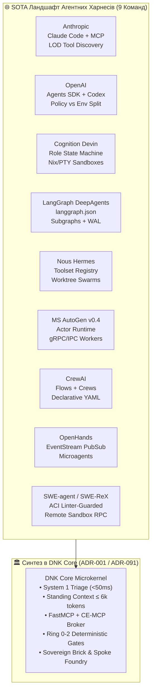
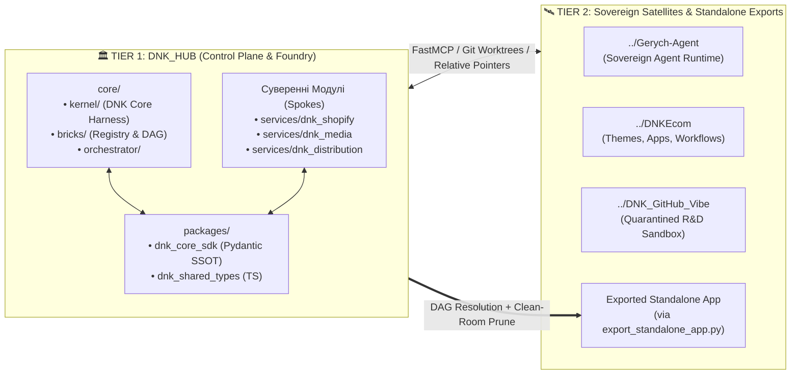
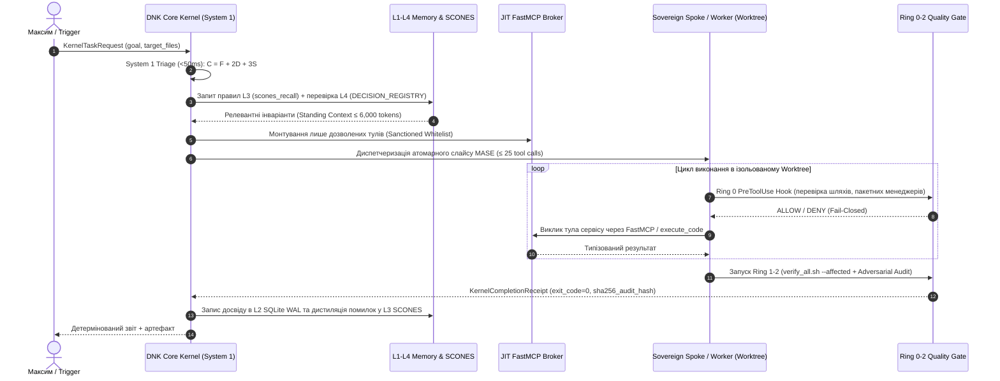
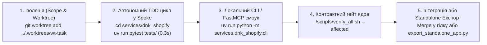

> [!metadata]- ⚙️ Системні метадані та інваріанти (MRH Header)
> ```yaml
> # --- DNK-MRH-HEADER ---
> mrh_id: "docs/architecture/reports/GERYCH_ROOT_AGENT_HARNESS_REPO_ARCHITECTURE_RESEARCH.md"
> purpose: "Universal IPC/RPC Contract Envelope between DNK Core Harness and Sovereign Spokes."
> canonical_source: true
> alters_files: []
> triggers_tasks: []
> status: "Active"
> version: "2.0.0"
> updated_at: "2026-11-18"
> author: "DNK-e.com Maksym & Antigravity"
> # --- END DNK-MRH-HEADER ---
> ```

# 🏛️ Архітектура Агентних Харнесів, Суверенних Компонентів та Робочого Простору MacBook: Глибоке Дослідження SOTA для DNK Core


---

## ⚡ 1. Executive Summary & Архітектурний Вердикт (ADHD Card)

**Головний інженерний висновок**: Передові команди будують не «великих агентів», а **мінімалістичні детерміновані харнеси (Agent Execution Harnesses / Microkernels)** навколо **автономних ізольованих компонентів (Sovereign Spokes / Bricks)**.

1. **Ядро — це шина та конституція, а не бізнес-логіка**:
   `DNK Core` виконує роль мікроядра операційної системи (System 1 Triage <50ms, JIT Tool Broker, L1–L4 Memory Hierarchy, Ring 0–2 Quality Gates, Event Bus). Жоден рядок специфічної логіки (Shopify Liquid, генерація відео, парсинг) не живе в ядрі.
2. **Подвійний суверенітет кожного компонента (Dual-Mode Spoke Invariant)**:
   Кожен сервіс (`services/dnk_*`), цеглинка (`core/bricks/brick_*`), плагін або спеціалізований агент має **два рівноправні режими запуску**:
   - **Standalone Mode (100% автономний)**: Має власний `cli.py`, власний тест-сьют (`pytest` / `vitest`), власні контракти (`contracts/schemas.py`) і запускається однією командою у власній теці без підняття `DNK Core`, веб-інтерфейсу чи інших сервісів.
   - **Harness-Mounted Mode (у складі екосистеми)**: Без зміни коду підключається до `DNK Core` через декларативний маніфест (`brick.manifest.yaml`) та протокол **FastMCP** (stdio / Unix Domain Socket) або **Code Mode (CE-MCP)**.
3. **Фізична топологія на MacBook (Zero-Duplicate APFS + Git Worktrees)**:
   - **Гібридна топологія `Two-Tier Sovereign Hub-and-Spoke`**: Центральний хаб (`DNK_HUB` з 8 канонічними кореневими теками) + суверенні сателіти (`../Gerych-Agent`, `../DNKEcom`, `../DNK_GitHub_Vibe`) + пул ефемерних робочих дерев (`../worktrees/<task-id>`).
   - **Нульове дублювання SSD**: `uv` (APFS Copy-on-Write `clonefile(2)`) + `pnpm` (Content-Addressable Hardlink Store `~/Library/pnpm/store/v10`) + централізовані віртуальні середовища `~/.dnk_runtime/venvs/`.

---

## 🔬 2. Порівняльний аналіз 9 передових команд світу (Frontier SOTA Overview)

Нижче наведено детальну деконструкцію того, як провідні лабораторії та інженерні команди світу організовують свої репозиторії, рантайми та межі між харнесом і компонентами.



### 2.1. Anthropic (`Claude Code`, `MCP`, `Agent SDK`, `Code Execution with MCP`)
- **Архітектура репозиторію та харнесу**:
  Anthropic розділяє тонкий термінальний рантайм (`claude` CLI) та зовнішній світ за допомогою відкритого протоколу **Model Context Protocol (MCP)**. Саме ядро харнесу відповідає лише за цикл діалогу, керування контекстним вікном, систему хуків (`PreToolUse`, `PostToolUse`, `Notification`, `Stop`) і політику дозволів (Permission Ladder).
- **Decoupled Tooling & Progressive Disclosure (LOD)**:
  Замість завантаження 50+ JSON-схем інструментів у системний промпт (що з'їдає 30–40k токенів), використовується трикрокове відкладене завантаження:
  1. У стоячому контексті присутній лише компактний каталог назв (`Deferred tool catalog`).
  2. Агент викликає `tool_search` / `tool_describe`, щоб підвантажити схему лише потрібного інструменту.
  3. Для складних багатоступеневих операцій використовується **Code Mode (CE-MCP)**: агент пише короткий Python-скрипт у `execute_code`, який викликає інструменти програмно у циклі і повертає у контекст LLM лише відфільтрований підсумок.
- **Файлова конвенція у репозиторії**:
  Ієрархічні файли `CLAUDE.md` (у корені та в підпапках окремих сервісів, які підвантажуються ледачо при вході агента в директорію) + `.claude/settings.json` (декларативні хуки та білі списки команд).

### 2.2. OpenAI (`OpenAI Agents SDK`, `Codex CLI`, `SWE-bench Harness`)
- **Тріада «Policy — Harness — Environment»**:
  OpenAI суворо відокремлює три шари:
  1. `Agent Policy` — інструкції, модель, інструменти та примітиви передачі керування (`Handoffs`).
  2. `Execution Harness` (`Runner.run()`) — цикл виконання, паралельні `Input/Output Guardrails` (які працюють як асинхронні tripwires і переривають генерацію при порушенні політики), трейсинг та бюджет кроків (`max_turns`).
  3. `Target Environment` — ізольований git worktree або контейнер без доступу до інтернету (після фази інсталяції залежностей), де виконуються мутації коду.
- **Ground-Truth Verification**:
  Агент ніколи не оцінює власний успіх. Зовнішній скрипт верифікації харнесу запускає тестовий раннер у чистому оточенні й фіксує бінарний результат (`exit code 0` та відсутність регресій у `PASS_TO_PASS` тестах).

### 2.3. Cognition (`Devin`)
- **Multi-Role DAG State Machine**:
  Devin уникає пастки «одного нескінченного чату». Харнес працює як скінченний автомат (State Machine), де планувальник (`Planner`) декомпозує задачу в DAG, кодер (`Coder`) працює у виділеному робочому дереві, а верифікатор (`Critic / Browser Agent`) перевіряє результат у живому рантаймі.
- **Ізоляція середовища та снапшоти**:
  Кожна сесія отримує детермінований снапшот файлової системи (через CoW файлової системи або Nix/OverlayFS), власний керований PTY-мультиплексор (щоб фонові сервери не блокували виконання команд) та подієвий журнал (`Event Timeline`), який дозволяє зробити `Time-Travel Rollback` до будь-якого кроку.

### 2.4. LangChain / LangGraph (`DeepAgents` & `Managed Deep Agents`)
- **Декларативний маніфест `langgraph.json` та модульні Subgraphs**:
  Кожен агент або воркфлоу оформлюється як незалежний скомпільований граф (`CompiledStateGraph`) зі своєю локальною схемою стану (`Pydantic` / `TypedDict`) та функціями-редюсерами (`Annotated[list, operator.add]`).
- **Ізоляція компонентів**:
  У `langgraph.json` кожен граф експортується за відносним шляхом (`"./services/shopify_agent/graph.py:graph"`). Підграфи розробляються і тестуються абсолютно автономно, а головний Supervisor-граф підключає їх як звичайні вузли.
- **Checkpointer Persistence & Sandboxed Subagents**:
  Стан кожного кроку автоматично серіалізується в SQLite/Postgres через `Checkpointer` (дозволяючи `interrupt()` для Human-in-the-Loop та відновлення після збою). Згідно з асимільованим у DNK OS патерном `managed_deepagents_assimilated` (`DNK-ARCH-002`), важкі підагенти працюють в ізольованих пісочницях з `PathTraversalError` захистом та анонімним маскуванням томів (`/app/node_modules`, `/app/.next`).

### 2.5. Nous Research (`Hermes Agent` / `Gerych Core`)
- **Мікроядерний CLI/Daemon Харнес**:
  Hermes розділяє ядро циклу (`AIAgent`), реєстр інструментів (`tools/registry.py`), процедурну пам'ять (`skills/*/SKILL.md`) та довготривалу пам'ять (`MEMORY.md` + SQLite WAL `state.db`).
- **Skill Level-of-Detail (LOD) Architecture**:
  У системному промпті присутній лише індекс скілів (назва + опис до 60 символів). Повний `SKILL.md` (обмежений `MAX_CORE_LINES <= 750`) підвантажується викликом `skill_view(name)`, а важкі довідники та шаблони лежать у `references/`, `templates/`, `scripts/` і читаються лише за вимогою (`skill_view(name, file_path=...)`).
- **Паралельне делегування (`delegate_task` + Worktrees)**:
  Батьківський агент спавнить ізольованих дочірніх субагентів (`max_concurrent_children=4`), кожен з яких отримує чистий контекст, власну сесію терміналу і повертає батькові лише стислий верифікований звіт (або JSON за `output_schema`), запобігаючи забрудненню основного контексту.

### 2.6. Microsoft `AutoGen` (v0.4+ `autogen-core` / `autogen-agentchat`)
- **Акторна модель та поділ `Host` vs `Worker Runtime`**:
  У новій архітектурі AutoGen v0.4 повністю розділено шар оркестрації (`autogen-core`) та високорівневі патерни (`autogen-agentchat`). Агенти є асинхронними акторами, які спілкуються виключно через типізовані повідомлення у шині подій (`TopicId`, `AgentId`).
- **Мультипроцесна та поліглотна ізоляція**:
  `HostRuntime` координує маршрутизацію повідомлень, тоді як окремі `WorkerRuntime` (на Python, TypeScript або .NET) підключаються через gRPC або локальні Unix-сокети. Виконання згенерованого коду жорстко винесене в `CodeExecutor` (Docker або локальний ізольований worktree).

### 2.7. CrewAI (`Flows` + `Crews`)
- **Дворівнева оркестрація (`Deterministic Flow` + `Autonomous Crew`)**:
  CrewAI розділяє детермінований каркас програми (`Flow` з декораторами `@start`, `@listen`, `@router` та строго типізованим станом `Flow[MyState]`) і автономні мікро-команди агентів (`Crew`), які викликаються всередині окремих кроків флоу.
- **Декларативна конфігурація в репозиторії**:
  Промпти, ролі та задачі винесені з Python-коду у чисті YAML-маніфести (`config/agents.yaml`, `config/tasks.yaml`), а вихід кожної задачі валідується через Pydantic (`output_pydantic=MySchema`), що гарантує 100% сумісність між автономними компонентами.

### 2.8. OpenHands (`All-Hands-AI` / `OpenDevin`)
- **EventStream Pub/Sub Architecture**:
  В основі OpenHands лежить єдина типізована шина подій (`EventStream`). Агент ніколи не викликає bash або файлову систему напряму: він публікує подію `Action` (`CmdRunAction`, `FileEditAction`, `IPythonRunCellAction`), яку перехоплює ізольований `Runtime`, виконує і повертає подію `Observation` (`CmdOutputObservation`, `FileEditObservation`).
- **Microagents (Контекстно-активовані інструкції)**:
  Папка `.openhands/microagents/` містить компактні Markdown-файли з YAML-фронтматером (`triggers: ["shopify", "liquid"]`). Харнес автоматично інжектує потрібний мікроагент у контекст лише тоді, коли задача або змінюваний файл відповідає тригеру.

### 2.9. Princeton / `SWE-agent` & `SWE-ReX`
- **Agent-Computer Interface (ACI)**:
  Дослідники SWE-agent довели, що стандартні Linux-інструменти (`cat`, `sed`, `grep`) створені для людей, а не для LLM. Натомість харнес надає спеціалізований **ACI**:
  - Віконний перегляд файлів з номерами рядків (`read_file(offset, limit)`).
  - Редагування з миттєвим вбудованим AST/синтаксичним лінтером: якщо патч агента створює `SyntaxError`, харнес **автоматично відхиляє запис на диск** і просить виправити помилку до того, як файл буде зіпсовано.
- **SWE-ReX (Sandboxed Remote Execution)**:
  Легковаговий клієнт харнесу працює на хост-машині (MacBook), а всі важкі процеси відкриття шеллів та тестування проксіюються через уніфікований RPC-інтерфейс у локальні або віддалені пісочниці.

### 2.10. Зведена матриця SOTA-патернів та їх реалізація в `DNK Core`

| Команда / Система | Головний архітектурний примітив | Ізоляція компонентів (Spokes) | Керування контекстом і тулами | Механізм верифікації (Quality Gate) | Як асимільовано в `DNK Core` |
| :--- | :--- | :--- | :--- | :--- | :--- |
| **Anthropic (Claude Code / MCP)** | Протокол MCP + система Lifecycle Hooks | Окремі процеси MCP (`stdio` / `SSE`) | LOD (`tool_search` -> `tool_describe`), `CLAUDE.md`, CE-MCP | `PreToolUse` / `PostToolUse` хуки + Permission Ladder | `FastMCP` + `execute_code` + `hermes_pre_tool_hook.py` |
| **OpenAI (Agents SDK / Codex)** | Розділення `Policy` / `Harness` / `Env` | Спеціалізовані агенти з `Handoffs` | `max_turns`, паралельні `Guardrails` | Зовнішній Ground-Truth Evaluator (`exit code 0`) | System 1 Triage + `verify_all.sh` + Jev Receipts |
| **Cognition (Devin)** | Багаторольовий DAG State Machine | Ізольовані ролі (`Planner`, `Coder`, `Auditor`) | Вікно активного кроку DAG + PTY мультиплексор | Живий браузерний / рантайм smoke-тест + снапшоти | Поділ `Antigravity` / `Denchik` / `Gerych` + Anti-Mock Gate |
| **LangGraph (DeepAgents)** | Скомпільовані `StateGraph` + `Checkpointer` | Незалежні `Subgraphs` у `langgraph.json` | Локальний типізований `State` + Reducers | `interrupt()` HITL гейти + ізольовані пісочниці | L2 SQLite WAL стан сесій + `DNKIsolatedFileSystem` |
| **Nous Research (Hermes)** | Мікроядро + `SKILL.md` + `delegate_task` | Ізольовані `Toolsets` та `Skills` | Standing context ≤ 6k токенів, LOD `skill_view` | Ізольовані субагенти з `output_schema` валідацією | Ядро Gerych/Denchik + `skills_curator.py` + Ratchet ≤750 |
| **Microsoft AutoGen v0.4** | Акторна шина (`Host` vs `Worker` Runtime) | Окремі воркери через gRPC / Unix Socket | Подієва маршрутизація за `TopicId` | Ізольований `CodeExecutor` у пісочниці | Локальна шина подій Unix Domain Socket (`./run/*.sock`) |
| **CrewAI (Flows + Crews)** | Детермінований `Flow` + автономні `Crews` | Декларативні `agents.yaml` / `tasks.yaml` | Передача лише валідованих `output_pydantic` | Суворі Pydantic-контракти між кроками | `brick.manifest.yaml` + `contracts/schemas.py` |
| **OpenHands** | Шина подій `EventStream` (`Action`/`Observation`) | Плагінні `Runtimes` + `.openhands/microagents` | Тригерне підвантаження мікроагентів | Детерміновані `Observation` коди помилок | Динамічна інжекція доменних правил та скілів |
| **SWE-agent / SWE-ReX** | Agent-Computer Interface (ACI) | Відокремлений клієнт та `SWE-ReX` рантайм | Віконне читання (`limit=120`), захист від спаму | Авто-відкат запису при помилці синтаксису (AST check) | Вбудований синтаксичний чекер у `write_file` / `patch` |

---

## 🏗️ 3. Monorepo vs Polyrepo vs Hybrid: Чому перемагає `Two-Tier Sovereign Hub-and-Spoke`

Для системи масштабу `DNK OS`, де в одному екосистемному полі живуть ядро оркестрації, веб-кабінет, візуальний канвас, Shopify-комбайн, генератор відео та десятки плагінів і скілів, класичні підходи мають фатальні вади:

1. **Чому чистий Monorepo ламається в агентній розробці**:
   - **Спільне болото залежностей**: конфлікт версій Python/Node пакетів між відео-генератором і Shopify-сервісом блокує обидва.
   - **Деградація уваги агентів та індексаторів**: VS Code / Cursor / `ripgrep` сканують 100,000+ файлів, а помилка в одному модулі валить загальний пайплайн.
   - **Неможливість чистого відчуження**: неможливо за 5 секунд віддати клієнту або винести на окремий VPS лише один сервіс без усього репозиторію.
2. **Чому чистий Polyrepo (30+ окремих Git-репозиторіїв) ламається**:
   - **Розсинхронізація контрактів (Schema Drift)**: зміна формату задачі в `DNK Core` вимагає ручного відкриття 15 Pull Request'ів у 15 репозиторіях.
   - **Параліч оркестрації**: агент не бачить сусідніх контрактів і не може виконати наскрізну перевірку інтеграції за один атомарний прохід.

### Рішення DNK Core: Дворівнева гібридна архітектура (`Two-Tier Sovereign Hub-and-Spoke`)



**Як працює цей гібрид**:
- **Усередині `DNK_HUB` (Tier 1)** ядро `core/` та 3 базові робочі конячки (`services/dnk_shopify`, `services/dnk_media`, `services/dnk_distribution`) і 6 компонованих цеглинок (`core/bricks/brick_01..06`) живуть під єдиним контролем типів, але **фізично розмежовані маніфестами `brick.manifest.yaml`**.
- **Незалежне життя компонента (Spoke Autonomy)**: розробник або агент може зайти в `services/dnk_shopify`, запустити його локальний тест-сьют та CLI за 0.4 секунди без жодного імпорту з інших сервісів.
- **Автоматична компіляція в окремий репозиторій (Tier 2 Export)**: скрипт `./scripts/system/export_standalone_app.py` за топологічним графом залежностей (`DNKBrickRegistry.resolve_dependencies()`) вирізає лише потрібні цеглинки/сервіси, відсікає секрети та кеші, генерує чистий самодостатній репозиторій і проганяє в ньому локальний гейт якості (`pytest`).
- **Суверенні сателіти (`../DNKEcom`, `../Gerych-Agent`, `../DNK_GitHub_Vibe`)**: важкі клієнтські Shopify-теми, зовнішні R&D-донори та форк рантайму винесені на рівень вище (`../`), щоб ніколи не роздувати індекс `DNK_HUB`.

---

## 💻 4. Фізична структура директорій на робочому MacBook (Apple Silicon Optimization)

Розробка агентної ОС на MacBook Pro (M1/M2/M3/M4 Max) вимагає специфічної інженерії файлової системи **APFS (Apple File System)**, щоб 10 паралельних агентів і 50 проєктів не знищили SSD, оперативну пам'ять та процесор фоновими індексаторами (`mds_stores`, `fseventsd`, VS Code `tsserver`).

### 4.1. Фізична карта директорій на MacBook Максима

```text
~/                                                  # Домашня директорія macOS
├── .dnk_runtime/                                   # ⚙️ ЦЕНТРАЛІЗОВАНИЙ РАНТАЙМ (Поза Git та Spotlight)
│   ├── venvs/                                      # Zero-Local-Venv пул (APFS CoW клони)
│   │   ├── dnk_hub_core/                           # Головне venv ядра
│   │   ├── brick_shopify/                          # Ізольоване venv для автономного тесту сервісу
│   │   └── brick_media/                            # Ізольоване venv для медіа- пайплайну
│   ├── run/                                        # Runtime PID-файли та Unix Domain Sockets
│   │   ├── dnk_core.sock                           # Головний IPC-сокет ядра (<0.5ms latency)
│   │   ├── mcp_shopify.sock                        # Сокет FastMCP сервісу dnk_shopify
│   │   └── dnk_core.pid                            # PID-сентінел з автоочищенням по EXIT/SIGTERM
│   ├── state/                                      # Транзакційні бази станів агентів (SQLite WAL)
│   │   ├── harness_sessions.db                     # Епізодична пам'ять L2 (WAL mode)
│   │   └── scones_vectors.db                       # Семантична пам'ять L3 + дистилятор помилок
│   └── logs/                                       # Ротовані JSONL-логи траєкторій та телеметрії
│
├── Library/pnpm/store/v10/                         # 📦 Глобальне CAS-сховище pnpm (Hardlinks, 0 байт дублів)
├── .cache/uv/                                      # ⚡ Глобальний кеш коліс Python (APFS clonefile)
│
└── Kuzmenko/MY_LIFE_WORK/                          # 🏢 РОБОЧИЙ ПРОСТІР ЕКОСИСТЕМИ (5 Canonical Workspaces)
    ├── DNK_HUB/                                    # [1] 🏛️ CONTROL PLANE & HARNESS FOUNDRY (8 канонічних тек)
    │   ├── apps/                                   # Користувацькі оболонки (api/, web/, tui/)
    │   ├── core/                                   # Ядро DNK Core (kernel/, bricks/, orchestrator/, scones/)
    │   ├── services/                               # 3 базові автономні сервіси (dnk_shopify, dnk_media, dnk_distribution)
    │   ├── packages/                               # Спільні SDK, клієнти, розширення (dnk_hermes_ext/)
    │   ├── infra/                                  # Docker, деплоймент, конфігурації портів
    │   ├── docs/                                   # Архітектурний SSOT, ADRs, контракти, звіти
    │   ├── tests/                                  # Наскрізні, контрактні та верифікаційні тести ядра
    │   └── scripts/                                # Автоматизація, гейти якості (verify_all.sh), хуки
    │
    ├── DNK_OS/                                     # [2] 🚀 Чистий продакшн-кокпіт (Tier-2 Standalone Release)
    ├── DNKEcom/                                    # [3] 🛍️ Фабрика Shopify-тем, додатків та CRO-воркфлоу
    │   ├── GitHub_Shopify_Themes/
    │   ├── GitHub_Shopify_Apps/
    │   └── Audit_Shopify_Themes_Sell_WF/
    ├── DNK_Vibe_Coding/                            # [4] 🧪 Інкубатор прикладних бізнес-сервісів та прототипів
    ├── DNK_GitHub_Vibe/                            # [5] 🛡️ Карантинна лабораторія зовнішніх SOTA-репозиторіїв
    ├── Gerych-Agent/                               # 🛰️ Суверенний репозиторій рантайму агента
    └── .worktrees/                                 # 🌿 ПУЛ ЕФЕМЕРНИХ GIT WORKTREES ДЛЯ РОЮ АГЕНТІВ
        ├── wt-denchik-shopify-401/                 # Ізольована робоча гілка білдера
        └── wt-gerych-audit-402/                    # Ізольована робоча гілка аудитора
```

### 4.2. П'ять апаратних оптимізацій під macOS (Apple Silicon)

1. **APFS Copy-on-Write (`clonefile(2)`) через `uv`**:
   На macOS файлова система APFS підтримує системний виклик `clonefile()`. Коли `uv venv` або `uv sync` створює середовище для нового сервісу чи worktree, файли бібліотек (PyTorch, Pydantic, FastAPI) **фізично не копіюються** — створюються лише нові метадані інодів, що вказують на ті самі блоки SSD у `~/.cache/uv/`. Створення повного середовища займає **15–40 мс** і споживає **0 МБ** додаткового місця.
2. **Content-Addressable Hardlinks через `pnpm`**:
   Заборона `npm` та `yarn` на рівні `scripts/system/hermes_pre_tool_hook.py` гарантує, що всі фронтенд-додатки (`apps/web`), Shopify-аппки (`../DNKEcom/GitHub_Shopify_Apps/*`) та плагіни використовують єдиний стор `~/Library/pnpm/store/v10`. Навіть якщо 25 проєктів використовують React 19 та Vite, на диску зберігається рівно одна фізична копія.
3. **Пул ізольованих `git worktree` проти конфліктів `.git/index.lock`**:
   Коли 3–4 агенти працюють паралельно в одній папці, виникають стан гонитви (race conditions), взаємне перезаписування файлів та помилка `fatal: Unable to create '.git/index.lock': File exists`.
   Використання `git worktree add ../.worktrees/wt-<agent>-<task_id> -b dnk-mvp/feature/<task_id>` створює ізольоване робоче дерево за <200 мс (спільна база `.git/objects`, але окремий індекс та файлове дерево). Розробник продовжує працювати в `DNK_HUB`, поки агенти компілюють і тестують код у `../.worktrees/`.
4. **Ізоляція сокетів, портів та PID-сентінелів**:
   - **Unix Domain Sockets замість TCP-портів**: Внутрішня комунікація між `DNK Core` та локальними FastMCP-сервісами відбувається через сокети у `~/.dnk_runtime/run/*.sock` або `./run/*.sock`. Це усуває конфлікти портів (`EADDRINUSE`), обходить мережевий стек TCP/IP ядра macOS і дає затримку **< 0.3 мс**.
   - **Детерміноване виділення портів для Web/API у Worktrees**: Якщо в worktree потрібно підняти HTTP-сервер для живого smoke-тесту, порт обчислюється за формулою `PORT = 8100 + (crc32(worktree_name) % 900)`, а при виході спрацьовує `trap 'kill -15 $(cat ./run/service.pid)' EXIT SIGINT SIGTERM`.
5. **Захист від індексаторів (`Anti-Indexer Lag`)**:
   Директорії `~/.dnk_runtime/`, `../DNK_GitHub_Vibe/` та `../.worktrees/` додаються до винятків Spotlight (`.metadata_never_index`) і ніколи не монтуються у головний файл `DNK_HUB.code-workspace`. Це утримує споживання RAM редактором у межах 1.5–2 ГБ замість 12+ ГБ.

---

## ⚙️ 5. Harness vs Agent Runtime: Як Ядро `DNK Core` керує системою

Фундаментальний принцип `DNK Core` (зафіксований в `ADR-001` та `ADR-091`): **Харнес — це детермінований код (System 1), а Агент — це стохастичний обчислювач (System 2), замкнений у жорсткі рамки харнесу**.



### 5.1. Керування контекстом (`Zero Standing Context Bloat`)
- **Бюджет стоячого контексту ≤ 6,000 токенів (`ADR-007`)**: На кроці 0 в контекст завантажуються лише ядерні інваріанти, список доступних скілів (без їх тіла) та базові файлові інструменти.
- **L1 Target File Whitelist (< 20,000 токенів)**: Кожна задача отримує явний білий список цільових файлів (`target_files`) та `Negative Scope`. Агент читає файли цільовими вікнами (`read_file(offset, limit=120)`), а не дампами по 5,000 рядків.
- **Чекпоінтинг при деградації уваги (`ADR-006`)**: Якщо сесія перевищує 20–25 викликів інструментів (MASE slice) або 40,000 токенів, харнес примусово зберігає стан у L2 і перезапускає свіжий воркер із чистим вікном уваги.

### 5.2. Чотирирівнева ієрархія пам'яті (`L1–L4 Memory Engine`)
1. **L1 (Working Slice)**: Оперативний контекст поточного атомарного слайсу (`KernelTaskRequest`, поточний `git diff`).
2. **L2 (Episodic Session Store — SQLite WAL)**: База сесій з увімкненими прагмами `PRAGMA journal_mode = WAL; PRAGMA busy_timeout = 5000; PRAGMA synchronous = NORMAL;`. Дозволяє конкурентне читання/запис десяткам процесів без `sqlite3.OperationalError: database is locked`.
3. **L3 (SCONES Semantic & Error Distillation Engine)**: Зберігає засвоєні архітектурні інваріанти (`scones_remember`), патерни 90+ SOTA-репозиторіїв (`scones_sota_intel`) та відбитки помилок (`error_distillations.json`). При виникненні помилки в тестах харнес миттєво підтягує готовий рецепт лікування замість сліпого перебору.
4. **L4 (Architectural SSOT & Decision Ledger)**: Канонічні документи в `docs/architecture/DECISION_REGISTRY_ADHD.md` та `docs/architecture/adr/`. Рішення зі статусом `[🔒 LOCKED]` є незмінним законом для всіх агентів.

### 5.3. Керування інструментами (`JIT FastMCP Broker + CE-MCP`)
- **Декларативний реєстр**: Ядро знає про всі інструменти екосистеми через маніфести, але монтує в конкретного агента лише ті, що входять у `Sanctioned Tools & MCP Whitelist` поточної таски.
- **Важкі зовнішні MCP (Notion, Chrome DevTools, Postgres)** тримаються відмонтованими під час кодингу та рефакторингу, підключаючись лише на етапі профільних інтеграційних задач.
- **Code Execution Mode (`execute_code`)**: Коли агенту потрібно обробити 20 файлів або зробити серію пошуків з фільтрацією, він виконує Python-скрипт у персистентному ядрі сесії, викликаючи інструменти програмно і повертаючи в контекст моделі лише релевантні 20 рядків результату.

### 5.4. Черги задач та `System 1 Triage` (< 50 мс)
- Вхідний запит оцінюється детермінованим класифікатором складності:
  $$C = F_{\text{files}} + 2 \times D_{\text{domains}} + 3 \times S_{\text{stages}}$$
- Якщо $C < 3$ — задача виконується в режимі `SOLO` одним воркером без накладних витрат на оркестрацію рою.
- Якщо $C \ge 3$ — генератор `TaskDNA` будує ациклічний граф (DAG) атомарних слайсів (`SWARM_PARALLEL` або `SWARM_SEQUENTIAL`), де кожен вузол графа призначається профільному спеціалісту (`dnk_shopify`, `dnk_dev_fullstack`, `dnk_video_ai_creator`, `gerych_auditor`).

### 5.5. Три ешелони перевірки якості (`Ring 0 – Ring 2 Quality Gates`)
- **Ring 0 (Pre-Tool Interceptor — `scripts/system/hermes_pre_tool_hook.py`)**: Спрацьовує **до** виконання будь-якої дії. Блокує абсолютні шляхи, несанкціоновані директорії в корені, підміняє `npm`/`pip` на `pnpm`/`uv`, блокує мутацію файлів поза Whitelist.
- **Ring 1 (Static & Schema Validators)**: Автоматична перевірка синтаксису при записі файлів, `anti_tautology_guard.py` (блокує фейкові тести на кшталт `assert True` або порожні моки), `markdown_schema_gate.py` (перевіряє MRH-хедери, відсутність води й наявність секцій епістемічної броні).
- **Ring 2 (Adversarial Gate & Live Runtime Verification — `scripts/verify_all.sh`)**:
  Змагальна перевірка `Builder 🛡️ vs Auditor ⚔️` (із використанням сліпого вибору `Blind Tournament` з Harness², щоб уникнути упередженості моделі) + жива перевірка рантайму (HTTP status / FastMCP виклик / DOM) + канонічний SHA-256 хеш аудиту (`KernelCompletionReceipt`).

### 5.6. Бекап, відкат та `3-Strike Boot Breaker`
- **Git Worktree Rollback**: Якщо експериментальна гілка агента не проходить `verify_all.sh` за 3 спроби, робоче дерево `../.worktrees/wt-*` миттєво знищується без жодного сліду в основній гілці.
- **SQLite Online WAL Backup**: Стан баз `SCONES` та сесій резервується атомарними снапшотами без зупинки запису.
- **3-Strike Boot Breaker**: При деплої або запуску сервісу, якщо `health_check()` падає 3 рази поспіль протягом 60 секунд, харнес автоматично відкочує компонент до тегу `tags/last-stable`.

---

## 🧩 6. Decoupled Plugin / Service / Agent Pattern: Анатомія Суверенного Компонента (Spoke)

Щоб реалізувати вимогу Максима — **«кожен сервіс, плагін та агент розробляється як індивідуальний автономний елемент, який може працювати окремо від системи, тестуватися, виправлятися і безшовно підключатися до DNK Core»** — у `DNK OS` використовується уніфікований стандарт **Sovereign Brick / Spoke Pattern**.

### 6.1. Внутрішня структура автономного сервісу або плагіна

Кожен суверенний компонент має стандартизовану внутрішню будову, яка робить його одночасно самодостатнім мікро-проєктом і плагіном ядра:

```text
services/dnk_<component_name>/                  # Або core/bricks/brick_XX_<name>/
├── brick.manifest.yaml                         # 1. Декларативний паспорт і контракт монтування в DNK Core
├── pyproject.toml                              # 2. Локальні залежності для автономного запуску (uv)
├── cli.py                                      # 3. Точка входу Standalone CLI (для локальної роботи без ядра)
├── mcp_server.py                               # 4. Точка входу FastMCP (для підключення до DNK Core / IDE)
├── router.py                                   # 5. Опційний FastAPI APIRouter (динамічно монтується в apps/api)
├── contracts/                                  # 6. Жорсткі контракти входу/виходу (SSOT компонента)
│   ├── __init__.py
│   ├── schemas.py                              # Pydantic v2 моделі запитів, відповідей та помилок
│   └── types.ts                                # Дзеркальні TypeScript інтерфейси для UI/Canvas
├── domain/                                     # 7. Чиста бізнес-логіка (0 залежностей від DNK Core!)
│   ├── __init__.py
│   └── engine.py
└── tests/                                      # 8. Автономний тест-сьют (працює за <1с через pytest)
    ├── test_contracts.py                       # Перевірка схем та граничних умов
    ├── test_engine_standalone.py               # Юніт та інтеграційні тести без ядра
    └── fixtures/                               # Локальні фікстури для повної автономності
```

> **Золоте правило розв'язки (Zero Upward Core Coupling)**:
> Папка `domain/` усередині сервісу **НІКОЛИ** не імпортує внутрішні модулі `core/orchestrator` чи інші сервіси. Вона працює виключно зі своїми `contracts/schemas.py`. Зв'язок із ядром відбувається тільки у тонких адаптерах `mcp_server.py` та `brick.manifest.yaml`.

### 6.2. Еталонний маніфест компонента (`brick.manifest.yaml`)

```yaml
id: "brick_04_shopify_engine"
name: "DNK Shopify Liquid AST & CRO Engine"
version: "1.2.0"
mrh_id: "services/dnk_shopify/brick.manifest.yaml"
category: "commerce_workhorse"
description: "Autonomous Shopify Theme 2.0 AST parser, Liquid validator, and SaaP CRO block synthesizer."

# Фізичні шляхи компонента (відносні від кореня хабу)
paths:
  - "services/dnk_shopify"
  - "core/bricks/brick_04_shopify_engine"

# Граф залежностей (для топологічного сортування в DNKBrickRegistry)
dependencies:
  internal:
    - "brick_02_scones_memory"
  external:
    python:
      - "pydantic>=2.7.0"
      - "pyyaml>=6.0"
    npm: []

# Типізовані контракти (Pydantic + TypeScript)
contracts:
  python_schema: "core/bricks/brick_04_shopify_engine/contracts/schemas.py"
  typescript_types: "core/bricks/brick_04_shopify_engine/contracts/types.ts"

# Точки входу для 2 режимів роботи (Standalone vs Harness-Mounted)
entrypoints:
  standalone_cli: "services.dnk_shopify.cli:main"
  mcp_server: "core.bricks.brick_04_shopify_engine.mcp_server:mcp"
  fastapi_router: "services.dnk_shopify.router:router"
  health_check: "services.dnk_shopify.health:check_health"

# Декларативний гейт якості для автономної верифікації
quality_gate:
  test_suite: "tests/bricks/test_brick_04_shopify.py"
  standalone_cmd: "uv run pytest services/dnk_shopify/tests -v"
  min_coverage: 85
```

### 6.3. Контракт IPC / RPC між `DNK Core` та Суверенним Компонентом (`contracts/schemas.py`)

Усі виклики між ядром та компонентами проходять через суворий конверт повідомлень (`Envelope Pattern`), який однаково працює при прямому виклику в пам'яті (Python import), через FastMCP (`stdio` / Unix Socket) або через HTTP:

```python
from typing import Any, Dict, List, Literal, Optional
from pydantic import BaseModel, Field


class SpokeInvocationRequest(BaseModel):
    correlation_id: str = Field(..., description="Unique trace ID across Kernel and Spoke")
    workspace_id: str = Field(default="ws-alpha-001", description="Tenant/workspace isolation key")
    spoke_id: str = Field(..., description="Target brick or service ID")
    action: str = Field(..., description="Tool or method name exposed by the spoke")
    payload: Dict[str, Any] = Field(default_factory=dict, description="Validated input parameters")
    timeout_ms: int = Field(default=30000, ge=100, le=600000)
    dry_run: bool = Field(default=False, description="Verify preconditions without mutating state")


class SpokeInvocationResponse(BaseModel):
    correlation_id: str
    spoke_id: str
    status: Literal["success", "error", "denied"]
    mutation_performed: bool = Field(default=False)
    upstream_call_count: int = Field(default=0, ge=0)
    data: Optional[Dict[str, Any]] = None
    error_code: Optional[str] = None
    error_message: Optional[str] = None
    audit_hash: str = Field(..., min_length=64, max_length=64, description="JCS canonical SHA-256 hash")
```

### 6.4. Як ізолюються Спеціалізовані Агенти (`AGENT.md`) та Скіли (`SKILL.md`)

Агенти та навички також є суверенними компонентами:
1. **Маніфест Агента (`core/orchestrator/agents/<agent_name>/SOUL.md` або `AGENT.md`)**:
   Визначає роль, `Sanctioned Tools & MCP Whitelist` (дозволені тули), `Negative Scope` (заборонені директорії та дії) та `Output Contract`.
2. **Процедурний Скіл (`skills/<category>/<skill_name>/SKILL.md`)**:
   - Містить YAML frontmatter (`name`, `description` до 60 символів у форматі `Use when <trigger>. <behavior>.`).
   - Основний файл `SKILL.md` ніколи не перевищує `750 рядків` (`Skill Core-Size Ratchet`).
   - Приклади коду, шаблони та великі схеми лежать у підпапках `references/`, `templates/`, `scripts/` і підвантажуються ледачо лише тоді, коли агент реально виконує цю задачу.

---

## 🛠️ 7. Практична Матриця: Структура Кореневих Тек та Робочий Цикл Розробника (Developer Loop)

### 7.1. Матриця відповідальності 8 канонічних кореневих директорій (`DNK_HUB`)

Згідно з інваріантом `Canonical 8-Root Directory Invariant`, у корені хабу дозволені виключно 8 директорій:

| Коренева тека | Архітектурна роль | Що всередині | Хто має право мутувати (Whitelist) | Заборонено (Negative Scope) |
| :--- | :--- | :--- | :--- | :--- |
| **`core/`** | **Агентний Харнес (`DNK Core`)** | `kernel/`, `bricks/`, `orchestrator/`, `scones/`, `system_one/`, `playbooks/` | Системні архітектори (`Antigravity`, `Denchik` за ADR) | Жодної прикладної логіки Shopify, відео чи UI-верстки |
| **`services/`** | **Суверенні Робочі Конячки (3 Workhorses)** | `dnk_shopify/`, `dnk_media/`, `dnk_distribution/` (плюс легасі-бриджі на етапі міграції) | Профільні доменні воркери (`dnk_shopify`, `dnk_video_ai_creator`) | Створення нових самовільних мікросервісів без ADR |
| **`apps/`** | **Користувацькі Оболонки (Surfaces)** | `api/` (FastAPI), `web/` (Next.js Command Center & Canvas), `tui/` | `dnk_dev_fullstack`, `gerych_builder` | Важка бізнес-логіка (має делегуватися у `services/` або `core/bricks/`) |
| **`packages/`** | **Спільні SDK, клієнти та патч-кіти** | `dnk_hermes_ext/` (патчі та розширення рантайму), спільні контракти | Інфраструктурні білдери | Монолітні бізнес-модулі або тимчасові файли |
| **`infra/`** | **Інфраструктура та Контейнеризація** | `docker/`, конфігурації деплою, мережеві політики, healthchecks | DevOps / Системні скрипти | Секрети у відкритому вигляді (`.env`, `.pem`, `.key`) |
| **`docs/`** | **Архітектурний SSOT та Пам'ять L4** | `architecture/` (`adr/`, `reports/`, `contracts/`, `schemas/`), `notes/`, `templates/` | Усі агенти (з обов'язковим `DNK-MRH-HEADER`) | Документи без MRH, абсолютні шляхи, підлабузницькі токени |
| **`tests/`** | **Наскрізна та Контрактна Верифікація** | `bricks/`, `core/`, `verification/`, інтеграційні та регресійні тести | Тест-інженери та `gerych_auditor` | Тавтологічні тести (`assert True`), невідстежувані сміттєві файли |
| **`scripts/`** | **Автоматизація, Хуки та Гейти Якості** | `system/` (`verify_all.sh`, `hermes_pre_tool_hook.py`, `export_standalone_app.py`) | Системний оркестратор | Ad-hoc одноразові скрипти без MRH-заголовків |

### 7.2. Покроковий робочий процес розробника та агента (`The Sovereign Developer Loop`)

Як Максим або автономний агент розробляє, лагодить і вдосконалює окремий компонент (наприклад, `services/dnk_shopify` або нову цеглинку) без ризику зламати ядро:



1. **Крок 1 — Локальний фокус (Standalone Spoke Development)**:
   Коли потрібно покращити парсер блоків у `services/dnk_shopify`, розробник/агент працює **виключно всередині директорії цього компонента**:
   - Не потрібно запускати Next.js фронтенд (`apps/web`).
   - Не потрібно запускати генератор відео (`services/dnk_media`).
   - Команда `uv run pytest services/dnk_shopify/tests/ -v` виконується за **0.3–0.8 секунди**.
2. **Крок 2 — Перевірка автономного інтерфейсу (CLI & FastMCP Smoke Proof)**:
   Компонент перевіряється через власний CLI або локальний інспектор FastMCP (`uv run python -m core.bricks.brick_04_shopify_engine.mcp_server --self-test`). Це гарантує, що компонент життєздатний як незалежна одиниця.
3. **Крок 3 — Перевірка сумісності з Харнесом (`--affected` Blast Radius Gate)**:
   Запускається `./scripts/verify_all.sh --affected`. Харнес автоматично визначає радіус ураження змінених файлів, перевіряє `brick.manifest.yaml`, Pydantic-контракти, відносні шляхи (`enforce_relative_paths.py`), відсутність тавтологій (`anti_tautology_guard.py`) та валідність документації (`markdown_schema_gate.py`).
4. **Крок 4 — Подвійна дистрибуція (Hub Integration + Standalone Export)**:
   - Усередині `DNK Core` оновлений компонент миттєво стає доступним усім агентам та воркфлоу через `DNKBrickRegistry`.
   - За потреби однією командою `./scripts/system/export_standalone_app.py --app-id shopify_studio --bricks brick_04_shopify_engine --target ../DNK_Vibe_Coding/shopify_studio` компонент експортується в повністю окремий, чистий репозиторій для автономного деплою.

---

## ⚔️ 8. Дисципліна скептика та 3 приховані ризики (3 Flaws & 5-Vector Critique)

Згідно з інваріантом епістемічної броні (`AGENTS.md` Section 6, `anti-sycophancy` rule), будь-яка модульна архітектура харнесу має приховані режими відмови. Нижче наведено 3 критичні ризики підходу «Ядро + Суверенні Компоненти» та їх інженерну нейтралізацію:

| № | Прихований ризик (Flaw) | Механізм виникнення (Why it fails in 30 days) | Інженерний бар'єр у `DNK Core` (Structural Fix) |
| :--- | :--- | :--- | :--- |
| **1** | **Прихована зв'язність через непрямі імпорти (`Implicit Cross-Spoke Coupling`)** | Під час швидкого вайбкодингу агент у `services/dnk_shopify` напряму імпортує утиліту з `services/dnk_media`. Усередині монорепо тести проходять зеленим, але при автономному запуску або експорті через `export_standalone_app.py` компонент падає з `ModuleNotFoundError`. | **AST Import Boundary Linter + In-Target Export Gate**: Заборона прямих імпортів між папками `services/dnk_A` та `services/dnk_B`. Спільний код дозволений лише у `packages/` або через `FastMCP` RPC. Скрипт `export_standalone_app.py` примусово ганяє `pytest` у відسترіляній цільовій папці. |
| **2** | **Версійний дрейф контрактів (`Contract Schema Drift`)** | Розробник оновлює поле в `brick_04_shopify_engine/contracts/schemas.py`, але забуває оновити TypeScript-типи у `apps/web` або очікування воркфлоу-оркестратора в `core/`. | **Single Source of Truth (Pydantic-to-TS Contract Test)**: Контрактні тести у `tests/bricks/test_brick_registry.py` перевіряють валідність усіх `brick.manifest.yaml` та відповідність вхідних/вихідних Pydantic-схем на кожному коміті. |
| **3** | **Зомбі-процеси та витік файлових дескрипторів на MacBook (`Orphaned MCP Daemons`)** | Якщо кожен із 15 плагінів і сервісів піднімає власний фоновий процес FastMCP або PTY-сесію і не завершує її при падінні агента, за 4 години роботи на MacBook закінчуються файлові дескриптори (`ulimit -n`) та оперативна пам'ять. | **Lazy On-Demand Spawning + PID Sentinel Trap**: Сервіси не висять у фоні постійно — брокер `DNK Core` піднімає їх on-demand (або викликає in-memory через Code Mode) з жорстким `timeout` та автоматичним прибиранням дочірніх PGID-груп по сигналу `SIGTERM`. |

### Оцінка за 5-векторною рамкою критики (`5-Vector Developer Critique`)
1. **Boundary Conditions (Граничні умови)**: Поведінка при недоступному сокеті плагіна, порожньому `target_files`, перевищенні ліміту 25 кроків MASE або заблокованій БД SQLite.
2. **Scalability (Масштабованість 100x)**: Перехід від 6 до 100 цеглинок не збільшує стартовий контекст агента (завдяки LOD-дискавері ≤ 6k токенів) і не роздуває диск (завдяки APFS CoW та `pnpm` store).
3. **Maintainability (Підтримуваність)**: Кожен компонент має < 15 файлів і тестується ізольовано за < 1 секунду, що усуває страх рефакторингу.
4. **Security Attack Vectors (Безпека)**: Ring 0 хук блокує path traversal (`PathTraversalError`), витік секретів при експорті (`clean_room_ignore` у `export_standalone_app.py`) та несанкціоновані мережеві виклики.
5. **Computational / Memory Efficiency (Ефективність ресурсів MacBook)**: Відмова від важких монолітних Docker-стеків (правило `Banned Systems Invariant`) на користь нативних процесів `uv` + Unix Domain Sockets економить 6–8 ГБ RAM.

---

## 🚧 9. Граничні умови (Boundary Conditions)

Архітектура `DNK Core + Sovereign Spokes` має чіткі кількісні межі застосування, за якими потрібні додаткові механізми:

1. **Граничний розмір одного атомарного слайсу (MASE Boundary)**:
   - **Ліміт**: Максимум **25 викликів інструментів** та **≤ 20,000 токенів активного контексту L1** на один запуск субагента.
   - **Що відбувається при перевищенні**: Харнес перериває сесію, записує проміжний чекпоінт у L2 SQLite WAL та вимагає декомпозиції задачі через `TaskDNA` на менші атомарні підзадачі.
2. **Гранична кількість паралельних Git Worktrees на одному MacBook**:
   - **Ліміт**: До **4–6 одночасних активних воркерів** (`max_concurrent_children = 4`), що виконують компіляцію або тести паралельно.
   - **Що відбувається при перевищенні**: Тротлінг вводу/виводу SSD та конкуренція за ядра CPU при паралельному запуску `vitest`/`pytest`. Черга ядра переводить надлишкові задачі в режим `SWARM_SEQUENTIAL`.
3. **Граничне навантаження на SQLite WAL**:
   - **Ліміт**: До **50–100 конкурентних транзакцій запису на секунду** на локальному диску APFS при `busy_timeout = 5000`.
   - **Що відбувається при перевищенні**: При масштабуванні рою понад 20 паралельних воркерів або винесенні в хмару шар L2/L3 перемикається за тим самим контрактом репозиторію на `PostgreSQL + pgvector`.
4. **Граничний розмір скілу (`Skill Core-Size Ratchet`)**:
   - **Ліміт**: `SKILL.md` **≤ 750 рядків**, опис в індексі **≤ 60 символів**.
   - **Що відбувається при перевищенні**: Гейт `scripts/system/validate_skill_bundle.py` блокує коміт, вимагаючи винесення деталей у `references/` або `templates/`.

---

## 🛠️ 10. Скептична альтернатива (Skeptic Alternative / Minimalist Solution)

Згідно з `Senior Dev Solution Ladder (DEC-057)`, перш ніж будувати складну розподілену інфраструктуру брокерів, черг та демон-серверів, необхідно визначити **мінімалістичну базову альтернативу (Minimalist Baseline)**, яка дає 90% результату при 10% складності:

- **Відмова від постійно запущених мікросервісних демонів на MacBook**:
  Замість того, щоб тримати у фоні 10 запущених FastAPI/gRPC серверів для кожного компонента (що ускладнює дебаг і їсть батарею та RAM макбука), у 95% локальних задач суверенний компонент підключається як **In-Process Python Package / On-Demand Stdio FastMCP**:
  1. Під час автономної розробки компонент викликається напряму через `uv run pytest` або `uv run python -m services.dnk_shopify.cli`.
  2. Під час оркестрації з `DNK Core` ядро імпортує публічний фасад компонента (`entrypoints.orchestrator` з `brick.manifest.yaml`) або запускає `mcp_server.py` через стандартний потік `stdio` лише на час виконання задачі.
- **Перевага скептичної альтернативи**: Нуль фонових зомбі-процесів, нуль мережевої конфігурації на старті, миттєвий стек-трейс при дебагу і 100% збереження модульної ізоляції через `brick.manifest.yaml` та контрактні тести.

---

## 🚀 11. Покроковий план впровадження (Implementation Plan & Checklist)

Нижче наведено практичний чекліст розвитку та стандартизації архітектури `DNK Core` і суверенних компонентів на робочому MacBook Максима:

### Фаза 1: Стандартизація контрактів ядра та суверенних маніфестів (Foundation)
- [x] Зафіксувати архітектуру мікроядра `DNK Core` та 4 базові контракти (`KernelTaskRequest`, `KernelTriageReceipt`, `KernelDecisionReceipt`, `KernelCompletionReceipt`) у `docs/architecture/adr/ADR-091-DNK-OS-AGENTIC-MICROKERNEL-SPECIFICATION.md`.
- [x] Впровадити реєстр компонованих цеглинок `core/bricks/registry.py` (`DNKBrickRegistry`) із топологічним вирішенням залежностей DAG та захистом від циклів.
- [x] Реалізувати чистий експорт автономних додатків через `scripts/system/export_standalone_app.py` із фільтрацією секретів (`clean_room_ignore`).
- [x] Заблокувати створення несанкціонованих кореневих тек (`Canonical 8-Root Directory Invariant`) та абсолютних шляхів через `scripts/system/verify_all.sh`.

### Фаза 2: Повна автономізація кожного Spoke-компонента (Dual-Mode Autonomy)
- [ ] Додати уніфікований `standalone_cli` (`cli.py`) та `health_check` до кожного сервісу в `services/dnk_shopify`, `services/dnk_media`, `services/dnk_distribution`, щоб кожен запускався автономно однією командою без підняття `apps/api`.
- [ ] Впровадити AST-лінтер міжсервісних кордонів (`scripts/system/spoke_boundary_guard.py`), який блокує прямі імпорти між сусідніми папками в `services/dnk_*` в обхід `contracts/schemas.py`.
- [ ] Розширити `scripts/system/export_standalone_app.py` динамічною генерацією легковагових `pyproject.toml` та `package.json` виключно зі списку `dependencies.external` обраних у blueprint цеглинок.

### Фаза 3: Оптимізація MacBook Runtime & Worktree Swarm Pool
- [ ] Автоматизувати менеджер робочих дерев `scripts/system/dnk_worktree_pool.py` для миттєвого спавну ізольованих середовищ у `../.worktrees/wt-<agent>-<task>` із автоприв'язкою симлінка `.venv -> ~/.dnk_runtime/venvs/dnk_hub_core`.
- [ ] Перевести всю локальну міжпроцесну взаємодію `DNK Core <-> FastMCP Bricks` на високошвидкісні Unix Domain Sockets (`./run/mcp_<brick_id>.sock`) з автоматичним `PID Sentinel` очищенням при завершенні сесії.
- [ ] Інтегрувати `Blind Tournament Selection` (за патерном Google `Harness²`) у `scripts/system/adversarial_gate_runner.py` для безособового арбітражу між варіантами коду від різних воркерів.
