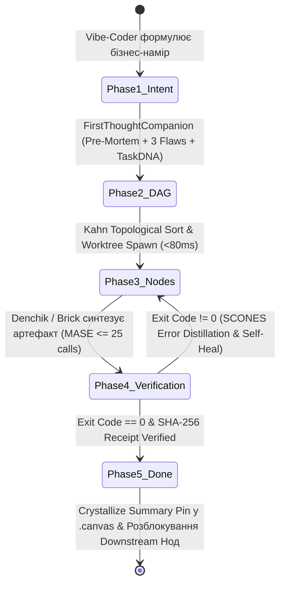
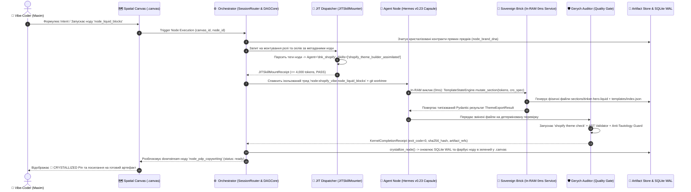

> [!metadata]- ⚙️ Системні метадані та інваріанти (MRH Header)
> ```yaml
> # --- DNK-MRH-HEADER ---
> mrh_id: "docs/architecture/reports/GERYCH_ROOT_ORCHESTRATOR_AND_TEAM_ARCHITECTURE_BLUEPRINT.md"
> purpose: "Canonical Senior-Grade Master Architectural Blueprint answering the 8 Foundational Questions for DNK OS Sovereign Core: Narrow-Waist Microkernel (<400 LOC), Hermes v0.23.0-dnk Agent Team, 3-Tier SCONES SQLite WAL + AST Memory, Spatial Canvas Interaction Topology, TaskForest/DAG Project Engine, Shopify Theme Factory vs Store Builder System-inside-System, 5-Element Sovereign Brick Dual-Mount Standard, and Golden Traces Compounding Reuse."
> canonical_source: true
> alters_files: []
> triggers_tasks: []
> status: "Active"
> version: "1.0.0"
> updated_at: "2026-11-15"
> author: "Gerych (Cold Knowledge Archivist & System Auditor) & Antigravity & DNK-e.com Maksym"
> # --- END DNK-MRH-HEADER ---
> ```

# 🏛️ GERYCH-ROOT MASTER BLUEPRINT: Архітектура Суверенного Ядра, Оркестратора, Команди Агентів та Конвеєра «Система Всередині Системи» (DNK OS v1.0)

**Вердикт Gerych-Root (Cold Knowledge Archivist & System Auditor, `DEC-054`, `DEC-110`, `ADR-092`):**
Накопичений за 9 місяців інтелектуальний капітал екосистеми (`DNK_HUB`, `DNK_OS`, `../Gerych-Agent v0.23.0-dnk`, `../DNKEcom`, `../DNK_Vibe`, 90+ асимільованих SOTA-репозиторіїв та 4 000+ інженерних документів) досяг критичної маси, за якої подальше нарощування функціоналу без жорсткої канонізації Ядра веде до ентропії контексту. Єдиний інженерно обґрунтований шлях переходу від R&D-інкубатора до суверенної виробничої машини — **фіксація ультракомпактного мікроядра (`Narrow-Waist Microkernel < 400 LOC`) з нульовою бізнес-логікою**, побудова **Команди-Квадри на єдиному пропатченому рантаймі Hermes Agent v0.23**, **3-рівнева ізоляція пам'яті SCONES SQLite WAL + Working-Tree AST**, **просторова оркестрація через JSON Canvas 1.0 + `dnk_dag_store.db`** та інкапсуляція всіх комерційних конвеєрів (зокрема двоконтурної фабрики Shopify) у **5-елементні Суверенні Цеглинки з подвійним монтуванням (`Dual-Mount: In-RAM 0ms + FastMCP`)**.

---

## 0. Суть Дослідження та Порівняльний Аналіз SOTA (Executive Summary & SOTA Comparative Matrix)

Протягом 9 місяців еволюції `DNK_HUB` було протестовано десятки архітектурних підходів: від монолітних мультиагентних роїв із глобальним чатом до важких зовнішніх MCP-серверів та векторних баз даних. Паралельно в лабораторії було деконструйовано провідні світові агентні системи: **Anthropic Claude Code & MCP Code Execution**, **NousResearch Hermes Agent v0.23**, **Cognition Devin**, **LangGraph (LangChain)**, **Microsoft AutoGen v0.4**, **Cursor Composer** та **Google Research Harness²**.

Головний висновок цього аудиту полягає в наступному: **успіх автономної агентної системи для сольного фаундера та Vibe-кодера визначається не кількістю агентів чи розміром векторної бази, а чистотою границь контексту (Context Isolation), детермінізмом контрактів між вузлами (Pydantic v2 / AST Verification) та нульовим накладним податком на оперативну пам'ять робочої станції Mac (Zero Standing Bloat)**.

### Таблиця 0.1. Порівняльна матриця світового SOTA та канонічної архітектури DNK OS (`DEC-110` / `ADR-092`)

| Архітектурний вимір | LangGraph / AutoGen | Cognition Devin / OpenHands | Anthropic Claude Code / Cursor | NousResearch Hermes v0.23 (Upstream) | Канонічне Ядро DNK OS (`DNK_OS` + `Gerych-Agent v0.23.0-dnk`) |
| :--- | :--- | :--- | :--- | :--- | :--- |
| **Топологія Ядра (Kernel Waist)** | Важкий графовий SDK із вшитою логікою станів у коді воркфлоу | Хмарний монолітний оркестратор із закритим планувальником | Лінійний сесійний цикл із subagent-делегуванням | Модульний CLI/TUI агент із підтримкою скілів та делегування | **Narrow-Waist Microkernel (`< 400 LOC`)**: 0 бізнес-логіки в ядрі, диспетчеризація виключно через Pydantic v2 контракти |
| **Стартовий бюджет промпту (Step 0 Overhead)** | Залежить від графа (`8k–25k` токенів при підключенні тулів) | Високий (`15k–30k` токенів системного оточення) | Компактний (`~4k–8k` токенів), але зростає при підключенні MCP | Компактний (`~3.5k–6k` токенів) із JIT-пошуком `tool_search` | **Sacred Prompt Cache `<= 6,000` токенів** (`core/kernel/contracts.py`), жорсткий гейт `JITSkillMounter <= 4,000` токенів |
| **Модель Пам'яті (Memory Engine)** | Зовнішні Checkpointers (Postgres / Redis) + Vector RAG | Пропрієтарний Playbook/Knowledge індекс | Локальні файли (`CLAUDE.md`, `.cursorrules`) + хмарний індекс | Локальний `MEMORY.md` (`2,200` симв.) + плагіни пам'яті | **3-Tier SCONES SQLite WAL (`FTS5 BM25 < 15ms`) + Working-Tree AST Overlay (`< 20ms`)**, 0 МБ фонових Docker-демонів |
| **Візуальний інтерфейс управління (UX for Vibe-Coder)** | LangGraph Studio (відлагоджувальний граф для інженерів) | Веб-кокпіт (термінал + браузер + лінійний чат) | Файловий редактор IDE + бічна панель чату | Термінальний TUI / CLI + ACP-адаптер | **Dual-State Spatial Canvas**: Obsidian `.canvas` (JSON Canvas 1.0) + ізольовані чати нод `node:{canvas_id}:{node_id}` у SQLite WAL |
| **Виклик доменних сервісів (Service Invocation)** | Python-функції всередині вузлів графа | Виклики через shell або REST API | Зовнішні MCP-сервери через `stdio`/`SSE` (висока витрата токенів) | Нативні тули + `execute_code` + MCP-клієнт | **Dual-Mount Sovereign Bricks**: `0 ms` In-RAM прямий імпорт для ядра/CodeMode (`-98.7%` токенів) + `mcp_server.py` для зовнішніх IDE |
| **Ізоляція паралельних задач на диску** | Відсутня (потребує ручних Docker-контейнерів) | Важкі ізольовані VM / контейнери (`5–15 с` старт) | Ручне управління git worktrees | Підтримка фонових процесів та субагентів | **APFS Copy-on-Write Worktree Pool** (`~/.dnk_runtime/worktrees/`, спавн ізольованої пісочниці за `< 80 ms`, 0 байт дублів) |

---

## 1. Питання №1: Чому «Architect First, Code Second» є законом і як описати Вузьке Мікроядро (`Narrow-Waist Microkernel < 400 LOC`)

### 1.1. Інженерна фізика закону «Architect First, Code Second» у мультиагентних системах

У класичній розробці ПЗ написання коду без архітектури створює технічний борг, який рефакториться людиною. В автономних агентних системах написання коду без попередньо зафіксованих контрактів запускає **незворотний каскад когнітивної деградації (Cascading Context Collapse)** з трьох причин:

1. **Забруднення вікна уваги (Attention Entropy & Context Bleed):**
   Коли агент-будівничий починає писати код без чіткого контракту входу/виходу (`Input/Output Schema`), `Target File Whitelist` та `Negative Scope`, він змушений читати десятки сусідніх файлів для вгадування інтерфейсів. Після перетину порогу у `35,000–40,000` токенів увага LLM деградує: модель починає галюцинувати неіснуючі методи, дублювати утиліти та порушувати інваріанти безпеки (`ADR-006`).
2. **Ефект розмивання границь (Boundary Erosion):**
   Історичний аудит `DNK_HUB` показав, що за відсутності жорсткого вузького ядра оркестраційна папка `./core/orchestrator/` розрослася до **57+ окремих модулів** (`quantum_engine.py`, `swarm_director.py`, `swarm_engine.py`, `agent_coordinator.py`, `control_plane.py` тощо), де логіка маршрутизації змішалася з предметною областю. У результаті зміна формату відповіді одного сервісу вимагала редагування самого оркестратора.
3. **Неможливість детермінованої верифікації (Untestable Hallucination Loop):**
   Агент не може перевірити власну роботу словами («Я все протестував, все працює» — це структурна похибка RLHF, зафіксована в `AGENTS.md` Розділ 6). Детермінований гейт (`pytest`, `shopify theme check`, AST-валідатор) може існувати лише тоді, коли **до написання першого рядка реалізації** зафіксовано формальний контракт (`Pydantic v2 Schema` + `Quality Gate`).

Тому в DNK OS діє залізний закон **Two-Phase Audit-First & Spec-Driven Synthesis**:
- **Фаза 1 (Architect / Scope / Contract Lock — Read-Only):** Декомпозиція наміру у DAG, визначення Pydantic-контрактів у `contracts/schemas.py`, фіксація `Target File Whitelist` та `Negative Scope`. Жодних мутацій коду.
- **Фаза 2 (MASE Atomic Synthesis — Write & Verify):** Атомарна реалізація зрізу (`<= 25` викликів інструментів) строго в межах білого списку файлів із негайним закриттям через машинний доказ (`exit code 0`).

---

### 1.2. Архітектура Вузької Талії Мікроядра (`Narrow-Waist Microkernel < 400 LOC`)

За аналогією з архітектурою мікроядра операційних систем (L4 / seL4) та стеком протоколів Інтернету (де IP є «вузькою талією» між будь-яким фізичним транспортом і будь-яким додатком), Ядро DNK OS (`./core/kernel/` та цільовий контур `../DNK_OS/core/kernel/`) проєктується як **Narrow-Waist Contract Dispatcher обсягом до 400 рядків коду (`< 400 LOC`)**.

```
                   [ VIBE-CODER MAXIM (Intent / Spatial Canvas / CLI) ]
                                            │
                                            ▼
             ┌─────────────────────────────────────────────────────────────┐
             │      NARROW-WAIST MICROKERNEL (< 400 LOC, 0 Domain Code)    │
             │  ┌───────────────────────────────────────────────────────┐  │
             │  │ 1. Sacred Prompt Cache Guard (<= 6,000 tokens Step 0) │  │
             │  │ 2. System 1 Fast Triage (< 50 ms complexity routing)  │  │
             │  │ 3. ThoughtCompanion / TaskDNA DAG Compiler            │  │
             │  │ 4. Contract Dispatcher & Role Capsule Loader          │  │
             │  │ 5. Completion Receipt & Audit Hash Verifier (SHA-256) │  │
             │  └───────────────────────────────────────────────────────┘  │
             └──────────────┬───────────────────────────────┬──────────────┘
                            │ (AgentCapsuleSpec)            │ (In-RAM 0ms / FastMCP)
                            ▼                               ▼
             ┌──────────────────────────────┐ ┌────────────────────────────┐
             │   SOVEREIGN QUAD AGENT TEAM  │ │  3 CANONICAL WORKHORSES    │
             │   (Hermes v0.23.0-dnk Core)  │ │  (5-Element Bricks)        │
             │  • Strategist (Companion)    │ │  • dnk_shopify (E-com/CRO) │
             │  • Antigravity (Coordinator) │ │  • dnk_media (Video/Image) │
             │  • Denchik (Master Builder)  │ │  • dnk_distribution (CRM)  │
             │  • Gerych (Cold Auditor)     │ │  + Core Bricks (01..06)    │
             └──────────────────────────────┘ └────────────────────────────┘
```

#### П'ять залізних інваріантів Мікроядра (`./core/kernel/`):
1. **Zero Business Logic Invariant:** У файлах `./core/kernel/__init__.py`, `./core/kernel/contracts.py` та `./core/kernel/thought_companion.py` суворо заборонені будь-які імпорти з `./services/dnk_shopify`, `./services/dnk_media` чи `./services/dnk_distribution`. Ядро оперує виключно абстрактними контрактами задач, капсулами ролей і квитанціями виконання.
2. **Sacred Prompt Cache Invariant (`<= 6,000 tokens`):** Базовий незмінний префікс системного промпту (`SYSTEM_PROMPT_TOKEN_CEILING = 6000` у `./core/kernel/contracts.py`) ніколи не мутується динамічними даними в середині сесії. Це гарантує ~90% влучань у KV-Cache провайдера LLM (Vertex AI Gemini / Anthropic Claude), знижуючи вартість і латентність першого токена (TTFT) у 4–6 разів.
3. **System 1 vs System 2 Dual-Speed Routing (`./core/kernel.py`):**
   - **System 1 (`fast_path`, `< 50 ms`):** Якщо запит є точковою операцією (перевірка статусу, лінтинг одного файлу, проста зміна конфігу з `estimated_steps <= 2`), ядро маршрутизує його напряму у відповідний ін-меморі інструмент без спавну графа.
   - **System 2 (`deep_dag`, TaskDNA + Spatial Canvas):** Якщо задача зачіпає кілька файлів, потребує дослідження або створює новий бізнес-артефакт, ядро активує `FirstThoughtCompanionAgent` (`./core/kernel/thought_companion.py`), який генерує `CompanionCritiqueBlock` (Pre-Mortem + 3 Flaws) і розкладає намір у DAG нод полотна.
4. **Role Capsule Isolation (`AgentCapsuleSpec`):** Замість «всемогутнього агента з 80 інструментами» ядро видає виконавцю вузьку капсулу ролі (`CANONICAL_ROLE_CAPSULES`), де жорстко прописані `allowed_tools` (до 5–8 інструментів), `filesystem_write_quota` та `token_budget_ceiling`.
5. **Deterministic Receipt Sealing (`KernelCompletionReceipt`):** Жодна задача не переходить у статус `done`, доки ядро не отримає підписану квитанцію з `verification_exit_code == 0`, списком реально змінених відносних шляхів (`modified_files`) та канонічним `audit_hash` (64-символьний SHA-256).

---

### 1.3. Канонічні Моделі Даних Диспетчера Контрактів (`./core/kernel/contracts.py`)

Нижче наведено фізично верифіковані Pydantic v2 контракти, які утворюють «вузьку талію» ядра:

```python
# Source: ./core/kernel/contracts.py (Pydantic v2 Strict Contracts)
from typing import Dict, List, Literal, Optional
from pydantic import BaseModel, ConfigDict, Field

SYSTEM_PROMPT_TOKEN_CEILING: int = 6000

class AgentCapsuleSpec(BaseModel):
    """Strict isolation capsule mounted per canvas node execution."""
    model_config = ConfigDict(extra="forbid", frozen=True)

    role_id: Literal["strategist_prime", "antigravity", "denchik", "gerych_auditor", "dnk_shopify", "dnk_media"]
    system_prompt_tokens: int = Field(..., le=SYSTEM_PROMPT_TOKEN_CEILING)
    allowed_tools: List[str] = Field(..., max_length=12)
    target_file_whitelist: List[str] = Field(default_factory=list)
    negative_scope: List[str] = Field(..., min_length=1)
    max_mase_tool_calls: int = Field(default=25, le=25)
    worktree_isolation_required: bool = Field(default=True)

class KernelTaskRequest(BaseModel):
    """Inbound intent envelope entering the Narrow-Waist Microkernel."""
    model_config = ConfigDict(extra="forbid")

    request_id: str = Field(..., pattern=r"^req_[a-zA-Z0-9_\-]+$")
    workspace_id: str = Field(default="ws-alpha-001")
    project_id: str = Field(..., min_length=1)
    canvas_id: Optional[str] = Field(default=None)
    node_id: Optional[str] = Field(default=None)
    raw_intent: str = Field(..., min_length=3)
    requested_bricks: List[str] = Field(default_factory=list)

class KernelTriageReceipt(BaseModel):
    """System 1 (<50ms) routing decision emitted by the Microkernel."""
    model_config = ConfigDict(extra="forbid", frozen=True)

    request_id: str
    routing_tier: Literal["system1_fast_path", "system2_spatial_dag"]
    assigned_capsule: AgentCapsuleSpec
    mounted_skills: List[str]
    estimated_prompt_tokens: int = Field(..., le=SYSTEM_PROMPT_TOKEN_CEILING)
    triage_latency_ms: float

class KernelCompletionReceipt(BaseModel):
    """Deterministic proof required to seal any node or task as DONE."""
    model_config = ConfigDict(extra="forbid", frozen=True)

    request_id: str
    node_id: str
    status: Literal["crystallized", "failed", "turned_down"]
    verification_command: str
    verification_exit_code: int
    modified_files: List[str]
    artifact_refs: List[str]
    crystallized_summary: str = Field(..., max_length=1200)
    audit_hash_sha256: str = Field(..., min_length=64, max_length=64)
```

---

### 1.4. П'ятифазний Життєвий Цикл Задачі в Ядрі (`Intent -> DAG -> Nodes -> Verification -> Done`)



1. **`Intent` (Прийом та Епістемічна Інверсія):** Максим подає високорівневий намір (у терміналі або створюючи кореневу ноду на полотні `.canvas`). `FirstThoughtCompanionAgent` перевіряє повноту вхідних даних: якщо відсутній `Target File Whitelist` або ключове бізнес-рішення, спрацьовує протокол `STATUS: TURN_DOWN_WORK` або Socratic Interview (`dnk-intent-discovery`) до моменту усунення двозначності.
2. **`DAG` (Декомпозиція у Топологічний Граф):** Складний намір розкладається у Directed Acyclic Graph (`ThoughtDAGGraph` у `./core/domain/dag_models.py`), де кожна вершина — це атомарна задача з власним вихідним контрактом, а ребра (`ContextWire`) визначають інформаційні залежності. Алгоритм Кана (`NodeCanvasCore`) миттєво відсікає будь-які циклічні залежності (`CycleDetectedError`).
3. **`Nodes` (Ізольоване По-Нодне Виконання):** Коли всі предки ноди переходять у стан `crystallized`, `SpatialCanvasSessionRouter` (`./core/canvas/session_router.py`) відкриває ізольовану сесію `node:{canvas_id}:{node_id}`, компілює хірургічний контекст лише з кристалізованих висновків прямих предків (`compile_node_context`), монтує JIT-скіли (`JITSkillMounter`) і запускає агента-виконавця у виділеному APFS `git worktree`.
4. **`Verification` (Детермінований Адверсаріальний Гейт):** Після завершення MASE-зрізу вмикається `gerych_auditor`. Він запускає тестовий набір цеглинки (`pytest`, `cli.py --self-test`, `shopify theme check`, `markdown_schema_gate.py`, `anti_tautology_guard.py`). Словесні звіти агента ігноруються; приймається виключно `verification_exit_code == 0`.
5. **`Done / Crystallized` (Кристалізація та Просування Графа):** Метод `crystallize_node()` записує стислий контракт (`Output Contract` + `Artifacts`) у SQLite WAL (`dnk_dag_store.db`), атомарно фарбує ноду в зелений колір (`color: "4"`) у файлі `.canvas`, зливає git worktree і автоматично переводить наступні залежні ноди зі стану `waiting_upstream` у `ready`.

---

## 2. Питання №2: Побудова Головного Агента та Команди на базі Hermes Agent v0.23 (`NousResearch / dnk-ecom/Gerych-Agent v0.23.0-dnk`)

### 2.1. Інженерний вердикт щодо рантайму Hermes Agent v0.23

**Так — ми не просто можемо, а вже маємо об'єктивні технічні підстави будувати і Головного Агента, і всю Команду (Квадру) на єдиному уніфікованому рантаймі `dnk-ecom/Gerych-Agent v0.23.0-dnk` (розташованому у `../Gerych-Agent` із патч-кітом у `./packages/dnk_hermes_ext/`).**

Чому єдиний пропатчений рантайм Hermes v0.23 перемагає зоопарк різних фреймворків (коли один агент крутиться на LangGraph, другий на CrewAI, третій на кастомному Python-скрипті):
- **Нульовий розсинхрон інструментів та хуків безпеки:** Усі агенти команди проходять через єдиний Ring-0 перехоплювач `./scripts/system/hermes_pre_tool_hook.py` (який блокує `npm install` на користь `pnpm`, `pip` на користь `uv`, забороняє абсолютні шляхи та захищає 8 канонічних коренів).
- **Єдиний пул авторизації та ротації квот Vertex AI:** Завдяки нашому патч-кіту (`./packages/dnk_hermes_ext/patches/series_v0230_dnk/0001..0026`) усі екземпляри агентів використовують спільний механізм Google Cloud Vertex AI ADC із автоматичним оновленням токенів кожні 3000 секунд (`_TOKEN_BEARER_MAX_AGE_SEC = 3000`), нормалізацією префіксів `google/gemini-*` та автоматичним failover між моделями при помилках `HTTP 429 Quota Exceeded` (патч `0011`).
- **Нульове дублювання віртуальних оточень:** Усі профілі агентів працюють поверх єдиного APFS CoW оточення `~/.dnk_runtime/venvs/hermes-agent` (`0 байт` дублювання бібліотек на диску).

---

### 2.2. Глибокий аудит архітектурних підсистем Hermes Agent v0.23 (`v0.23.0-dnk`)

Аудит вихідного коду `../Gerych-Agent` та нашого розширення `./packages/dnk_hermes_ext/` підтверджує наявність 5 промислових підсистем світового рівня:

| Підсистема Hermes v0.23.0-dnk | Фізичні модулі в `../Gerych-Agent` та `./packages/dnk_hermes_ext` | Інженерні можливості та роль у Ядрі DNK OS |
| :--- | :--- | :--- |
| **1. Agent Client Protocol (ACP)** | `../Gerych-Agent/acp_adapter/` (`server.py`, `session.py`, `tools.py`, `events.py`, `permissions.py`, `elicitation.py`, `edit_approval.py`, `provenance.py`) | Стандартизований JSON-RPC 2.0 транспорт між агентним ядром та будь-яким UI-клієнтом (Spatial Canvas UI, Zed, VS Code, Antigravity Cockpit). Підтримує стрімінг подій мислення, інтерактивне підтвердження дифів (`edit_approval.py`), запити уточнень (`elicitation.py`) та криптографічне відстеження походження змін (`provenance.py`). |
| **2. Tool Calling & Programmatic Code Mode** | `tools/`, `execute_code`, `tool_search`, `tool_describe`, `tool_call`, `./packages/dnk_hermes_ext/overlay/tools/` | Дворівнева система виклику інструментів: (а) **Deferred Tool Catalog** (`tool_search` -> `tool_describe`) тримає важкі схеми поза стартовим промптом; (б) **`execute_code` (Persistent Python Kernel)** дозволяє агенту об'єднувати 3–50 викликів інструментів і фільтрувати мегабайти даних у Python до того, як вони потраплять у контекст LLM. |
| **3. Session Management & Lossless Compression** | `agent/`, патчі `0018`, `0019`, `0020`, `0021` у `./packages/dnk_hermes_ext/patches/series_v0230_dnk/` | При наближенні до ліміту контексту спрацьовує **SCONES v2 Pre-Compaction Flush** (патч `0020`): критичні рішення, змінені файли та негативні обмеження (`Negative Constraints Pinning`, патч `0019`) фіксуються у `Structured State Ledger` (патч `0021`), а великі виводи інструментів замінюються на `Lossless Pointer Stubs` (патч `0018`) із посиланням на файл на диску. |
| **4. Dynamic Skills Mounting (LOD Disclosure)** | `skills_list`, `skill_view(name, file_path)`, `./core/canvas/jit_skill_mounter.py` | Агент бачить на старті лише однорядковий індекс скілів (`<= 60` символів на опис). Повний `SKILL.md` (`<= 750` рядків) або вкладені довідники `references/*.md` завантажуються виключно Just-In-Time під конкретну ноду полотна. |
| **5. Dual Execution Modes: Interactive TUI vs Headless CLI / Subagent Tree** | `hermes_cli/`, `tui_gateway/`, `cli.py --oneshot -q "..."`, `delegate_task` (`max_spawn_depth=2`, `max_concurrent_children=4`) | **Interactive Mode** забезпечує прямий діалог Максима зі Стратегом/Координатором у терміналі Ghostty. **Headless Mode (`--oneshot` / ACP / `delegate_task`)** дозволяє оркестратору програмно спавнити до 4 паралельних ізольованих воркерів на вузлах полотна без участі людини. |

---

### 2.3. Організація Команди: Архітектура Суверенної Квадри (The Sovereign Quad) на Єдиному Рантаймі

Замість хаотичного рою з десятків неконтрольованих ботів, управління ядром будується навколо **Суверенної Квадри (4 фундаментальні когнітивні ролі)**, де кожна роль запускається на тому самому двигуні Hermes v0.23, але з ізольованим профілем (`~/.hermes/profiles/<role>/` або через капсулу `./core/orchestrator/agents/<role>/SOUL.md`), власним списком дозволених інструментів та різним температурним/модельним профілем:

```
                      ┌───────────────────────────────────────────────┐
                      │         👑 VIBE-CODER MAXIM (Founder)         │
                      │    Високорівневий Намір (Intent) & HITL Gate  │
                      └───────────────────────┬───────────────────────┘
                                              │
                                              ▼
      ┌───────────────────────────────────────────────────────────────────────────────┐
      │ 1. 🧠 СТРАТЕГ (Strategist Prime / FirstThoughtCompanionAgent)                 │
      │    • Вхідний шлюз намірів, Socratic Interview (dnk-intent-discovery)          │
      │    • Presupposition Inversion & 3-Flaws Pre-Mortem Critique                   │
      │    • Синтез BrandDNA та розкладка бізнес-цілі у TaskDNA DAG (.canvas)         │
      └───────────────────────────────────────┬───────────────────────────────────────┘
                                              │ (Затверджений DAG + Контракти Нод)
                                              ▼
      ┌───────────────────────────────────────────────────────────────────────────────┐
      │ 2. 🧭 КООРДИНАТОР-АРХІТЕКТОР (Antigravity / Hermes Prime Orchestrator)        │
      │    • Управління графом виконання (Kahn's DAG, OCC-версії, dnk_dag_store.db)   │
      │    • Спавн APFS CoW git worktrees (<80ms) та JIT-монтування скілів (<=4k tok) │
      │    • Маршрутизація задач у Суверенні Цеглинки (dnk_shopify / media / distr)   │
      └───────────────────┬───────────────────────────────────────┬───────────────────┘
                          │ (Dispatch: Whitelist + Spec)          │ (Audit Request)
                          ▼                                       ▼
┌───────────────────────────────────────────────────┐ ┌───────────────────────────────────────────────────┐
│ 3. ⚡ БУДІВНИЧИЙ (Denchik / Domain Specialists)   │ │ 4. 🛡️ АУДИТОР-АРХІВАРІУС (Gerych-Root / Auditor)  │
│    • Фізичний синтез коду, AST-мутації, тести     │ │    • Read-Only код-рев'ю (4-Part Review Rubric)   │
│    • Включає спеціалізації:                       │ │    • Запуск гейтів: verify_all.sh, pytest,        │
│      - dnk_shopify (Liquid 2.0 / Tinker / CRO)    │ │      markdown_schema_gate, anti_tautology_guard   │
│      - dnk_video_ai_creator (Remotion / FFmpeg)   │ │    • Фіксація SHA-256 квитанцій та ведення        │
│      - dnk_dev_fullstack (FastAPI / Pydantic / TS)│ │      живого літопису FOUNDATION_CHRONICLE.md      │
│    • Працює строго в межах MASE <= 25 tool calls  │ │    • Право ВЕТО (Fail-Closed Gate) при порушеннях │
└─────────────────────────┬─────────────────────────┘ └─────────────────────────┬─────────────────────────┘
                          │                                                     │
                          └──────────────────────────┬──────────────────────────┘
                                                     ▼
                          ┌─────────────────────────────────────────────────────┐
                          │ 📌 CRYSTALLIZED ARTIFACT & UPDATED .CANVAS STATE    │
                          └─────────────────────────────────────────────────────┘
```

### Таблиця 2.1. Матриця розподілу відповідальності, прав доступу (RBAC) та конфігурації рантайму Квадри

| Параметр конфігурації на рантаймі Hermes v0.23 | 1. Стратег (`strategist_prime`) | 2. Координатор (`antigravity` / `gerych_prime`) | 3. Будівничий (`denchik` + доменні капсули) | 4. Аудитор та Архіваріус (`gerych` / `gerych_auditor`) |
| :--- | :--- | :--- | :--- | :--- |
| **Канонічний статус (`AGENTS.md`)** | C-Suite Thought Partner & ICP/CRO Strategist | Head of Orchestration, Architecture & Quality Gates | Sovereign Master Builder (`DEC-042`, `DEC-052`) | Cold Knowledge Archivist & Historical Auditor (`DEC-054`) |
| **Режим доступу до ФС (Filesystem Scope)** | Запис тільки у `./docs/canvas/`, `./docs/notes/` та SCONES L2 (`BrandDNA`) | Запис у `./docs/architecture/`, `./core/kernel/`, `.canvas` та метадані DAG | Повний запис **виключно** у файли з `Target File Whitelist` усередині виділеного `git worktree` | **Read-Only** для коду додатків; запис дозволено лише у `./docs/architecture/reports/` та `./docs/plans/*CHRONICLE.md` |
| **Санкціонований білий список інструментів (`Sanctioned Tools`)** | `scones_recall`, `web_search`, `web_extract`, `read_file`, `write_file` (плани/канвас), `skill_view` | `delegate_task`, `execute_code`, `read_file`, `search_files`, `patch`, `scones_recall`, `scones_remember` | `read_file`, `search_files`, `patch`, `write_file`, `execute_code` (In-RAM Bricks), `terminal` (тести/білд) | `read_file`, `search_files`, `terminal` (`verify_all.sh`, `pytest`, `git diff`), `scones_recall`, `scones_remember` |
| **Як запускається на єдиному рантаймі Hermes v0.23** | Інтерактивна сесія або коренева нода полотна (`agent_role="strategist_prime"`) | Головний керуючий процес оркестратора / ACP-сервер (`acp_adapter`) | Ізольований воркер через `delegate_task` або headless `cli.py --oneshot` на ноді полотна | Автоматичний post-execution хук у фазі `verification` перед викликом `crystallize_node()` |
| **Головний критерій успіху (Output Contract)** | Валідний DAG у `.canvas` + `CompanionCritiqueBlock` (3 ризики, границі, альтернатива) | Безколізійна маршрутизація DAG, дотримання бюджету `<= 6,000` токенів на старті нод | Чистий диф, що реалізує специфікацію за `<= 25` кроків MASE з 1+ граничним тестом | Незалежний машинний доказ `exit code 0`, відсутність тавтологій у тестах та запис у Літопис |

**Як спеціалізовані доменні рої (14 агентів зі специфікації `GERYCH_PRIME_UNIFIED_ORCHESTRATION_AND_SOTA_SPEC.md`) співвідносяться з Квадрою:**
Вони не є окремими важкими демонами в оперативній пам'яті! У новій архітектурі `dnk_shopify`, `dnk_video_ai_creator`, `dnk_dev_fullstack`, `dnk_marketing_cmo` тощо — це **динамічні спеціалізації (Skill + Persona Overlay Capsules) Будівничого (`denchik`) або Стратега (`strategist_prime`)**, які монтуються на час життя однієї ноди полотна через `JITSkillMounter.mount_skills_for_node()`.

---

## 3. Питання №3: Розбудова Когнітивної Пам'яті — Аудит SCONES SQLite WAL + AST та 3-Рівнева Ієрархія

### 3.1. Інженерний аудит: чи підходить варіант, реалізований у `DNK_HUB`?

**Вердикт:** Фундаментальний двигун пам'яті, реалізований у `./core/memory/scones_store.py` (**SCONES SQLite WAL + FTS5 BM25 + Working-Tree Diff Overlay + Vitality Decay + Anchor Verifier**), є **інженерно правильним і суттєво перевершує локальні векторні бази даних для робочої станції розробника на Apple Silicon**. Водночас для повної реалізації візії Максима (мультипроєктної фабрики бізнесів) базову схему таблиць необхідно доповнити **суворим трирівневим розділенням просторів імен (`Account L1 -> Project L2 -> Node L3`)**, щоб унеможливити змішування контекстів різних бізнес-проєктів.

---

### 3.2. Чому SCONES SQLite WAL + Working-Tree AST перемагає важкі Vector DB (Qdrant / Milvus / Chroma) на Mac

У 2024–2025 роках індустрія масово впроваджувала локальні Vector DB (Qdrant, Milvus, ChromaDB, Weaviate у Docker) для кодових агентів. Проте практична експлуатація та бенчмарки Anthropic (Claude Code), Cursor і власні вимірювання в `DNK_HUB` довели, що для кодової бази та архітектурної пам'яті обсягом до `250,000+ LOC` важкі векторні бази на локальному MacBook є **архітектурним антипатерном**:

```
┌──────────────────────────────────────────────────────────────────────────────────────────┐
│ ЧОМУ VECTOR DB ПРОГРАЄ НА РОБОЧІЙ СТАНЦІЇ MAC (Фізика пам'яті та точності коду)          │
├────────────────────────────────────────┬─────────────────────────────────────────────────┤
│ ❌ Важка Vector DB (Qdrant / Milvus)   │ ✅ SCONES SQLite WAL (FTS5 BM25) + Live AST     │
├────────────────────────────────────────┼─────────────────────────────────────────────────┤
│ 1. Фоновий Docker-демон спалює         │ 1. Вбудований sqlite3 (Python stdlib):          │
│    1.5 – 4.2 GB Unified RAM 24/7.      │    0 MB фонових демонів, один файл .db.         │
│ 2. Stale Embedding Drift: щойно агент  │ 2. Live Working-Tree Overlay:                   │
│    змінив 5 файлів, векторний індекс   │    SconesOverlayEngine + ast-grep сканують      │
│    стає брехливим до повної переіндек- │    реальний git diff на льоту за < 20 ms        │
│    сації (яка триває секунди/хвилини). │    зі 100% актуальністю стану диска.            │
│ 3. Розмитий семантичний пошук (Cosine) │ 3. Точний лексично-ранжований FTS5 BM25         │
│    плутає схожі назви класів, повертає │    (< 15 ms) + SconesAnchorVerifier, який       │
│    застарілі шматки коду без гарантії  │    перевіряє, чи існує згаданий символ у        │
│    існування символу.                  │    поточному AST файлу прямо зараз.             │
│ 4. Мережевий/HTTP оверхед 40–150 ms    │ 4. Пряме читання з Page Cache ядра macOS        │
│    плюс виклик Embedding API.          │    через mmap/WAL за 0.8 – 12 ms.               │
└────────────────────────────────────────┴─────────────────────────────────────────────────┘
```

#### Чотири унікальні переваги нашої реалізації в `./core/memory/scones_store.py`:
1. **`SconesBM25Index` (`./core/memory/scones_bm25_index.py`):** Повнотекстовий пошук SQLite FTS5 із ранжуванням BM25 знаходить точні архітектурні інваріанти (`DEC-110`, `CartMutationQueue`, `shopify theme check`) за `< 15 ms` без жодних викликів зовнішніх Embedding-моделей.
2. **`SconesOverlayEngine` (`./core/memory/scones_overlay.py`):** Накладає поточні незакомічені зміни робочого дерева (`git status` / `git diff`) поверх базових знань, тому агент ніколи не читає «вчорашню» сигнатуру функції.
3. **`SconesAnchorVerifier` (`./core/memory/scones_anchor_verifier.py`):** Кожне збережене правило чи урок прив'язується до файлового якоря (`anchor_path` + `symbol_name`). Якщо файл було видалено або функцію перейменовано, верифікатор автоматично позначає спостереження як `stale_anchor`, запобігаючи галюцинаціям за застарілими інструкціями.
4. **`SconesVitalityEngine` (`DEC-045`, `./core/memory/scones_vitality.py`):** Реалізує біологічну формулу життєздатності пам'яті (експоненційне загасання рідковживаних тимчасових спостережень із періодом напіврозпаду 30 днів та підвищення ваги правил, які часто підтверджуються успішними білдами).

---

### 3.3. Трирівнева Ієрархія Пам'яті (3-Tier Sovereign Memory Architecture)

Щоб Максим міг одночасно вести десятки бізнес-проєктів (наприклад, власну R&D-фабрику тем, клієнтський стор косметики, бренд коптилень ReBurn Smokehouse, медіа-канал) без жодного змішування контексту, пам'ять розділяється на **три суворо ізольовані концентричні рівні**:

```
┌─────────────────────────────────────────────────────────────────────────────────────────┐
│ РІВЕНЬ L1: ПАМ'ЯТЬ АКАУНТА VIBE-КОДЕРА (Global Founder & System Memory)                 │
│ • Обсяг у промпті: <= 1,500 токенів (частина Sacred Prompt Cache)                       │
│ • Джерело: UserProfile (./core/domain/identity_models.py) + MEMORY.md + SCONES [global] │
│ • Вміст: Мовний протокол (UA спілкування / EN код), Epistemic Armor (Zero Flattery,     │
│   3-Flaws Rule), глобальні архітектурні замки (DEC-001..DEC-112), золоті інженерні      │
│   правила та індекс 90+ асимільованих SOTA-репозиторіїв.                                │
│ • Час життя: Перманентний (крос-проєктний SSOT).                                        │
└────────────────────────────────────────────┬────────────────────────────────────────────┘
                                             │ (Успадковується всіма проєктами в Read-Only)
                                             ▼
┌─────────────────────────────────────────────────────────────────────────────────────────┐
│ РІВЕНЬ L2: ПАМ'ЯТЬ БІЗНЕС-ПРОЄКТУ (Project Workspace & Brand DNA Memory)                │
│ • Обсяг у промпті: <= 1,500 токенів через BrandDNA.extract_lod_slice(lod_type)          │
│ • Джерело: ProjectWorkspace + BrandDNA (./core/domain/identity_models.py) +             │
│   SCONES [project_id = 'proj_reburn' | 'proj_client_x']                                 │
│ • Вміст: Місія бренду, ICP-аватари покупців, Tone of Voice, VisualStyle (Hex-палітра,   │
│   типографіка, дизайн-токени), специфіка доменної моделі клієнта, Negative Constraints  │
│   бренду (що заборонено писати/показувати).                                             │
│ • Ізоляція: Суворий SQL-фільтр WHERE project_id = ? (Zero Cross-Tenant Contamination).  │
│ • Час життя: Протягом життєвого циклу бізнес-проєкту клієнта.                           │
└────────────────────────────────────────────┬────────────────────────────────────────────┘
                                             │ (Ін'єктується як LOD-зріз у ноди проєкту)
                                             ▼
┌─────────────────────────────────────────────────────────────────────────────────────────┐
│ РІВЕНЬ L3: ПАМ'ЯТЬ ПІДПРОЄКТУ / НОДИ ПОЛОТНА (Ephemeral Node Thread & Working Memory)   │
│ • Обсяг у промпті: <= 3,000 токенів вхідного контексту предків + локальний тред ноди    │
│ • Джерело: node_chat_sessions / node_chat_messages (./core/canvas/session_router.py) +  │
│   scones_working_memory [session_id = 'node:{canvas_id}:{node_id}']                     │
│ • Вміст: Кристалізовані контракти прямих предків у DAG, змонтовані JIT-скіли під цю     │
│   конкретну задачу, локальний діалог/трейс виконання MASE-зрізу.                        │
│ • Час життя: ЕФЕМЕРНИЙ — активний лише до виклику crystallize_node(). Після успішної    │
│   верифікації стискається у Crystallized Summary Pin (<= 300 токенів), а сирий лог      │
│   ізолюється в архіві SQLite і НІКОЛИ не передається у наступні ноди!                   │
└─────────────────────────────────────────────────────────────────────────────────────────┘
```

---

### 3.4. Точна Схема Даних 3-Рівневої Пам'яті (SQLite WAL + Pydantic v2 LOD Slicing)

Удосконалена схема SQLite WAL (`.data/scones_memory.db` + `~/.dnk_runtime/agents_state/spatial_canvas_sessions.db`), що формалізує три рівні пам'яті:

```sql
-- Обов'язкові інваріанти конкурентності SQLite (AGENTS.md Розділ 14)
PRAGMA journal_mode = WAL;
PRAGMA busy_timeout = 5000;
PRAGMA synchronous = NORMAL;

-- 1. Рівень L1 (Global) та L2 (Project): Таблиця дистильованих правил і спостережень
CREATE TABLE IF NOT EXISTS scones_observations (
    id TEXT PRIMARY KEY,
    memory_tier TEXT NOT NULL CHECK(memory_tier IN ('L1_ACCOUNT', 'L2_PROJECT', 'L3_NODE')),
    account_id TEXT NOT NULL DEFAULT 'usr_maxim_founder',
    project_id TEXT NOT NULL DEFAULT 'global',          -- 'global' для L1, 'proj_<slug>' для L2
    topic TEXT NOT NULL,
    observation TEXT NOT NULL,
    golden_rule TEXT NOT NULL,
    anchor_file_path TEXT,                              -- Відносний шлях для SconesAnchorVerifier
    anchor_symbol TEXT,                                 -- Ім'я класу/функції в AST
    confidence REAL NOT NULL DEFAULT 0.9,
    vitality_score REAL NOT NULL DEFAULT 1.0,           -- Загасає за формулою DEC-045
    created_at REAL NOT NULL,
    last_verified_at REAL NOT NULL
);

CREATE INDEX IF NOT EXISTS idx_scones_tier_proj ON scones_observations(memory_tier, project_id, vitality_score DESC);

-- Віртуальна таблиця FTS5 BM25 для миттєвого пошуку (< 15 ms)
CREATE VIRTUAL TABLE IF NOT EXISTS scones_observations_fts USING fts5(
    id UNINDEXED,
    project_id UNINDEXED,
    topic,
    observation,
    golden_rule,
    tokenize='porter unicode61'
);

-- 2. Рівень L2: Реєстр Бізнес-Проєктів та BrandDNA
CREATE TABLE IF NOT EXISTS dnk_project_workspaces (
    project_id TEXT PRIMARY KEY,                        -- напр. 'proj_reburn_smokehouse'
    account_id TEXT NOT NULL DEFAULT 'usr_maxim_founder',
    title TEXT NOT NULL,
    domain_type TEXT NOT NULL,                          -- 'shopify_store', 'theme_factory', 'media_channel', 'saas'
    brand_dna_json TEXT NOT NULL,                       -- Валідований JSON моделі BrandDNA
    active_canvas_path TEXT NOT NULL,                   -- Відносний шлях, напр. './docs/canvas/reburn.canvas'
    target_repo_rel_path TEXT NOT NULL,                 -- Відносний шлях до репо або дельта-дерева
    created_at TIMESTAMP DEFAULT CURRENT_TIMESTAMP,
    updated_at TIMESTAMP DEFAULT CURRENT_TIMESTAMP
);
```

---

### 3.5. Математичний Механізм Запобігання Деградації Контексту (`Zero Context Overflow`)

Деградація контексту (Context Rot) у довгих проєктах виникає тоді, коли обсяг історії діалогу зростає лінійно $O(N)$ від кількості виконаних задач. У DNK OS впроваджено **константну складність контексту $O(1)$ відносно глибини проєкту** завдяки чотирьом бар'єрам:

1. **Формула жорсткого бюджету Step 0 на кожній ноді полотна:**
   $$\text{Tokens}_{\text{Step 0}}(v) = \underbrace{\text{Tokens}(\text{L1}_{\text{Kernel}})}_{\le 1,500} + \underbrace{\text{Tokens}(\text{L2}_{\text{BrandDNA LOD}})}_{\le 1,200} + \underbrace{\text{Tokens}(\text{JIT Skills}(v))}_{\le 3,300} + \underbrace{\sum_{u \in \text{Parents}(v)} \text{Tokens}(\text{Pin}(u))}_{\le 300 \times |\text{Parents}(v)|} \le 6,000 \text{ tokens}$$
2. **LOD Context Slicing (`BrandDNA.extract_lod_slice()` у `./core/domain/identity_models.py`):**
   Копірайтерська нода (`node_pdp_copywriting`) отримує з L2-пам'яті проєкту лише `mission`, `target_audience`, `tone_of_voice` та `negative_constraints` (~450 токенів), тоді як її не навантажують таблицями CSS-кольорів і налаштуваннями Vite. Візуальна нода (`node_brand_dna`) отримує лише `visual_style` (палітру і типографіку).
3. **Graph Context Surgery (`compile_node_context` у `./core/canvas/session_router.py`):**
   Коли агент завершує роботу в Ноді $A$ (де він міг витратити 18 кроків і 25,000 токенів на парсинг конкурентів), виклик `crystallize_node()` перетворює весь цей діалог на **Crystallized Summary Pin** обсягом до 250–300 токенів плюс посилання на фізичний файл `./artifacts/shopify/competitor_matrix.json`. Нода $B$ отримує **0 токенів сирого чату Ноди $A$** — вона бачить лише кристалізований контракт!
4. **Автоматичний Checkpoint & Reboot (`ADR-006` + патчі Hermes `0018`–`0021`):**
   Якщо всередині однієї складної ноди сесія досягає 20 викликів інструментів або 35,000 токенів, рантайм автоматично виконує `SCONES Pre-Compaction Flush`: скидає проміжний стан у `Structured State Ledger`, замінює важкі логи інструментів на `Lossless Pointer Stubs` і продовжує роботу зі свіжим вікном уваги.

---

## 4. Питання №4: Взаємодія Vibe-Кодера, Оркестратора, Агентів, Сервісів, Плагінів, Воркфлоу та Артефактів

### 4.1. Чітка таксономія сутностей у Ядрі DNK OS (Хто є Хто)

Щоб у системі ніколи не виникало плутанини між поняттями «агент», «сервіс», «плагін», «скіл», «воркфлоу» та «артефакт», зафіксуємо їхні суворі інженерні визначення:

| Сутність | Що це фізично у файловій системі | Чи має власну LLM-увагу (Reasoning)? | Головна функція у системі |
| :--- | :--- | :--- | :--- |
| **1. Vibe-Кодер (Максим)** | Людина-фаундер, оператор полотна Infinite Canvas та термінала Ghostty | **Суверенний Розум (Intent & Judgment)** | Задає вектор бізнесу (Intent), референси, смак (Taste/Vibe) і затверджує рішення на контрольних гейтах (HITL Gates). |
| **2. Оркестратор (Microkernel)** | `./core/kernel/` + `./core/canvas/node_canvas_core.py` + `session_router.py` | **Ні (Детермінований код `< 400 LOC`)** | Керує станом DAG, блокуванням за алгоритмом Кана, спавном worktrees, компіляцією контексту предків та перевіркою квитанцій. |
| **3. Агент (Agent Role Capsule)** | Екземпляр Hermes v0.23 із капсулою `./core/orchestrator/agents/<role>/SOUL.md` | **Так (Когнітивний Виконавець)** | Приймає рішення всередині однієї ноди полотна, планує MASE-кроки, викликає цеглинки та синтезує код/контент. |
| **4. Навичка (Skill)** | Папка `./core/skills/<skill_name>/SKILL.md` (`<= 750` рядків) + `references/` | **Ні (Процедурне Знання / Рецепт)** | Текстовий SOP-протокол та шаблони, які монтуються в промпт агента Just-In-Time (`JITSkillMounter`) для конкретної ноди. |
| **5. Сервіс-Цеглинка (Sovereign Brick)** | `./services/dnk_<domain>/` або `./core/bricks/brick_XX/` за 5-елементним стандартом | **Ні (Детермінований Програмний Двигун)** | Виконує важку обчислювальну або API-роботу (парсинг Liquid AST, рендер FFmpeg, транспiляція токенів) за контрактом Pydantic v2. |
| **6. Плагін (Runtime Plugin)** | `./packages/dnk_hermes_ext/overlay/plugins/` або `./packages/plugins/` | **Ні (Інфраструктурний Хук / Адаптер)** | Розширює сам рантайм Hermes v0.23 (наприклад, плагін пам'яті SCONES, адаптер Vertex AI Imagen/Veo, перехоплювач безпеки). |
| **7. Воркфлоу (Spatial Workflow DAG)** | Файл `./docs/canvas/<workflow>.canvas` (JSON Canvas 1.0) + запис у `dnk_dag_store.db` | **Ні (Топологічна Карта Конвеєра)** | Визначає граф нод (кроків бізнес-процесу) та ребер (`ContextWire`), якими течуть контракти від ідеї до релізу. |
| **8. Артефакт (Verified Artifact)** | Фізичний файл (`./artifacts/...`, `.liquid`, `.mp4`, `.zip`, `.json`) + SHA-256 хеш | **Ні (Матеріальний Результат Праці)** | Верифікований продукт ноди, що зберігається на диску і передається за посиланням (`artifact_refs`) у наступні ноди графа. |

---

### 4.2. Роль Vibe-Кодера: Режисура Намірів на Полотні та 3 Контрольні Шлюзи (HITL Gates)

Vibe-кодер не повинен працювати «маршрутизатором промптів», копіюючи відповіді одного чату в інший, або вручну виправляти синтаксичні помилки Liquid/Python. Робота Максима концентрується у трьох точках найвищого важеля (High-Leverage HITL Gates):

1. **HITL Gate #1 — Inception & DAG Approval (Старт воркфлоу):**
   Максим формулює бізнес-намір (наприклад: *«Запускаємо Shopify-стор для бренду ReBurn Smokehouse: візьми за референс естетику Traeger + наш темний обсидіановий стиль, додай інтерактивний квіз вибору коптильні та бандли тріски»*). Стратег декомпонує це у візуальний граф із 5–7 нод на полотні `.canvas` і видає Pre-Mortem (3 головні ризики). Максим одним поглядом оцінює граф на полотні, за потреби перетягує або редагує ноду і натискає **Approve DAG**.
2. **HITL Gate #2 — Aesthetic & Brand DNA Lock (Візуальний та смисловий камертон):**
   Коли дослідницькі ноди зібрали матрицю конкурентів і згенерували `brand_tokens.json` + прототип ключової секції (`PrototypeGenerateRequest`), система показує візуальний прев'ю-артефакт. Максим затверджує «вайб» (кольори, типографіку, тон оффера), після чого `BrandDNA` блокується в L2-пам'яті проєкту.
3. **HITL Gate #3 — Production Release Seal (Фінальний випуск):**
   Усі технічні перевірки (`shopify theme check`, `pytest`, `verify_all.sh`, збірка `.zip`) виконуються **автономно між Будівничим та Аудитором без участі Максима**. Максим отримує вже 100% зелений, скомпільований реліз і дає фінальну команду на деплой у бойовий стор клієнта.

---

### 4.3. Наскрізний Потік Взаємодії (End-to-End Sequence Diagram)



---

### 4.4. Алгоритм Підбору Виконавців (Агентів та Скілів) під Конкретну Ноду за Мітками та Контрактами

Як саме Оркестратор розуміє, якого агента, які скіли та яку цеглинку підключити до конкретної ноди полотна? Цей процес реалізований детерміновано через комбінацію **Явної Специфікації Ноди (`DNK-STUDIO-ARCH-001-node-contract-v1.yaml`)** та **Семантичного Резолвера (`./core/canvas/jit_skill_mounter.py` + `./core/orchestrator/tool_semantic_index.py`)**:

1. **Декларативний парсинг заголовка ноди (Explicit Tag Binding):**
   Як видно у фізичному файлі `./docs/canvas/shopify_vibe_pipeline.canvas`, кожна нода полотна містить структуровані директиви:
   ```markdown
   ### 4. Розробка секцій та блоків Liquid 2.0
   **Agent**: `dnk_shopify`
   **Status**: `waiting_upstream`
   **Skills**: `shopify_theme_builder_assimilated, shopify_dynamic_pdp_playbook_assimilated`
   ```
2. **Автоматичний Fallback-матчинг за Доменними Мітками та Схемами Контрактів (Contract-Driven Matchmaking):**
   Якщо Vibe-кодер створив нову ноду вручну і написав лише текст задачі (без тегів `Agent:` та `Skills:`), `TaskTriage` (`./core/orchestrator/task_triage.py`) аналізує очікуваний тип вихідного артефакту (`output_artifact_ext` / `domain_tags`) за таблицею маршрутизації:

| Сигнали в тексті / контракті ноди (`domain_tags` / `output_schema`) | Призначена Капсула Агента (`agent_role`) | Автоматично змонтовані JIT-скіли з `./core/skills/` (`<= 4,000 tokens`) | Підключена Суверенна Цеглинка (In-RAM / FastMCP) |
| :--- | :--- | :--- | :--- |
| `liquid`, `section`, `theme`, `shopify`, `cart-drawer`, `pdp`, `.liquid`, `settings_data.json` | `dnk_shopify` (капсула Будівничого) | `shopify_theme_builder_assimilated`, `shopify_cro_blocks`, `shopify-theme-architecture` | `brick_04_shopify_engine` (`./services/dnk_shopify/`) |
| `video`, `remotion`, `reels`, `9:16`, `tts`, `voiceover`, `banner`, `.mp4`, `.png` | `dnk_video_ai_creator` (капсула Будівничого) | `remotion_composition_patterns`, `media-use`, `autoclip_assimilated` | `brick_05_video_ai` (`./services/dnk_media/`) |
| `competitors`, `market`, `scrape`, `github`, `donor`, `benchmark`, `matrix.json` | `gerych_researcher` (капсула Дослідника) | `social_media_research_skills_assimilated`, `webtwin_assimilated`, `grounded-citations` | `dnk_researcher` / `dnk_git_research` |
| `copywriting`, `icp`, `funnel`, `offer`, `ukrainian`, `advertorial` | `strategist_prime` (капсула Стратега) | `ukrainian-humanizer`, `consultant_assimilated`, `the_ultimate_cro_app_assimilated` | `dnk_distribution` (`./services/dnk_distribution/`) |
| `fastapi`, `pydantic`, `sqlite`, `react`, `canvas`, `typescript`, `brick` | `denchik` / `dnk_dev_fullstack` | `mcp_code_execution`, `test-driven-development`, `untangle-codebase` | `brick_03_spatial_canvas` / `brick_06_web_api_shell` |
| `audit`, `verify`, `security`, `pre-commit`, `chronicle`, `adr` | `gerych_auditor` (капсула Аудитора) | `requesting-code-review`, `pr_af_assimilated`, `agentshield_assimilated` | Ring-0 Gate (`./scripts/system/markdown_schema_gate.py`) |

3. **Перевірка Бюджету (`JITSkillMountReceipt`):**
   `JITSkillMounter.mount_skills_for_node()` обчислює сумарну кількість токенів обраних скілів. Якщо вона перевищує `MAX_SKILL_TOKENS_CEILING = 4000`, маунтер автоматично переходить у режим `LOD Progressive Reduction` — ін'єктує лише головний індекс `SKILL.md` без вторинних файлів `references/`, залишаючи агенту вказівник підвантажити потрібний підрозділ через `skill_view(name, file_path)` за потреби.

---

## 5. Питання №5: Як Буде Вестися Система Проєктів та Задач (Obsidian TaskForest + JSON Canvas 1.0 + SQLite WAL DAG Store)

### 5.1. Триєдина Архітектура Управління Проєктами та Задачами (Tri-Layer Project State Engine)

Класичні таск-трекери (Jira, Linear, Notion) відірвані від фізичного коду та контексту виконання агентів: людина змушена вручну переносити статуси, а агенти не бачать топологічних залежностей між задачами. У DNK OS впроваджено **триєдину синхронізовану систему стану**, де кожен рівень відповідає за свій масштаб управління:

```
┌─────────────────────────────────────────────────────────────────────────────────────────┐
│ РІВЕНЬ 1: СТРАТЕГІЧНЕ ПОРТФОЛІО ТА ІЄРАРХІЯ ПРОГРЕСУ (Obsidian TaskForest Engine)       │
│ • Модуль: ./core/task_forest/obsidian/src/obsidian_task_forest.py                       │
│ • Зберігання: Markdown-нотатки Obsidian із YAML frontmatter (tags: dnk-task-forest)     │
│ • Біологічна шкала: Field (🌾 Напрямок) -> Sector (🏞️ Проєкт/Клієнт) ->                 │
│   Tree (🌳 Епік/Реліз) -> Bush (🌿 Модуль/Фіча) -> Flower (🌱 Атомарна нода MASE)        │
│ • Математика: Детермінований Bottom-Up Rollup відсотка завершення (0.0% .. 100.0%).     │
└────────────────────────────────────────────┬────────────────────────────────────────────┘
                                             │ (1 Tree / Bush = 1 Візуальне Полотно .canvas)
                                             ▼
┌─────────────────────────────────────────────────────────────────────────────────────────┐
│ РІВЕНЬ 2: ПРОСТОРОВА КАРТА КОНВЕЄРА (JSON Canvas 1.0 .canvas — Git & Obsidian Layer)    │
│ • Модуль: ./core/canvas/node_canvas_core.py + ./docs/canvas/*.canvas                    │
│ • Зберігання: Чистий стандарт JSON Canvas 1.0 (nodes[], edges[]), 100% сумісний з       │
│   нативним Obsidian Canvas та нашим React/XYFlow Spatial Cockpit.                       │
│ • Вміст: Геометрія вузлів, кольорова індикація статусу, ребра залежностей та            │
│   короткий Crystallized Summary Pin (без тисяч рядків сирого чату!).                    │
└────────────────────────────────────────────┬────────────────────────────────────────────┘
                                             │ (1 Node = 1 Ізольована Сесія + OCC Запис)
                                             ▼
┌─────────────────────────────────────────────────────────────────────────────────────────┐
│ РІВЕНЬ 3: ТРАНЗАКЦІЙНИЙ DAG ТА ІЗОЛЬОВАНІ ТРЕДИ НОД (SQLite WAL + ThoughtDAGStore)      │
│ • Модулі: ./core/canvas/session_router.py + ./core/canvas/dag_store.py                  │
│ • Зберігання: ~/.dnk_runtime/agents_state/spatial_canvas_sessions.db (SQLite WAL) +     │
│   .data/thoughtdag_v2/<graph_id>.json із POSIX flock та OCC sidecar (<file>.version).   │
│ • Вміст: Ізольовані чати node:{canvas_id}:{node_id}, SHA-256 відбитки предків           │
│   (compute_upstream_fingerprint), логи мутацій та квитанції верифікації.                │
└─────────────────────────────────────────────────────────────────────────────────────────┘
```

---

### 5.2. Повний Життєвий Цикл Задачі-Ноди та Кольорове Кодування на Полотні

Кожна задача на полотні проходить через суворий скінченний автомат станів (`NodeStatus` у `./core/domain/dag_models.py` та `./core/canvas/session_router.py`), що миттєво відображається кольором картки в Obsidian та UI:

| Стан задачі (`NodeStatus`) | Код кольору JSON Canvas (`color`) | Візуальний колір в Obsidian / Cockpit | Умова входу в стан (Guard Condition) | Хто виконує перехід і що відбувається на диску |
| :--- | :--- | :--- | :--- | :--- |
| **`todo` / `blocked` (`waiting_upstream`)** | `"2"` (Orange) або `"1"` (Red) | Помаранчевий (очікує предків) / Червоний (заблоковано) | Хоча б один прямий предок $u \in \text{Parents}(v)$ у DAG ще не має статусу `crystallized`. | Алгоритм Кана в `NodeCanvasCore` блокує запуск агента для цієї ноди. |
| **`ready` (`todo_unblocked`)** | `"5"` (Cyan) | Блакитний (готова до старту) | Коренева нода ($\text{in\_degree}(v) = 0$) або всі предки перейшли у `crystallized`. | Оркестратор поміщає ноду в чергу готових до виконання хвиль (`Ready Queue`). |
| **`planned`** | `"6"` (Purple) | Фіолетовий (архітектуру зафіксовано) | Згенеровано `AgentCapsuleSpec`: зафіксовано `Target File Whitelist`, `Negative Scope` та `JITSkillMountReceipt`. | `FirstThoughtCompanionAgent` + `JITSkillMounter` перевірили, що бюджет промпту `<= 6,000` токенів. |
| **`in_progress`** | `"3"` (Yellow) | Жовтий (агент активно працює) | Створено ізольований APFS CoW `git worktree` (`~/.dnk_runtime/worktrees/<node_id>`) і відкрито сесію `node:{canvas_id}:{node_id}`. | Будівничий (`denchik` / `dnk_shopify` / `dnk_media`) виконує MASE-зріз (`<= 25` викликів інструментів). |
| **`verification`** | `"5"` (Cyan Pulse) | Пульсуючий синій (аудит гейтів) | Будівничий завершив генерацію артефакту і передав управління `gerych_auditor`. | Запуск `pytest`, `shopify theme check`, `markdown_schema_gate.py`, `anti_tautology_guard.py`. Якщо `exit_code != 0` — повернення в `in_progress` із дистиляцією помилки. |
| **`crystallized` / `done`** | `"4"` (Green) | Зелений (`📌 CRYSTALLIZED`) | Отримано `KernelCompletionReceipt` із `verification_exit_code == 0` та валідним SHA-256 хешем. | `crystallize_node()` оновлює SQLite WAL, атомарно записує `Output Contract` + `Artifacts` у `.canvas`, зливає worktree і перераховує `PlantNode.get_completion_percentage()` у TaskForest. |

---

### 5.3. Автоматичне Блокування за Залежностями (Kahn's DAG) та Паралельне Виконання Неколізійних Задач

В основі рушія `./core/canvas/node_canvas_core.py` лежить математична модель орієнтованого ациклічного графа $G = (V, E)$ з алгоритмом топологічного сортування Кана (**Kahn's Algorithm**) та оптимістичним контролем конкурентності (**OCC Versioning** у `./core/canvas/dag_store.py`):

1. **Захист від циклів при додаванні ребра (`CycleDetectedError`):**
   Перед збереженням будь-якого нового зв'язку $u \to v$ на полотні `NodeCanvasCore` обчислює півстепені заходу $\text{in\_degree}(w)$ для всіх вершин і запускає чергу Кана. Якщо кількість відвіданих вершин менша за $|V|$, функція `find_cycle()` знаходить точний контур циклу і миттєво відхиляє мутацію, захищаючи оркестратор від нескінченних рекурсивних петель.
2. **Контроль свіжості предків через SHA-256 (`compute_upstream_fingerprint`):**
   Кожна нода зберігає криптографічний відбиток кристалізованих контрактів усіх своїх предків:
   $$H_{\text{upstream}}(v) = \text{SHA256}\left(\bigoplus_{u \in \text{Parents}(v)} \left(\text{id}(u) \parallel \text{version}(u) \parallel \text{summary}(u) \parallel \text{artifacts}(u)\right)\right)$$
   Якщо Максим повернувся у верхню ноду `node_brand_dna` і змінив основний колір бренду з синього на золотий, її версія зростає, і для всіх нижчих нод (`node_liquid_blocks`, `node_pdp_copywriting`) старий $H_{\text{upstream}}$ перестає збігатися з актуальним. Оркестратор автоматично позначає залежні ноди прапорцем `needs_revalidation` (помаранчевий колір), показуючи, які саме артефакти потребують перезбірки!
3. **Алгоритм Паралельного Виконання Неколізійних Хвиль (Zero-Collision Parallel Wave Dispatch):**
   Коли на одному топологічному рівні графа опиняються $k$ готових нод $\{v_1, v_2, \dots, v_k\}$ (де всі предки вже `crystallized`), Оркестратор запускає їх **одночасно у паралельних потоках** (`delegate_task` до 4 воркерів паралельно) за умови проходження перевірки неперетину білих списків файлів:
   $$\forall i \neq j \in \{1 \dots k\}: \quad \text{Whitelist}(v_i) \cap \text{Whitelist}(v_j) = \emptyset$$
   - Якщо перетин порожній ($\emptyset$): кожна нода отримує власний миттєвий APFS CoW `git worktree` у `~/.dnk_runtime/worktrees/wt_<node_id>` (створюється за `< 80 ms`), виконується паралельно і після проходження тестів безконфліктно вливається в цільову гілку, а стан графа зберігається під захистом POSIX-блокування `fcntl.flock` та `OCC expected_version` у `ThoughtDAGStore`.
   - Якщо дві ноди претендують на редагування одного й того ж файлу ($\text{Whitelist}(v_i) \cap \text{Whitelist}(v_j) \neq \emptyset$): планувальник автоматично серіалізує їх у дві послідовні підхвилі, повністю усуваючи git merge-конфлікти між агентами!

---

## 6. Питання №6: Побудова «Системи Всередині Системи» (System-inside-System) на Кейсі Комерційного Конвеєра Shopify

### 6.1. Принцип Розділення Мета-Системи (Фабрики Інструментів) та Прикладного Конвеєра (Фабрики Клієнтських Продуктів)

Одна з найнебезпечніших помилок у побудові продуктових студій — змішувати **розробку базової платформи (R&D ядра теми)** та **виконання конкретного клієнтського замовлення (збірку магазину під бренд замовника)** в одному репозиторії та одному контексті агентів. Якщо агент під час створення магазину для клієнта «А» починає правити базовий CSS/Liquid-код головної теми, через 5 клієнтів мастер-тема перетворюється на непідтримуване спагеті з захардкодженими кольорами, чужими шрифтами та специфічними милицями.

У DNK OS ця проблема вирішується архітектурою **«Система Всередині Системи» (System-inside-System / Foundry-vs-Assembly Split)**, закладеною на полотні `./docs/canvas/dnk_brain.canvas` (`node-master-theme` vs `node-deltatree`) та в рушіях `./services/dnk_shopify/studio/engine/`:

```
╔═════════════════════════════════════════════════════════════════════════════════════════╗
║                        ЗОВНІШНЯ СИСТЕМА: СУВЕРЕННЕ ЯДРО DNK OS                          ║
║          (Narrow-Waist Microkernel + Hermes v0.23 Quad + SCONES + Spatial Canvas)       ║
╠═══════════════════════════════════════════╦═════════════════════════════════════════════╣
║   ВНУТРІШНЯ СИСТЕМА №1 (R&D FOUNDRY)      ║   ВНУТРІШНЯ СИСТЕМА №2 (APPLIED FACTORY)    ║
║   🏭 СЕРВІС 1: ФАБРИКА ТЕМ                ║   🚀 СЕРВІС 2: БУДІВНИК МАГАЗИНІВ           ║
║   (Shopify Theme Factory / Tinker Core)   ║   (Autonomous Store Builder / Deltatree)    ║
╟───────────────────────────────────────────╫─────────────────────────────────────────────╢
║ • Мета: Інженерія власної еталонної       ║ • Мета: Конвеєрний запуск бойових клієнт-   ║
║   суверенної теми DNK Horizon Tinker 4.2+ ║   ських магазинів за 15–30 хвилин на базі   ║
║   та молекулярної бібліотеки блоків.      ║   готового релізу суверенної теми.          ║
║ • Вхід: Донорські теми з                  ║ • Вхід: Read-Only реліз мастер-теми +       ║
║   ../DNKEcom/GitHub_Shopify_Themes/,      ║   Бриф клієнта (BrandDNA, ніша, референси,  ║
║   SOTA CRO-патерни, Shopify OS 2.0/3.0.   ║   товарний каталог, фото/відео).            ║
║ • Що модифікує: Ядро Liquid (sections/,   ║ • Що модифікує: ВИКЛЮЧНО Клієнтську Дельту  ║
║   blocks/, snippets/, assets/), Web       ║   (Client Deltatree): settings_data.json,   ║
║   Components, CartMutationQueue, Vite.    ║   templates/*.json, locales/*.json, медіа.  ║
║ • Заборонено: Хардкодити назви, кольори   ║ • Заборонено: Мутувати базові файли         ║
║   чи тексти жодного конкретного клієнта!  ║   sections/*.liquid або blocks/*.liquid     ║
║                                           ║   мастер-теми без промоції у Фабрику Тем!   ║
║ • Вихідний Артефакт: Незмінний SemVer     ║ • Вихідний Артефакт: Готовий до деплою      ║
║   реліз dnk-tinker-master-vX.Y.Z.zip +    ║   клієнтський стор <brand>-store-v1.0.zip   ║
║   JSON-реєстр схем блоків (Block Vault).  ║   або 1-Click Push у Shopify Admin клієнта. ║
╚═══════════════════════════════════════════╩═════════════════════════════════════════════╝
                                      │               ▲
                                      └───────────────┘
                        [ Immutable Release Contract: SemVer Artifact ]
```

---

### 6.2. Детальна Архітектура Сервісу 1: Фабрика Тем (`Shopify Theme Factory / Tinker R&D Foundry`)

**Фабрика Тем** — це внутрішній інженерний R&D-конвеєр, де народжується і вдосконалюється наш головний інтелектуальний актив у e-commerce: суверенна мастер-тема **`DNK Horizon Tinker`** та молекулярний сейф компонентів (**`dnk_component_vault`**).

1. **Конвеєр асиміляції донорів (`AGENTS.md` Розділ 11 + `./services/dnk_shopify/tools/`):**
   - Дослідник (`gerych_researcher`) вивчає провідні преміальні теми у карантинній зоні `../DNKEcom/GitHub_Shopify_Themes/<theme>/` (наприклад, *Elixir*, *Sugar*, *Horizon*, *Impact*).
   - `theme_cleanroom_neutralizer.py` очищує донорські секції від зовнішніх трекерів, зашитих скриптів та ліцензійного сміття.
   - Деконструктор розщеплює монолітні секції на атомарні **SaaP Dual-Ready v2.0 Theme Blocks** (`TinkerBlockModel` у `./services/dnk_shopify/schemas/domain_models.py`), де кожен блок підтримує CSS-змінні дизайн-токенів (`--dnk-color-primary`, `--dnk-font-heading`, `--dnk-radius-card`).
2. **Жорсткі інженерні гейти Фабрики Тем:**
   - Кожна секція та блок у мастер-темі проходять через `theme_ast_validator.py`, `validate_theme_integrity.py` та офіційний `shopify theme check` (0 помилок Liquid/JSON).
   - Усі мутації кошика проходять виключно через єдиний Web Component `CartMutationQueue` (захист від race conditions при одночасному спрацюванні Sticky ATC, Bundle Upsell та Free Shipping Meter).
3. **Механізм випуску релізу (`theme_exporter.py` -> Release Vault):**
   Коли нова фіча (наприклад, `tinker-dnk-delivery-estimator.liquid` або 3-рівневий бандл-білдер) протестована, Фабрика Тем компілює версіонований артефакт:
   - `./dist/themes/dnk-tinker-master-v4.2.0.zip` (чистий архів теми).
   - `./services/dnk_shopify/master_theme/block_registry_v4.2.0.json` (машиночитаний каталог усіх доступних секцій, блоків та їхніх JSON-схем налаштувань для LLM-синтезатора).

---

### 6.3. Детальна Архітектура Сервісу 2: Будівник Магазинів (`Autonomous Store Builder / Client Deltatree Pipeline`)

**Будівник Магазинів** (`DualTrackStoreEngine` у `./services/dnk_shopify/studio/engine/dual_track_store_engine.py`, `StoreSynthesizer` у `store_synthesizer.py`, `TemplateStateEngine` у `template_state_engine.py` та `merchant_launchpad_router.py`) — це швидкісний комерційний конвеєр, який взаємодіє з Фабрикою Тем виключно як **споживач її версіонованого релізу**.

Будівник Магазинів працює у двох канонічних режимах (`StoreCreationMode`):
- **Track 1 (`CLONE_AND_RESTYLE`):** Приймає URL або HTML референсного магазину конкурента (`reference_url` / `reference_html`), деконструює структуру його воронки (`_deconstruct_reference_html`), відсікає чужі стилі, накладає `DesignTokens` нашого клієнта і збирає еквівалентну сторінку із чистих блоків нашої мастер-теми `DNK Horizon Tinker`.
- **Track 2 (`GENERATIVE_CRO`):** Приймає нішу клієнта (`tech_apparel`, `health_supplements`, `luxury_jewelry`, `smokehouse_bbq`), `BrandDNA` та каталог товарів, і автоматично синтезує висококонверсійну структуру магазину за допомогою `StoreSynthesizer` та полотна `./docs/canvas/shopify_vibe_pipeline.canvas`.

#### Як працює Патерн «Client Deltatree» (Розділення Репозиторіїв, Контекстів та Версіонування):

```
┌────────────────────────────────────────────────────────────────────────────────────────┐
│ СХОВИЩЕ РЕЛІЗІВ ФАБРИКИ ТЕМ (Immutable Read-Only Base Layer)                           │
│ 📦 dnk-tinker-master-v4.2.0/                                                           │
│ ├── layout/theme.liquid                 (Read-Only Base)                               │
│ ├── sections/*.liquid                   (35+ верифікованих CRO-секцій, Read-Only)      │
│ ├── blocks/*.liquid                     (Молекулярні Theme Blocks 2.0, Read-Only)      │
│ ├── snippets/*.liquid                   (Чисті сніпети без хардкоду, Read-Only)        │
│ └── assets/dnk-core.js, dnk-core.css    (Vite-скомпільоване ядро, Read-Only)           │
└───────────────────────────────────────────┬────────────────────────────────────────────┘
                                            │
                                            ▼ (APFS CoW Overlay / MechanicalTranspiler)
┌────────────────────────────────────────────────────────────────────────────────────────┐
│ КЛІЄНТСЬКИЙ ПРОЄКТ БУДІВНИКА МАГАЗИНІВ (Mutable Client Deltatree Only)                 │
│ 📁 projects/stores/proj_reburn_smokehouse/                                             │
│ ├── delta.manifest.yaml                 (base_theme_version: "4.2.0", project_id: ...) │
│ ├── brand_dna.json                      (L2 Пам'ять клієнта: палітра, шрифти, ICP)     │
│ ├── config/settings_data.json           (Транспільовані дизайн-токени клієнта)         │
│ ├── templates/index.json                (Композиція головної сторінки з блоків Tinker) │
│ ├── templates/product.flagship.json     (CRO-воронка PDP: квіз, бандли, відгуки)       │
│ ├── locales/uk.json, en.default.json    (Людський копірайтинг без AI-slop)             │
│ └── custom_sections/                    (Порожня у 95% кейсів; використовується лише   │
│                                          для 100% унікальних блоків із подальшою       │
│                                          промоцією у Фабрику Тем v4.3.0!)              │
└───────────────────────────────────────────┬────────────────────────────────────────────┘
                                            │
                                            ▼ (TemplateCompiler + Shopify Theme Check)
┌────────────────────────────────────────────────────────────────────────────────────────┐
│ 🚀 БОЙОВИЙ АРТЕФАКТ: reburn-smokehouse-v1.0.0-upload.zip  ➔  1-Click Shopify Deploy    │
└────────────────────────────────────────────────────────────────────────────────────────┘
```

#### Чому архітектура `Theme Releases -> Store Ingestion (Client Deltatree)` дає 10-кратну перевагу:
1. **Миттєве оновлення всіх клієнтських магазинів:** Коли у Фабриці Тем виходить реліз `dnk-tinker-master-v4.3.0` (наприклад, прискорено роботу Cart Drawer або додано новий блок відео-відгуків), достатньо змінити `base_theme_version: "4.3.0"` у `delta.manifest.yaml` клієнтського проєкту і перезібрати бандл. Ні брендинг клієнта (`settings_data.json`), ні його тексти (`templates/*.json`) не зачіпаються!
2. **Зворотне збагачення Фабрики (Reverse Promotion Loop):** Якщо під час замовлення для клієнта виникла потреба у новому блоці (наприклад, калькулятор ваги м'яса для коптильні), Будівник не ліпить милицю в клієнтський стор — він формує задачу у Фабрику Тем на створення узагальненого параметризованого блока `tinker-calculator-block.liquid`, який після релізу `v4.2.1` стає доступним для всіх наступних магазинів Максима.
3. **100% Чистота Контексту L2:** Агенти, що працюють у контурі Будівника Магазинів над проектом `proj_reburn`, бачать у контексті лише `block_registry_v4.2.0.json` (схеми налаштувань блоків) та `BrandDNA` клієнта. Їм не потрібно читати 15,000 рядків вихідного Liquid/JS-коду мастер-теми, що економить 90% токенів і виключає випадкову поломку верстки.

---

## 7. Питання №7: Розвиток Сервісів-Проєктів як Суверенних Цеглинок (5-Element Sovereign Brick Standard & Dual-Mount)

### 7.1. Філософія «Система як Плагін» та Заборона Несанкціонованих Мікросервісів

Згідно з `AGENTS.md` (Розділи 8 та 15) і `DEC-110`, у DNK OS діє жорсткий закон **Zero Unsanctioned Microservices**. Замість розпорошення логіки на десятки дрібних серверів, уся прикладна міць системи сконцентрована у **3 Канонічних Воркхорсах** (`services/dnk_shopify`, `services/dnk_media`, `services/dnk_distribution`) та **6 Ядерних Цеглинках** (`core/bricks/brick_01..06`, зареєстрованих у `DNKBrickRegistry` у `./core/bricks/registry.py`).

Кожен такий сервіс будується як **Суверенна Цеглинка (Sovereign Brick)**, яка:
- Може працювати **на 100% автономно** (запускатися з CLI однією командою, мати власні тести і продаватися/експортуватися як окремий продукт через `./scripts/export_standalone_app.py`).
- Може **монтуватися в Ядро DNK OS або будь-яку зовнішню IDE** як безшовний плагін без жодного рядка клейового коду (glue code).

---

### 7.2. Анатомія 5-Елементного Контракту Суверенної Цеглинки (`./scripts/system/new_brick.py`)

Кожна цеглинка (існуюча або створена за 1 секунду командою `just new-brick <name>`) зобов'язана мати ідентичну 5-елементну анатомію:

```text
services/dnk_<brick_name>/  (або core/bricks/brick_XX_<name>/)
├── 1. brick.manifest.yaml        # Паспорт цеглинки, DAG-залежності, entrypoints та quality_gate
├── 2. contracts/
│   └── schemas.py                # Суворі Pydantic v2 контракти (Request / Response / Events)
├── 3. src/
│   └── service.py                # Чистий доменний рушій (Pure Python, 0 транспортних залежностей)
├── 4. cli.py                     # Автономний CLI-інтерфейс із прапорцем --self-test (< 1 с)
├── 5. mcp_server.py              # Тонкий FastMCP-адаптер (@mcp.tool) для зовнішніх агентів/IDE
└── tests/
    └── test_brick.py             # Детермінований набір граничних тестів (pytest)
```

#### Еталонна реалізація кожного з 5 елементів:

1. **`brick.manifest.yaml` (Декларативний Паспорт для `DNKBrickRegistry`):**
   ```yaml
   # --- DNK-MRH-HEADER ---
   # mrh_id: "services/dnk_shopify/brick.manifest.yaml"
   # purpose: "Sovereign Brick Manifest for DNK Shopify Workhorse."
   # status: "Active"
   # --- END DNK-MRH-HEADER ---
   id: "brick_04_shopify_engine"
   name: "DNK Shopify Theme Factory & Store Builder"
   version: "2.0.0"
   mrh_id: "services/dnk_shopify/brick.manifest.yaml"
   category: "ecommerce_workhorse"
   description: "Dual-contour Shopify OS 2.0 Theme Factory (Tinker) and Autonomous Store Builder."
   dependencies:
     internal: ["brick_02_scones_memory"]
     external_python: ["pydantic>=2.7.0", "mcp>=1.0.0,<2"]
   contracts:
     python_schema: "services/dnk_shopify/contracts/schemas.py"
   entrypoints:
     in_ram_service: "services.dnk_shopify.src.service:ShopifyWorkhorseService"
     mcp_stdio: "services/dnk_shopify/mcp_server.py"
     cli_runner: "services/dnk_shopify/cli.py"
   quality_gate:
     test_suite: "tests/shopify/test_template_state_engine.py"
     min_coverage: 90
   ```

2. **`contracts/schemas.py` (Єдина Мова Міжсервісної Кооперації):**
   Усі вхідні параметри та результати роботи цеглинки описуються як Pydantic v2 класи з `ConfigDict(extra="forbid")`. Це гарантує, що якщо цеглинка `dnk_shopify` передає дані у цеглинку `dnk_media`, будь-яка невідповідність типів виявляється за `0.1 ms` до початку важких обчислень.

3. **`src/service.py` (Чисте Ядро Логіки):**
   Клас сервісу приймає виключно об'єкти з `contracts/schemas.py` і повертає об'єкти з `contracts/schemas.py`. Він нічого не знає про те, хто його викликав — термінал, FastMCP, Spatial Canvas чи інша цеглинка.

---

### 7.3. Патерн Подвійного Монтування (`Dual-Mount Architecture: In-RAM 0ms + FastMCP`)

Найбільша інженерна інновація `DEC-110` / `ADR-092`, запозичена з синтезу Anthropic *Code Execution with MCP* та Unix Shared Libraries — це **подвійний інтерфейс доступу до кожної цеглинки**:

```
               ┌────────────────────────────────────────────────────────────┐
               │       СУВЕРЕННА ЦЕГЛИНКА (напр. services/dnk_shopify)      │
               │   contracts/schemas.py  ◄────►  src/service.py (Core)      │
               └──────────────┬──────────────────────────────┬──────────────┘
                              │                              │
        [ШЛЯХ А: ВНУТРІШНІЙ]  │ (Direct Python Import)       │ (FastMCP @mcp.tool Wrapper) [ШЛЯХ Б: ЗОВНІШНІЙ]
        • Латентність: 0.0 ms │                              │ • Транспорт: stdio / SSE
        • RAM демонів: 0 MB   │                              │ • Клієнти: Claude Code,
        • Економія токенів:   │                              │   Cursor, Antigravity IDE,
          -98.7% (Code Mode)  ▼                              ▼   зовнішні MCP-оркестратори
               ┌─────────────────────────────┐┌─────────────────────────────┐
               │  NARROW-WAIST MICROKERNEL   ││      mcp_server.py          │
               │  & HERMES execute_code      ││  (FastMCP("dnk_shopify"))   │
               │  Кооперація цеглинок напряму││  Експорт тих самих методів  │
               │  в оперативній пам'яті!     ││  у JSON-RPC 2.0 світ        │
               └─────────────────────────────┘└─────────────────────────────┘
```

#### Як цеглинки співпрацюють між собою без спалювання токенів LLM (Кейс Кооперації `dnk_shopify` + `dnk_media`):
Уявімо, що під час збірки магазину на полотні необхідно згенерувати 3 товарні банери та 9:16 відео-огляд для Hero-секції і одразу прописати шляхи до них у `templates/index.json`.
- **Якби використовувався класичний MCP-підхід:** Агент викликав би MCP-тул `dnk_media`, отримав би у вікно чату LLM величезний JSON з метаданими і base64/шляхами, а потім другим ходом LLM переписував би цей JSON у виклик MCP-тула `dnk_shopify`. Це займає 20–40 секунд і спалює тисячі токенів.
- **Як це працює у DNK OS через Dual-Mount In-RAM (`execute_code` / Pipeline):**
  Агент Будівничий (`denchik`) у `execute_code` виконує пряме композиційне зв'язування двох цеглинок за `0 ms` транспортної затримки:
  ```python
  # Пряма In-RAM кооперація двох Суверенних Цеглинок у спільному адресному просторі:
  from services.dnk_media.src.service import MediaWorkhorseService
  from services.dnk_media.contracts.schemas import ProductMediaBundleRequest
  from services.dnk_shopify.src.service import ShopifyWorkhorseService
  from services.dnk_shopify.contracts.schemas import SectionMediaInjectRequest

  media_svc = MediaWorkhorseService()
  shopify_svc = ShopifyWorkhorseService()

  # 1. Цеглинка dnk_media генерує візуальні асети згідно з BrandDNA L2
  media_bundle = media_svc.generate_product_bundle(
      ProductMediaBundleRequest(project_id="proj_reburn", sku="REBURN-PRO-X1", aspect_ratios=["16:9", "9:16"])
  )

  # 2. Результат передається напряму в цеглинку dnk_shopify (0 токенів LLM посередника!)
  updated_template = shopify_svc.inject_media_into_template(
      SectionMediaInjectRequest(
          project_id="proj_reburn",
          template_name="index.json",
          target_section_id="hero_banner",
          asset_paths=media_bundle.generated_file_paths,
      )
  )
  print(f"Verified pipeline complete: {updated_template.output_path}")
  ```
  У контекст LLM повертається лише один фінальний рядок підтвердження (`Verified pipeline complete...`), тоді як уся типізована взаємодія між сервісами відбулася зі швидкістю нативного коду Python під захистом Pydantic v2!

---

## 8. Питання №8: Збереження, Капіталізація та Адаптація Якісних Рішень і Воркфлоу (Golden Traces, Canvas Templates, Justfile & Skills)

### 8.1. Чотирирівневий Контур Капіталізації Інженерного Досвіду (Compounding Intelligence Engine)

Головна перевага суверенної системи Максима полягає в тому, що **кожен успішно реалізований бізнес-проєкт робить систему розумнішою і швидшою для наступного проєкту**. Щоб жодне вдале архітектурне рішення, промпт-конструкція чи комбінація нод не загубилися в історії чатів, у DNK OS діє чотирирівневий механізм кристалізації досвіду:

```
                   [ УСПІШНО ЗАВЕРШЕНИЙ І ВЕРИФІКОВАНИЙ ПРОЄКТ / ВОРКФЛОУ ]
                                (Verification Exit Code == 0)
                                              │
            ┌─────────────────────────────────┼─────────────────────────────────┐
            ▼                                 ▼                                 ▼
┌───────────────────────┐       ┌───────────────────────────┐     ┌───────────────────────────┐
│ 1. КАРТА ПРОЦЕСУ      │       │ 2. ПРОЦЕДУРНА НАВИЧКА     │     │ 3. КОМАНДНИЙ ПУЛЬТ        │
│    (Canvas Template)  │       │    (Assimilated Skill)    │     │    (Justfile Recipe)      │
│ • ./docs/canvas/*.canvas      │ • ./core/skills/<name>/   │     │ • ./Justfile              │
│ • Зберігає топологію  │       │ • SKILL.md (<= 750 рядків)│     │ • Перетворює багатоходовий│
│   нод, ролі агентів,  │       │   + references/           │     │   пайплайн на 1 атомарну  │
│   списки JIT-скілів   │       │   + templates/            │     │   команду:                │
│   та контракти ребер. │       │ • Курується автоматично   │     │   just launch-store <id>  │
│                       │       │   core/skills_curator.py  │     │                           │
└───────────┬───────────┘       └─────────────┬─────────────┘     └─────────────┬─────────────┘
            │                                 │                                 │
            └─────────────────────────────────┼─────────────────────────────────┘
                                              ▼
                       ┌─────────────────────────────────────────────┐
                       │ 4. GOLDEN TRACE RECORD У SCONES L1 MEMORY   │
                       │ • Таблиця scones_observations (L1_ACCOUNT)  │
                       │ • Фіксує еталонну траєкторію, витрату       │
                       │   токенів та контрольні хеші гейтів.        │
                       └─────────────────────────────────────────────┘
```

---

### 8.2. Золоті Сліди (`Golden Traces`) та Бібліотека Шаблонів Полотен (`./docs/canvas/`)

Коли складний конвеєр на полотні (наприклад, 5-нодний пайплайн запуску Shopify-магазину `./docs/canvas/shopify_vibe_pipeline.canvas`) проходить усі гейти верифікації з першого разу і дає високий комерційний результат, виконується процедура **Дистиляції Золотого Сліду (`Golden Trace Extraction`)**:

1. **Очищення від клієнтських констант (Template Parameterization):**
   Конкретні дані клієнта замінюються на декларативні слоти контексту L2 (`{{project.brand_dna}}`, `{{project.niche}}`, `{{project.reference_urls}}`), а сама структура вузлів (`nodes[]`), ребер (`edges[]`), призначених ролей (`Agent: dnk_shopify`) та списків навичок (`Skills: shopify_theme_builder_assimilated, ...`) зберігається як канонічний шаблон у `./docs/canvas/templates/<pipeline_name>.template.canvas`.
2. **Запис паспорта траєкторії у SCONES (`GoldenTraceReceipt`):**
   У таблицю `scones_observations` (рівень `L1_ACCOUNT`, тема `GOLDEN_TRACE:<domain>`) записується опис того, яка саме комбінація скілів і контрактів дала `exit_code == 0`, щоб `FirstThoughtCompanionAgent` при плануванні майбутніх схожих проєктів автоматично пропонував цей перевірений шаблон замість генерації графа з нуля.

---

### 8.3. Бібліотека Асимільованих Скілів (`./core/skills/`) та Καталог Рецептів (`./Justfile`)

1. **Структурована еволюція скілів (`./core/skills/` + `./core/skills_curator.py`):**
   На сьогодні в екосистемі вже асимільовано понад 110 SOTA-навичок (`shopify_theme_builder_assimilated`, `the_ultimate_cro_app_assimilated`, `shopify_cro_blocks`, `webtwin_assimilated`, `remotion_composition_patterns`, `ukrainian-humanizer` тощо).
   - Згідно з інваріантом **Skill Core-Size Ratchet (`AGENTS.md` Розділ 9)**, головний файл `SKILL.md` ніколи не перевищує `750 рядків`: він містить лише алгоритм дій, правила та антипатерни.
   - Усі важкі приклади коду, JSON-схеми та довідники виносяться у підпапки `references/` та `templates/` всередині скіла, звідки підвантажуються точково через `skill_view(name, file_path)`.
   - Кожне виправлення помилки або зауваження Максима під час роботи фіксується через `scones_remember(topic="skill_observation:<skill_name>", ...)` і вшивається куратором `core/skills_curator.py` у тіло відповідного скіла.
2. **Єдиний пульт запусків (`./Justfile`):**
   Найкращі інженерні воркфлоу закріплюються як детерміновані рецепти у кореневому `./Justfile`:
   - `just status` — миттєва перевірка гігієни 8 коренів, стану ядра та середовища.
   - `just new-brick <name>` — генерація нової 5-елементної Суверенної Цеглинки за 1 секунду.
   - `just canvas-pipeline` — аудит та запуск канонічного комерційного графа нод.
   - `just test-canvas` — прогін детермінованих тестів просторового ядра та ізоляції сесій.
   - `just search-archive <query>` — миттєвий ripgrep-пошук по історичних напрацюваннях без роздування контексту агентів.
   - `just gate-docs` — перевірка архітектурних документів через `markdown_schema_gate.py`.

---

### 8.4. Механізм Адаптації під Новий Бізнес-Проєкт без Ручного Переписування Коду (Zero-Code-Rewrite Parameterization)

Як саме перевірений воркфлоу (наприклад, `shopify_vibe_pipeline.canvas`) запускає принципово інший бізнес-проєкт **без зміни жодного рядка Python-коду в ядрі чи цеглинках**? Це досягається патерном **Data-Driven Context Injection (Ін'єкція Контексту L2 у Незмінний Граф Воркфлоу)**:

```
┌─────────────────────────────────────────────────────────────────────────────────────────┐
│ НЕЗМІННИЙ КАНОНІЧНИЙ КОНВЕЄР (Zero Code Changes Required)                               │
│ • Граф воркфлоу: ./docs/canvas/shopify_vibe_pipeline.canvas (5 нод, ті самі агенти)     │
│ • Скіли: ./core/skills/shopify_theme_builder_assimilated, shopify_cro_blocks            │
│ • Цеглинки: services/dnk_shopify (Tinker 4.2.0) + services/dnk_media                    │
└────────────────────────────────────────────┬────────────────────────────────────────────┘
                                             ▲
         ┌───────────────────────────────────┼───────────────────────────────────┐
         │ (Ін'єкція Пакету L2 #1)           │ (Ін'єкція Пакету L2 #2)           │ (Ін'єкція Пакету L2 #3)
┌────────┴────────────────────────┐ ┌────────┴────────────────────────┐ ┌────────┴────────────────────────┐
│ ПРОЄКТ А: ReBurn Smokehouse     │ │ ПРОЄКТ Б: BioLongevity Lab      │ │ ПРОЄКТ В: Aurum Fine Jewelry    │
│ • project_id: proj_reburn       │ │ • project_id: proj_longevity    │ │ • project_id: proj_aurum        │
│ • niche: smokehouse_bbq         │ │ • niche: health_supplements     │ │ • niche: luxury_jewelry         │
│ • Palette: #0B0F19 / #FF4500    │ │ • Palette: #022C22 / #10B981    │ │ • Palette: #0A0A0A / #F59E0B    │
│ • CRO Focus: Квіз вибору об'єму │ │ • CRO Focus: Subscribe & Save   │ │ • CRO Focus: Кастомізатор       │
│   камери + бандли тріски        │ │   30% + клінічні сертифікати    │ │   розміру + сертифікат GIA      │
│ • Вихід: reburn-store-v1.zip    │ │ • Вихід: longevity-store-v1.zip │ │ • Вихід: aurum-store-v1.zip     │
└─────────────────────────────────┘ └─────────────────────────────────┘ └─────────────────────────────────┘
```

#### Чотири кроки адаптації під новий проєкт (0 рядків переписування коду):
1. **Створення Маніфесту Проєкту L2 (`BrandDNA` + `StoreSynthesisRequest`):**
   Стратег разом із Максимом створює JSON-профіль нового бізнес-проєкту у таблиці `dnk_project_workspaces` (або файлі `projects/<slug>/brand_dna.json`), де фіксуються ніша, палітра, шрифти, ICP-аватари, URL конкурентів та специфічні CRO-модулі.
2. **Інстанціація Шаблону Полотна (`Canvas Clone`):**
   Копіюється еталонний граф `shopify_vibe_pipeline.canvas` -> `./docs/canvas/<project_slug>.canvas`. Вузли, ребра, ролі агентів та скіли залишаються ідентичними.
3. **Динамічна Компіляція По-Нодного Контексту (`compile_node_context` + `BrandDNA.extract_lod_slice`):**
   Коли Оркестратор запускає Ноду 1 (`node_competitors`), Ноду 2 (`node_cro_audit`), Ноду 3 (`node_brand_dna`), Ноду 4 (`node_liquid_blocks`) та Ноду 5 (`node_pdp_copywriting`), кожна нода автоматично зчитує L2-профіль поточного `project_id` і передає ці параметри як аргументи Pydantic-схем (`DualTrackStoreConfig`, `DesignTokens`, `BundleConfigRequest`) у незмінні методи Суверенних Цеглинок.
4. **Автоматичний Синтез Унікальної Клієнтської Дельти (`Client Deltatree`):**
   На виході ті самі цеглинки `dnk_shopify` та `dnk_media` генерують абсолютно новий, унікальний магазин під бренд клієнта з його дизайн-токенами, секціями, медіа та копірайтингом, не змінивши жодного рядка у Python-коді платформи!

---

## 9. Дисципліна Скептика: 3 Приховані Ризики та Pre-Mortem Аналіз (Mandatory Dissent & 3 Flaws Rule)

Згідно з конституційним інваріантом Епістемічної Броні (`AGENTS.md` Розділ 6, `ArXiv 2602.23971`), проведемо жорсткий **Pre-Mortem аудит** запропонованої архітектури: *«Уявімо, що через 30 днів експлуатації ця архітектура Ядра дала серйозний збій і загальмувала запуск бізнес-проєктів Максима. Які 3 приховані інженерні вразливості стали причиною і як ми їх нейтралізуємо на старті?»*

### Прихований Ризик №1: «Задушлива Кристалізація» (Over-Compression / Lossy Pin Blindness на ребрах полотна)
- **Суть загрози:** Коли Нода $A$ стискає результат своєї роботи у короткий `Crystallized Summary Pin` (`<= 300` токенів) для передачі по ребру `ContextWire` у Ноду $B$, текстове резюме може випадково опустити критичну низькорівневу деталь (наприклад, точний селектор DOM-елемента або специфічний ID метаполя Shopify). Тоді агент у Ноді $B$, не маючи доступу до сирого чату Ноди $A$, або згенерує несумісний код, або зупиниться.
- **Інженерний запобіжник (Mitigation):**
  Двошаровий контракт ребра (**Summary Pin + Typed Artifact File Pointer**). `crystallize_node()` передає в наступну ноду не просто текст резюме, а обов'язковий масив `artifact_refs` (шляхи до фізичних JSON/YAML/Liquid-файлів на диску, наприклад `./artifacts/shopify/brand_tokens.json`). Агент у Ноді $B$ отримує у системний промпт легкий Pin (`300` токенів), але має прямий `read_file` доступ до структурованого файлу-артефакту предка на диску, де збережено 100% точних параметрів без жодних втрат!

### Прихований Ризик №2: «Витік Мутабельного Стану при In-RAM Монтуванні Цеглинок» (In-Process Singleton & Memory Leak Poisoning)
- **Суть загрози:** Коли внутрішнє Мікроядро або `execute_code` викликає Суверенні Цеглинки напряму в оперативній пам'яті Python (`Dual-Mount In-RAM 0ms`), довгоживучий процес оркестратора може накопичувати глобальний стан у модулях цеглинок (кешовані змінні класу, незакриті файлові дескриптори SQLite, мутовані глобальні словники конфігурацій від попереднього клієнтського проєкту `proj_A` при переході до `proj_B`).
- **Інженерний запобіжник (Mitigation):**
  Суворий інваріант **Stateless Service Instance & Explicit Context Passing**:
  1. У `src/service.py` кожної Суверенної Цеглинки заборонені мутабельні атрибути на рівні модуля або класу.
  2. Кожен виклик методу сервісу приймає незмінний (`frozen=True`) Pydantic-контракт із явним `project_id` та `worktree_path`.
  3. Усі підключення до SQLite у `SconesMemoryStore` та `SpatialCanvasSessionRouter` відкриваються через контекстні менеджери `with self._get_connection() as conn:` із негайним закриттям або поверненням у пул після транзакції.

### Прихований Ризик №3: «Тромбоз Git Worktrees та Втомлюваність на HITL-Гейтах» (Orphaned Worktree Sprawl & Gate Fatigue)
- **Суть загрози:** При активній паралельній роботі Квадри агентів на полотні з 10+ нодами можливі два операційні збої: (а) якщо воркер падає по таймауту або переривається користувачем (`/stop`), у `~/.dnk_runtime/worktrees/` залишаються «осиротілі» гілки та незакомічені робочі дерева, які блокують наступний спавн для тієї ж ноди; (б) якщо поставити HITL-гейт затвердження людини на кожній дрібній технічній ноді, Vibe-кодер перетвориться на вузьке місце (bottleneck) і втратить стан потоку.
- **Інженерний запобіжник (Mitigation):**
  1. Автоматичний **Worktree Garbage Collector (`git worktree prune`)**: перед спавном воркера для `node_id` оркестратор перевіряє наявність активного PID-файлу у `~/.dnk_runtime/run/<node_id>.pid`; якщо процес мертвий, стара пісочниця автоматично очищується за `< 20 ms`.
  2. **Правило Максимум 3 HITL-Гейтів на Воркфлоу:** Людина затверджує лише (1) Стартовий DAG намірів, (2) Візуальний BrandDNA прототип та (3) Фінальний реліз перед публікацією. Усі проміжні технічні вузли верифікуються на 100% автономно через `gerych_auditor` (`exit code 0`).

---

## 10. Граничні Умови та 5-Векторний Інженерний Критик-Аудит (Boundary Conditions & 5-Vector Critique)

Визначимо точні математичні та фізичні межі, де поточна архітектура працює зі 100% ефективністю, і пороги, за якими потрібна еволюція інфраструктури:

### Таблиця 10.1. Матриця 5-Векторного Інженерного Аудиту та Граничних Умов Ядра DNK OS

| Вектор інженерного аудиту | Робочий діапазон (100% Оптимум на MacBook Pro) | Гранична умова (Точка зламу / Degrade Threshold) | Детермінований тригер та протокол масштабування (`shortcut:` Trigger) |
| :--- | :--- | :--- | :--- |
| **1. Boundary Conditions (Межі графа та контексту)** | • Розмір полотна `.canvas`: до `100` нод на 1 воркфлоу.<br>• Прямі предки ноди: `1–5` вхідних ребер.<br>• Кроки MASE всередині ноди: `<= 25` викликів тулів. | • Якщо одна нода має `> 12` прямих вхідних ребер (`in_degree > 12`), сума їхніх Pin-контрактів (`12 * 300 = 3,600` токенів) перевищить квоту предків у `Sacred Prompt Cache`. | При `in_degree(v) > 6` оркестратор автоматично вставляє проміжну агрегуючу ноду-редьюсер (`Synthesizer Node`), зберігаючи вхідну арність кожної вершини `<= 5`. |
| **2. Scalability (100x Навантаження на Сховище та Код)** | • Кодова база: до `250,000 LOC`.<br>• База SCONES SQLite WAL: до `250,000` записів спостережень (`~400 MB` `.db` файл).<br>• Конкурентні агенти на 1 Mac: `4` паралельні воркери. | • При `> 16` одночасних воркерах, що пишуть у SQLite WAL в ту саму мілісекунду, виникає черга на single-writer lock (`busy_timeout = 5000 ms`).<br>• При `> 1,000,000 LOC` лінійне AST-сканування перевищує `200 ms`. | • Запис у SQLite здійснюється лише у фазах старту повідомлення та `crystallize_node()` (`< 2 ms` на транзакцію).<br>• При виході в мульти-серверний SaaS-кластер SQLite WAL замінюється за тим самим контрактом на PostgreSQL + `pgvector` (донор №5 у черзі асиміляції). |
| **3. Maintainability & Technical Debt (Підтримуваність)** | • Ядро `< 400 LOC`.<br>• 8 Канонічних Коренів.<br>• 3 Воркхорси за 5-елементним стандартом.<br>• Скіли `<= 750` рядків. | • Порушення дисципліни розробки: прямий імпорт внутрішніх функцій однієї цеглинки в іншу в обхід `contracts/schemas.py` або розростання `SKILL.md > 750` рядків. | Автоматичний Ring-0 гейт у `verify_all.sh` та `markdown_schema_gate.py`: блокує коміт при виявленні несанкціонованих кореневих папок, перевищенні ліміту LOC ядра або порушенні MRH-хедерів. |
| **4. Security Attack Vectors (Вектори атак і безпека)** | • Повна ізоляція секретів клієнтів по `project_id`.<br>• Read-only мастер-тема.<br>• Pre-tool hook перехоплення команд. | • Prompt Injection через спарсений HTML чужого сайту конкурента (коли у прихованому `<div style="display:none">` конкурента закладено інструкцію для LLM видалити файли або вивести `$GH_TOKEN`). | **Untrusted Data Quarantine:** Увесь зовнішній контент з `web_extract` або HTML конкурентів обробляється детермінованим парсером (`_deconstruct_reference_html` у `dual_track_store_engine.py`) і обгортається у теги `<untrusted_external_data>` без права прямого виконання shell-команд. |
| **5. Computational & Memory Efficiency (Фізика RAM/SSD на Mac)** | • Фонове споживання RAM ядром і SCONES: `< 80 MB`.<br>• Спавн APFS CoW worktree: `< 80 ms`, `0 MB` дублів пакетів завдяки `~/.dnk_runtime/`. | • Одночасний рендеринг важкого 4K відео через FFmpeg/Remotion у цеглинці `dnk_media` паралельно з запуском 4 LLM-воркерів та локального dev-сервера Next.js може навантажити GPU/CPU Apple Silicon на 100%. | Семафор важких медіа-задач (`MediaRenderSemaphore(max_concurrent=1)` у `dnk_media`): генерація відео виконується зі зниженим пріоритетом `nice -n 10`, не блокуючи інтерактивний цикл оркестратора. |

---

## 11. Скептична Альтернатива: Мінімалістична Канонічна Архітектура (Skeptic Alternative & Minimalist Solution)

Згідно з **Senior Dev Solution Ladder (`DEC-057` Anti-Generative Bloat)** та правилом Скептичної Альтернативи, поставимо питання ребром: *«Який найпростіший, максимально надійний та низьковитратний спосіб запустити цю архітектуру прямо сьогодні без місяців будівництва складного графічного інтерфейсу?»*

**Суть Мінімалістичної Скептичної Альтернативи (Zero-UI-Wait Execution Path):**
Нам **не потрібно чекати завершення розробки кастомного веб-фронтенду Spatial Canvas на React/XYFlow**, щоб уже сьогодні на 100% використовувати всю потужність Суверенного Ядра, Квадри агентів, ізольованих чатів нод та конвеєра Shopify!

1. **Нативний Obsidian як Безкоштовний Spatial Canvas UI (0 годин розробки фронтенду):**
   Оскільки наш рушій `./core/canvas/session_router.py` та `./core/canvas/node_canvas_core.py` працює безпосередньо з відкритим форматом **JSON Canvas 1.0 (`./docs/canvas/*.canvas`)**, Максим уже сьогодні відкриває `./docs/canvas/shopify_vibe_pipeline.canvas` у стандартному додатку **Obsidian** на Mac. Коли оркестратор виконує ноду і викликає `crystallize_node()`, картка в Obsidian автоматично змінює колір на зелений і відображає `📌 CRYSTALLIZED Output Contract` та посилання на згенеровані файли в режимі реального часу!
2. **Командний Пульт `./Justfile` + Ghostty Dropdown Термінал як Диспетчер:**
   Замість складних кнопок у браузері, запуск будь-якої ноди або всього пайплайну виконується однією командою `just canvas-pipeline` або через інтерактивну сесію `gerych` у терміналі Ghostty (виклик за гарячою клавішею за `0.1 с`, `DEC-106`).
3. **Пряме In-RAM Монтування Цеглинок через Python `import` замість підняття мережевих серверів:**
   Жодних Docker-контейнерів, Kubernetes, RabbitMQ, Redis чи Qdrant. Один файл SQLite WAL (`.data/scones_memory.db`), один файл сесій канвасу (`spatial_canvas_sessions.db`), один пропатчений рантайм Hermes v0.23 (`../Gerych-Agent`) і три папки Суверенних Цеглинок (`services/dnk_shopify`, `services/dnk_media`, `services/dnk_distribution`), що імпортуються напряму в пам'ять за `0 ms`.

Цей мінімалістичний фундамент дає **100% цільової бізнес-функціональності при 0% інфраструктурного жиру**, дозволяючи паралельно та спокійно розвивати кастомний візуальний кокпіт `apps/canvas` як надбудову над тими самими файлами `.canvas` та `dnk_dag_store.db`.

---

## 12. Покроковий План Впровадження та Чеклист Верифікації (Actionable Implementation Plan & Checklist)

Нижче зафіксовано покрокову дорожню карту консолідації Суверенного Ядра та Команди за протоколом **MASE (Mandatory Atomic Slice Execution, `<= 25` дій на зріз)** із синхронізацією у Живому Бортовому Журналі `./docs/plans/DNK_OS_FOUNDATION_EXECUTION_CHRONICLE.md`:

### Хвиля 1 — Конституційний Замок, Топологія APFS та Просторове Ядро (Виконано та Верифіковано)
- [x] **Зріз `FOUND-00` (Architecture Lock):** Ратифікація та блокування `DEC-110` у `./docs/architecture/DECISION_REGISTRY_ADHD.md` та `ADR-092` у `./docs/architecture/adr/ADR-092-DNK-OS-FOUR-ZONE-APFS-SPATIAL-CANVAS-ARCHITECTURE.md`.
- [x] **Зріз `FOUND-01` (4-Zone APFS Runtime & Command Center):** Налаштування `~/.dnk_runtime/` із `.metadata_never_index`, `uv` CoW clone mode, розгортання кореневого `./Justfile`, порталу Fumadocs (`./apps/docs`) та генератора цеглинок `./scripts/system/new_brick.py`.
- [x] **Зріз `FOUND-04` (Spatial Canvas Core & Per-Node Isolation):** Реалізація `./core/canvas/session_router.py` (`session_id = node:{canvas_id}:{node_id}`, `compile_node_context`, `crystallize_node`), побудова канонічного пайплайну `./docs/canvas/shopify_vibe_pipeline.canvas` та проходження 5 детермінованих тестів `just test-canvas` (`exit code 0`).
- [x] **Зріз `FOUND-BLUEPRINT` (Master Architecture Blueprint):** Створення та канонічна верифікація цього інженерного документа `./docs/architecture/reports/GERYCH_ROOT_ORCHESTRATOR_AND_TEAM_ARCHITECTURE_BLUEPRINT.md` із відповідями на 8 фундаментальних питань Максима.

### Хвиля 2 — Фінальна Дистиляція Вузького Мікроядра та Капсул Суверенної Квадри (`FOUND-02` & `FOUND-03`)
- [ ] **Зріз `FOUND-02A` (Narrow-Waist Microkernel Seal `< 400 LOC`):** Завершити фізичну консолідацію `./core/kernel/` у чистому контурі `../DNK_OS/core/kernel/` з автоматичним AST-тестом у `tests/core/test_kernel_waist.py`, який перевіряє `total_loc < 400` та відсутність будь-яких доменних імпортів із `services/`.
- [ ] **Зріз `FOUND-02B` (Hermes v0.23.0-dnk Sovereign Quad Profiles):** Створити 4 канонічні конфігураційні капсули на єдиному рантаймі `../Gerych-Agent` (`strategist_prime`, `antigravity`, `denchik`, `gerych_auditor`) із жорстко закріпленими білими списками інструментів та лімітом `Sacred Prompt Cache <= 6,000 tokens`.
- [ ] **Зріз `FOUND-03A` (3-Tier SCONES Namespace Isolation):** Додати обов'язкове поле `memory_tier` (`L1_ACCOUNT`, `L2_PROJECT`, `L3_NODE`) та суворий фільтр `project_id` у методи пошуку `./core/memory/scones_store.py`, покривши граничним тестом нульовий витік даних між двома клієнтськими проєктами (`Zero Cross-Tenant Bleed Test`).

### Хвиля 3 — Сертифікація Двоконтурного Воркхорса `dnk_shopify` та Конвеєра Цеглинок (`FOUND-05` .. `FOUND-07`)
- [ ] **Зріз `FOUND-05A` (Shopify Theme Factory Release Lock):** Оформити мастер-тему `DNK Horizon Tinker 4.2.0` як незмінний Read-Only реліз-артефакт із автоматично згенерованим `block_registry_v4.2.0.json` та 100% зеленим проходженням `shopify theme check`.
- [ ] **Зріз `FOUND-05B` (Store Builder Client Deltatree Pipeline):** Сертифікувати `services/dnk_shopify` за повним 5-елементним контрактом Суверенної Цеглинки (`brick.manifest.yaml`, `contracts/schemas.py`, `src/service.py`, `cli.py --self-test`, `mcp_server.py`) для генерації клієнтських магазинів через `Client Deltatree` без мутації файлів мастер-теми.
- [ ] **Зріз `FOUND-06` & `FOUND-07` (Media & Distribution Dual-Mount Bricks):** Привести воркхорси `services/dnk_media` та `services/dnk_distribution` до ідентичного 5-елементного стандарту Dual-Mount і протестувати пряму In-RAM кооперацію `dnk_shopify <-> dnk_media` за `0 ms`.
- [ ] **Зріз `FOUND-08` (Golden Trace Launch Recipe):** Додати у `./Justfile` єдиний композитний рецепт `just launch-project <project_id> <template_canvas>`, який клонує шаблон полотна, підключає L2 `BrandDNA` клієнта та проводить граф задач від Ноди 1 до готового релізного артефакту.

---

### Підсумкова Матриця Швидкої Навігації по Кодовій Базі (Codebase SSOT Pointers)

| Підсистема Архітектури | Канонічний відносний шлях у репозиторії | Статус |
| :--- | :--- | :--- |
| **Конституційний Реєстр Рішень (`DEC-001..112`)** | `./docs/architecture/DECISION_REGISTRY_ADHD.md` | `[🔒 LOCKED]` |
| **Архітектурний Стандарт Робочої Станції (`ADR-092`)** | `./docs/architecture/adr/ADR-092-DNK-OS-FOUR-ZONE-APFS-SPATIAL-CANVAS-ARCHITECTURE.md` | `Active` |
| **Живий Бортовий Журнал Розбудови (`Chronicle`)** | `./docs/plans/DNK_OS_FOUNDATION_EXECUTION_CHRONICLE.md` | `Active` |
| **Вузьке Мікроядро та Контракти (`< 400 LOC`)** | `./core/kernel/__init__.py`, `./core/kernel/contracts.py`, `./core/kernel/thought_companion.py` | `Active` |
| **Пропатчений Рантайм Hermes v0.23 (`v0.23.0-dnk`)** | `../Gerych-Agent/` + `./packages/dnk_hermes_ext/patches/series_v0230_dnk/` | `Active` |
| **Когнітивна Пам'ять SCONES SQLite WAL + AST** | `./core/memory/scones_store.py`, `./core/domain/identity_models.py` | `Active` |
| **Просторове Полотно та Ізольовані Сесії Нод** | `./core/canvas/session_router.py`, `./core/canvas/node_canvas_core.py`, `./core/canvas/dag_store.py` | `Verified` |
| **JIT-Маунтер Навичок та Ієрархія TaskForest** | `./core/canvas/jit_skill_mounter.py`, `./core/task_forest/obsidian/src/obsidian_task_forest.py` | `Active` |
| **Реєстр та Генератор Суверенних Цеглинок** | `./core/bricks/registry.py`, `./scripts/system/new_brick.py`, `./Justfile` | `Verified` |
| **Воркхорс Shopify (Theme Factory & Store Builder)** | `./services/dnk_shopify/studio/engine/dual_track_store_engine.py`, `store_synthesizer.py` | `Active` |
| **Канонічний Шаблон Полотна Комерційного Конвеєра** | `./docs/canvas/shopify_vibe_pipeline.canvas` | `Verified` |

