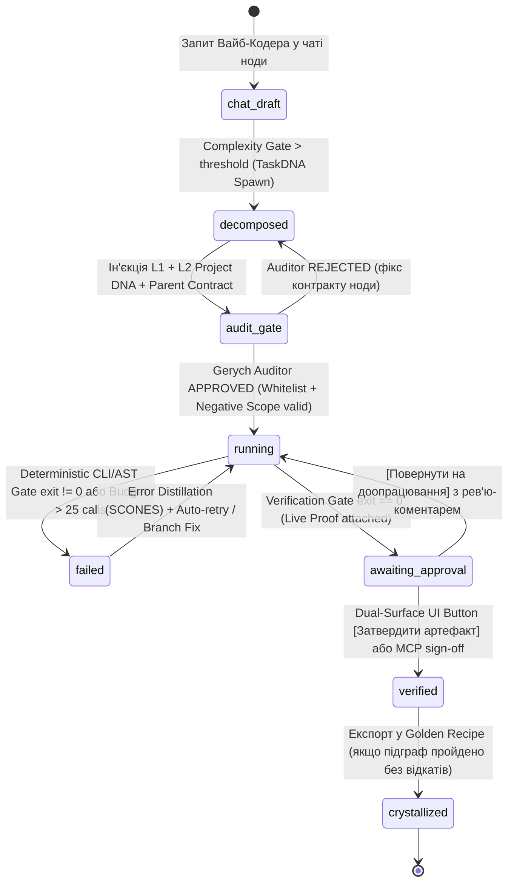

> [!metadata]- ⚙️ Системні метадані та інваріанти (MRH Header)
> ```yaml
> # --- DNK-MRH-HEADER ---
> mrh_id: "docs/architecture/reports/GERYCH_ROOT_VIBE_CODER_ARCHITECTURE_AND_SOTA_SYNTHESIS.md"
> purpose: "Canonical TypeScript interfaces mirroring Python Pydantic v2 contracts for DNK Canvas UI."
> canonical_source: true
> alters_files: []
> triggers_tasks: []
> status: "Active"
> version: "2.0.0"
> updated_at: "2026-11-18"
> author: "DNK-e.com Maksym & Antigravity"
> # --- END DNK-MRH-HEADER ---
> ```

<!-- --- DNK-MRH-HEADER ---
mrh_id: "docs/architecture/reports/GERYCH_ROOT_VIBE_CODER_ARCHITECTURE_AND_SOTA_SYNTHESIS.md"
purpose: "SOTA Audit, Internal Asset Inventory & Canonical Architecture Specification for DNK Core v1 Vibe-Coder Model."
archetype: "SOTA_AUDIT"
canonical_source: true
alters_files: []
triggers_tasks: []
status: "Active"
version: "1.0.0"
updated_at: "2026-11-16"
author: "DNK-e.com Maksym & Gerych-Root (Cold Archivist & System Auditor)"
--- END DNK-MRH-HEADER --- -->

# 🏛️ GERYCH-ROOT SOTA SYNTHESIS: Архітектурна Модель DNK Core v1 для Vibe-Кодера

## 0. Суть Дослідження та Порівняльний Аналіз Світового Досвіду (Executive Summary & SOTA Comparative Matrix)

Концепція Максима поєднує чотири критичні площини, які більшість сучасних AI-середовищ реалізують лише фрагментарно:
1. **Суверенний Акаунт Вайб-Кодера (L1 Account)**: In-RAM FastMCP, APFS Worktrees, SCONES L1, штатна команда агентів та бібліотека Golden Recipes.
2. **Ізольований Бізнес-Проєкт (L2 Project DNA)**: одноразове заповнення дизайн-системи, ICP, Tone of Voice та бізнес-правил із детермінованим успадкуванням у 3 функціональних треках (R&D, Маркетинг/Продажі, Аудит донорів).
3. **Просторове Дерево Задач (L3 ThoughtDAG + Agent-Native Dual-Surface Actions)**: перехід від лінійного чату до дерева підзадач на полотні, де кожна дія доступна одночасно як FastMCP tool для агента і як реактивний UI-контрол для людини.
4. **Конвеєр «Система всередині системи» та Капіталізація**: розробка базового ядра продукту (`DNK_Horizon_Tinker` / Sovereign Bricks) окремо від тиражованих клієнтських інстансів і збереження вдалих графів як параметризованих Golden Recipes.

### Порівняльна Матриця SOTA-Рішень (8 Світових Еталонів vs DNK Core v1)

| Система / Фреймворк | Ізоляція та успадкування контексту | Dual-Surface Actions (LLM Tool ↔ UI) | Chat-to-DAG Tree Spawning | Конвеєр «Система всередині системи» | Що беремо в DNK Core v1 (і що відкидаємо) |
| :--- | :--- | :--- | :--- | :--- | :--- |
| **BuilderIO/agent-native** | `AGENTS.md` + Per-app `db` + Context X-Ray; але слабкий міжпроєктний L2 DNA | **Еталон (Track 2 Clean-Room)**: єдині Action-примітиви, Visual Canvas Apps, Approval Workflows (`Turn into App`) | Лінійні visual plans (`references/visual-plans.md`), без повноцінного графа нод | Workspace templates, але без жорсткого розділення Kernel vs Client Deploy | **Беремо**: контракт `DualSurfaceActionSpec`, UI-кнопки підтвердження, Visual Plan. **Відкидаємо**: прив'язку до хмарного SaaS-хостингу. |
| **chenxiachan/thoughtdag** | **Context Wires** — ребра графа буквально визначають видимий контекст (`full` або `quote`) | Мінімальні UI-контроли ноди (edit/branch), без MCP-контракту для бекенд-інструментів | **Еталон (Track 1 MIT)**: чат розгалужується у редаговане дерево нод на нескінченному полотні | Відсутній (чистий когнітивний canvas для промптів) | **Беремо**: `ContextWire`, семантику гілкування чату у вузли, селективну подачу контексту. **Відкидаємо**: передачу сирого chat history через дроти (DEC-110). |
| **LangGraph (LangChain)** | `StateGraph` + `Checkpointer` (SQLite/Postgres) + `Store` (cross-thread namespace) | Через AG-UI / CopilotKit або кастомний SSE bridge; не нативно dual-surface | Статичні/динамічні `Send()` subgraphs, але граф програмується в коді, не в UI-полотні | Multi-tenant assistant graphs (LangGraph Platform) | **Беремо**: typed state reduction та checkpoint-відкат нод. **Відкидаємо**: важкий runtime-граф, написаний вручну замість JSON Canvas 1.0. |
| **Microsoft AutoGen (v0.4)** | `AgentRuntime` + `TopicId` / `AgentId` pub-sub; слабка ізоляція бізнес-ДНК | Відсутня нативна UI-поверхня (потрібен AutoGen Studio окремо) | Динамічний Magentic-One / GroupChat-маршрутизатор, але текстовий без полотна | Відсутній; фокус на агентних ролях, а не на продуктовій капіталізації | **Беремо**: патерн контракту між агентом-планувальником і верифікатором (`Auditor`). **Відкидаємо**: неконтрольовані групові балачки (GroupChat token burn). |
| **Meta (Agentic Engineering / Internal IDE)** | Багаторівневі репозиторні інструкції + Monorepo Buck2 scope boundaries | Диф-рев'ю UI (Phabricator/Sapling) прив'язаний до детермінованих CLI-лінтерів | Внутрішні DAG-пайплайни збірки та тестів; задачі розбиваються в трекері, не в чаті | Жорстке розділення Platform Infra vs Product Verticals через Bazel/Buck targets | **Беремо**: детермінований Pre-Commit / AST gate як обов'язковий перехід стану ноди. |
| **Cognition Devin** | Ізольована VM-сесія + Interactive Knowledge (аналог L2 Project DNA з тригерами) | Planner + Shell + Browser + Editor панелі з єдиним станом сесії | Лінійний Interactive Plan з чекбоксами, без вільного багатовузлового полотна | Playbooks (повторювані макро-рецепти для однотипних задач) | **Беремо**: концепцію *Knowledge Triggers* (автоін'єкція L2 DNA за умовою) та *Playbooks* → Golden Recipes. |
| **Cursor (Rules + Worktrees + Subagents)** | `.cursor/rules/*.mdc` (always / glob / agent-requested) + `.worktrees/` | Inline Diff Accept/Reject + Terminal Command Approval + MCP Tools | Фоновий роутинг субагентів у паралельні worktrees (без візуального DAG) | Team Rules + Project Rules, але без бізнес-треків (Маркетинг/Аудит) | **Беремо**: `.mdc`-подібний механізм умовного завантаження правил (`glob`/`trigger`) та APFS worktrees. |
| **Shopify CLI + Theme Architecture** | `settings_schema.json` + `config/settings_data.json` + Locale JSON | Theme Editor (`schema` JSON у Liquid) ↔ Storefront DOM (`web-components`) | Theme Blocks 2.0 (`@theme`, `Accepts`/`Holds` дерево блоків до 8 рівнів вкладеності) | **Еталон для комерції**: Base Theme Repo (OS 2.0) ➔ Merchant Store `shopify theme push` + Presets | **Беремо**: сувору схему `blocks/*.liquid`, `visible_if`, ліміти `< 512 KB`, розподіл Base Core vs Merchant Preset. |

---

## 1. Глибокий Аналіз 4 Стовпів Світового Досвіду (Deep-Dive Architectural Analysis)

### 1.1. Ізоляція та успадкування контексту: `L1 Account -> L2 Project DNA -> L3 Subtask Tree`
Провідні команди (Cursor `.mdc`, Cognition Devin Knowledge, LangGraph Cross-Thread Store, BuilderIO `AGENTS.md`) зійшлися на тому, що **суцільний системний промпт не масштабується**. Якщо вливати всі знання про акаунт, бренд і сусідні задачі в один контекст, виникає *Context Rot* та деградація уваги після 20–40k токенів (зафіксовано у `AGENTS.md` ADR-006).

У SOTA-системах ця проблема вирішується **детермінованою компіляцією контексту на вході в кожну ноду** (`compile_context_envelope`):
1. **L1 Account Layer (Global Immutable Core + Sacred Prompt Cache ≤ 6,000 токенів)**: системні інваріанти (`AGENTS.md`), правила безпеки, Tone of Voice фаундера, патерни роботи команди (Стратег, Архітектор, Denchik, Gerych) та глобальні навички. Завантажується як *cacheable prefix*.
2. **L2 Project DNA Layer (Structured Tenant Contract)**: одноразово зафіксований профіль бізнес-проєкту: дизайн-токени (кольори, типографіка, spacing), ICP (Ideal Customer Profile), доменні обмеження (наприклад, *Theme Blocks 2.0, zero jQuery, Liquid AST clean*), та перелік Workstreams (Треків). Замість переказу в чаті ін'єктується як стислий JSON/YAML маніфест (~800–1,500 токенів) плюс умовні тригери (як у Cursor `globs` або Devin Knowledge).
3. **L3 Subtask Node Layer (Artifact-Only Wire Inheritance)**: за стандартом **DEC-110** та `thoughtdag`, по ребру (`ContextWire`) передається **НЕ сира історія чату батьківської ноди**, а лише її **кристалізований контракт** (`crystallized_output`, `artifact_refs`, `acceptance_criteria`) або цільова проєкція `{{output.field}}`. Кожна нода має ізольовану сесію `node:{canvas_id}:{node_id}`.

### 1.2. Dual-Surface Actions (Спільна схема для LLM Tool та React UI Action)
Ключова ідея `BuilderIO/agent-native` — **паритет інтерфейсів (Action Parity)**: будь-яка операція, яку може викликати агент через MCP/Tool Call, має існувати як інтерактивний елемент в UI для людини (і навпаки), використовуючи **єдиний контракт схеми входу/виходу, авторизації та аудиту**.
- У класичних чат-ботах агент повертає текст: *"Я підготував файл, запустіть тести"*.
- У **Dual-Surface моделі** декларація однієї дії `DualSurfaceActionSpec` автоматично генерує:
  1. **Agent Surface (FastMCP)**: JSON Schema для виклику з Code Mode / Hermes (`dnk_shopify__run_theme_check`, `dnk_canvas__approve_artifact`).
  2. **Human UI Surface (React / Canvas Node Widget)**: інтерактивну кнопку або форму всередині картки ноди (`[▶ Запустити Theme Check]`, `[🛡 Затвердити артефакт]`, `[🌿 Розгалужити підзадачу]`) з прив'язкою до стану `approval_required` / `running` / `verified`.
  3. **Unified Audit Receipt**: незалежно від того, хто натиснув дію — людина кліком у React-полотні чи агент викликом FastMCP — обидва шляхи проходять через `AgentActionBus` (`core/action_bus/bus.py`) і записують однаковий криптографічний чек у SQLite WAL (`dnk_dag_store.db`).

### 1.3. Автоматична декомпозиція з чату у дерево нод (Chat-to-DAG Tree Spawning)
Лінійний чат руйнується у трьох точках: паралельні залежності (фронт + бек + копірайтинг), потреба перезапустити лише одну гілку без втрати решти контексту, та human-in-the-loop затвердження проміжних артефактів.
Світовий патерн **Chat-to-DAG Tree Spawning** (синтез `thoughtdag` + `BuilderIO visual-plans` + `pmx-canvas`):
1. **Chat Intake & Complexity Gate**: користувач формулює запит у чаті кореневої ноди (або в `AgentCopilotDock`). Якщо оцінка складності перевищує поріг (`files > 2` або `tracks > 1` або `requires_verification = true`), Оркестратор не виконує монолітний прохід, а переходить у режим **Plan Spawner** (`TaskDNA`).
2. **Materialization on Canvas**: план матеріалізується на `.canvas` як піддерево нод зі зв'язками `subtask_of` / `depends_on` (`ContextWire`). Кожна дочірня нода отримує власний `budget` (`≤ 25 tool calls` згідно з MASE), призначеного агента-спеціаліста (`dnk_shopify`, `dnk_dev_fullstack`, `gerych_auditor`), `target_file_whitelist` та `negative_scope`.
3. **Parallel Wave Execution & Convergence Gate**: незалежні гілки виконуються паралельно в ізольованих APFS `git worktrees` (`< 80 ms`), а вузол-агрегатор (Convergence / Merge Node) чекає детермінованого `exit_code == 0` усіх вхідних дротів перед зняттям блокування.

### 1.4. Конвеєр «Система всередині системи» (Core Product vs Client Deployment)
На кейсі `Shopify Theme DNK-Ecom` це критичне розмежування (як у **Shopify Theme Store + Dawn/Horizon** та **Meta Platform/Product**):
- **Внутрішня система (Product Foundry / Core Engine)**: створення еталонної теми `DNK_Horizon_Tinker` (`services/dnk_shopify/DNK_Horizon_Tinker/`), де кожна секція та `blocks/*.liquid` проходять AST-лінтинг, `shopify theme check`, перевірку `visible_if ≤ 250 символів`, бюджет `< 512 KB` на JSON-шаблон та CRO-бенчмарки. Код чистий від специфіки конкретного клієнта (тільки токени та схеми).
- **Зовнішня система (Deployment & Client Adaptation Pipeline)**: коли створюється новий магазин чи проєкт, система **не форкає ядро хаотично**, а застосовує **Golden Recipe + новий L2 Project DNA**: підставляє палітру, шрифти, ICP, локалізацію та набір секцій у `config/settings_data.json` і `templates/*.json`, проганяє `scripts/export_standalone_app.py` / `shopify theme package` і деплоїть на dev/production store без забруднення ядра теми.

---

## 2. Аудит Внутрішніх Активів DNK OS (Knowledge Base, Skills & Repositories)

Під час інвентаризації робочого простору підтверджено такий реальний стан активів (перевірено на диску):

| Площина активів | Перевірений обсяг та ключові артефакти | Що вже готово для моделі Вайб-Кодера | Виявлені розриви (Gaps) |
| :--- | :--- | :--- | :--- |
| **Документація (`docs/`)** | **4 069 файлів**. Ключові: `docs/architecture/DECISION_REGISTRY_ADHD.md` (DEC-063..DEC-112), `docs/architecture/reports/GERYCH_ROOT_ORCHESTRATOR_AND_TEAM_ARCHITECTURE_BLUEPRINT.md`, `AGENT_NATIVE_AND_AG_UI_ANALYSIS.md`, `GERYCH_SPATIAL_CANVAS_ORCHESTRATION_RESEARCH.md`, `DNK-STUDIO-ARCH-001-node-contract-v1.yaml` | Зафіксовано 3-рівневу ієрархію, Narrow-Waist Microkernel, Dual-State Spatial Canvas, Mandatory Dissent та Sovereign Brick Contract | Досі відсутня єдина консолідована специфікація `AccountSpec -> ProjectDNA -> TrackSpec -> SubtaskNodeSpec -> DualSurfaceActionSpec` із прямим мапінгом на UI-віджети та Golden Recipes |
| **Ядро (`core/`, 672 `.py` файли)** | `core/kernel.py`, `core/domain/identity_models.py` (`UserProfile`, `BrandDNA`, `ProjectWorkspace`), `core/domain/dag_models.py` (`ThoughtNode`, `Wire`, `ThoughtDAGGraph`, `compile_thoughtdag_context`), `core/domain/agent_mesh_models.py` (`ApprovalChainSpec`), `core/canvas/session_router.py`, `core/canvas/approval.py`, `core/memory/` (17 файлів SCONES WAL + BM25), `core/bricks/brick_01..brick_06`, `core/sdk/dnk.py` | Існує `BrandDNA` та `ProjectWorkspace` в `identity_models.py`, `compile_thoughtdag_context` в `dag_models.py`, `session_router.py` з ізоляцією `node:{canvas}:{node}` | 1) Відсутні класи `TrackSpec` (3 треки проєкту) та `DualSurfaceActionSpec` (єдиний реєстр для FastMCP + React UI); 2) `ThoughtNode` не має жорсткого поля `verification_gate` та `crystallized_recipe_ref`; 3) `BrandDNA` слабко інтегрований у 3-рівневу SCONES-пам'ять як L2 auto-inherited context |
| **Frontend Полотно (`apps/canvas/` + `docs/canvas/`)** | React + `@xyflow/react` + Zustand (`apps/canvas/src/store/canvasStore.ts`), `AgentTaskNode.tsx`, `ArtifactNode.tsx`, `AgentCopilotDock.tsx`, `ComponentSandbox.tsx`, 7 `.canvas` файлів (`shopify_vibe_pipeline.canvas`, `canvas_shopify_horizon.canvas`, `dnk_brain.canvas` тощо) | Є візуальна картка `AgentTaskNode` зі стадіями `RESEARCH_RAW -> AUDIT_GATE -> FOUNDER_APPROVAL -> LIBRARIAN_INGEST -> COMPLETED` та `auditorReview` | `AgentTaskNode` має захардкоджені кнопки (наступна стадія, перемикач статусу, запуск аудитора), а не динамічний рендеринг декларативних `DualSurfaceActionSpec`; відсутня візуалізація шарів L1/L2 DNA та 3 треків проєкту |
| **Навички (`core/skills/` / `~/.hermes/skills/`)** | Понад 120 скілів, зокрема `agent_native_assimilated` (з `references/visual-plans.md`, `references/context-xray.md`, `references/turn-into-app.md`, `references/an.md`), `thoughtdag_assimilated`, `pmx_canvas_assimilated` (`json-render-mcp.md`, `control-session-orchestrator.md`), `shopify_theme_builder_assimilated`, `shopify_theme_handbook_assimilated`, `shopify_cro_blocks` | Засвоєно рецепти Context Wires, Visual Plans, AG-UI/JSON Render, Theme Blocks 2.0, 34-пунктового аудиту тем | Частина скілів є мета-індексами без прямого прив'язування до `Sanctioned Tools & MCP Whitelist` усередині `SubtaskNodeSpec` (JIT-ін'єкція на крок 0) |
| **Пісочниця `../DNK_Vibe/` (20 проєктів)** | `DAG-chat`, `swarmchat`, `astryx`, `shopify-theme-customization-service`, `donor_superdev`, `nashi-app`, `tandem`, `mac-station`, `Agents Room`, `dnk-mixar-gcp-gateway` та ін. | `DAG-chat` (SQL графа розмов), `swarmchat` (промпти owner/team/tester-loop/worker), `shopify-theme-customization-service` (сервісні пакети кастомізації тем для комерції) | Інструменти лежать ізольовано в R&D-пісочниці; їхні патерни (`tester-loop`, `DAG-chat` схема) мають працювати через Brick-контракти, а не пряме копіювання |
| **Комерційна фабрика `../DNKEcom/` + `services/dnk_shopify/`** | `services/dnk_shopify/DNK_Horizon_Tinker/` (реальне ядро теми `DNK Ecom`), `dnk_apex_theme/`, `../DNKEcom/DNK-Ecom_git_mirrow/` (теми `tinker`, `sugar`, `ascendify`, `ella`, `casaio`, `story`, `staging`), `../DNKEcom/Audit_Shopify_Themes_Sell_WF/` (`DNK_AGENTIC_AGENCY_MASTER_FRAMEWORK.md` + 7 аудитів екосистем), `../DNKEcom/GitHub_Shopify_Themes/` (14+ аудитів донорів), `../DNKEcom/GitHub_Shopify_Apps/the-ultimate-cro-app/` | **Майже повна готова база для пілота 'Shopify Theme DNK-Ecom'**: існує базове ядро `DNK_Horizon_Tinker`, еталонний 5-фазний конвеєр аудиту тем, 34 правила перевірки, бібліотеки донорів (`sugar`, `story`, `tinker`) та CRO App | Потрібно звести всі 3 треки (`DNK_Horizon_Tinker` R&D, `shopify-theme-customization-service` / `DNK-e.com` маркетинг-воронка, та `Audit_Shopify_Themes_Sell_WF` аудити донорів) під один **L2 Project DNA** та об'єднати в єдиний шаблон полотна |

---

## 3. Технічна Архітектура та Канонічні Схеми Даних (Pydantic v2 + TypeScript)

### 3.1. Рівневий Контракт Спадкування Контексту (`L1 -> L2 -> L3`)

Архітектурно модель будується як **строгий спрямований потік контрактів** (без передачі неструктурованого шуму вниз по дереву):

```
[L1: AccountSpec]
   ├── sacred_invariants (AGENTS.md, MRH, relative paths)
   ├── sovereign_team (Strategist, Architect, Denchik, Gerych)
   ├── global_services (FastMCP In-RAM, APFS Worktree Pool, SCONES WAL)
   └── golden_recipes_library (Parametrized Canvas Templates)
          │
          ▼  (inherit: read-only cache prefix <= 6,000 tokens)
[L2: ProjectDNA]  ── e.g., "Shopify Theme DNK-Ecom"
   ├── design_system (palette, typography, tokens, breakpoints)
   ├── icp_and_voice (target buyer, tone_of_voice, UVP)
   ├── domain_guardrails (Theme Blocks 2.0, <512KB JSON, theme-check clean)
   └── tracks[1..3]: TrackSpec
          ├── Track 1: R&D / Core Product (DNK_Horizon_Tinker)
          ├── Track 2: Marketing & Sales Funnels (Landing, PDP, Lead Magnets)
          └── Track 3: Donor Audits & Benchmarks (Sugar, Story, Casaio, Shrine)
                 │
                 ▼  (inject: L1 + compact L2 DNA + Parent Crystallized Contract)
[L3: SubtaskNodeSpec]  (node:{canvas_id}:{node_id})
   ├── isolated_chat_thread (SQLite WAL, never leaked across edges)
   ├── dual_surface_actions[] (FastMCP tool <-> React Node UI Button)
   ├── verification_gate (deterministic CLI/AST/HTTP exit_code == 0)
   └── crystallized_output ──(ContextWire)──► Child Subtask / Golden Recipe
```

### 3.2. Повні Pydantic v2 Схеми (`core/domain/vibe_core_contracts.py` — Target Spec)

```python
# --- DNK-MRH-HEADER ---
# mrh_id: "core/domain/vibe_core_contracts.py"
# purpose: "Canonical Pydantic v2 contracts for DNK Core v1 Vibe-Coder Model (Account, ProjectDNA, Track, SubtaskNode, DualSurfaceAction)."
# canonical_source: true
# status: "Proposed"
# version: "1.0.0"
# --- END DNK-MRH-HEADER ---

from __future__ import annotations

from datetime import datetime, timezone
from enum import Enum
from typing import Any, Dict, List, Literal, Optional
from pydantic import BaseModel, Field, field_validator


class AgentRole(str, Enum):
    STRATEGIST = "strategist"
    ARCHITECT = "architect"
    BUILDER_DENCHIK = "denchik"
    AUDITOR_GERYСH = "gerych"
    DOMAIN_SHOPIFY = "dnk_shopify"
    DOMAIN_MEDIA = "dnk_media"
    DOMAIN_DISTRIBUTION = "dnk_distribution"


class TrackKind(str, Enum):
    CORE_RND = "core_rnd"               # Track 1: Product Foundry
    MARKETING_SALES = "marketing_sales" # Track 2: Funnels, PDP, Lead Magnets
    DONOR_AUDIT = "donor_audit"         # Track 3: Reverse-Engineering & Benchmarks


class NodeLifecycleState(str, Enum):
    CHAT_DRAFT = "chat_draft"
    DECOMPOSED = "decomposed"
    AUDIT_GATE = "audit_gate"
    RUNNING = "running"
    AWAITING_APPROVAL = "awaiting_approval"
    VERIFIED = "verified"
    FAILED = "failed"
    CRYSTALLIZED = "crystallized"


class ActionSurfaceMode(str, Enum):
    DUAL = "dual"           # Exposed both to LLM FastMCP & React UI
    AGENT_ONLY = "agent"    # Internal automated step
    HUMAN_ONLY = "human"    # Final founder sign-off / destructive action


class DualSurfaceActionSpec(BaseModel):
    """Unified Action Contract (BuilderIO/agent-native parity for FastMCP + React UI)."""
    action_id: str = Field(..., pattern=r"^[a-z0-9_]+\.[a-z0-9_]+$", description="e.g. 'shopify.run_theme_check'")
    label_uk: str = Field(..., description="UI button label in Ukrainian for Vibe-Coder")
    description_en: str = Field(..., description="Semantic description for LLM tool selection")
    surface_mode: ActionSurfaceMode = Field(default=ActionSurfaceMode.DUAL)
    mcp_brick: str = Field(..., description="Target FastMCP brick or kernel endpoint")
    mcp_tool_name: str = Field(..., description="Exact FastMCP tool name")
    input_json_schema: Dict[str, Any] = Field(default_factory=dict, description="Shared JSON Schema for tool & UI form")
    ui_widget: Literal["button", "approve_reject", "diff_viewer", "checklist", "form_drawer"] = "button"
    ui_tone: Literal["primary", "secondary", "danger", "approve"] = "secondary"
    requires_human_confirmation: bool = Field(default=False)
    idempotent: bool = Field(default=True)
    allowed_states: List[NodeLifecycleState] = Field(
        default_factory=lambda: [NodeLifecycleState.DECOMPOSED, NodeLifecycleState.AWAITING_APPROVAL]
    )


class AccountServiceBinding(BaseModel):
    service_id: str
    mount_mode: Literal["in_ram_fastmcp", "apfs_worktree_pool", "sqlite_wal_bus"]
    endpoint_or_module: str
    healthcheck_cmd: str


class GoldenRecipeRef(BaseModel):
    recipe_id: str
    title: str
    version: str = "1.0.0"
    source_project_id: str
    required_dna_fields: List[str] = Field(default_factory=list)
    canvas_template_path: str = Field(..., description="Relative path e.g. ./templates/recipes/shopify_launch.canvas")
    verified_runs_count: int = Field(default=0, ge=0)


class AccountSpec(BaseModel):
    """L1 Account Level: Sovereign Vibe-Coder Workstation & Global Memory."""
    account_id: str = Field(..., description="e.g. 'acct-dnk-maxim'")
    owner_name: str
    comms_language: Literal["uk"] = "uk"
    code_language: Literal["en"] = "en"
    tone_of_voice: str = Field(..., description="Global founder communication & UX voice principles")
    system_invariants: List[str] = Field(default_factory=list, description="L1 SCONES immutable rules (relative paths, MRH, etc.)")
    system_services: List[AccountServiceBinding] = Field(default_factory=list)
    sovereign_team: List[AgentRole] = Field(
        default_factory=lambda: [
            AgentRole.STRATEGIST,
            AgentRole.ARCHITECT,
            AgentRole.BUILDER_DENCHIK,
            AgentRole.AUDITOR_GERYСH,
        ]
    )
    sanctioned_skill_catalog: List[str] = Field(default_factory=list)
    golden_recipes: List[GoldenRecipeRef] = Field(default_factory=list)
    sacred_prompt_budget_tokens: int = Field(default=6000, le=6000)


class DesignSystemTokens(BaseModel):
    primary_colors: Dict[str, str] = Field(default_factory=dict, description="Hex tokens e.g. {'bg': '#0B0F17', 'accent': '#10B981'}")
    typography: Dict[str, str] = Field(default_factory=dict, description="Heading/body font families and scale")
    spacing_unit_px: int = Field(default=4, ge=1)
    border_radius_px: int = Field(default=8, ge=0)
    component_rules: List[str] = Field(default_factory=list)


class ICPProfile(BaseModel):
    segment_name: str
    pain_points: List[str] = Field(min_length=1)
    value_proposition: str
    brand_voice_rules: List[str] = Field(default_factory=list)
    forbidden_cliches: List[str] = Field(default_factory=list)


class TrackSpec(BaseModel):
    """Functional Workstream inside a Business Project (1..N)."""
    track_id: str
    project_id: str
    kind: TrackKind
    title: str
    mission: str
    assigned_workhorse: Literal["dnk_shopify", "dnk_media", "dnk_distribution", "core"]
    repo_root_rel: str = Field(..., description="Strictly relative path e.g. ./services/dnk_shopify/DNK_Horizon_Tinker")
    root_canvas_path: str
    default_actions: List[DualSurfaceActionSpec] = Field(default_factory=list)
    deterministic_gates: List[str] = Field(default_factory=list, description="CLI commands that must return exit 0")


class ProjectDNA(BaseModel):
    """L2 Business Project Memory: Filled ONCE, auto-inherited by all Tracks & Nodes."""
    project_id: str = Field(..., pattern=r"^proj-[a-z0-9-]+$")
    account_id: str
    project_name: str
    domain_type: Literal["shopify_theme", "saas_app", "agency_pipeline", "media_product"]
    design_system: DesignSystemTokens
    icp: ICPProfile
    business_rules: List[str] = Field(default_factory=list)
    technical_constraints: List[str] = Field(default_factory=list)
    tracks: List[TrackSpec] = Field(..., min_length=1)
    system_inside_system_mode: bool = Field(
        default=True,
        description="Separates Base Core Foundry from Client Deployment Presets"
    )
    dna_version: str = "1.0.0"
    updated_at: str = Field(default_factory=lambda: datetime.now(timezone.utc).isoformat())

    @field_validator("tracks")
    @classmethod
    def ensure_unique_track_ids(cls, tracks: List[TrackSpec]) -> List[TrackSpec]:
        ids = [t.track_id for t in tracks]
        if len(ids) != len(set(ids)):
            raise ValueError("Duplicate track_id detected in ProjectDNA")
        return tracks


class VerificationCriteria(BaseModel):
    command: str = Field(..., description="Deterministic verification command e.g. 'shopify theme check --fail-level error'")
    expected_exit_code: int = 0
    required_artifacts: List[str] = Field(default_factory=list)
    anti_mock_live_check: Optional[str] = Field(default=None, description="Live HTTP/DOM/FastMCP assertion")


class SubtaskNodeSpec(BaseModel):
    """L3 Task/Subtask Node on ThoughtDAG Canvas with Dual-Surface Actions."""
    node_id: str
    canvas_id: str
    project_id: str
    track_id: str
    parent_node_id: Optional[str] = None
    session_id: str = Field(..., description="Isolated SQLite WAL thread: 'node:{canvas_id}:{node_id}'")
    title: str
    goal: str
    assigned_agent: AgentRole
    state: NodeLifecycleState = NodeLifecycleState.CHAT_DRAFT

    # Anti-degradation & Zero-Waste MASE boundaries
    target_file_whitelist: List[str] = Field(default_factory=list)
    negative_scope: List[str] = Field(default_factory=list)
    sanctioned_skills: List[str] = Field(default_factory=list, max_length=5)
    max_tool_calls: int = Field(default=25, ge=1, le=25)
    worktree_branch: Optional[str] = None

    # Context Wire Inheritance (Artifacts only, zero raw parent chat logs)
    inherited_parent_contract: Dict[str, Any] = Field(default_factory=dict)
    actions: List[DualSurfaceActionSpec] = Field(default_factory=list)
    verification: VerificationCriteria

    # Crystallization output
    crystallized_output: Optional[Dict[str, Any]] = None
    receipt_sha256: Optional[str] = None
```

### 3.3. Повні TypeScript Схеми (`apps/canvas/src/types/vibeCore.ts` — Target Spec)

```ts
// --- DNK-MRH-HEADER ---
// mrh_id: "apps/canvas/src/types/vibeCore.ts"
// purpose: "Canonical TypeScript interfaces mirroring Python Pydantic v2 contracts for DNK Canvas UI."
// canonical_source: true
// status: "Proposed"
// version: "1.0.0"
// --- END DNK-MRH-HEADER ---

export type AgentRole =
  | 'strategist'
  | 'architect'
  | 'denchik'
  | 'gerych'
  | 'dnk_shopify'
  | 'dnk_media'
  | 'dnk_distribution';

export type TrackKind = 'core_rnd' | 'marketing_sales' | 'donor_audit';

export type NodeLifecycleState =
  | 'chat_draft'
  | 'decomposed'
  | 'audit_gate'
  | 'running'
  | 'awaiting_approval'
  | 'verified'
  | 'failed'
  | 'crystallized';

export type ActionSurfaceMode = 'dual' | 'agent' | 'human';

export type ActionUIWidget =
  | 'button'
  | 'approve_reject'
  | 'diff_viewer'
  | 'checklist'
  | 'form_drawer';

export interface DualSurfaceActionSpec {
  action_id: string;
  label_uk: string;
  description_en: string;
  surface_mode: ActionSurfaceMode;
  mcp_brick: string;
  mcp_tool_name: string;
  input_json_schema: Record<string, unknown>;
  ui_widget: ActionUIWidget;
  ui_tone: 'primary' | 'secondary' | 'danger' | 'approve';
  requires_human_confirmation: boolean;
  idempotent: boolean;
  allowed_states: NodeLifecycleState[];
}

export interface AccountServiceBinding {
  service_id: string;
  mount_mode: 'in_ram_fastmcp' | 'apfs_worktree_pool' | 'sqlite_wal_bus';
  endpoint_or_module: string;
  healthcheck_cmd: string;
}

export interface GoldenRecipeRef {
  recipe_id: string;
  title: string;
  version: string;
  source_project_id: string;
  required_dna_fields: string[];
  canvas_template_path: string;
  verified_runs_count: number;
}

export interface AccountSpec {
  account_id: string;
  owner_name: string;
  comms_language: 'uk';
  code_language: 'en';
  tone_of_voice: string;
  system_invariants: string[];
  system_services: AccountServiceBinding[];
  sovereign_team: AgentRole[];
  sanctioned_skill_catalog: string[];
  golden_recipes: GoldenRecipeRef[];
  sacred_prompt_budget_tokens: number;
}

export interface DesignSystemTokens {
  primary_colors: Record<string, string>;
  typography: Record<string, string>;
  spacing_unit_px: number;
  border_radius_px: number;
  component_rules: string[];
}

export interface ICPProfile {
  segment_name: string;
  pain_points: string[];
  value_proposition: string;
  brand_voice_rules: string[];
  forbidden_cliches: string[];
}

export interface TrackSpec {
  track_id: string;
  project_id: string;
  kind: TrackKind;
  title: string;
  mission: string;
  assigned_workhorse: 'dnk_shopify' | 'dnk_media' | 'dnk_distribution' | 'core';
  repo_root_rel: string;
  root_canvas_path: string;
  default_actions: DualSurfaceActionSpec[];
  deterministic_gates: string[];
}

export interface ProjectDNA {
  project_id: string;
  account_id: string;
  project_name: string;
  domain_type: 'shopify_theme' | 'saas_app' | 'agency_pipeline' | 'media_product';
  design_system: DesignSystemTokens;
  icp: ICPProfile;
  business_rules: string[];
  technical_constraints: string[];
  tracks: TrackSpec[];
  system_inside_system_mode: boolean;
  dna_version: string;
  updated_at: string;
}

export interface VerificationCriteria {
  command: string;
  expected_exit_code: number;
  required_artifacts: string[];
  anti_mock_live_check?: string;
}

export interface SubtaskNodeSpec {
  node_id: string;
  canvas_id: string;
  project_id: string;
  track_id: string;
  parent_node_id?: string;
  session_id: string;
  title: string;
  goal: string;
  assigned_agent: AgentRole;
  state: NodeLifecycleState;
  target_file_whitelist: string[];
  negative_scope: string[];
  sanctioned_skills: string[];
  max_tool_calls: number;
  worktree_branch?: string;
  inherited_parent_contract: Record<string, unknown>;
  actions: DualSurfaceActionSpec[];
  verification: VerificationCriteria;
  crystallized_output?: Record<string, unknown>;
  receipt_sha256?: string;
}
```

### 3.4. Життєвий Цикл Ноди та Механіка Взаємодії (Chat ➔ Tree ➔ Gate ➔ Golden Recipe)



**Правила Context Wire (Запобігання роздуттю контексту):**
1. При створенні дочірньої ноди `B` від `A`, `session_router.py` формує `ContextEnvelope = { L1_cache_ref, L2_project_dna_compact, A.crystallized_output }` — жорстка стеля `<= 8,000` токенів на старті.
2. Повний чат-лог ноди `A` залишається в `dnk_dag_store.db` під ключем `node:{canvas_id}:{A.node_id}` і **ніколи** не копіюється у `B`.
3. Будь-яка дія на картці ноди в `apps/canvas` викликає `/api/v1/actions/dispatch` з `DualSurfaceActionSpec.action_id`, який транслюється в той самий FastMCP handler, що й агентський виклик.

---

## 4. План Пілотного Проєкту: «Shopify Theme DNK-Ecom» (3 Треки на Полотні)

Пілотний проєкт `proj-shopify-theme-dnk-ecom` об'єднує вже наявні компоненти в єдиний керований граф у `docs/canvas/shopify_dnk_ecom_master.canvas` без дублювання даних.

### 4.1. Єдина Пам'ять Проєкту (`L2 ProjectDNA` — заповнюється 1 раз)
- **Ядро продукту (`system_inside_system_mode = true`)**: базова тема `./services/dnk_shopify/DNK_Horizon_Tinker/` (Theme Blocks 2.0, `Accepts`/`Holds`, Vanilla Web Components + Liquid).
- **Design System Tokens**: адаптивна типографіка (`clamp()`), мінімалістичні CSS variables без сторонніх фреймворків, dark/light scheme presets (`settings_schema.json`).
- **ICP & Tone of Voice**: Shopify Plus та D2C мерчанти з чеком від $20k/міс, які втомлені від повільних перевантажених тем і шукають швидкий CRO-орієнтований магазин без десятків платних додатків.
- **Technical Constraints (усі ноди успадковують автоматично)**:
  1. `shopify theme check` — 0 errors;
  2. кожен JSON-шаблон `< 512 KB` (попередження при `> 300 KB`);
  3. `visible_if` у схемах `≤ 250` символів, без операторів `>` / `<`;
  4. жодного jQuery, жодних watchdog-пінгів чи захардкоджених URL донорів.

### 4.2. Розкладка 3 Функціональних Треків на Полотні

| Трек на полотні | Призначений Воркхорс / Агент | Стартові Ноди-Задачі (Subtask Tree) | Dual-Surface Actions (UI Кнопки ↔ FastMCP) | Детерміновані Критерії Приймання |
| :--- | :--- | :--- | :--- | :--- |
| **Трек 1: R&D / Розробка теми DNK-Ecom** | `dnk_shopify` + `denchik` (у worktree) | `1.1` Приведення секцій PDP та Cart Drawer (`tinker-dnk-*`) до Theme Blocks 2.0;<br>`1.2` Liquid AST санітизація та оптимізація `critical.css`;<br>`1.3` Експорт базової теми vs клієнтський Preset Generator (`System-inside-System`) | `[🔍 Theme Check AST]` (`shopify.run_theme_check`)<br>`[📦 Зібрати Preview ZIP]` (`shopify.package_theme`)<br>`[🌿 Створити підзадачу фіксу]` (`canvas.spawn_subtask`) | `shopify theme check --fail-level error` exit `0`; Lighthouse Mobile LCP `< 2.5s`, CLS `< 0.05` |
| **Трек 2: Маркетинг та продаж теми DNK-Ecom** | `dnk_distribution` + `strategist` + `dnk_media` | `2.1` Позиціонування та Landing Page на базі `../DNK_Vibe/shopify-theme-customization-service`;<br>`2.2` Інтерактивний CRO-порівняльник (DNK-Ecom vs типові теми);<br>`2.3` Лід-магніт («34-пунктовий чеклист аудиту Shopify теми» + відео-демо) | `[✍ Перевірити Tone of Voice]` (`distribution.audit_copy`)<br>`[🎬 Згенерувати демо-кліп]` (`media.render_preview`)<br>`[🛡 Затвердити копірайт]` (`canvas.approve_artifact`) | Проходження анти-сліпотного чеку (`forbidden_cliches == 0`), робоча live-форма лід-магніту (HTTP 200) |
| **Трек 3: Аудит існуючих світових рішень** | `gerych` (Auditor) + `dnk_shopify` | `3.1` Деконструкція донорів у `../DNKEcom/DNK-Ecom_git_mirrow/` (`tinker`, `sugar`, `story`, `casaio`, `ascendify`);<br>`3.2` Формування CRO-бенчмарків (Sticky ATC, Swatches, B2B Qty, Cart Upsell);<br>`3.3` Санітизований Vault патернів для Треку 1 | `[🧪 Деконструювати донора]` (`shopify.audit_donor_theme`)<br>`[📊 Оновити матрицю патернів]` (`scones.upsert_benchmark`)<br>`[🔗 Передати патерн у Трек 1]` (`canvas.wire_to_track`) | Наявність `AUDIT_<theme>.md` за `markdown_schema_gate.py` (exit `0`), нуль скопійованого GPL/пропрієтарного коду |

### 4.3. Капіталізація у Golden Recipe (1-Click New Business Launch)
Після успішного проходження пілота `Shopify Theme DNK-Ecom`:
1. Стан графа (`nodes`, `edges`, `actions`, `verification` без конкретних клієнтських артефактів) експортується у `./templates/recipes/business_launch_3track_v1.canvas`.
2. При старті нового бізнес-проєкту (наприклад, *SaaS App* або *AI Agency*) Максим заповнює лише **L2 ProjectDNA** (1 форма / JSON), обирає `business_launch_3track_v1`, і полотно миттєво розгортає 3 треки з уже підключеними Dual-Surface кнопками та критеріями перевірки.

---

## 5. Дисципліна Скептика: 3 Приховані Ризики та Pre-Mortem Аналіз (Mandatory Dissent & 3 Flaws Rule)

Припустимо, ця система провалилася через 30 днів після впровадження. Ось 3 критичні конструкційні причини, чому концепція Максима може зламатися на практиці:

1. **Ризик №1: «Graph Spaghetti» та параліч декомпозиції (Over-Spawning)**
   - *Механізм відмови*: якщо оркестратор автоматично розгортає навіть прості 2-хвилинні задачі в дерево з 5–8 нод, Вайб-Кодер тоне в кліканні кнопок `awaiting_approval` на полотні. Швидкість вайб-кодингу падає в 4 рази порівняно зі звичайним CLI/чатом.
   - *Контрзахід*: жорсткий **Complexity Gate** — прості однофайлові задачі (`files <= 2`, `estimated_calls <= 8`) виконуються інлайн без створення піддерева нод; `approval_required` ставиться тільки на фінальному артефакті або при зміні публічних контрактів/деплої.

2. **Ризик №2: Розсинхронізація Dual-Surface Action (Schema Drift між Python FastMCP та React UI)**
   - *Механізм відмови*: команда оновлює аргументи інструменту в Python (`core/bricks/`), але забуває оновити TypeScript-типи чи компоненти в `apps/canvas/`. Кнопка в UI падає з `422 Unprocessable Entity` або передає застарілі поля.
   - *Контрзахід*: **Single Source of Truth Generation** — React UI не описує схеми форм вручну, а рендерить віджети динамічно з OpenAPI/FastMCP JSON Schema, які експортуються єдиним скриптом генерації в рамках `scripts/verify_all.sh`.

3. **Ризик №3: Контекстне отруєння через «завмерлий» L2 Project DNA (Stale DNA Drift)**
   - *Механізм відмови*: заповнений "рівно 1 раз" Project DNA через 2 тижні активного R&D застаріває (змінилися кольорові токени, уточнився ICP у маркетингу, з'явилося нове обмеження Shopify), але всі підзадачі продовжують сліпо ін'єктувати старий DNA і генерувати неактуальний код або копірайт.
   - *Контрзахід*: **DNA Version Pinning & Mutation Hook** — кожна зміна дизайн-токенів у `settings_schema.json` або правил у Треку 1/2 підіймає `dna_version` (`1.0.x`) і автоматично позначає відкриті ноди, які базувалися на старій версії, бейджем `DNA_OUTDATED`.

---

## 6. Граничні Умови та 5-Векторний Інженерний Аудит (Boundary Conditions & 5-Vector Critique)

### Де система ламається (Boundary Conditions)
- **Кількість активних нод на одному `.canvas` > 60**: React Flow DOM + Zustand re-renders починають гальмувати, а людина втрачає огляд графа. *Поріг*: при `> 40` нодах обов'язкова архівація завершених підграфів у суб-полотна (`group` / `file` link) або Golden Recipes.
- **Латентність FastMCP при синхронних UI-кнопках**: якщо Dual-Surface кнопка запускає важкий `shopify theme check` або рендер відео (`> 3s`) синхронно, UI блокується. *Поріг*: будь-яка дія тривалістю `> 500ms` зобов'язана повертати `202 Accepted` + `task_id` із подальшим стрімінгом статусу через `AgentActionBus`.
- **Одночасне редагування `.canvas` агентом і людиною**: призводить до перезапису координат нод. *Поріг*: обов'язковий 3-way OCC merge (`core/canvas/graph_occ_merge.py`), який вже закладений у ядрі.

### 5-Векторний Аудит
1. **Boundary Conditions**: без Complexity Gate та ліміту `<= 40` нод на видимий шар полотно перетворюється на візуальний шум.
2. **Scalability (100x load)**: SQLite WAL витримує тисячі ізольованих `node:{canvas}:{node}` сесій за умови `busy_timeout=5000` та ротації старих повідомлень у стислі підсумки; але паралельне виконання `> 4` git worktrees одночасно навантажує I/O та RAM ноутбука (стеля — 4 паралельні воркери).
3. **Maintainability & Tech Debt**: зберігання єдиного реєстру дій у `DualSurfaceActionSpec` зменшує дублювання між фронтендом і бекендом удвічі, за умови заборони захардкоджених кнопок у `AgentTaskNode.tsx`.
4. **Security Attack Vectors**: експозиція UI-кнопок на FastMCP-інструменти підвищує ризик CSRF або випадкового виклику деструктивних дій через Prompt Injection у тексті ноди (наприклад, з чужої теми-донора в Треку 3). *Захист*: `ActionSurfaceMode.HUMAN_ONLY` для деплою/мерджу + жорстка санітизація донорських файлів перед ін'єкцією у контекст ноди (`core/domain/agent_mesh_models.py::SanitizationResult`).
5. **Computational / Memory Efficiency**: тримання L1 у Sacred Prompt Cache (`<= 6k` токенів) та передача по Context Wires лише `crystallized_output` економить 70–85% токенів на багатоступеневих графах порівняно з класичними агентними ланцюжками.

---

## 7. Скептична Альтернатива: Мінімалістична Канонічна Архітектура (Skeptic Alternative & Minimalist Solution)

Якщо відкинути спокусу будувати складний комбайн із нуля, найменший життєздатний шлях (MVP, що запускається за 1–2 тижні без нового технічного боргу) використовує вже наявні в `DNK_HUB` цеглинки:
1. **Замість нової БД акаунтів/проєктів**: `AccountSpec` і `ProjectDNA` зберігаються як типізовані YAML/JSON файли у `./docs/projects/<project_id>/project_dna.yaml` (під Git-контролем і `pydantic` валідацією), а у SCONES WAL кешуються їхні FTS5-індекси.
2. **Замість кастомного двигуна полотна**: розширюємо вже працюючий `apps/canvas/` (`canvasStore.ts` + `AgentTaskNode.tsx`), замінюючи хардкодні кнопки на рендер масиву `actions: DualSurfaceActionSpec[]`, що приходить із `core/kernel.py`.
3. **Замість складного AI-планувальника DAG з нуля**: використовуємо існуючий `core/domain/dag_models.py` + `core/canvas/session_router.py` із простим правилом Complexity Gate (розгортати підграф лише за командою `/spawn` або коли задача зачіпає `> 2` файли / `> 1` трек).
4. **Golden Recipes без власної DSL-мови**: параметризований `.canvas` JSON-файл з плейсхолдерами `{{project.project_id}}`, `{{project.repo_root_rel}}`, що розгортається одним Python-скриптом у `core/canvas/`.

---

## 8. Покроковий План Впровадження та Чеклист Верифікації (Actionable Implementation Plan & Checklist)

- [ ] **Крок 1 (Контракти — Single Source of Truth)**: Додати `core/domain/vibe_core_contracts.py` із Pydantic v2 моделями (`AccountSpec`, `ProjectDNA`, `TrackSpec`, `SubtaskNodeSpec`, `DualSurfaceActionSpec`) та юніт-тестами граничних умов у `tests/unit/test_vibe_core_contracts.py`.
- [ ] **Крок 2 (Context Compiler L1->L2->L3)**: Оновити `core/domain/dag_models.py::compile_thoughtdag_context` та `core/canvas/session_router.py` для ін'єкції компактного `ProjectDNA` + `crystallized_output` батька із жорстким бюджетом `<= 8,000` токенів і перевіркою `dna_version`.
- [ ] **Крок 3 (Dual-Surface Action Registry & Dispatch)**: Додати в `core/kernel.py` та `core/action_bus/` реєстр `DualSurfaceActionSpec`, який експортує схеми одночасно у FastMCP tools і REST-ендпоінт `/api/v1/actions/dispatch` (з `202 Accepted` для довгих операцій).
- [ ] **Крок 4 (Canvas UI Parity у `apps/canvas/`)**: Створити `apps/canvas/src/types/vibeCore.ts`, додати панель `ProjectDNADrawer` (редагування L2 DNA 1 раз) та перевести `AgentTaskNode.tsx` на динамічний рендеринг `DualSurfaceActionSpec[]` із 3-колонковим відображенням треків.
- [ ] **Крок 5 (Розгортання Пілоту «Shopify Theme DNK-Ecom»)**: Створити `./docs/projects/proj-shopify-theme-dnk-ecom/project_dna.yaml` і `./docs/canvas/shopify_dnk_ecom_master.canvas` з 3 треками (`DNK_Horizon_Tinker`, `shopify-theme-customization-service` воронка, `Audit_Shopify_Themes_Sell_WF` донори) та підключити live-перевірку `shopify theme check`.
- [ ] **Крок 6 (Golden Recipe Crystallizer & Gate)**: Реалізувати експорт верифікованого графа у `./templates/recipes/business_launch_3track_v1.canvas` та перевірити повний контур через `./scripts/verify_all.sh` і живий прогін одного циклу в `apps/canvas/`.
